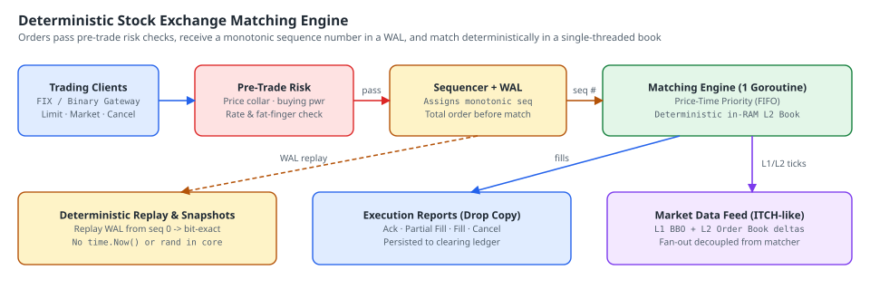

# Design Lab: A Deterministic Stock Exchange Simulator

Build a deterministic Go matching engine for one synthetic trading symbol. The core architectural principle of real electronic exchanges (such as Nasdaq's [FIX](https://fixtrading.org/standards/fix-protocol/) order entry paired with [ITCH](https://www.nasdaqtrader.com/content/technicalsupport/specifications/dataproducts/NQTVITCHSpecification.pdf) market data) is **strict determinism**: sequence every inbound command into a durable Write-Ahead Log (WAL) *before* matching, then execute the matching core on a **single goroutine with zero locks, zero `time.Now()`, and zero randomness** so replaying the WAL from sequence 0 reproduces the bit-exact order book and execution list.



## Matching rules and fixed-point integer arithmetic

Never represent stock prices or share quantities with `float64`. Use integer **price ticks** (`int64`, e.g., `$100.25 = 10025` ticks) and integer **lots** (`int64`).

- **Price-time priority (FIFO)**: Best bid is the highest price; best ask is the lowest price. Within the same price level, orders rest and fill in strict FIFO arrival sequence.
- **Crossing rule**: An incoming buy limit order matches resting asks with `ask.PriceTicks <= buy.PriceTicks`; an incoming sell matches resting bids with `bid.PriceTicks >= sell.PriceTicks`. Executions fill at the **resting (maker) order's price**.
- **Sequencing before matching**: HTTP arrival time or goroutine scheduling is never the authoritative order—the sequencer's monotonic `Sequence uint64` is.

## Go implementation: Single-threaded deterministic L2 order book

Keep the matching core completely pure and allocation-light. Maintain sorted price levels (with FIFO linked-list or slice queues) and an `orders map[string]*Order` index for $O(1)$ cancellation lookup:

```go
package exchange

import (
	"container/list"
	"sort"
)

type Side uint8

const (
	SideBuy Side = iota + 1
	SideSell
)

type CommandKind uint8

const (
	CmdLimit CommandKind = iota + 1
	CmdCancel
)

type Command struct {
	Sequence   uint64 // Assigned monotonically by the Sequencer + WAL
	RequestID  string
	OrderID    string
	Kind       CommandKind
	Side       Side
	PriceTicks int64
	Lots       int64
}

type Execution struct {
	Sequence   uint64
	FillIndex  uint32
	BuyOrder   string
	SellOrder  string
	PriceTicks int64
	Lots       int64
}

type restingOrder struct {
	id         string
	side       Side
	priceTicks int64
	remaining  int64
	elem       *list.Element
}

type OrderBook struct {
	bids   map[int64]*list.List // price -> FIFO queue of *restingOrder
	asks   map[int64]*list.List
	byID   map[string]*restingOrder
	seenRq map[string]struct{}
}

func NewOrderBook() *OrderBook {
	return &OrderBook{
		bids:   make(map[int64]*list.List),
		asks:   make(map[int64]*list.List),
		byID:   make(map[string]*restingOrder),
		seenRq: make(map[string]struct{}),
	}
}

// Apply processes one sequenced command deterministically (single-owner goroutine).
func (b *OrderBook) Apply(cmd Command) []Execution {
	if _, dup := b.seenRq[cmd.RequestID]; dup {
		return nil
	}
	b.seenRq[cmd.RequestID] = struct{}{}

	if cmd.Kind == CmdCancel {
		b.cancel(cmd.OrderID)
		return nil
	}
	if cmd.PriceTicks <= 0 || cmd.Lots <= 0 {
		return nil
	}
	if cmd.Side == SideBuy {
		return b.matchBuy(cmd)
	}
	return b.matchSell(cmd)
}

func (b *OrderBook) cancel(orderID string) {
	ord, ok := b.byID[orderID]
	if !ok {
		return
	}
	levels := b.bids
	if ord.side == SideSell {
		levels = b.asks
	}
	if q, exists := levels[ord.priceTicks]; exists {
		q.Remove(ord.elem)
		if q.Len() == 0 {
			delete(levels, ord.priceTicks)
		}
	}
	delete(b.byID, orderID)
}

func (b *OrderBook) sortedPrices(levels map[int64]*list.List, desc bool) []int64 {
	prices := make([]int64, 0, len(levels))
	for p := range levels {
		prices = append(prices, p)
	}
	sort.Slice(prices, func(i, j int) bool {
		if desc {
			return prices[i] > prices[j]
		}
		return prices[i] < prices[j]
	})
	return prices
}

func (b *OrderBook) matchBuy(cmd Command) []Execution {
	var fills []Execution
	rem := cmd.Lots
	var fillIdx uint32

	for _, askPrice := range b.sortedPrices(b.asks, false) {
		if askPrice > cmd.PriceTicks || rem == 0 {
			break
		}
		q := b.asks[askPrice]
		for q.Len() > 0 && rem > 0 {
			front := q.Front()
			maker := front.Value.(*restingOrder)
			qty := min(rem, maker.remaining)
			rem -= qty
			maker.remaining -= qty
			fillIdx++
			fills = append(fills, Execution{
				Sequence:   cmd.Sequence,
				FillIndex:  fillIdx,
				BuyOrder:   cmd.OrderID,
				SellOrder:  maker.id,
				PriceTicks: maker.priceTicks, // Maker price
				Lots:       qty,
			})
			if maker.remaining == 0 {
				q.Remove(front)
				delete(b.byID, maker.id)
			}
		}
		if q.Len() == 0 {
			delete(b.asks, askPrice)
		}
	}

	if rem > 0 {
		b.rest(SideBuy, cmd.OrderID, cmd.PriceTicks, rem)
	}
	return fills
}

func (b *OrderBook) matchSell(cmd Command) []Execution {
	var fills []Execution
	rem := cmd.Lots
	var fillIdx uint32

	for _, bidPrice := range b.sortedPrices(b.bids, true) {
		if bidPrice < cmd.PriceTicks || rem == 0 {
			break
		}
		q := b.bids[bidPrice]
		for q.Len() > 0 && rem > 0 {
			front := q.Front()
			maker := front.Value.(*restingOrder)
			qty := min(rem, maker.remaining)
			rem -= qty
			maker.remaining -= qty
			fillIdx++
			fills = append(fills, Execution{
				Sequence:   cmd.Sequence,
				FillIndex:  fillIdx,
				BuyOrder:   maker.id,
				SellOrder:  cmd.OrderID,
				PriceTicks: maker.priceTicks,
				Lots:       qty,
			})
			if maker.remaining == 0 {
				q.Remove(front)
				delete(b.byID, maker.id)
			}
		}
		if q.Len() == 0 {
			delete(b.bids, bidPrice)
		}
	}

	if rem > 0 {
		b.rest(SideSell, cmd.OrderID, cmd.PriceTicks, rem)
	}
	return fills
}

func (b *OrderBook) rest(side Side, id string, price, lots int64) {
	levels := b.bids
	if side == SideSell {
		levels = b.asks
	}
	q, ok := levels[price]
	if !ok {
		q = list.New()
		levels[price] = q
	}
	ord := &restingOrder{id: id, side: side, priceTicks: price, remaining: lots}
	ord.elem = q.PushBack(ord)
	b.byID[id] = ord
}
```

## Risk checks, failover fencing, and performance

- **Pre-trade risk**: Validate fat-finger price collars (e.g., ±10% from last trade), order size caps, and buying-power reservations *before* sequencing so rejected orders never pollute the matching core.
- **Single fenced leader per symbol**: Partition symbols across matching engines (`AAPL` on Engine 1, `GOOG` on Engine 2). Only **one** Raft/fenced leader may sequence a symbol at a time; split-brain dual matching creates contradictory fills that cannot be reconciled.
- **Decoupled market data**: Publish L1/L2 deltas to a ring buffer or multicast feed so slow market-data subscribers never stall the matching goroutine.

## Acceptance evidence

1. **Price-time priority**: Rest asks for `5 lots @ 100` and `4 lots @ 101`, then submit a buy for `7 lots @ 101`. Assert fills of `5 @ 100` and `2 @ 101`, leaving `2 lots @ 101` resting.
2. **Equal-price FIFO & cancel**: Rest two asks at `100`, cancel the first, and assert the second fills cleanly with zero list corruption.
3. **Bit-exact WAL recovery**: Persist 10,000 sequenced commands to a WAL, kill the engine mid-run, restart from snapshot + WAL replay, and assert the SHA-256 hash of the recovered book and executions matches an uninterrupted run identically.

## Reference materials

- [FIX Trading Community — FIX Protocol Standards](https://fixtrading.org/standards/fix-protocol/)
- [Nasdaq TotalView-ITCH 5.0 Specification](https://www.nasdaqtrader.com/content/technicalsupport/specifications/dataproducts/NQTVITCHSpecification.pdf)
- [Write-ahead log durability in Go](../../17-systems-programming/142b-write-ahead-log.md)
- [Raft consensus and wire protocols](../../18-distributed-infra/159-raft-consensus-wire-protocols-rpc.md)
