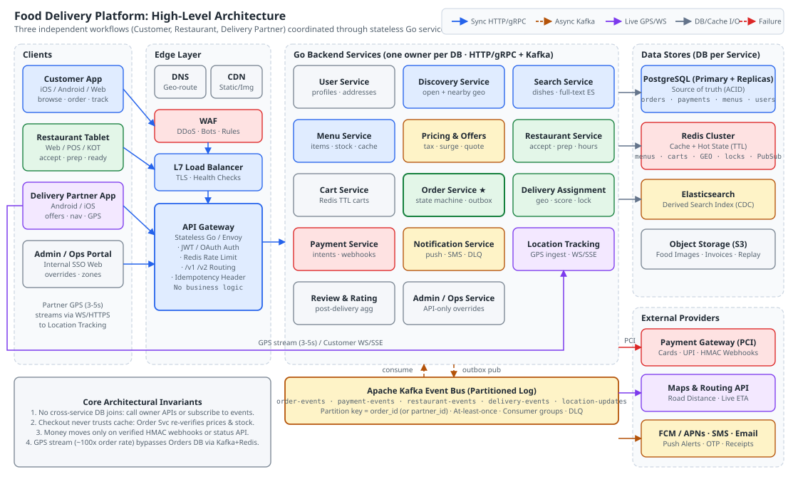
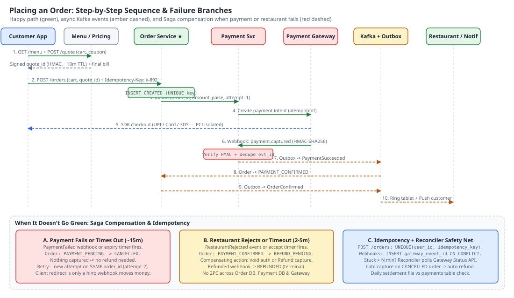
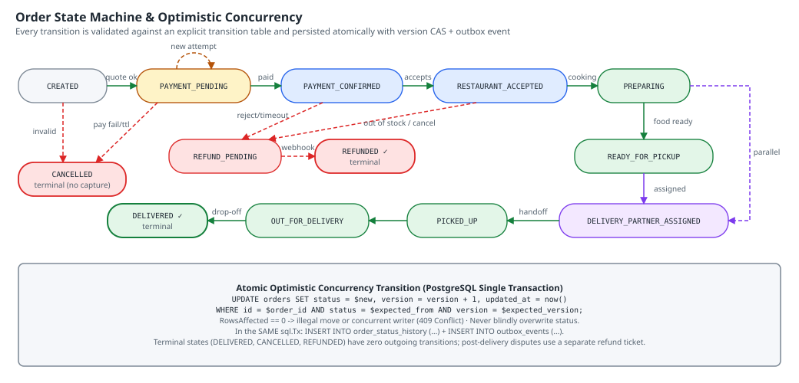
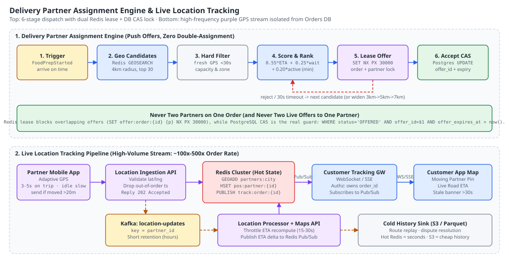
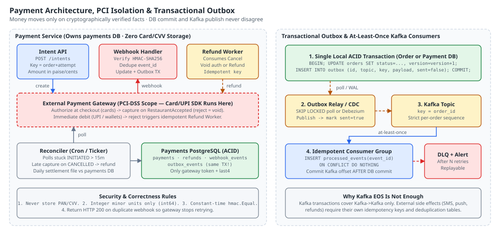

# Design Lab: Food Delivery Platform (End-to-End Capstone)

A food delivery platform (in the style of Swiggy, Zomato, or Uber Eats) is a **three-sided real-time marketplace**: a customer orders, a restaurant cooks, and a delivery partner drives. Each actor follows an independent workflow that can stall, retry, or fail without blocking the other two. The backend's job is to keep all three workflows in step through one authoritative **Order** record, strict state transitions, and asynchronous domain events.

This capstone combines patterns from across the Go book—HTTP gateways, PostgreSQL transactions, optimistic concurrency, transactional outbox, Kafka consumer groups, Redis geospatial indexing, HMAC webhooks, SSE/WebSockets, and `singleflight` caching—into one cohesive, project-driven design and implementation workbook.

> [!NOTE]
> The architecture, numbers, and service names below are a generic engineering blueprint for learning and building in Go—not the proprietary internals of any commercial company.

## Three independent workflows and project layout

Before writing a single handler, map the four actors and their separate lifecycles:

| Actor | Client surface | Core workflow | Failure mode that must not block others |
|-------|---------------|---------------|-----------------------------------------|
| **Customer** | iOS, Android, Web | Search -> Menu -> Cart -> Pay -> Track live | App killed mid-payment or flaky mobile network |
| **Restaurant** | Tablet, Web, POS/KOT | Accept/Reject -> Prep time -> Cook -> Mark ready | Kitchen ignores tablet or item runs out mid-prep |
| **Delivery partner** | Android, iOS | Go online -> Accept offer -> Pick up -> Drop off | Rejects offer, GPS drops in tunnel, or phone dies |
| **Admin / Operations** | Internal SSO Web | Live order board, stuck-order alerts, manual overrides, zones & surge | Never mutates another service's database directly; calls owner APIs |

### Workbook Go module layout

Build the capstone as a **modular monolith first** (one Go module, separate internal packages with strict database-schema ownership) so you can run the entire platform locally with `docker compose` (PostgreSQL, Redis, Kafka/Redpanda) and split services into separate binaries later without rewriting business logic:

```text
food-delivery/
├── go.mod
├── docker-compose.yml              # Postgres, Redis, Redpanda (Kafka API)
├── cmd/
│   ├── gateway/main.go             # L7 edge gateway: JWT, rate limit, idempotency
│   ├── platform/main.go            # Modular monolith hosting domain services
│   └── workers/main.go             # Outbox relay, reconciler, dispatch matcher
├── internal/
│   ├── platform/                   # Shared primitives: clock, tracing, dbpool, errors
│   ├── gateway/                    # Auth, Redis token bucket, request validation
│   ├── menu/                       # Cache-aside + singleflight menu loader
│   ├── pricing/                    # Tax/surge/coupon rules + HMAC signed quotes
│   ├── order/                      # State machine, CAS transitions, outbox writes
│   ├── restaurant/                 # Store availability, accept timer, KOT events
│   ├── payment/                    # PCI-isolated intents, HMAC webhooks, reconciler
│   ├── dispatch/                   # Redis GEOSEARCH, scorer, NX lease + DB CAS lock
│   ├── tracking/                   # GPS ingestion, Redis Pub/Sub, SSE/WS fan-out
│   └── outbox/                     # SKIP LOCKED relay + idempotent Kafka consumer
└── migrations/
    ├── 001_orders.sql
    ├── 002_payments.sql
    ├── 003_assignments.sql
    └── 004_outbox_and_dedupe.sql
```

## High-level architecture and service boundaries

Every arrow in the architecture below represents a real network call or data flow. Services are stateless, scale horizontally behind an L7 load balancer, and communicate synchronously (HTTP/gRPC) only on the user-facing request path; everything downstream of order confirmation flows asynchronously through Apache Kafka.



### Edge layer and API Gateway

The edge layer absorbs traffic spikes and enforces cross-cutting policy before any business service is touched:

- **DNS & CDN**: Geo-routed DNS directs clients to the nearest region. The CDN caches the static web bundle, food photography from S3, and public restaurant menus (`Cache-Control: public, max-age=30, stale-while-revalidate=60`).
- **WAF & L7 Load Balancer**: Drops volumetric DDoS, credential stuffing, and injection payloads; terminates TLS; runs `/readyz` health checks; distributes requests across stateless gateway replicas.
- **API Gateway (zero business logic)**: Validates JWT/OAuth tokens, routes `/v1` and `/v2` paths to owning services, propagates W3C `traceparent` headers, enforces per-user/IP/API-key token-bucket rate limits in Redis, and checks required headers such as `Idempotency-Key` on mutating endpoints.

### Service ownership matrix (database per service)

No service ever joins against or writes to another service's tables. Cross-service reads happen through versioned APIs or local read models hydrated from Kafka events.

| Service | Authoritative store | Cache / Index | Key responsibility |
|---------|--------------------|---------------|--------------------|
| **User Service** | `users-db` (Postgres) | Redis session cache | Profiles, delivery addresses, login |
| **Discovery Service** | Reads Restaurant/Geo state | Elasticsearch + Redis GEO | Open and deliverable restaurants near `(lat, lng)` |
| **Search Service** | Derived from Catalog CDC | Elasticsearch / OpenSearch | Full-text search across dishes, cuisines, names |
| **Menu Service** | `catalog-db` (Postgres) | Redis menu cache + CDN | Menus, item prices, in-stock flags |
| **Cart Service** | None (ephemeral) | Redis Cluster (TTL) | Active shopping cart per user |
| **Pricing & Offers** | `pricing-db` (Postgres) | Redis rules cache | Taxes, delivery fee, surge, coupons, HMAC signed quotes |
| **Order Service ★** | `orders-db` (Postgres) | Redis order status cache | Order record, state machine, transactional outbox |
| **Restaurant Service** | `catalog-db` (Postgres) | Redis `is-open` flag | Hours, manual pause, accept/reject, prep-time ETA |
| **Delivery Assignment** | `delivery-db` (Postgres) | Redis GEO + NX leases | Candidate search, scoring, time-boxed partner offers |
| **Payment Service** | `payments-db` (Postgres) | None (always DB truth) | Gateway intents, HMAC webhooks, refunds, reconciliation |
| **Location Tracking** | S3/Parquet (cold replay) | Redis GEO + Pub/Sub | High-frequency GPS ingest, live ETA, customer WS/SSE |
| **Notification Service** | `notif-db` (Postgres) | Kafka DLQ | Push (FCM/APNs), SMS, email with retries and dedupe |
| **Review & Rating** | `reviews-db` (Postgres) | Async -> Search | Post-delivery ratings and store aggregates |
| **Admin / Ops Service** | Audit log only | None | Support views, manual cancel/reassign via owner APIs |

### Go implementation: Stateless API Gateway middleware

Keep the gateway thin and composable using Go's `net/http` middleware chain. See [rate limiting](../../15-web-development-in-go/282-rate-limiting.md) and [tracing context propagation](../../19-observability-sre/163-tracing-context-propagation.md) for deeper background.

```go
package gateway

import (
	"context"
	"net/http"
	"strings"
	"time"
)

type RateLimiter interface {
	Allow(ctx context.Context, key string, limit int, window time.Duration) (bool, error)
}

type TokenVerifier interface {
	Verify(ctx context.Context, bearer string) (userID string, err error)
}

type ctxKey string

const userIDKey ctxKey = "user_id"

// Guard enforces JWT authentication, Redis rate limiting, and Idempotency-Key
// presence on mutating endpoints without leaking domain logic into the gateway.
func Guard(verifier TokenVerifier, limiter RateLimiter, next http.Handler) http.Handler {
	return http.HandlerFunc(func(w http.ResponseWriter, r *http.Request) {
		token := strings.TrimPrefix(r.Header.Get("Authorization"), "Bearer ")
		userID, err := verifier.Verify(r.Context(), token)
		if err != nil || userID == "" {
			http.Error(w, `{"error":"unauthorized"}`, http.StatusUnauthorized)
			return
		}

		// Per-user token bucket: 60 requests per minute on checkout/write paths.
		allowed, err := limiter.Allow(r.Context(), "rl:user:"+userID, 60, time.Minute)
		if err != nil {
			// Fail open on browse, fail closed on money-moving endpoints.
			if strings.HasPrefix(r.URL.Path, "/v1/orders") || strings.HasPrefix(r.URL.Path, "/v1/payments") {
				http.Error(w, `{"error":"rate limiter unavailable"}`, http.StatusServiceUnavailable)
				return
			}
		} else if !allowed {
			w.Header().Set("Retry-After", "5")
			http.Error(w, `{"error":"rate limit exceeded"}`, http.StatusTooManyRequests)
			return
		}

		if r.Method == http.MethodPost && strings.HasPrefix(r.URL.Path, "/v1/orders") {
			if strings.TrimSpace(r.Header.Get("Idempotency-Key")) == "" {
				http.Error(w, `{"error":"Idempotency-Key header required"}`, http.StatusBadRequest)
				return
			}
		}

		ctx := context.WithValue(r.Context(), userIDKey, userID)
		next.ServeHTTP(w, r.WithContext(ctx))
	})
}
```

## Placing an order, step by step, and failure branches

Order placement crosses three independent systems—**Order DB**, **Payment DB**, and the **External Payment Gateway**—so no single ACID transaction can span all three. Instead, checkout uses a **choreographed Saga** backed by signed quotes, idempotency keys, and the transactional outbox.



### The 10-step happy path

1. **Discover nearby open restaurants**: Customer app sends `(lat, lng)` to Discovery/Search, which queries Elasticsearch + Redis open status and returns deliverable restaurants with estimated ETAs.
2. **Fetch menu (cache-aside)**: Menu Service serves items and in-stock flags from Redis (or Postgres on miss).
3. **Mutate cart**: Cart Service stores the active cart in Redis with a sliding TTL (e.g., 2 hours).
4. **Compute signed pricing quote**: Pricing & Offers calculates item subtotal, taxes, packaging, delivery fee, surge multiplier, and coupon discount, returning a `quote_id` signed with HMAC-SHA256 and a ~10-minute expiry.
5. **Confirm order (`POST /v1/orders`)**: Client sends `cart`, `quote_id`, and `Idempotency-Key: k-892`. Order Service validates the quote signature, expiry, and live item stock against source-of-truth prices, then inserts the order in `CREATED` -> `PAYMENT_PENDING` inside a single PostgreSQL transaction.
6. **Initiate payment intent**: Order Service calls Payment Service with `idempotency_key = order_id + ":attempt-1"` and integer minor units (e.g., `48500` paise for ₹485.00). Payment Service creates a gateway intent and returns the client token.
7. **Customer pays in Gateway SDK**: Card/UPI/3-D Secure runs inside the payment gateway's hosted UI or SDK. Card numbers and CVVs never touch our servers.
8. **Verified webhook moves money state**: The gateway posts `payment.captured` to Payment Service. Payment Service verifies the HMAC signature, deduplicates `gateway_event_id`, updates `payments`, and inserts `PaymentSucceeded` into its outbox in one transaction.
9. **Order transitions to `PAYMENT_CONFIRMED`**: Order Service consumes `PaymentSucceeded`, runs an atomic optimistic-concurrency update, and emits `OrderConfirmed` via its outbox.
10. **Fan-out to Restaurant and Customer**: Restaurant Service rings the partner tablet over WebSocket; Notification Service sends the customer push notification ("Order placed").

> [!IMPORTANT]
> The client's "payment succeeded" browser/app redirect is **only a UI hint**. Never transition an order to `PAYMENT_CONFIRMED` based on a client callback—only a cryptographically verified gateway webhook or a server-to-server Gateway Status API check moves money state.

### Why not one big distributed transaction (2PC)?

Two-phase commit (`XA` / 2PC) requires every participant to hold locks across network round trips while waiting for a coordinator decision. An external payment gateway will not participate in 2PC, and holding database row locks across third-party HTTP calls collapses throughput during gateway slowdowns. A **Saga** replaces distributed locks with:

- **Local ACID transactions** inside each service's own database.
- **Transactional Outbox** so the database commit and event publication cannot disagree.
- **Explicit compensating actions**: if the restaurant rejects after payment capture, the Saga emits a cancellation that triggers the Refund Worker to void the authorization or issue an idempotent refund.

### Go implementation: Signed pricing quotes and idempotent order creation

Signing the quote prevents price tampering on the client while letting Order Service verify that the quote has not expired or drifted before creating the order. Always use integer minor units (`int64`) for currency—never `float64`.

```go
package pricing

import (
	"crypto/hmac"
	"crypto/sha256"
	"encoding/hex"
	"errors"
	"fmt"
	"time"
)

type Quote struct {
	QuoteID       string    `json:"quote_id"`
	UserID        string    `json:"user_id"`
	RestaurantID  string    `json:"restaurant_id"`
	SubtotalMinor int64     `json:"subtotal_minor"` // e.g. paise or cents
	TaxMinor      int64     `json:"tax_minor"`
	DeliveryMinor int64     `json:"delivery_minor"`
	DiscountMinor int64     `json:"discount_minor"`
	TotalMinor    int64     `json:"total_minor"`
	Currency      string    `json:"currency"`
	ExpiresAt     time.Time `json:"expires_at"`
	Signature     string    `json:"signature"`
}

var (
	ErrQuoteExpired   = errors.New("quote expired")
	ErrQuoteTampered  = errors.New("quote signature invalid")
)

func canonicalPayload(q Quote) string {
	return fmt.Sprintf("%s|%s|%s|%d|%d|%d|%d|%d|%s|%d",
		q.QuoteID, q.UserID, q.RestaurantID,
		q.SubtotalMinor, q.TaxMinor, q.DeliveryMinor,
		q.DiscountMinor, q.TotalMinor, q.Currency, q.ExpiresAt.Unix(),
	)
}

func SignQuote(q Quote, secret []byte) Quote {
	mac := hmac.New(sha256.New, secret)
	mac.Write([]byte(canonicalPayload(q)))
	q.Signature = hex.EncodeToString(mac.Sum(nil))
	return q
}

func VerifyQuote(q Quote, secret []byte, now time.Time) error {
	if now.After(q.ExpiresAt) {
		return ErrQuoteExpired
	}
	expected := SignQuote(q, secret).Signature
	got, err := hex.DecodeString(q.Signature)
	if err != nil {
		return ErrQuoteTampered
	}
	expBytes, _ := hex.DecodeString(expected)
	if !hmac.Equal(got, expBytes) {
		return ErrQuoteTampered
	}
	return nil
}
```

## Order state machine and optimistic concurrency

Not every order visits every state, and illegal jumps (such as `DELIVERED -> PREPARING`) must be impossible at both the application and database layers. Notice also that **delivery partner assignment runs in parallel with cooking**: a partner may be assigned while the order is `PREPARING` or after it becomes `READY_FOR_PICKUP`, so either order is valid before `PICKED_UP`.



### Authoritative PostgreSQL schema (`migrations/001_orders.sql`)

```sql
CREATE TABLE orders (
    id                UUID PRIMARY KEY,
    user_id           UUID NOT NULL,
    restaurant_id     UUID NOT NULL,
    idempotency_key   TEXT NOT NULL,
    payload_hash      TEXT NOT NULL,
    status            TEXT NOT NULL,
    version           BIGINT NOT NULL DEFAULT 1,
    total_minor       BIGINT NOT NULL CHECK (total_minor > 0),
    currency          CHAR(3) NOT NULL,
    quote_id          TEXT NOT NULL,
    partner_id        UUID,
    created_at        TIMESTAMPTZ NOT NULL DEFAULT now(),
    updated_at        TIMESTAMPTZ NOT NULL DEFAULT now(),
    UNIQUE (user_id, idempotency_key)
);

CREATE TABLE order_status_history (
    id          BIGSERIAL PRIMARY KEY,
    order_id    UUID NOT NULL REFERENCES orders(id),
    from_status TEXT NOT NULL,
    to_status   TEXT NOT NULL,
    actor       TEXT NOT NULL,
    reason      TEXT NOT NULL DEFAULT '',
    created_at  TIMESTAMPTZ NOT NULL DEFAULT now()
);

CREATE TABLE outbox_events (
    id          UUID PRIMARY KEY,
    topic       TEXT NOT NULL,
    partition_k TEXT NOT NULL,
    event_type  TEXT NOT NULL,
    payload     JSONB NOT NULL,
    created_at  TIMESTAMPTZ NOT NULL DEFAULT now(),
    sent_at     TIMESTAMPTZ
);

CREATE INDEX idx_outbox_unsent ON outbox_events (created_at) WHERE sent_at IS NULL;
```

### Go implementation: Explicit transition table + atomic CAS + outbox write

Every state transition checks the allowlist in memory, then executes an optimistic-concurrency `UPDATE` with `WHERE id = $1 AND status = $2 AND version = $3`. If `RowsAffected == 0`, another writer won the race or the order is not in the expected state, so we abort cleanly and return `ErrConcurrentModification`.

```go
package order

import (
	"context"
	"database/sql"
	"encoding/json"
	"errors"
	"fmt"
	"time"
)

type Status string

const (
	StatusCreated                 Status = "CREATED"
	StatusPaymentPending          Status = "PAYMENT_PENDING"
	StatusPaymentConfirmed        Status = "PAYMENT_CONFIRMED"
	StatusRestaurantAccepted      Status = "RESTAURANT_ACCEPTED"
	StatusPreparing               Status = "PREPARING"
	StatusReadyForPickup          Status = "READY_FOR_PICKUP"
	StatusDeliveryPartnerAssigned Status = "DELIVERY_PARTNER_ASSIGNED"
	StatusPickedUp                Status = "PICKED_UP"
	StatusOutForDelivery          Status = "OUT_FOR_DELIVERY"
	StatusDelivered               Status = "DELIVERED"
	StatusCancelled               Status = "CANCELLED"
	StatusRefundPending           Status = "REFUND_PENDING"
	StatusRefunded                Status = "REFUNDED"
)

var allowedTransitions = map[Status]map[Status]bool{
	StatusCreated:                 {StatusPaymentPending: true, StatusCancelled: true},
	StatusPaymentPending:          {StatusPaymentConfirmed: true, StatusCancelled: true},
	StatusPaymentConfirmed:        {StatusRestaurantAccepted: true, StatusRefundPending: true},
	StatusRestaurantAccepted:      {StatusPreparing: true, StatusRefundPending: true},
	StatusPreparing:               {StatusReadyForPickup: true, StatusDeliveryPartnerAssigned: true, StatusRefundPending: true},
	StatusReadyForPickup:          {StatusDeliveryPartnerAssigned: true, StatusPickedUp: true},
	StatusDeliveryPartnerAssigned: {StatusReadyForPickup: true, StatusPickedUp: true},
	StatusPickedUp:                {StatusOutForDelivery: true},
	StatusOutForDelivery:          {StatusDelivered: true},
	StatusRefundPending:           {StatusRefunded: true},
	// Terminal states: DELIVERED, CANCELLED, REFUNDED have no outgoing edges.
}

var (
	ErrIllegalTransition      = errors.New("illegal order state transition")
	ErrConcurrentModification = errors.New("order version conflict or stale status")
)

func CanTransition(from, to Status) bool {
	return allowedTransitions[from][to]
}

type TransitionCmd struct {
	OrderID         string
	ExpectedFrom    Status
	ExpectedVersion int64
	To              Status
	Actor           string
	Reason          string
	EventID         string
	EventType       string
}

type Store struct {
	DB *sql.DB
}

// Transition validates the state move, increments version atomically, logs
// audit history, and writes the Kafka outbox event inside one PostgreSQL TX.
func (s *Store) Transition(ctx context.Context, cmd TransitionCmd) (int64, error) {
	if !CanTransition(cmd.ExpectedFrom, cmd.To) {
		return 0, fmt.Errorf("%w: %s -> %s", ErrIllegalTransition, cmd.ExpectedFrom, cmd.To)
	}

	tx, err := s.DB.BeginTx(ctx, &sql.TxOptions{Isolation: sql.LevelReadCommitted})
	if err != nil {
		return 0, err
	}
	defer tx.Rollback()

	res, err := tx.ExecContext(ctx, `
		UPDATE orders
		SET status = $1, version = version + 1, updated_at = now()
		WHERE id = $2 AND status = $3 AND version = $4`,
		string(cmd.To), cmd.OrderID, string(cmd.ExpectedFrom), cmd.ExpectedVersion,
	)
	if err != nil {
		return 0, err
	}
	rows, err := res.RowsAffected()
	if err != nil {
		return 0, err
	}
	if rows == 0 {
		return 0, ErrConcurrentModification
	}

	if _, err := tx.ExecContext(ctx, `
		INSERT INTO order_status_history (order_id, from_status, to_status, actor, reason)
		VALUES ($1, $2, $3, $4, $5)`,
		cmd.OrderID, string(cmd.ExpectedFrom), string(cmd.To), cmd.Actor, cmd.Reason,
	); err != nil {
		return 0, err
	}

	payload, err := json.Marshal(map[string]any{
		"event_id":    cmd.EventID,
		"order_id":    cmd.OrderID,
		"from_status": cmd.ExpectedFrom,
		"to_status":   cmd.To,
		"version":     cmd.ExpectedVersion + 1,
		"occurred_at": time.Now().UTC().Format(time.RFC3339Nano),
	})
	if err != nil {
		return 0, err
	}

	if _, err := tx.ExecContext(ctx, `
		INSERT INTO outbox_events (id, topic, partition_k, event_type, payload)
		VALUES ($1, 'order-events', $2, $3, $4)`,
		cmd.EventID, cmd.OrderID, cmd.EventType, payload,
	); err != nil {
		return 0, err
	}

	if err := tx.Commit(); err != nil {
		return 0, err
	}
	return cmd.ExpectedVersion + 1, nil
}
```

## Restaurant side: Order intake, prep time, and availability

The restaurant workflow is strictly event-driven ("events in, events out"):

1. **`OrderConfirmed` arrives**: Restaurant Service pushes a loud new-order alert to the restaurant's tablet over a persistent WebSocket connection (with SMS/push fallback if offline).
2. **Accept or reject**: The restaurant confirms within the SLA window (typically 2–5 minutes) and supplies an estimated prep time (default item prep time + active kitchen queue depth).
3. **Escalation when a restaurant does not answer**:
   - At **~2 minutes**: Re-ring tablet + trigger automated IVR phone call.
   - At **~5 minutes**: Accept timer expires -> emit `RestaurantRejected(reason="timeout")` -> Order Service transitions `PAYMENT_CONFIRMED -> REFUND_PENDING` -> Payment Service voids or refunds.
   - **Repeated misses**: Auto-pause the store's `is-open` flag so new customers do not hit a dead kitchen.
4. **Kitchen ticket & cooking**: Once accepted, POS integration prints a Kitchen Order Ticket (KOT) or pushes to a Kitchen Display System (KDS). Emitting `FoodPreparationStarted` wakes the **Delivery Assignment** service so a partner arrives just as food finishes cooking—minimizing cold food and rider idle wait.
5. **Can this restaurant take orders?**: Authoritative truth lives in `catalog-db` (operating hours in local timezone, manual "kitchen full" pause, item out-of-stock flags, delivery radius/polygon) with a hot copy in Redis checked by Discovery and re-verified by Order Service at checkout.

## Delivery partner assignment engine

Assigning a partner is a **real-time matching problem under contention**: you want the partner who minimizes total food wait + customer ETA, while guaranteeing that **never two partners are assigned to one order** and **never two live offers go to one partner**.



### The 6-stage dispatch pipeline

1. **Trigger**: Consumes `FoodPreparationStarted` (timed using `prep_time_minutes` so the partner arrives right as food is ready).
2. **Geo candidates (`Redis GEOSEARCH`)**: Fetches up to 30 online partners within a starting radius (e.g., 4 km) around the restaurant:
   ```text
   GEOSEARCH partners:available:city-19 FROMLONLAT 77.64 12.97 BYRADIUS 4 km ASC COUNT 30 WITHDIST
   ```
   Redis computes straight-line (Haversine) distance in sub-millisecond time using a sorted-set geohash index.
3. **Hard filters**: Drop partners with stale GPS (`age > 30s`), insufficient vehicle capacity (e.g., large party order on bicycle), already holding an active offer lease, or exceeding max concurrent orders.
4. **Multi-factor scoring (lower is better)**: Query road ETA via Maps/Routing API for the top ~10 filtered candidates and rank by weighted normalized score:
   $$\text{score} = 0.55 \cdot \text{eta\_norm} + 0.25 \cdot \text{wait\_at\_shop\_norm} + 0.20 \cdot \text{active\_orders\_norm}$$
   Wait-at-shop captures `max(0, food_ready_eta - partner_arrival_eta)`—arriving 12 minutes early wastes rider capacity, while arriving 10 minutes late cools the food.
5. **Time-boxed push offer (Redis lease)**: Push an offer to the #1 candidate for 30 seconds by acquiring two short Redis leases (`SET offer:order:789 partner:P1 NX PX 30000` and `SET offer:partner:P1 order:789 NX PX 30000`). On reject or 30s timeout, release and offer to #2. If the pool exhausts, widen radius (`3 km -> 5 km -> 7 km`), add a surge incentive, and alert ops if still unassigned.
6. **Accept -> authoritative database lock**: The Redis lease is only an optimization to prevent overlapping offers. **PostgreSQL is the real lock**:
   ```sql
   UPDATE assignments
   SET partner_id = $1, status = 'ACCEPTED', accepted_at = now()
   WHERE order_id = $2
     AND status = 'OFFERED'
     AND offer_id = $3
     AND offer_expires_at > now();
   ```
   A late accept carries an old `offer_id` (or hits `offer_expires_at <= now()`) and updates 0 rows—even if the Redis lease already expired and moved to partner P2.

### Go implementation: Candidate scorer and dual-guard accept

```go
package dispatch

import (
	"context"
	"database/sql"
	"errors"
	"sort"
	"time"
)

type Candidate struct {
	PartnerID     string
	RoadETA       time.Duration // partner -> restaurant
	FoodReadyIn   time.Duration // remaining kitchen prep time
	ActiveOrders  int
	LastGPSAt     time.Time
	MaxOrderCount int
}

type ScoredCandidate struct {
	Candidate
	Score float64
}

// RankCandidates filters stale/busy partners and sorts by weighted score (lower wins).
func RankCandidates(candidates []Candidate, now time.Time) []ScoredCandidate {
	var valid []Candidate
	maxETA := 1.0
	maxWait := 1.0
	maxActive := 1.0

	for _, c := range candidates {
		if now.Sub(c.LastGPSAt) > 30*time.Second || c.ActiveOrders >= c.MaxOrderCount {
			continue
		}
		etaMin := c.RoadETA.Minutes()
		waitMin := (c.FoodReadyIn - c.RoadETA).Minutes()
		if waitMin < 0 {
			waitMin = 0
		}
		if etaMin > maxETA {
			maxETA = etaMin
		}
		if waitMin > maxWait {
			maxWait = waitMin
		}
		if float64(c.ActiveOrders) > maxActive {
			maxActive = float64(c.ActiveOrders)
		}
		valid = append(valid, c)
	}

	scored := make([]ScoredCandidate, 0, len(valid))
	for _, c := range valid {
		etaNorm := c.RoadETA.Minutes() / maxETA
		waitMin := (c.FoodReadyIn - c.RoadETA).Minutes()
		if waitMin < 0 {
			waitMin = 0
		}
		waitNorm := waitMin / maxWait
		activeNorm := float64(c.ActiveOrders) / maxActive

		score := 0.55*etaNorm + 0.25*waitNorm + 0.20*activeNorm
		scored = append(scored, ScoredCandidate{Candidate: c, Score: score})
	}

	sort.Slice(scored, func(i, j int) bool {
		return scored[i].Score < scored[j].Score
	})
	return scored
}

var ErrOfferLost = errors.New("offer expired or already accepted by another partner")

// AcceptOffer enforces single-winner assignment in PostgreSQL using offer_id + expiry CAS.
func AcceptOffer(ctx context.Context, db *sql.DB, orderID, partnerID, offerID string) error {
	res, err := db.ExecContext(ctx, `
		UPDATE assignments
		SET partner_id = $1, status = 'ACCEPTED', accepted_at = now()
		WHERE order_id = $2
		  AND status = 'OFFERED'
		  AND offer_id = $3
		  AND offer_expires_at > now()`,
		partnerID, orderID, offerID,
	)
	if err != nil {
		return err
	}
	n, err := res.RowsAffected()
	if err != nil {
		return err
	}
	if n == 0 {
		return ErrOfferLost
	}
	return nil
}
```

## Live location tracking (the purple path)

The GPS stream runs at **100×–500× the checkout order rate** (thousands of pings per second at peak). Routing it through the Orders PostgreSQL database would saturate write IOPS and starve checkout. Instead, it gets a dedicated **hot-state pipeline** (Redis + Kafka) completely isolated from transactional order storage:

- **Adaptive update frequency**: Faster pings give smoother map animation and fresher ETAs, but drain mobile battery, burn cellular data, and multiply ingest QPS. Use adaptive intervals: **3–5s when on an active trip**, slower (15–30s) when idle or parked, faster near drop-off, and suppress pings when displacement is `< 20 m` and heading is unchanged.
- **Ingestion API**: Validates coordinates (`-90 <= lat <= 90`, `-180 <= lng <= 180`), drops out-of-order timestamps (`ping.Timestamp <= lastSeen.Timestamp`), updates Redis (`GEOADD` + latest position hash + `PUBLISH` to `track:order:{id}`), produces to Kafka `location-updates` (keyed by `partner_id`), and returns `202 Accepted` immediately.
- **ETA recomputation**: Calling an external Maps/Routing API on every 3-second ping is expensive. The Location Processor consumes `location-updates` and throttles road-ETA calls to every 15–30 seconds (or when route deviation exceeds 150 m), publishing ETA deltas back to Redis Pub/Sub.
- **Hot state vs. cold history**: Redis holds only the latest few seconds of state (if Redis restarts, the next GPS ping rebuilds it in 5 seconds). A separate Kafka consumer batches coordinates into compressed Parquet files in S3 for route replay, support disputes, and ML ETA training.

### Go implementation: Monotonic GPS ingestion and Customer SSE gateway

Server-Sent Events (`text/event-stream`) are ideal for customer live tracking because data flows strictly server-to-client over standard HTTP/2, works seamlessly through corporate proxies and CDNs, and includes automatic reconnection via `Last-Event-ID`. See [real-time SSE, QUIC, and WebRTC](../../32-databases-and-architecture/05-realtime-sse-quic-webrtc.md).

```go
package tracking

import (
	"context"
	"encoding/json"
	"fmt"
	"net/http"
	"sync"
	"time"
)

type LocationPing struct {
	PartnerID string  `json:"partner_id"`
	OrderID   string  `json:"order_id,omitempty"`
	Lat       float64 `json:"lat"`
	Lng       float64 `json:"lng"`
	Heading   float64 `json:"heading"`
	SeqTimeMs int64   `json:"seq_time_ms"`
}

type HotStore interface {
	UpdatePartnerPosition(ctx context.Context, p LocationPing) error
	PublishOrderUpdate(ctx context.Context, orderID string, payload []byte) error
	SubscribeOrder(ctx context.Context, orderID string) (<-chan []byte, func(), error)
}

type Ingestor struct {
	store    HotStore
	mu       sync.Mutex
	lastSeen map[string]int64 // partner_id -> last accepted SeqTimeMs
}

func NewIngestor(store HotStore) *Ingestor {
	return &Ingestor{store: store, lastSeen: make(map[string]int64)}
}

func (in *Ingestor) HandlePing(w http.ResponseWriter, r *http.Request) {
	var p LocationPing
	if err := json.NewDecoder(http.MaxBytesReader(w, r.Body, 4096)).Decode(&p); err != nil {
		http.Error(w, "invalid json", http.StatusBadRequest)
		return
	}
	if p.Lat < -90 || p.Lat > 90 || p.Lng < -180 || p.Lng > 180 || p.PartnerID == "" {
		http.Error(w, "invalid coordinates", http.StatusBadRequest)
		return
	}

	// Drop out-of-order GPS packets so map pins never jump backward.
	in.mu.Lock()
	if p.SeqTimeMs <= in.lastSeen[p.PartnerID] {
		in.mu.Unlock()
		w.WriteHeader(http.StatusAccepted)
		return
	}
	in.lastSeen[p.PartnerID] = p.SeqTimeMs
	in.mu.Unlock()

	if err := in.store.UpdatePartnerPosition(r.Context(), p); err != nil {
		http.Error(w, "store error", http.StatusServiceUnavailable)
		return
	}
	if p.OrderID != "" {
		b, _ := json.Marshal(p)
		_ = in.store.PublishOrderUpdate(r.Context(), p.OrderID, b)
	}
	w.WriteHeader(http.StatusAccepted)
}

// StreamOrderSSE pushes live partner coordinates to an authorized customer.
func StreamOrderSSE(store HotStore, authorize func(ctx context.Context, orderID string) bool) http.HandlerFunc {
	return func(w http.ResponseWriter, r *http.Request) {
		orderID := r.PathValue("orderID")
		if !authorize(r.Context(), orderID) {
			http.Error(w, "forbidden", http.StatusForbidden)
			return
		}

		flusher, ok := w.(http.Flusher)
		if !ok {
			http.Error(w, "streaming unsupported", http.StatusInternalServerError)
			return
		}

		w.Header().Set("Content-Type", "text/event-stream")
		w.Header().Set("Cache-Control", "no-cache")
		w.Header().Set("Connection", "keep-alive")

		updates, cancel, err := store.SubscribeOrder(r.Context(), orderID)
		if err != nil {
			http.Error(w, "subscribe failed", http.StatusServiceUnavailable)
			return
		}
		defer cancel()

		// Comment heartbeat every 15s keeps intermediate proxies from closing idle streams.
		heartbeat := time.NewTicker(15 * time.Second)
		defer heartbeat.Stop()

		for {
			select {
			case <-r.Context().Done():
				return
			case <-heartbeat.C:
				fmt.Fprint(w, ": ping\n\n")
				flusher.Flush()
			case msg, ok := <-updates:
				if !ok {
					return
				}
				fmt.Fprintf(w, "event: location\ndata: %s\n\n", msg)
				flusher.Flush()
			}
		}
	}
}
```

## Events: The glue between services (Kafka and Transactional Outbox)

Kafka decouples the three workflows so that Notification, Analytics, or Restaurant outages never block checkout. Partitioning every order-scoped topic by `order_id` guarantees strict per-order event ordering within a partition while allowing horizontal scaling across consumer-group instances.

### Kafka topic topology

| Topic | Partition key | Producer | Events | Consumer groups |
|-------|---------------|----------|--------|-----------------|
| `order-events` | `order_id` | Order Service | `OrderCreated`, `OrderConfirmed`, `OrderCancelled` | Restaurant Svc, Notification, Analytics |
| `payment-events` | `order_id` | Payment Service | `PaymentInitiated`, `PaymentSucceeded`, `PaymentFailed`, `RefundInitiated`, `Refunded` | Order Service, Notification, Finance |
| `restaurant-events` | `order_id` | Restaurant Service | `RestaurantAccepted`, `RestaurantRejected`, `FoodPreparationStarted`, `FoodReady` | Order Service, Assignment, Notification |
| `delivery-events` | `order_id` | Assignment Service | `DeliveryPartnerAssigned`, `DeliveryPartnerRejected`, `OrderPickedUp`, `OrderDelivered` | Order Service, Notification, Tracking, Review |
| `location-updates` | `partner_id` | Location Ingestion | `LocationUpdated` (high volume, short retention) | Location Processor, Cold S3 History Sink |

> [!WARNING]
> **Kafka exactly-once semantics (EOS) only covers Kafka-to-Kafka pipelines.** Sending a push notification, firing an SMS, or calling a bank refund API is an external side effect. You must commit Kafka offsets **after** durable processing (at-least-once) and guard every consumer with an idempotency table (`processed_events(event_id PRIMARY KEY)`) plus exponential backoff and a Dead Letter Queue (DLQ).

### Go implementation: `FOR UPDATE SKIP LOCKED` Outbox Relay and Idempotent Consumer

A lightweight Go relay using PostgreSQL's `FOR UPDATE SKIP LOCKED` lets multiple relay workers drain the outbox concurrently without deadlocking or double-locking rows (at higher scale, swap the poller for WAL log tailing via Debezium's Outbox Event Router).

```go
package outbox

import (
	"context"
	"database/sql"
	"time"
)

type Event struct {
	ID         string
	Topic      string
	PartitionK string
	EventType  string
	Payload    []byte
}

type Publisher interface {
	Publish(ctx context.Context, topic, key string, value []byte) error
}

// DrainBatch locks up to limit unsent outbox rows without blocking peer workers,
// publishes each to Kafka, and marks sent_at. Duplicate publishes on crash are
// safe because every downstream consumer deduplicates by event_id.
func DrainBatch(ctx context.Context, db *sql.DB, pub Publisher, limit int) (int, error) {
	tx, err := db.BeginTx(ctx, nil)
	if err != nil {
		return 0, err
	}
	defer tx.Rollback()

	rows, err := tx.QueryContext(ctx, `
		SELECT id, topic, partition_k, event_type, payload
		FROM outbox_events
		WHERE sent_at IS NULL
		ORDER BY created_at ASC
		LIMIT $1
		FOR UPDATE SKIP LOCKED`, limit,
	)
	if err != nil {
		return 0, err
	}

	var batch []Event
	for rows.Next() {
		var e Event
		if err := rows.Scan(&e.ID, &e.Topic, &e.PartitionK, &e.EventType, &e.Payload); err != nil {
			rows.Close()
			return 0, err
		}
		batch = append(batch, e)
	}
	rows.Close()
	if err := rows.Err(); err != nil {
		return 0, err
	}

	sent := 0
	for _, e := range batch {
		if err := pub.Publish(ctx, e.Topic, e.PartitionK, e.Payload); err != nil {
			// Stop batch on broker error; rows remain unsent and retry next tick.
			break
		}
		if _, err := tx.ExecContext(ctx,
			`UPDATE outbox_events SET sent_at = $1 WHERE id = $2`,
			time.Now().UTC(), e.ID,
		); err != nil {
			return sent, err
		}
		sent++
	}

	if err := tx.Commit(); err != nil {
		return 0, err
	}
	return sent, nil
}

// HandleOnce executes fn inside a transaction only if eventID has never been processed.
func HandleOnce(ctx context.Context, db *sql.DB, consumerGroup, eventID string, fn func(*sql.Tx) error) error {
	tx, err := db.BeginTx(ctx, nil)
	if err != nil {
		return err
	}
	defer tx.Rollback()

	res, err := tx.ExecContext(ctx, `
		INSERT INTO processed_events (consumer_group, event_id, processed_at)
		VALUES ($1, $2, now())
		ON CONFLICT (consumer_group, event_id) DO NOTHING`,
		consumerGroup, eventID,
	)
	if err != nil {
		return err
	}
	n, err := res.RowsAffected()
	if err != nil {
		return err
	}
	if n == 0 {
		return nil // Already processed; safe to commit Kafka offset.
	}
	if err := fn(tx); err != nil {
		return err
	}
	return tx.Commit()
}
```

## Payment architecture, PCI isolation, and reconciliation

Money moves **only** on cryptographically verified facts. Payment Service owns `payments`, `refunds`, and `webhook_events` in its own PostgreSQL database and isolates card/UPI handling inside the external PCI-DSS gateway.



### Authorize vs. capture and PCI rules

- **Authorize vs. capture**: For cards, you can **authorize** (hold) funds at checkout and **capture** once `RestaurantAccepted` arrives—if the restaurant rejects, a void releases the hold immediately with zero settlement fee. For UPI and wallets, funds debit immediately, so a restaurant rejection triggers the idempotent **Refund Worker**.
- **PCI-DSS scope isolation**: Never receive, log, or store raw PAN (card number) or CVV. Store only the gateway's opaque payment token, card network brand, and last 4 digits.
- **Secrets management**: Load webhook signing secrets and gateway API keys from a secrets manager (Vault / KMS) with dual-key rotation—never hardcode or log them.
- **Reconciler safety net**: Webhooks can be dropped during outages or arrive after a 15-minute checkout timeout. A scheduled **Reconciler** polls the gateway's Status API for intents stuck in `INITIATED` > 15 minutes and compares daily settlement files against `payments`. If a late capture arrives for an already-`CANCELLED` order, the reconciler triggers an automatic refund instead of silently pocketing the customer's money.

### Go implementation: Constant-time HMAC webhook handler

Always read the raw request bytes before JSON decoding (re-marshaling changes whitespace and breaks HMAC signatures), verify with `hmac.Equal`, deduplicate `gateway_event_id`, and return `200 OK` on duplicates so the gateway stops retrying.

```go
package payment

import (
	"crypto/hmac"
	"crypto/sha256"
	"database/sql"
	"encoding/hex"
	"encoding/json"
	"io"
	"net/http"
)

type GatewayWebhook struct {
	EventID   string `json:"event_id"`
	IntentID  string `json:"intent_id"`
	OrderID   string `json:"order_id"`
	EventType string `json:"event_type"` // "payment.captured" | "payment.failed" | "refund.succeeded"
	Amount    int64  `json:"amount_minor"`
}

func WebhookHandler(db *sql.DB, webhookSecret []byte) http.HandlerFunc {
	return func(w http.ResponseWriter, r *http.Request) {
		rawBody, err := io.ReadAll(io.LimitReader(r.Body, 1<<20))
		if err != nil {
			http.Error(w, "read failed", http.StatusBadRequest)
			return
		}

		sigHex := r.Header.Get("X-Gateway-Signature")
		sigBytes, err := hex.DecodeString(sigHex)
		if err != nil {
			http.Error(w, "invalid signature encoding", http.StatusUnauthorized)
			return
		}

		mac := hmac.New(sha256.New, webhookSecret)
		mac.Write(rawBody)
		if !hmac.Equal(sigBytes, mac.Sum(nil)) {
			http.Error(w, "signature mismatch", http.StatusUnauthorized)
			return
		}

		var evt GatewayWebhook
		if err := json.Unmarshal(rawBody, &evt); err != nil || evt.EventID == "" {
			http.Error(w, "invalid payload", http.StatusBadRequest)
			return
		}

		tx, err := db.BeginTx(r.Context(), nil)
		if err != nil {
			http.Error(w, "db error", http.StatusServiceUnavailable)
			return
		}
		defer tx.Rollback()

		// Deduplicate at-least-once gateway deliveries.
		res, err := tx.ExecContext(r.Context(), `
			INSERT INTO webhook_events (gateway_event_id, payload, received_at)
			VALUES ($1, $2, now())
			ON CONFLICT (gateway_event_id) DO NOTHING`,
			evt.EventID, rawBody,
		)
		if err != nil {
			http.Error(w, "db error", http.StatusServiceUnavailable)
			return
		}
		n, _ := res.RowsAffected()
		if n == 0 {
			w.WriteHeader(http.StatusOK) // Duplicate: acknowledge so gateway stops retrying.
			return
		}

		newStatus := "FAILED"
		outboxType := "PaymentFailed"
		if evt.EventType == "payment.captured" {
			newStatus = "SUCCEEDED"
			outboxType = "PaymentSucceeded"
		}

		if _, err := tx.ExecContext(r.Context(), `
			UPDATE payments SET status = $1, updated_at = now()
			WHERE gateway_intent_id = $2`,
			newStatus, evt.IntentID,
		); err != nil {
			http.Error(w, "db error", http.StatusServiceUnavailable)
			return
		}

		if _, err := tx.ExecContext(r.Context(), `
			INSERT INTO outbox_events (id, topic, partition_k, event_type, payload)
			VALUES ($1, 'payment-events', $2, $3, $4)`,
			evt.EventID, evt.OrderID, outboxType, rawBody,
		); err != nil {
			http.Error(w, "db error", http.StatusServiceUnavailable)
			return
		}

		if err := tx.Commit(); err != nil {
			http.Error(w, "commit error", http.StatusServiceUnavailable)
			return
		}
		w.WriteHeader(http.StatusOK)
	}
}
```

## Data ownership, caching, and thundering-herd protection

Never confuse the three storage roles:

| Store | Role | If it is lost |
|-------|------|---------------|
| **PostgreSQL** | Source of truth (ACID, multi-AZ standby, WAL + PITR) | Must not happen; primary failover + point-in-time recovery |
| **Redis Cluster** | Cache & short-lived hot state (menus, carts, GEO, leases) | Rebuild from Postgres on miss; GEO rebuilds from GPS pings in seconds |
| **Elasticsearch** | Derived search index (dishes, cuisines, filters) | Re-index from Postgres via CDC or event replay |
| **Object Storage (S3)** | Blobs (images, receipts, GPS Parquet history) | Versioning + cross-region replication; served via CDN |

### Cache-aside, versioned keys, and `singleflight`

When a popular restaurant goes viral during a major sports match, thousands of concurrent requests hit the same menu key at the exact moment its TTL expires. Without protection, every caller misses Redis and slams PostgreSQL (a **thundering herd**). Combine three defenses:

1. **Versioned keys + explicit invalidation**: Store menus under `menu:{restaurant_id}:v{version}` and bump the version on menu edit; TTL (~5–15 min) is only a safety net.
2. **TTL jitter**: Add `±10%` random jitter so keys do not expire in synchronized waves.
3. **In-process coalescing (`golang.org/x/sync/singleflight`)**: Collapse concurrent misses for the same key into a single PostgreSQL query per Go instance (see [singleflight request coalescing](../../11-concurrency-parallelism/48-singleflight-request-coalescing.md)).

> [!CAUTION]
> **Checkout never trusts the cache.** Menu and Pricing caches accelerate browsing (95%+ of traffic), but when `POST /v1/orders` runs, Order Service re-validates item availability and signed quote totals against the authoritative database.

```go
package menu

import (
	"context"
	"encoding/json"
	"math/rand/v2"
	"time"

	"golang.org/x/sync/singleflight"
)

type Menu struct {
	RestaurantID string `json:"restaurant_id"`
	Version      int64  `json:"version"`
	Items        []Item `json:"items"`
}

type Item struct {
	ID         string `json:"id"`
	Name       string `json:"name"`
	PriceMinor int64  `json:"price_minor"`
	InStock    bool   `json:"in_stock"`
}

type Cache interface {
	Get(ctx context.Context, key string) ([]byte, error)
	Set(ctx context.Context, key string, val []byte, ttl time.Duration) error
}

type Repo interface {
	LoadMenu(ctx context.Context, restaurantID string) (Menu, error)
}

type Loader struct {
	cache Cache
	repo  Repo
	group singleflight.Group
}

func (l *Loader) GetMenu(ctx context.Context, restaurantID string) (Menu, error) {
	key := "menu:" + restaurantID
	if raw, err := l.cache.Get(ctx, key); err == nil && len(raw) > 0 {
		var m Menu
		if err := json.Unmarshal(raw, &m); err == nil {
			return m, nil
		}
	}

	// Coalesce concurrent cache misses so only one goroutine queries PostgreSQL.
	v, err, _ := l.group.Do(key, func() (any, error) {
		// Detach from a single caller's cancellation so one aborted request
		// does not fail all coalesced waiters; enforce a bounded DB timeout.
		dbCtx, cancel := context.WithTimeout(context.WithoutCancel(ctx), 2*time.Second)
		defer cancel()

		m, err := l.repo.LoadMenu(dbCtx, restaurantID)
		if err != nil {
			return Menu{}, err
		}
		if b, err := json.Marshal(m); err == nil {
			baseTTL := 10 * time.Minute
			jitter := time.Duration(rand.IntN(120)-60) * time.Second
			_ = l.cache.Set(dbCtx, key, b, baseTTL+jitter)
		}
		return m, nil
	})
	if err != nil {
		return Menu{}, err
	}
	return v.(Menu), nil
}
```

## When things break: Failure modes and reliability toolkit

Most failures should degrade the user experience gracefully—very few should cancel an active order.

| What breaks | What the system does | Impact on active orders |
|-------------|----------------------|-------------------------|
| **Payment gateway unstable** | Circuit breaker + retry on 5xx; offer alternate payment method or secondary gateway; reconciler resolves in-flight intents once back | Stays `PAYMENT_PENDING` then expires -> `CANCELLED`; never double-charged |
| **Restaurant does not respond** | Re-ring tablet -> automated IVR call at 2 min -> accept timer expires at 5 min | Auto-cancelled + idempotent void/refund; customer notified |
| **Delivery partner rejects** | Release lease -> offer to next scored candidate -> widen radius (3 -> 5 -> 7 km) -> surge incentive -> ops alert | Keeps cooking; not cancelled |
| **Location updates stop** | Mark pin stale after 30s; show last known location + static ETA; mobile app buffers fixes and resends | Continues; tracking degrades gracefully |
| **Kafka consumer falls behind** | Consumer lag alert -> scale group replicas (up to partition count); location consumers drop stale points | Status notifications lag; zero orders lost |
| **Redis unavailable** | Circuit-break cache and fall back to Postgres read replicas; shed browse load; GEO index rebuilds from GPS pings in seconds | Slower browsing; assignment pauses briefly |
| **Database primary down** | Fail over to synchronous standby (multi-AZ); fail fast with retryable 503 rather than hanging | Zero half-written orders |
| **Notification provider fails** | Exponential backoff with jitter -> fallback Push to SMS -> DLQ + alert | Unaffected (never on checkout critical path) |

### Scaling and reliability toolkit

- **Connection pooling**: Place PgBouncer in front of PostgreSQL (or bound `pgxpool` max connections per replica) so 200 Go pods × 20 connections never exhaust database memory.
- **Bulkheads**: Isolate browse/discovery worker pools and database read replicas from checkout/payment pools so a traffic spike on home-screen feeds cannot starve `POST /v1/orders`.
- **Timeouts and retries**: Set explicit `context.WithTimeout` on every outbound HTTP/gRPC call. Retry **only** idempotent operations with exponential backoff and full jitter (see [retry and circuit breaker patterns](../../18-distributed-infra/152-retry-circuit-breaker-patterns.md)).
- **Observability**: Propagate W3C `traceparent` across HTTP headers and Kafka message headers so one `order_id` trace spans Gateway -> Order -> Payment -> Kafka -> Restaurant -> Assignment. Expose `/healthz` (process alive) and `/readyz` (DB/Kafka reachable) separately.

## Architectural trade-offs and back-of-the-envelope capacity

### Key design trade-offs

| Decision | Chosen default | What you give up & when it flips |
|----------|---------------|----------------------------------|
| **Polling vs. WebSockets / SSE** | SSE for customer tracking; batched HTTPS/WS for partner GPS; polling fallback | Long-lived connections consume file descriptors and complicate deploys; pure polling is simpler below ~1k concurrent orders |
| **Sync vs. Async** | Sync HTTP/gRPC through checkout; async Kafka events after `PAYMENT_CONFIRMED` | Async adds eventual consistency and replay complexity; keep sync only where the user blocks on an immediate answer |
| **Kafka vs. RabbitMQ** | Kafka | Higher operational footprint than RabbitMQ, but gives durable replay, strict per-`order_id` partition ordering, and multi-group fan-out |
| **Strong vs. Eventual consistency** | Strong (ACID + CAS) for money & order state; eventual for search, ratings, ETA | Strong consistency caps single-primary write throughput, which is fine because checkout QPS is tiny |
| **Monolith vs. Microservices** | Modular monolith first, split along bounded contexts later | Early microservices add network hops, distributed tracing, and deploy overhead before team size justifies them |
| **Push vs. Pull assignment** | Push time-boxed offers with Redis lease | Pull (open job board) is simpler to build, but partners cherry-pick short high-tip orders and starve long deliveries |
| **GPS ping frequency vs. cost** | Adaptive 3–5s on trip, slower when idle | 1s pings give marginally smoother animation at 3–5× battery, cellular, and ingest infrastructure cost |

### Back-of-the-envelope capacity estimation (illustrative)

Assume **1,000,000 DAU** (~20 API calls/user/day), **200,000 orders/day**, a **5× dinner-rush peak**, an average **30-minute delivery**, and **5-second GPS pings** during active trips:

| Metric | Calculation | Average | Peak (5×) |
|--------|-------------|---------|-----------|
| **Orders / sec** | `200,000 / 86,400` | `~2.3 orders/s` | **`~11.6 orders/s`** |
| **API reads / sec** | `(1,000,000 × 20) / 86,400` | `~231 req/s` | **`~1,155 req/s`** |
| **GPS pings / order** | `30 min (1,800s) / 5s` | `360 pings/order` | — |
| **GPS ingest / sec** | `(200,000 × 360) / 86,400` | `~833 pings/s` | **`~4,167 pings/s`** |
| **Active trips cross-check** | `11.6 orders/s × 1,800s = ~20,880 trips ÷ 5s` | — | **`~4,176 pings/s`** |
| **Order DB storage / day** | `200,000 × 2 KB` | **`400 MB/day`** | `~146 GB/year` |
| **GPS raw events / day** | `72,000,000 × 200 B` | **`~14.4 GB/day`** | Compress to Parquet in S3 |

> [!TIP]
> **The central scaling takeaway:** Checkout write volume is tiny (~12 orders/s at peak)—a single well-tuned PostgreSQL primary handles it comfortably. The GPS location stream is **~350× the order rate**, which is why it runs on its own Kafka + Redis path and never touches the Orders database.

## Workbook exercises and acceptance evidence

Build the project incrementally and verify every invariant with automated tests (`go test -race ./...`):

1. **Milestone 1 — Idempotent Checkout & State Machine**: Implement `POST /v1/orders` with HMAC quote verification and `Transition()`. **Drill**: Fire 50 concurrent identical `POST /v1/orders` requests with the same `Idempotency-Key` and assert exactly 1 row is created in `orders` and 49 return the identical order ID. Fire two concurrent transitions (`PREPARING` vs `REFUND_PENDING`) at the same `version` and assert exactly one succeeds and one returns `ErrConcurrentModification`.
2. **Milestone 2 — Outbox Relay & Consumer Deduplication**: Run `DrainBatch` against a fake Kafka publisher that fails every 3rd message and restarts mid-batch. **Drill**: Assert every committed order event is delivered at least once and `HandleOnce` executes the side effect **exactly once** even when the same event is replayed 10 times.
3. **Milestone 3 — PCI-Isolated Payment Webhook & Reconciler**: Simulate a gateway posting the same `payment.captured` webhook 5 times concurrently, plus one tampered payload with a bad HMAC. **Drill**: Tampered payload returns `401`; first valid webhook transitions payment and inserts 1 outbox row; 4 duplicates return `200` with zero duplicate outbox rows. Simulate a late capture arriving after a 15-minute checkout timeout and verify the reconciler enqueues an idempotent refund.
4. **Milestone 4 — Dispatch Engine Contention Drill**: Seed 20 synthetic partners into Redis via `GEOADD`, score candidates, and issue a 30s offer lease. **Drill**: Race 10 goroutines calling `AcceptOffer` with valid and stale `offer_id` values; assert exactly 1 partner wins and stale `offer_id` accepts always return `ErrOfferLost`.
5. **Milestone 5 — Live Tracking & Out-of-Order GPS**: Stream 1,000 synthetic GPS pings per second (10% intentionally out-of-order) into `HandlePing` while 20 SSE clients subscribe via `StreamOrderSSE`. **Drill**: Assert zero backward timestamp jumps, zero goroutine leaks on client disconnect (`pprof` goroutine count returns to baseline), and heartbeat `: ping` frames arrive during idle periods.
6. **Milestone 6 — Thundering-Herd Menu Cache**: Flush Redis and fire 200 concurrent `GetMenu` requests for the same restaurant. **Drill**: Assert the underlying `Repo.LoadMenu` counter increments exactly **once** via `singleflight`.

## Reference materials and protocol specifications

### External standards, protocols, and documentation

- **HTTP Idempotency**: [IETF Draft — The `Idempotency-Key` HTTP Header Field](https://datatracker.ietf.org/doc/draft-ietf-httpapi-idempotency-key-header/)
- **Webhook & Quote Authentication**: [RFC 2104 — HMAC: Keyed-Hashing for Message Authentication](https://www.rfc-editor.org/info/rfc2104/)
- **Real-Time Streaming Protocols**: [WHATWG HTML Standard — 9.2 Server-Sent Events (`EventSource` and `Last-Event-ID`)](https://html.spec.whatwg.org/multipage/server-sent-events.html) and [RFC 6455 — The WebSocket Protocol](https://www.rfc-editor.org/info/rfc6455/)
- **Distributed Tracing**: [W3C Trace Context (`traceparent` / `tracestate`)](https://www.w3.org/TR/trace-context/)
- **PostgreSQL Transactions & Queues**: [Go `database/sql` Package](https://pkg.go.dev/database/sql), [Go Executing Transactions Guide](https://go.dev/doc/database/execute-transactions), and [PostgreSQL `FOR UPDATE SKIP LOCKED` Queue Pattern](https://neon.com/guides/queue-system)
- **Transactional Outbox & CDC**: [Microservices.io — Transactional Outbox Pattern](https://microservices.io/patterns/data/transactional-outbox.html) and [Debezium Outbox Event Router SMT](https://docs.confluent.io/kafka-connectors/transforms/current/eventrouter.html)
- **Kafka Delivery Semantics**: [Apache Kafka Design & Delivery Semantics](https://kafka.apache.org/41/design/design/) and [Confluent Kafka Message Delivery Guarantees](https://docs.confluent.io/kafka/design/delivery-semantics.html)
- **Geospatial Indexing**: [Redis `GEOSEARCH` Command](https://redis.io/docs/latest/commands/geosearch/), [Redis `GEOADD` Command](https://redis.io/docs/latest/commands/geoadd/), and [Redis Geospatial Data Type Guide](https://redis.io/docs/latest/develop/data-types/geospatial/)
- **Request Coalescing**: [Go `golang.org/x/sync/singleflight` Package](https://pkg.go.dev/golang.org/x/sync/singleflight)

### Related chapters in this Go book

- [Requirements, estimates, and scaling](../../18-distributed-infra/150a-system-design-method-and-capacity.md)
- [Idempotency keys](../../18-distributed-infra/155-idempotency-keys.md) and [Outbox reliable side effects](../../18-distributed-infra/157-outbox-reliable-side-effects.md)
- [Sagas and process managers](../../29-event-driven-dev/20-sagas-and-process-managers.md) and [Outbox in Event-Driven Dev](../../29-event-driven-dev/10-outbox.md)
- [Retry and circuit breaker patterns](../../18-distributed-infra/152-retry-circuit-breaker-patterns.md) and [Singleflight request coalescing](../../11-concurrency-parallelism/48-singleflight-request-coalescing.md)
- [Proximity service](08-proximity-service.md), [Maps and routing](10-maps-and-routing.md), [Payment system](15-payment-system.md), and [Digital wallet](16-digital-wallet.md)
