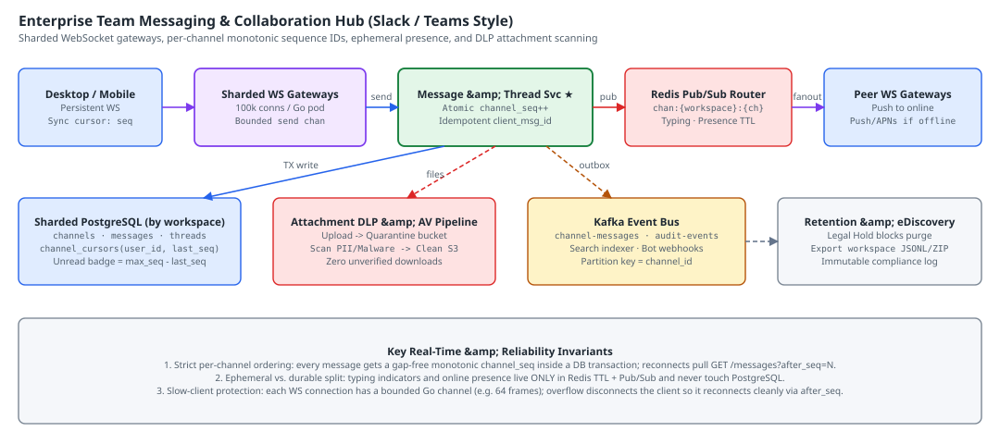

# Design Lab: Enterprise Team Messaging & Collaboration Hub

Build a production-grade multi-tenant team messaging hub (in the style of Slack or Microsoft Teams) in Go. Unlike a toy WebSocket chat room, an enterprise hub must guarantee **gap-free per-channel message ordering**, **100k+ concurrent connections per gateway fleet with zero slow-client OOMs**, **ephemeral presence isolated from PostgreSQL**, **malware/DLP attachment quarantine**, and **compliance retention with legal holds**.



## Architecture and authoritative schema

Separate **durable ordered messages** (sharded PostgreSQL by `workspace_id`) from **ephemeral real-time signals** (typing indicators and online presence in Redis TTL + Pub/Sub). Every channel maintains a strictly monotonic `channel_seq` counter so any mobile client waking from airplane mode can fetch exact missed history via `GET /v1/channels/{id}/messages?after_seq=N` and compute unread badges as `channel.last_seq - cursor.last_read_seq`.

### Authoritative schema (`migrations/001_collab.sql`)

```sql
CREATE TABLE channels (
    id           UUID PRIMARY KEY,
    workspace_id UUID NOT NULL,
    name         TEXT NOT NULL,
    is_private   BOOLEAN NOT NULL DEFAULT false,
    last_seq     BIGINT NOT NULL DEFAULT 0,
    created_at   TIMESTAMPTZ NOT NULL DEFAULT now()
);

CREATE TABLE channel_messages (
    workspace_id  UUID NOT NULL,
    channel_id    UUID NOT NULL REFERENCES channels(id),
    channel_seq   BIGINT NOT NULL,
    client_msg_id TEXT NOT NULL, -- Idempotency key from sender client
    author_id     UUID NOT NULL,
    thread_root   BIGINT,        -- NULL for top-level, parent channel_seq for thread reply
    body          TEXT NOT NULL,
    created_at    TIMESTAMPTZ NOT NULL DEFAULT now(),
    PRIMARY KEY (channel_id, channel_seq),
    UNIQUE (channel_id, author_id, client_msg_id)
);

CREATE TABLE read_cursors (
    channel_id    UUID NOT NULL REFERENCES channels(id),
    user_id       UUID NOT NULL,
    last_read_seq BIGINT NOT NULL DEFAULT 0,
    updated_at    TIMESTAMPTZ NOT NULL DEFAULT now(),
    PRIMARY KEY (channel_id, user_id)
);
```

## Go implementation: Sequenced message append and slow-client-safe WebSocket hub

### 1. Atomic monotonic `channel_seq` append with idempotency

Lock the single `channels` row (`UPDATE channels SET last_seq = last_seq + 1 ... RETURNING last_seq`) inside one short transaction to guarantee gap-free ordering even when 50 team members post to `#incident-room` simultaneously:

```go
package messaging

import (
	"context"
	"database/sql"
	"errors"
)

type AppendReq struct {
	WorkspaceID string
	ChannelID   string
	AuthorID    string
	ClientMsgID string
	ThreadRoot  *int64
	Body        string
}

// AppendMessage assigns a gap-free monotonic channel_seq and deduplicates retries
// by (channel_id, author_id, client_msg_id) in one PostgreSQL transaction.
func AppendMessage(ctx context.Context, db *sql.DB, req AppendReq) (int64, error) {
	tx, err := db.BeginTx(ctx, nil)
	if err != nil {
		return 0, err
	}
	defer tx.Rollback()

	var existingSeq int64
	err = tx.QueryRowContext(ctx, `
		SELECT channel_seq FROM channel_messages
		WHERE channel_id = $1 AND author_id = $2 AND client_msg_id = $3`,
		req.ChannelID, req.AuthorID, req.ClientMsgID,
	).Scan(&existingSeq)
	if err == nil {
		return existingSeq, nil
	}
	if !errors.Is(err, sql.ErrNoRows) {
		return 0, err
	}

	var seq int64
	if err := tx.QueryRowContext(ctx, `
		UPDATE channels SET last_seq = last_seq + 1
		WHERE id = $1 AND workspace_id = $2
		RETURNING last_seq`,
		req.ChannelID, req.WorkspaceID,
	).Scan(&seq); err != nil {
		return 0, err
	}

	if _, err := tx.ExecContext(ctx, `
		INSERT INTO channel_messages (workspace_id, channel_id, channel_seq, client_msg_id, author_id, thread_root, body)
		VALUES ($1, $2, $3, $4, $5, $6, $7)`,
		req.WorkspaceID, req.ChannelID, seq, req.ClientMsgID, req.AuthorID, req.ThreadRoot, req.Body,
	); err != nil {
		return 0, err
	}

	if err := tx.Commit(); err != nil {
		return 0, err
	}
	return seq, nil
}
```

### 2. Bounded-queue WebSocket hub (slow-client eviction)

Never write directly to a WebSocket from the broadcast loop—one stalled mobile connection on 3G would block delivery to an entire 10,000-person channel. Give every connection a bounded send channel (`cap = 64`); if it fills up, evict and close that connection so the client reconnects and catches up cleanly via `?after_seq=N`.

```go
package wshub

import "sync"

type Client struct {
	ID   string
	Send chan []byte // Bounded buffer (e.g., 64 frames)
	Kick func()      // Closes underlying WebSocket connection
}

type Hub struct {
	mu       sync.RWMutex
	channels map[string]map[*Client]struct{}
}

func NewHub() *Hub {
	return &Hub{channels: make(map[string]map[*Client]struct{})}
}

func (h *Hub) Join(channelID string, c *Client) {
	h.mu.Lock()
	defer h.mu.Unlock()
	if h.channels[channelID] == nil {
		h.channels[channelID] = make(map[*Client]struct{})
	}
	h.channels[channelID][c] = struct{}{}
}

func (h *Hub) Leave(channelID string, c *Client) {
	h.mu.Lock()
	defer h.mu.Unlock()
	delete(h.channels[channelID], c)
	if len(h.channels[channelID]) == 0 {
		delete(h.channels, channelID)
	}
}

// Broadcast pushes frame to all local subscribers without ever blocking on a slow client.
func (h *Hub) Broadcast(channelID string, frame []byte) {
	h.mu.RLock()
	subs := make([]*Client, 0, len(h.channels[channelID]))
	for c := range h.channels[channelID] {
		subs = append(subs, c)
	}
	h.mu.RUnlock()

	for _, c := range subs {
		select {
		case c.Send <- frame:
		default:
			// Slow consumer overflow: evict so client resyncs cleanly via after_seq.
			h.Leave(channelID, c)
			if c.Kick != nil {
				c.Kick()
			}
		}
	}
}
```

## Attachment DLP quarantine, presence, and capacity math

- **Attachment quarantine**: Upload files to a private `quarantine/` S3 bucket first. An async scanner runs antivirus + Data Loss Prevention (credit-card/secret regex) checks; only `CLEAN` blobs move to the serving bucket and become downloadable via short-lived presigned URLs.
- **Ephemeral presence**: Clients send a lightweight heartbeat every 30s (`SET presence:{ws}:{uid} "online" EX 75`). Never write presence transitions to PostgreSQL.
- **Capacity (5M DAU, 1M concurrent WebSockets)**: At `~20 KB` RAM per Go WebSocket goroutine pair (tuned read/write buffers), 100k connections fit in `~2–3 GB` RAM per Go pod—meaning **10–15 stateless gateway pods** handle 1M live connections comfortably.

## Acceptance drills (`go test -race ./...`)

1. **Concurrent channel sequencing**: Fire 100 goroutines posting to the same channel simultaneously; assert `channel_seq` forms a contiguous `1..100` sequence with zero gaps and duplicate `client_msg_id` retries return the original sequence.
2. **Slow-client eviction**: Attach 1 blocked client (`cap = 4`) alongside 50 healthy clients, broadcast 10 frames, and assert the blocked client is evicted cleanly while all 50 healthy clients receive all 10 frames in `< 5 ms`.
3. **Airplane-mode resync**: Disconnect a client at `seq = 12`, post 15 messages, reconnect, call `?after_seq=12`, and assert exact delivery of `seq 13..27` and unread badge `15`.

## Reference materials

- [RFC 6455 — The WebSocket Protocol](https://www.rfc-editor.org/info/rfc6455/)
- [Scaling to ten thousand connections in Go](../../14-network-performance/03-scaling-to-ten-thousand-connections.md)
- [WebSocket chat and multi-instance extension](../99u-websocket-chat.md)
- [S3-like object storage lab](05-object-storage.md)
