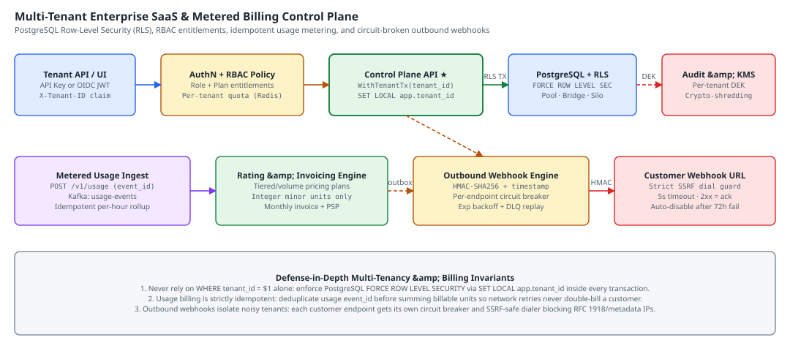

# Design Lab: Multi-Tenant Enterprise SaaS & Metered Billing Control Plane

Build the foundational control plane behind modern B2B SaaS platforms (Stripe, Datadog, or Snowflake-style): **PostgreSQL Row-Level Security (RLS) tenant isolation**, **RBAC & plan entitlements**, **idempotent metered usage ingestion**, **tiered invoice rating in integer minor units**, and a **circuit-broken HMAC outbound webhook engine** that isolates noisy customer endpoints.



## Tenant isolation models: Pool vs. Bridge vs. Silo

Choosing the wrong isolation tier either explodes operational overhead or fails enterprise security audits:

| Model | Storage layout | Best for | Trade-off |
|-------|---------------|----------|-----------|
| **Pool (Shared DB + RLS)** | Shared tables with `tenant_id` + PostgreSQL `FORCE ROW LEVEL SECURITY` | 95% of B2B tenants; instant onboarding, single migration pipeline | Noisy neighbors share IOPS; requires strict `SET LOCAL` discipline and tenant-leading indexes |
| **Bridge (Schema per tenant)** | Separate Postgres schema per tenant | Mid-market compliance | Schema migrations slow down past ~500 tenants; catalog bloat |
| **Silo (DB / Cluster per tenant)** | Dedicated PostgreSQL instance + KMS key per enterprise customer | Regulated banking/healthcare (HIPAA/FedRAMP), EU data residency | Highest cost; requires automated control-plane fleet orchestrator |

## Go implementation: Transaction-scoped RLS wrapper, usage metering, and HMAC webhooks

### 1. Defense-in-depth `WithTenantTx` (PostgreSQL RLS)

Always use `set_config('app.tenant_id', $1, true)` where the third parameter (`is_local = true`) scopes the setting strictly to the **current transaction**. Never use session-level `SET` with a shared connection pool (`database/sql` or `pgxpool`), or a pooled connection returned without resetting will leak Tenant A's context into Tenant B's next request!

```go
package tenantdb

import (
	"context"
	"database/sql"
	"errors"
)

var ErrMissingTenant = errors.New("tenant_id is required for RLS transaction")

// WithTenantTx opens a transaction, binds PostgreSQL's transaction-local
// app.tenant_id setting for FORCE ROW LEVEL SECURITY, runs fn, and commits.
func WithTenantTx(ctx context.Context, db *sql.DB, tenantID string, fn func(*sql.Tx) error) error {
	if tenantID == "" {
		return ErrMissingTenant
	}
	tx, err := db.BeginTx(ctx, &sql.TxOptions{Isolation: sql.LevelReadCommitted})
	if err != nil {
		return err
	}
	defer tx.Rollback()

	// Third argument `true` = SET LOCAL (automatically cleared on commit/rollback).
	if _, err := tx.ExecContext(ctx, `SELECT set_config('app.tenant_id', $1, true)`, tenantID); err != nil {
		return err
	}
	if err := fn(tx); err != nil {
		return err
	}
	return tx.Commit()
}
```

### 2. Idempotent metered usage ingestion & tiered rating

Usage-based billing (API calls, tokens, GB-hours) must survive duplicate client retries without double-charging a single unit, and compute prices strictly in `int64` minor units (cents/paise):

```go
package billing

import (
	"context"
	"database/sql"
	"time"
)

type UsageEvent struct {
	EventID    string
	TenantID   string
	Metric     string // e.g. "api_requests"
	Units      int64
	OccurredAt time.Time
}

type Tier struct {
	UpToUnits      int64 // 0 means unlimited (top tier)
	UnitPriceMinor int64 // price per unit in minor currency (e.g. cents)
}

// RecordUsage deduplicates by (tenant_id, event_id) and rolls up hourly billable units atomically.
func RecordUsage(ctx context.Context, tx *sql.Tx, ev UsageEvent) (bool, error) {
	res, err := tx.ExecContext(ctx, `
		INSERT INTO usage_events (tenant_id, event_id, metric, units, occurred_at)
		VALUES ($1, $2, $3, $4, $5)
		ON CONFLICT (tenant_id, event_id) DO NOTHING`,
		ev.TenantID, ev.EventID, ev.Metric, ev.Units, ev.OccurredAt.UTC(),
	)
	if err != nil {
		return false, err
	}
	n, _ := res.RowsAffected()
	if n == 0 {
		return false, nil // Duplicate retry
	}

	hourBucket := ev.OccurredAt.UTC().Truncate(time.Hour)
	_, err = tx.ExecContext(ctx, `
		INSERT INTO usage_hourly_rollups (tenant_id, metric, hour_start, total_units)
		VALUES ($1, $2, $3, $4)
		ON CONFLICT (tenant_id, metric, hour_start)
		DO UPDATE SET total_units = usage_hourly_rollups.total_units + EXCLUDED.total_units`,
		ev.TenantID, ev.Metric, hourBucket, ev.Units,
	)
	return err == nil, err
}

// RateGraduated computes total minor-unit cost across graduated pricing tiers.
func RateGraduated(totalUnits int64, tiers []Tier) int64 {
	var cost, prevCap int64
	rem := totalUnits
	for _, t := range tiers {
		if rem <= 0 {
			break
		}
		var slice int64
		if t.UpToUnits == 0 {
			slice = rem
		} else {
			band := t.UpToUnits - prevCap
			slice = min(rem, band)
			prevCap = t.UpToUnits
		}
		cost += slice * t.UnitPriceMinor
		rem -= slice
	}
	return cost
}
```

### 3. Outbound webhook signing (`X-Webhook-Signature` + replay window)

Sign every outbound customer webhook as `HMAC-SHA256(secret, timestamp + "." + raw_body)` so customers can verify both authenticity and replay freshness (e.g., reject timestamps older than 5 minutes). Deliver through an SSRF-safe HTTP client (blocking loopback, RFC 1918 private networks, and link-local cloud metadata ranges) with a **per-endpoint circuit breaker** so one customer's broken staging server never fills the shared webhook worker queue.

```go
package webhooks

import (
	"crypto/hmac"
	"crypto/sha256"
	"encoding/hex"
	"fmt"
	"time"
)

// SignHeader produces a Stripe-style timestamped HMAC-SHA256 signature header.
func SignHeader(secret, payload []byte, now time.Time) string {
	ts := now.UTC().Unix()
	mac := hmac.New(sha256.New, secret)
	mac.Write([]byte(fmt.Sprintf("%d.", ts)))
	mac.Write(payload)
	return fmt.Sprintf("t=%d,v1=%s", ts, hex.EncodeToString(mac.Sum(nil)))
}
```

## Tenant offboarding, crypto-shredding, and acceptance drills

- **Crypto-shredding**: Encrypt sensitive tenant blobs and PII columns with a per-tenant Data Encryption Key (DEK) wrapped by KMS. On GDPR/contractual deletion, destroying the tenant's KMS key renders all historical backups cryptographically unreadable without rewriting immutable archive tapes.
- **Noisy-neighbor protection**: Enforce per-tenant token buckets at the gateway and `SET LOCAL statement_timeout = '5s'` inside `WithTenantTx` so one unindexed report cannot pin database CPUs.

### Acceptance drills (`go test -race ./...`)

1. **Pooled RLS isolation**: Set `db.SetMaxOpenConns(2)` and interleave 200 concurrent transactions for Tenant A and Tenant B; assert zero cross-tenant reads or writes even when one transaction rolls back with an error.
2. **Usage replay invariance**: Replay a batch of 1,000 usage events 3 times and assert `total_units` and `RateGraduated` invoice totals are bit-exact.
3. **Noisy webhook isolation**: Point Tenant A's webhook to a server that hangs for 30s and Tenant B's to a healthy 200 OK endpoint; assert Tenant A's circuit breaker opens after 5 consecutive timeouts while Tenant B's p99 delivery latency stays `< 100 ms`.
4. **SSRF guard**: Register a private RFC 1918 or link-local metadata address as a customer webhook URL and assert the dialer blocks it at connect time.

## Reference materials

- [PostgreSQL Row Security Policies (`ddl-rowsecurity`)](https://www.postgresql.org/docs/current/ddl-rowsecurity.html)
- [RFC 2104 — HMAC: Keyed-Hashing for Message Authentication](https://www.rfc-editor.org/info/rfc2104/)
- [Input validation and SSRF protection](../../22-security-hardening/175-input-validation-and-ssrf.md)
- [Payment orchestration lab](15-payment-system.md) and [Ad click event aggregation lab](11-click-event-aggregation.md)
