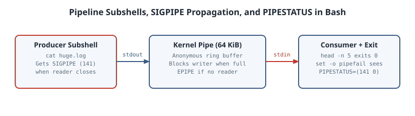

# Pipeline Subshells, Traps, and Signal Propagation

Every stage of a Bash pipeline (`cmd1 | cmd2 | cmd3`) executes in its own **subshell process** connected by anonymous kernel pipes. That process boundary explains two classic production surprises: why variable assignments inside a pipeline vanish in the parent shell, and why `set -o pipefail` combined with `head` can unexpectedly fail a script with exit status `141` (`SIGPIPE`).



## Why `SIGPIPE` Breaks `set -o pipefail`

When `cmd1 | head -n 5` runs, `head` reads five lines and immediately exits with code `0`, closing the read end of the kernel pipe. If `cmd1` is still writing bytes into that pipe, the Linux kernel sends **`SIGPIPE` (signal 13)** to `cmd1`, terminating it with exit code `128 + 13 = 141`. Under `set -o pipefail`, Bash reports `141` as the exit status of the entire pipeline.

### Handling Cleanup Traps Cleanly

```bash
#!/usr/bin/env bash
set -euo pipefail

TMPDIR_LAB=$(mktemp -d)
cleanup() {
  local rc=$?
  rm -rf "$TMPDIR_LAB"
  exit "$rc"
}
trap cleanup EXIT INT TERM

# Inspect exact per-stage exit codes via PIPESTATUS
set +e
yes | head -n 3 >/dev/null
printf 'PIPESTATUS=(%s)
' "${PIPESTATUS[*]}"
set -e
```

> [!TIP]
> To avoid losing variable mutations inside a `while read` loop, feed the loop via **process substitution** (`while IFS= read -r line; do ...; done < <(cmd)`) instead of piping (`cmd | while ...`) so the loop executes in the current shell rather than a subshell.

## Hands-On Lab: Observe Subshell Isolation and `PIPESTATUS`

```bash
count=0
printf "a
b
c
" | while IFS= read -r _; do count=$((count + 1)); done
echo "After piped while (subshell): count=$count"

count=0
while IFS= read -r _; do count=$((count + 1)); done < <(printf "a
b
c
")
echo "After process substitution:   count=$count"
```
