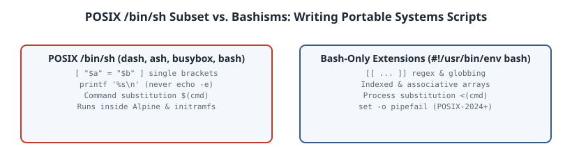

# The POSIX Shell Standard and Script Portability

When your automation must run across Debian (`dash` as `/bin/sh`), Alpine (`busybox ash`), RHEL (`bash`), and minimal container initramfs images, writing **POSIX-compliant `/bin/sh`** guarantees zero missing-interpreter surprises.



## High-Impact POSIX vs. Bash Differences

| Feature | Portable POSIX (`/bin/sh`) | Bash-Only (`#!/usr/bin/env bash`) |
| :--- | :--- | :--- |
| **Test expression** | `[ "$a" = "$b" ]` (always quote variables!) | `[[ $a == $b ]]` |
| **Printing safely** | `printf '%s
' "$msg"` | `echo -e "$msg"` (varies across shells) |
| **Arrays** | Positional params (`set -- ...`) | `arr=(one two)` / `declare -A` |
| **Local scope** | Not strictly POSIX (widely supported, use care) | `local var=1` |
| **Arithmetic** | `$((a + b))` | `((a++))` |

## Portable Script Pattern

```sh
#!/bin/sh
set -eu

log() {
  printf '[%s] %s
' "$(date -u '+%Y-%m-%dT%H:%M:%SZ')" "$*"
}

target="${1:-/tmp}"
if [ -d "$target" ]; then
  log "Verified directory exists: $target"
else
  log "Missing directory: $target" >&2
  exit 1
fi
```

> [!TIP]
> Run **`shellcheck -s sh script.sh`** in CI on every `/bin/sh` script. ShellCheck immediately catches Bashisms (`[[`, `local`, `source`, arrays, `echo -e`) before your script ever hits an Alpine container.

## Hands-On Lab: Verify Strict POSIX Syntax with `/bin/sh -n`

```bash
cat > /tmp/posix-check.sh <<'SH'
#!/bin/sh
set -eu
for item in alpha beta gamma; do
  printf 'item=%s
' "$item"
done
SH
/bin/sh -n /tmp/posix-check.sh && /bin/sh /tmp/posix-check.sh
rm -f /tmp/posix-check.sh
```
