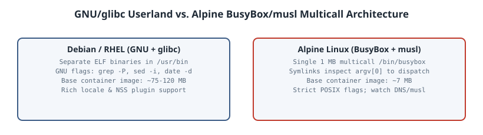

# Alpine Linux, BusyBox, and musl Differences

Containerizing a shell script originally written on Ubuntu or Fedora onto `alpine:3.21` is one of the fastest ways to hit subtle portability failures. Alpine replaces **GNU coreutils** with **BusyBox** (a single ~1 MB multicall binary) and **glibc** with **musl libc**.



## Common BusyBox Gotchas in Production Scripts

1. **`grep -P` (PCRE) is absent:** BusyBox `grep` supports `-E` (extended regex), not Perl regexes. Use `grep -E` or install `grep` via `apk add --no-cache grep`.
2. **`date -d "2 days ago"` behaves differently:** BusyBox `date` accepts ISO timestamps (`-d "2026-01-01"`) but rejects English relative phrases unless GNU `coreutils` is installed.
3. **`ps aux` vs. `ps`:** BusyBox `ps` ignores BSD-style flags without `-o` formatting unless `procps` is added.
4. **musl DNS & resolver nuances:** musl queries all `/etc/resolv.conf` nameservers in parallel and takes the first answer; long `search` domains and huge `ndots` values behave differently from glibc.

## Writing Scripts That Work on Both GNU and BusyBox

```sh
#!/bin/sh
set -eu

# Portable regex matching using ERE (-E) instead of GNU-only -P
printf 'status=200
status=503
' | grep -E '^status=5[0-9]{2}$'

# Portable UTC timestamp (works identically on GNU date, BusyBox, and BSD/macOS)
date -u '+%Y-%m-%dT%H:%M:%SZ'
```

## Hands-On Lab: Inspect Multicall Symlinks or Tool Flavors

```bash
# Detect whether core utilities are GNU, BSD, or BusyBox
for cmd in grep sed awk tar; do
  ver=$($cmd --version 2>&1 | head -n 1 || echo "BSD/BusyBox variant")
  printf '%-6s -> %s
' "$cmd" "$ver"
done
```
