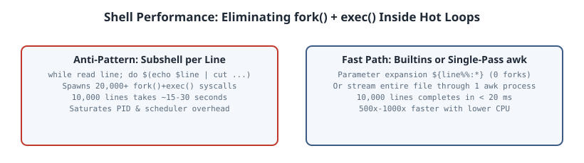

# Fork Costs and Eliminating Subshells in Hot Loops

Shell scripts feel slow almost exclusively for one reason: **spawning external processes (`fork()` + `exec()`) inside a loop**. Every `$(echo "$x" | sed ...)` inside a 10,000-line `while read` loop asks the kernel to clone page tables, create pipes, load ELF binaries, and tear down processes 20,000 times.



## Built-In Parameter Expansion vs. External Commands

| Task | Slow (Spawns External Process) | Fast (Zero-Fork Bash Builtin) |
| :--- | :--- | :--- |
| Strip file extension | `$(basename "$f" .log)` | `${f%.log}` |
| Extract filename | `$(basename "$path")` | `${path##*/}` |
| Extract directory | `$(dirname "$path")` | `${path%/*}` |
| Lowercase string | `$(echo "$s" | tr A-Z a-z)` | `${s,,}` (Bash 4+) |
| String length | `$(echo -n "$s" | wc -c)` | `${#s}` |

## Hands-On Lab: Benchmark Parameter Expansion vs. Subshell `cut`

Run this 500-iteration local benchmark to feel the latency difference firsthand:

```bash
# Slow: spawns external `cut` process 500 times
time for i in $(seq 1 500); do
  _=$(printf 'user:%s:admin
' "$i" | cut -d: -f2)
done

# Fast: zero forks using pure parameter expansion
time for i in $(seq 1 500); do
  line="user:${i}:admin"
  tmp="${line#*:}"
  _="${tmp%%:*}"
done
```
