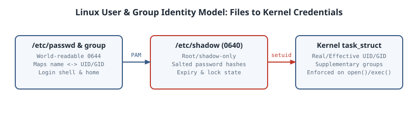

# User, Group, and Least-Privilege Service Account Management

Every Linux process runs with numeric kernel credentials—a User ID (**UID**), primary Group ID (**GID**), and list of supplementary GIDs. Names like `nginx` or `postgres` are strictly userspace conveniences looked up in `/etc/passwd` and `/etc/group`.



## Creating Locked System Service Accounts

Always run daemons under dedicated, non-login system accounts (`UID < 1000`, shell set to `/usr/sbin/nologin`) so a compromised web worker cannot spawn an interactive shell or read another service's secrets:

```bash
# Create a dedicated system group and locked non-login service account (Linux)
# sudo groupadd --system appmetrics
# sudo useradd --system --gid appmetrics --home-dir /nonexistent #   --no-create-home --shell /usr/sbin/nologin appmetrics
```

### Auditing Account Security Invariants

- **UID 0 uniqueness:** Only `root` should ever have UID `0` in `/etc/passwd`.
- **Locked system passwords:** System accounts should have `!` or `*` in the password hash column of `/etc/shadow`.
- **Least-privilege supplementary groups:** Audit `sudo`, `wheel`, and `docker` group memberships regularly (membership in `docker` is effectively equivalent to root).

## Hands-On Lab: Read-Only Identity Audit

```bash
# 1. Inspect your current UID, GID, and supplementary groups
id

# 2. Verify only root holds UID 0 in /etc/passwd
awk -F: '$3 == 0 { print "UID 0 account:", $1 }' /etc/passwd

# 3. List accounts with interactive login shells
awk -F: '$7 !~ /(nologin|false)$/ { printf "%-16s uid=%-5s shell=%s
", $1, $3, $7 }' /etc/passwd | head -n 15
```
