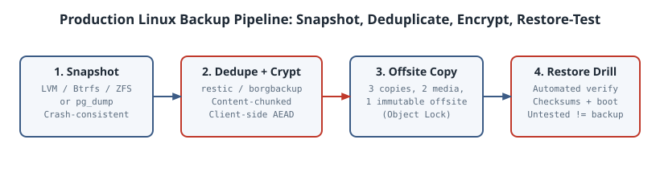

# Backup, Deduplication, and Restore Verification Patterns

An untested backup is not a backup—it is a wish. Reliable Linux backup engineering combines **crash-consistent snapshots**, **client-side encrypted deduplication** (`restic` or `borgbackup`), the **3-2-1 rule** (3 copies, 2 media types, 1 offsite immutable copy), and **scheduled automated restore drills**.



## Why Plain `tar` of a Live Database Fails

Copying raw `/var/lib/postgresql/data` files with `tar` or `rsync` while PostgreSQL is actively writing produces torn pages and an unbootable cluster. Always use either:
- **Logical dumps:** `pg_dump --format=custom` (consistent MVCC snapshot).
- **Atomic filesystem snapshots:** `btrfs subvolume snapshot -r`, `zfs snapshot`, or `lvcreate -s` taken around `pg_backup_start()` / `pg_backup_stop()`.

## Encrypted Deduplicated Backup Script Pattern (`restic`)

```bash
#!/usr/bin/env bash
set -euo pipefail

# Requires RESTIC_REPOSITORY and RESTIC_PASSWORD_FILE exported in environment
restic backup /etc /srv/app-data   --exclude-caches   --one-file-system   --tag scheduled

# Enforce retention policy and prune unreferenced chunks
restic forget --keep-daily 7 --keep-weekly 4 --keep-monthly 6 --prune

# Verify repository integrity (read a random 5% data subset)
restic check --read-data-subset=5%
```

> [!IMPORTANT]
> Store offsite backup credentials with **append-only / S3 Object Lock** permissions so a ransomware compromise on a production server cannot run `restic forget --prune` or delete historical backups.

## Hands-On Lab: Archive, Checksum, and Verify a Restore Drill in `/tmp`

```bash
mkdir -p /tmp/backup-lab/{src,archive,restore}
printf "critical-config=true
" > /tmp/backup-lab/src/app.conf

# 1. Create compressed archive + SHA-256 digest
tar -czf /tmp/backup-lab/archive/backup.tar.gz -C /tmp/backup-lab/src .
(cd /tmp/backup-lab/archive && sha256sum backup.tar.gz > backup.sha256)

# 2. Verify digest, extract to clean restore directory, and diff against source
(cd /tmp/backup-lab/archive && sha256sum -c backup.sha256)
tar -xzf /tmp/backup-lab/archive/backup.tar.gz -C /tmp/backup-lab/restore
diff -ru /tmp/backup-lab/src /tmp/backup-lab/restore && echo "Restore drill verified byte-for-byte!"
rm -rf /tmp/backup-lab
```
