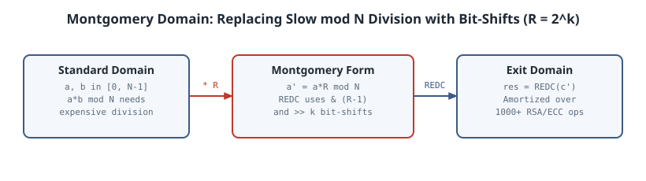

# Montgomery Modular Multiplication

## Thesis

**Montgomery multiplication** replaces costly `mod n` divisions with cheaper reductions in a residue representation. This chapter implements a tiny Python version for correctness. Pure-Python teaching code is **slower** than naïve `%` on small moduli — the win appears in big-int/constant-time code.

## Mental model

```text
  a → aR mod n; mont_mul; leave with ·R⁻¹
```

## Worked examples

```
n 1000000007 R 4294967296
classic (a*b)%n = 259106859
montgomery      = 259106859
match True
classic 200000 muls: 12.61 ms  result=641624714
mont    200000 muls: 58.49 ms  result=641624714 match=True
```

## Trap

**Copying Montgomery into app Python for 64-bit primes.** Slower and bug-prone.

## Boring rule

Learn it to read crypto code; call audited libraries for production.

## Try this

1. Reimplement in C with `__uint128_t`.
2. Read HAC §14.3.
3. Inspect Go `math/big` Montgomery paths.

## Sources

- Montgomery 1985; HAC §14.3
## Montgomery Domain Diagram & Python REDC Verification Lab



Verify Montgomery reduction (`REDC`) against standard modular multiplication in pure Python:

```python
def montgomery_mul(a: int, b: int, n: int, r_bits: int) -> int:
    r = 1 << r_bits
    mask = r - 1
    n_prime = (-pow(n, -1, r)) & mask

    def redc(t: int) -> int:
        m = ((t & mask) * n_prime) & mask
        u = (t + m * n) >> r_bits
        return u - n if u >= n else u

    r2 = (r * r) % n
    a_m = redc(a * r2)
    b_m = redc(b * r2)
    return redc(redc(a_m * b_m))

assert montgomery_mul(12345, 67890, 1000003, 24) == (12345 * 67890) % 1000003
print("Montgomery REDC verified exact match!")
```
