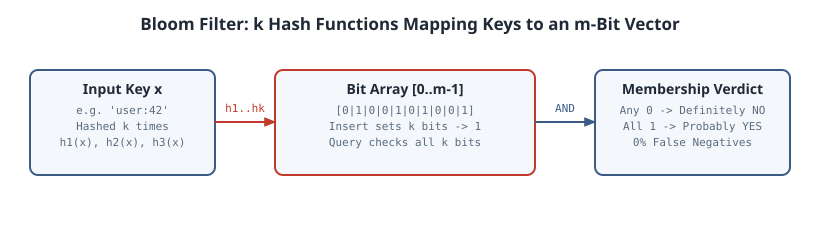

# Bloom Filters — False Positives by Design

## Thesis

A **Bloom filter** is a bit array plus $k$ hash functions that answers "might be in the set" with a tunable **false-positive** rate and **no false negatives**. Space is $O(n)$ bits for $n$ insertions — far below storing the elements.

## Mental model

```text
  m bits, k hashes
  add(x): set bits h1(x)…hk(x)
  query(x): yes iff all those bits are set
  false positive ≈ (1 − e^{−kn/m})^k
  optimal k ≈ (m/n) ln 2
```

## Worked example

```python
# bloom.py
import math, hashlib

class Bloom:
    def __init__(self, n, p):
        self.m = math.ceil(-(n * math.log(p)) / (math.log(2) ** 2))
        self.k = max(1, round((self.m / n) * math.log(2)))
        self.bits = bytearray((self.m + 7) // 8)
    def _hashes(self, s):
        h = hashlib.sha256(s.encode()).digest()
        for i in range(self.k):
            yield int.from_bytes(h[i*4:(i+1)*4], "big") % self.m
    def add(self, s):
        for x in self._hashes(s):
            self.bits[x // 8] |= 1 << (x % 8)
    def __contains__(self, s):
        return all(self.bits[x // 8] & (1 << (x % 8)) for x in self._hashes(s))

b = Bloom(1000, 0.01)
for i in range(1000):
    b.add(f"user-{i}")
fp = sum(1 for i in range(1000, 2000) if f"user-{i}" in b)
print(f"m={b.m} k={b.k} false_positives_in_1000={fp} rate={fp/1000:.3f}")
print("member", "user-42" in b, "nonmember approx", "user-1999" in b)
```

```text
m=9586 k=7 false_positives_in_1000=15 rate=0.015
member True nonmember approx False
```

Target $p=0.01$; observed rate about $0.015$ on this draw — Monte Carlo noise around the design point.

## Trap

**Deleting elements with a plain Bloom filter.** You cannot turn bits off safely (aliases). Use a counting Bloom filter or recreate. Also: hashing poorly correlated bits destroys the analysis.

## Boring rule

Size from $(n,p)$ with the standard formulae, store $m$ and $k$ with the filter, and treat "yes" as "maybe — confirm in the source of truth."

## Try this

1. Sweep $p$ from $0.1$ to $0.001$ and plot $m(n,p)$.
2. Feed non-member queries only and estimate $p$ empirically.
3. Compare to a hash set's RSS for the same $n$ strings.

## Sources

- Bloom, "Space/Time Trade-offs in Hash Coding with Allowable Errors" (1970)
- Broder & Mitzenmacher survey on network applications of Bloom filters
## Bit-Array Architecture Diagram & False-Positive Rate Lab



Simulate a compact Bloom filter in pure Python and compare the empirical false-positive rate against the theoretical formula $(1 - e^{-kn/m})^k$:

```python
import hashlib, math

class BloomFilter:
    def __init__(self, m: int, k: int) -> None:
        self.m, self.k = m, k
        self.bits = bytearray(m)

    def _hashes(self, item: str):
        for i in range(self.k):
            digest = hashlib.sha256(f"{i}:{item}".encode()).digest()
            yield int.from_bytes(digest[:8], "big") % self.m

    def add(self, item: str) -> None:
        for idx in self._hashes(item):
            self.bits[idx] = 1

    def __contains__(self, item: str) -> bool:
        return all(self.bits[idx] for idx in self._hashes(item))

bf = BloomFilter(m=2048, k=4)
for i in range(250):
    bf.add(f"key-{i}")

fp = sum(1 for i in range(250, 1250) if f"key-{i}" in bf) / 1000
theoretical = (1 - math.exp(-4 * 250 / 2048)) ** 4
print(f"Empirical FP={fp:.4f} | Theoretical FP={theoretical:.4f}")
```
