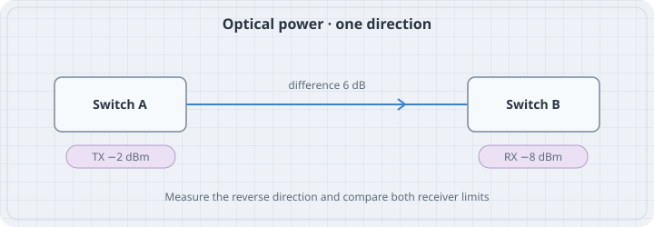

# Physical Ethernet: Media, Optics, PoE and Fault Isolation

A routing protocol cannot repair a damaged fiber, an incompatible transceiver, or a powered device that never starts. Conversely, a physical link can show `UP` while a VLAN, MTU, or route is wrong. Production troubleshooting starts by separating Layer 1 signal integrity from Layer 2/3 forwarding and collecting matched evidence from **both ends** of the link.

## Choose a compatible link

Twisted-pair copper carries electrical signals over balanced pairs, while optical fiber carries modulated light and provides galvanic isolation. **Single-mode fiber (SMF)** and **multimode fiber (MMF)** have fundamentally different core diameters (typically 9 µm vs 50 µm), modal dispersion characteristics, and wavelengths (e.g., 1310/1550 nm vs 850 nm). A physical LC or MPO connector that clicks into place does not prove that transceiver form factor, wavelength, lane count, polarity (Type A/B/C on MPO), reach, and host port breakout/FEC modes match.

### Copper media and autonegotiation

Copper link speed and reach depend on the Ethernet PHY, cable category (Cat5e/Cat6/Cat6A), termination quality, and alien crosstalk. Do not assume every copper run achieves 100 meters at 2.5G/5G/10GBASE-T; poor terminations or patch-panel pairs can negotiate down to 100 Mbps or drop frames under load.

For 1000BASE-T and faster copper standards, IEEE 802.3 mandates autonegotiation for master/slave clock selection and pair training. Forcing speed and duplex on one end while leaving the peer on autonegotiation creates classic **duplex mismatch** symptoms on 10/100 Mbps links:

- The forced full-duplex side transmits freely and records **FCS/CRC errors, runts, and alignment errors** whenever the half-duplex side aborts mid-frame.
- The autonegotiating side falls back to half-duplex (via parallel detection) and records **late collisions and excessive deferrals**.
- Small pings (`64 bytes`) may succeed with low loss while bulk TCP transfers collapse to a few kilobits per second.

> [!WARNING]
> On 10G/25G/100G/400G fiber and DAC links, disabling autonegotiation or mismatching Forward Error Correction (FEC) modes can keep the link permanently down (`no-carrier` / `notconnect`) even when optical Rx power is healthy. Always verify both speed and FEC mode on both peers.

## Optical transceiver DOM power budgets

Digital Optical Monitoring (DOM / DDM, standardized in SFF-8472 and CMIS) reports real-time transceiver telemetry: temperature, supply voltage, laser bias current, transmit optical power (**Tx**), and receive optical power (**Rx**). Optical power is expressed in **dBm** (decibels relative to 1 milliwatt), while insertion loss and link margin are relative differences in **dB**.



### Calculating attenuation and margin

For each direction and lane independently:

1. **Measured channel loss (dB):** `Local Tx (dBm) - Remote Rx (dBm)`.
2. **Lower-limit margin (dB):** `Remote Rx (dBm) - Remote Rx Sensitivity Min (dBm)`.
3. **Overload headroom (dB):** `Remote Rx Overload Max (dBm) - Remote Rx (dBm)`.

For example, if Switch A transmits at `-2.0 dBm` and Switch B receives `-8.0 dBm` on an optic whose receiver sensitivity is `-10.0 dBm` and overload threshold is `+0.5 dBm`:

- Measured loss is `-2.0 - (-8.0) = 6.0 dB`.
- Sensitivity margin is `-8.0 - (-10.0) = 2.0 dB` (functional, though tight for long-term plant aging).
- Overload headroom is `+0.5 - (-8.0) = 8.5 dB` (safe).

| Metric | Healthy Indicator | Degraded / Fault Condition |
|---|---|---|
| Tx Power | Within datasheet min/max (e.g., `-5` to `0 dBm` for 10GBASE-LR) | Falling Tx with rising laser bias current signals an aging/failing laser |
| Rx Power (too low) | At least 3 dB above receiver sensitivity | Dirty/scratched ferrule, macro-bend, bad splice, wrong fiber type |
| Rx Power (too high) | Safely below receiver overload threshold | Long-reach optic (ER/ZR) connected short-range without an optical attenuator |
| Laser Bias Current | Stable within vendor range | Spiking toward high-alarm threshold indicates imminent optic failure |
| Temperature | Below high-warning threshold (typically `< 70 °C`) | Blocked chassis airflow or failing fan causing thermal drift and bit errors |

> [!CAUTION]
> Never look directly into an active fiber end or optical port, and never connect high-power long-reach optics (such as 40 km ER or 80 km ZR) back-to-back without checking the receiver overload rating and inserting the required fixed optical attenuator. Clean and inspect every ferrule with an approved fiber scope before mating.

## FEC and Layer 1 error counter triage

At 25 Gbps per electrical/optical lane and above (25G, 50G, 100G, 400G), raw bit error rates (BER) require **Forward Error Correction (FEC)** to achieve Ethernet frame-loss targets. Two common modes appear in production:

- **FC-FEC (FireCode / Clause 74 BASE-R FEC):** Lower latency, weaker coding gain; common on 25G short-reach links or 10G/25G DACs.
- **RS-FEC (Reed-Solomon / Clause 91 or Clause 108):** Stronger burst-error correction, slightly higher serialization latency (~100–250 ns); standard on 100GBASE-SR4/LR4, 25GBASE-SR, and 400G optics.

A rising **corrected FEC codeword** counter means the PHY is repairing bit errors before they corrupt frames—an early warning of marginal optics, dirty connectors, or thermal drift. Once errors exceed the FEC code's correction capacity, **uncorrected FEC codewords** and **CRC/FCS errors** climb simultaneously, causing actual packet drops.

Always read interface counters as a **time series** (two snapshots separated by 30–60 seconds) rather than trusting lifetime totals.

| Counter / Symptom | Layer 1 Meaning | Candidate Causes & Next Evidence |
|---|---|---|
| `rx_crc_errors` / `FCS-Err` rising | Frame arrived with invalid Ethernet checksum | Dirty fiber, marginal Rx power, bad DAC/patch cord, failing peer Tx, duplex mismatch |
| `symbol_errors` / `rx_err` rising | Line-code decoding failure at PCS/PMA | Interference, failing transceiver, damaged cable pair, clock/CDR instability |
| `fec_corrected_cw` rising, `uncorrected = 0` | Bit errors repaired by FEC; no frame loss yet | Early optical degradation; inspect DOM Rx power and clean connectors before outage |
| `fec_uncorrected_cw` rising + CRC rising | Bit errors exceeded FEC capability; frames dropped | Severe optical loss, FEC mismatch, failing laser or SerDes lane |
| `rx_missed_errors` / `in_discards` (0 CRC) | Clean frames dropped by NIC/ASIC buffer | Queue congestion, pause/PFC storm, host CPU/ring-buffer exhaustion (not L1 media) |
| Link flaps (`carrier_changes` rising) | Loss of signal (LOS) or PCS lock loss | Loose transceiver seating, bent cable, marginal power, failing peer port |

> [!NOTE]
> A receive CRC error on Port B does not prove Port B's optic is defective. The fault can lie in Port A's transmitter, the patch cords, the structured cable plant, or Port B's receiver. Compare both directions and swap one component at a time.

## Platform verification commands

The outputs below are **illustrative example outputs** showing the key fields to inspect on Linux hosts, Arista EOS switches, and Nokia SR Linux nodes.

### Linux (`ethtool`)

```bash
# Check link state, speed, duplex, autoneg, and FEC mode
ethtool eth0
ethtool --show-fec eth0

# Read transceiver DOM telemetry (Tx/Rx power, bias, temp, thresholds)
ethtool -m eth0

# Sample PHY, MAC, and FEC counters twice (30s apart) to observe deltas
ethtool -S eth0 | grep -iE 'crc|fcs|err|fec|sym|drop'
```

Illustrative example output from `ethtool -m eth0`:

```text
Identifier                                : 0x03 (SFP)
Transceiver type                          : 10G Ethernet: 10G Base-LR
Laser wavelength                          : 1310nm
Module temperature                        : 41.25 degrees C / 106.25 degrees F
Laser bias current                        : 32.450 mA
Laser output power                        : 0.6310 mW / -2.00 dBm
Receiver signal average optical power     : 0.1585 mW / -8.00 dBm
Laser rx power high alarm threshold       : 1.1220 mW / 0.50 dBm
Laser rx power low alarm threshold        : 0.0363 mW / -14.40 dBm
```

### Arista EOS

```bash
show interfaces Ethernet1/1
show interfaces Ethernet1/1 phy detail
show interfaces Ethernet1/1 transceiver detail
show interfaces Ethernet1/1 counters errors
```

Illustrative example output from `show interfaces Ethernet1/1 transceiver detail`:

```text
mA: milliamperes, dBm: decibels (milliwatts), NA or N/A: not applicable.
                     High Alarm  High Warn   Low Warn    Low Alarm
           Temp      Threshold   Threshold   Threshold   Threshold
Port       (Celsius) (Celsius)   (Celsius)   (Celsius)   (Celsius)
---------- --------- ----------- ----------- ----------- -----------
Et1/1      42.10     75.00       70.00       0.00        -5.00

           Optical   High Alarm  High Warn   Low Warn    Low Alarm
           Rx Power  Threshold   Threshold   Threshold   Threshold
Port       (dBm)     (dBm)       (dBm)       (dBm)       (dBm)
---------- --------- ----------- ----------- ----------- -----------
Et1/1      -8.02     0.50        -1.00       -12.40      -14.40
```

### Nokia SR Linux

```bash
show interface ethernet-1/1 detail
show interface ethernet-1/1 transceiver
show interface ethernet-1/1 statistics
```

Illustrative example output from `show interface ethernet-1/1 transceiver`:

```text
ethernet-1/1 transceiver:
  oper-state     : up
  form-factor    : qsfp28
  ethernet-pmd   : 100gbase-lr4
  temperature    : 44.5 C
  tx-power-dbm   : [ -1.8, -1.9, -2.1, -1.7 ]
  rx-power-dbm   : [ -4.2, -4.5, -13.9, -4.1 ]   <-- Lane 2 degraded!
```

> [!TIP]
> On multi-lane optics (40G/100G/400G SR4, LR4, DR4), always inspect **every lane** individually. A single contaminated lane (such as Lane 2 at `-13.9 dBm` above) triggers uncorrectable FEC errors and link instability even if the other three lanes look spotless.

## Power over Ethernet (PoE)

Power Sourcing Equipment (PSE)—a switch port or midspan injector—supplies DC power to a Powered Device (PD) such as an access point, camera, or IP phone. Standards-based PoE (802.3af Type 1 up to 15.4 W PSE / 12.95 W PD; 802.3at Type 2 up to 30 W / 25.5 W; 802.3bt Type 3/4 up to 60–90 W) performs resistance detection and power classification before applying full voltage.

Common PoE failure patterns:

- **Switch power budget exhaustion:** The port is enabled, but total chassis PoE allocation is full, denying power to lower-priority ports.
- **LLDP-MED power negotiation mismatch:** High-draw APs boot in reduced-radio mode (or reboot under Wi-Fi load) if LLDP is disabled on the switch port and hardware classification caps power at 15.4 W.
- **Cable DC resistance loss:** Long or copper-clad-aluminum (CCA) cables drop voltage under load; PSE output power is always higher than delivered PD power.

## Step-by-step Layer 1 fault isolation runbook

Follow this isolation sequence on an authorized link, recording timestamps and outputs at **both ends** before touching any hardware:

1. **Confirm administrative and operational state:** Verify neither end is `admin-down`, `errdisabled` (BPDU guard, UDLD, link-flap), or mismatched in breakout/port-group configuration.
2. **Capture two counter snapshots 30 seconds apart:** Compare `rx_crc_errors`, `symbol_errors`, `fec_corrected`, `fec_uncorrected`, and `in_discards`. If errors are zero while drops climb, pivot to QoS/buffers/L2-L3 forwarding rather than media.
3. **Verify speed, duplex, autoneg, and FEC parity:** Confirm both ends agree on speed, autonegotiation, and FEC mode (`RS-FEC`, `FC-FEC`, or `off`).
4. **Inspect DOM on both ends and all lanes:** Compute `Tx_A - Rx_B` and `Tx_B - Rx_A`. Check for low-Rx alarms, high-Rx overload, high temperature, or rising laser bias current.
5. **Isolate the faulty segment one swap at a time:**
   - Clean and inspect both patch-cord ferrules and transceiver receptacles.
   - Replace the local patch cord with a known-good spare and re-check DOM and 30-second error deltas.
   - If loss remains asymmetric or unchanged, swap the transceiver on the suspect end (Tx-side first if remote Rx is low).
   - If swapping patch cords and optics does not clear the loss, test the structured cable plant with an optical power meter / OTDR (fiber) or cable certifier (copper).
6. **Verify Layer 2/3 after L1 stabilizes:** Confirm LLDP/CDP neighbor discovery, VLAN/trunk state, PoE allocated power (if applicable), and bidirectional traffic with zero new CRC or uncorrected FEC deltas.

## Review

1. Why can a 100G link stay `UP` with zero CRC errors while `fec_corrected_cw` climbs rapidly, and why should you investigate it before packet loss starts?
2. On a duplex-mismatched copper link, why do small pings often succeed while large TCP transfers stall?
3. Given Switch A Tx `-2.0 dBm`, Switch B Rx `-8.0 dBm`, and Switch B Rx sensitivity `-10.0 dBm`, why is a 6 dB loss calculation alone insufficient to certify the optical link?
4. When `rx_crc_errors` rises on Switch B's port, why must you inspect Switch A's Tx power and bias current as well as Switch B's Rx power?

Further reading: [Linux Ethernet twisted-pair diagnostic guide](https://docs.kernel.org/networking/diagnostic/twisted_pair_layer1_diagnostics.html) and [IEEE 802.3 PoE materials](https://www.ieee802.org/3/ad_hoc/PDCC/public/2024/IEEE_802d3_feedback_091224.pdf).
