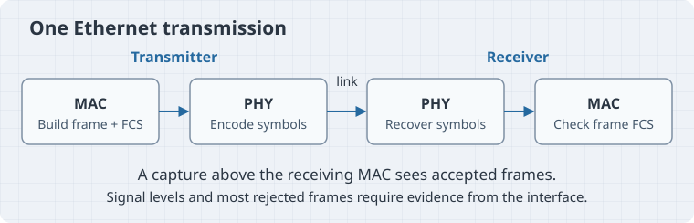

# From Signals to Ethernet Frames

A switch reports a 1 Gb/s link to a workstation. The workstation accepts a write to a TCP socket. Between those two observations, how does either machine know where a frame begins, whether it arrived intact, or which application should receive the bytes? Follow one direction of an Ethernet link, starting at the transmitting network interface controller (NIC).



## What a port connects

On a wiring diagram, a **node** can be a workstation, switch, router, or access point. Draw each attachment separately. A two-port router has one forwarding role and two link endpoints. A laptop can have both a wireless interface and an Ethernet adapter, each with its own link state. A passive patch panel joins cable segments and has no forwarding table.

Three different things can be called a *port*. A switch's physical port terminates a medium. A bridge port is an interface through which the bridge can forward frames, including a virtual interface with no connector. TCP destination port 443 is a number a host uses to deliver data to a socket. Replacing a cable can move a host to a different switch port while leaving its application's port number intact.

## How bits travel through a medium

On twisted pair, a transmitter drives differences in voltage. In fiber, a transmitter modulates light and a receiver detects the arriving optical signal. On Wi-Fi, antennas couple radio waves into and out of a shared space. In each case the receiver observes a physical quantity that can vary continuously. Bits are decisions the receiver makes about that observation under the rules of the link technology.

A **symbol** is one choice from a set of signal states during a signaling interval. In a simplified four-level system, the choices could represent 00, 01, 10, and 11. At a million symbols per second that one lane would represent two million coded bits per second, before synchronization, coding, or error-correction overhead. A link's bit rate alone therefore tells you neither its symbol rate nor the useful application data it can carry.

The physical-layer transceiver, or **PHY**, encodes data for the medium. At the far end its peer recovers timing, distinguishes symbols, and decodes them. Attenuation reduces signal strength. Noise and distortion can make neighboring symbol states harder to distinguish. Some PHYs correct a limited number of errors using redundancy. An increasing corrected-error counter can thus coexist with an Ethernet interface that still delivers intact frames.

## Where a frame becomes visible

On transmit, the host stack prepares data and headers, and the driver makes buffers available to the NIC. The MAC handles Ethernet framing, including the frame check sequence (FCS). On the wire, a preamble and start delimiter precede the destination address. Ethernet leaves an interpacket gap between transmissions. None of those intervals holds application bytes.

On receive, the PHY presents decoded data to the MAC. The receiver checks the FCS, a cyclic redundancy check over the frame from the destination address through payload and padding. A frame that fails the check is normally discarded before host capture software sees it. A passing FCS gives evidence about accidental corruption on this link. An Ethernet sender can calculate a valid FCS for any frame it originates.

The NIC and driver deliver accepted traffic through receive queues. The EtherType identifies the next protocol, possibly after a VLAN tag. For an IPv4 TCP packet, IP's protocol field then selects TCP, and the receiving stack matches the segment to a socket. A switch forwarding the same frame can make its ordinary bridging decision from the VLAN and destination MAC alone. A router that receives the frame as the next hop makes a new link-layer transmission on its outgoing interface.

## Account for a full-size transmission

Take a 1 Gb/s full-duplex Ethernet link carrying untagged frames, each with a 1,500-byte IP packet. The accounting below uses Ethernet bit times at the advertised MAC rate, so PHY coding overhead does not enter the calculation again.

| Portion | Byte times on the transmitting link |
|---|---:|
| Preamble and start delimiter | 8 |
| Destination and source MAC plus EtherType | 14 |
| IP packet | 1,500 |
| FCS | 4 |
| Minimum interpacket gap | 12 |
| Total per frame in a continuous sequence | 1,538 |

At this rate a transmission and its gap occupy about 12.3 microseconds. With 20-byte IPv4 and TCP headers, the frame carries 1,460 application bytes. The ideal one-direction TCP payload ceiling for this example is about 949 Mb/s, from 1,000 × 1,460 / 1,538. Options, short frames and retransmissions change that result. Distance adds propagation delay even on an idle link.

## Read the evidence from a Linux interface

List interfaces with `ip -br link`. Choose a physical Ethernet interface from the output and substitute its name for `enp1s0` below. The last two queries require ethtool and driver support.

```bash
ip -s link show dev enp1s0
ethtool enp1s0
ethtool -S enp1s0
```

Read both link partners over the same interval. A workstation transmitting while the switch's ingress FCS counter rises localizes the symptom to the direction toward the switch. Possible causes still include the transmitter, medium, and receiver. A clean FCS counter alongside rising receive-buffer misses directs attention to how fast the host drains its queues. Driver-specific counter names and aggregation rules vary. [Linux interface statistics](https://docs.kernel.org/networking/statistics.html)

A local capture may contain a TCP buffer larger than the MTU before NIC segmentation, or a combined buffer after receive aggregation. A capture on a virtual Ethernet pair also lacks the optical or electrical stage entirely. To investigate the signal, use PHY counters or transceiver diagnostics. To investigate socket delivery, inspect the host stack. [Linux segmentation offloads](https://docs.kernel.org/networking/segmentation-offloads.html)

For measurements at both ends of a cable, continue to [physical Ethernet diagnostics](04b-physical-ethernet-diagnostics.md). For the switch's next decision, follow a frame through [Ethernet MAC learning](../03-layer-2/01-ethernet-mac.md).
