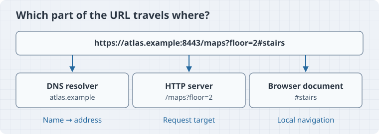

# From a URL to a Web Response

A browser opens `https://atlas.example:8443/maps?floor=2#stairs`. The network operator sees a connection to an IP address. The web server logs a request for a map. The browser scrolls to the stairs. Each participant used a different piece of the same URL.



## Read the URL before following the packets

| Component | Value | Who uses it here |
|---|---|---|
| Scheme | `https` | The client establishes a secure HTTP connection. |
| Host | `atlas.example` | The resolver looks up the host. The client checks the server certificate against this name. |
| Port | `8443` | The client uses this explicit destination port. HTTPS otherwise defaults to 443. |
| Path | `/maps` | The HTTP server selects a resource. A path can be implemented by code or backed by a file. |
| Query | `floor=2` | The application defines what the parameters mean. |
| Fragment | `stairs` | The browser interprets this within the retrieved representation. It is omitted from the HTTP request target. |

The web **origin** combines scheme, host, and effective port. Changing the floor or fragment keeps the same origin. Removing the explicit port in this example changes the origin even if both ports lead to the same server. A fully qualified DNS name such as `atlas.example.` ends at the DNS root. The trailing dot makes that explicit in DNS tools. The scheme, path, port, and fragment have no place in an A or AAAA query. [URI components](https://www.rfc-editor.org/rfc/rfc3986#section-3) · [HTTP origins](https://www.rfc-editor.org/rfc/rfc9110#section-4.3.1)

## Follow a cold connection

Assume an empty cache, a remote IPv4 destination, Ethernet, and HTTP/1.1 over TLS. The laptop already has an address, a connected prefix, a default route, and a resolver, supplied in this example by DHCP. Each has a separate job.

1. The stub resolver asks its configured resolver for the host's address. A recursive resolver can answer from cache or consult authoritative servers. The DNS answer might identify a nearby web edge shared by many sites.
2. The host looks up the chosen address in its route table. For the assumed remote address it resolves the gateway's MAC with ARP and sends the first frame there. The IP destination remains the selected server address.
3. TCP opens a connection from a client-selected source port to port 8443. TLS authenticates the service name against the certificate and establishes traffic keys. A shared edge can use the indicated server name to select a certificate.
4. Inside TLS, HTTP/1.1 carries the method, request target, and Host field. The response contains a status code, fields, and usually a body. A proxy may contact a separate origin server or answer from cache.
5. The browser interprets the returned media type. An HTML document can reference images, stylesheets, scripts, and other origins. Loading one page can produce many HTTP requests, and several requests can reuse one connection.

A simplified exchange after TLS decryption looks like this. The empty line ends each field section.

```http
GET /maps?floor=2 HTTP/1.1
Host: atlas.example:8443
Accept: text/html

```

```http
HTTP/1.1 200 OK
Content-Type: text/html
Content-Length: 24

<h1 id="stairs">Map</h1>
```

HTTP/2 represents these same semantics with binary frames and can multiplex streams on one TCP connection. HTTP/3 carries streams over QUIC, which runs over UDP and integrates TLS. In each case the receiver must still identify the target resource and interpret the response. A reachable TCP port is evidence about only one of these possible transports. [HTTP semantics](https://www.rfc-editor.org/rfc/rfc9110)

## Observe a request entirely on loopback

With Python 3 and curl installed, run this in a terminal. The temporary directory holds a single sample page. Press Ctrl-C after the exercise, then run the cleanup line.

```bash
web_dir=$(mktemp -d)
printf '%s' '<h1 id="stairs">Map</h1>' > "$web_dir/maps.html"
python3 -m http.server 18080 --bind 127.0.0.1 --directory "$web_dir"
rm -r -- "$web_dir"
```

In a second terminal, send two requests to the sample server.

```bash
curl --noproxy '*' -sv 'http://127.0.0.1:18080/maps.html?floor=2#stairs'
curl --noproxy '*' -sv 'http://127.0.0.1:18080/missing.html'
```

In curl's first outgoing request line, find the path and query. Compare it with the server log. Both omit the fragment. The simple file server serves the same file for different floor values because it has no application logic for that query. The second request returns 404 over a working connection. This exchange isolates HTTP by using cleartext, a literal loopback address, and a local listener.

## Who serves whom?

For the map, the browser acts as a client and the map service answers as a server. These are roles in an exchange. If the map service queries a geocoding API, it becomes a client on that second connection. Logs on the two servers can show different client addresses for one user action.

In a peer-to-peer map-sharing application, two laptops may each hold some offline map tiles. A directory service can introduce the peers, after which either laptop can request a tile from the other. The directory may know who is present while never carrying tile bytes. A peer behind NAT may lack a directly reachable address. A relay can then carry the data while the two endpoints retain their application roles. Discovery, delivery, and verification of the tile are three separate design decisions. [Peer connectivity with ICE](https://www.rfc-editor.org/rfc/rfc8445) · [TURN relays](../07-a-overlays-tunnels/08b-turn-relays-and-peer-policy.md)

For a working example, [assemble an offline map from two peers](16-peer-discovery-and-piece-verification.md) and check which copies match the publisher’s release.

## Work backward from a symptom

| Observation | What it establishes | Next question |
|---|---|---|
| Resolver returns an address | An answer was available for that name and record type | Which address did the client try, and does it have a route? |
| TLS reports a name mismatch | A peer presented a certificate | Did the client use the intended hostname, and does the certificate cover it? |
| Server returns 404 | An HTTP component answered for this request | Do its authority and path match the intended site and resource? |
| Map loads but scrolling fails | The representation reached the client | Does the returned document contain an element with the requested fragment identifier? |

Follow [host forwarding](11-host-forwarding-and-routing-intro.md) for the gateway decision and [CDN edge delivery](../07-d-dataplanes-and-traffic-delivery/03-cdn-architecture-and-edge-delivery.md) for the path behind a public server address.
