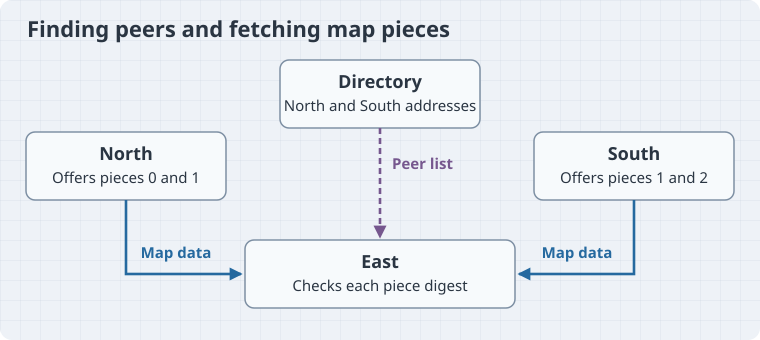

# Peer Discovery and Piece Verification

Three field stations need a new offline map. North has the first two pieces of the release. South has the last two. East can reach both stations, but the publisher has gone offline. Can East still assemble the map? Yes, if at least one reachable peer has a valid copy of each piece and East already has trusted metadata for that release. A list of three online stations alone cannot answer the question.

## Separate the directory from the transfer

With a conventional download, a client asks an origin server or CDN for a named resource. With peer-assisted distribution, a station that downloads a piece can also supply it to another station. Client and server roles can change from one connection to the next. This shifts some upload work from the publisher to participants and makes delivery depend on which pieces those participants retain.



The map system has four distinct jobs.

| Job | What East obtains | What remains to establish |
|---|---|---|
| Select a release | An authenticated manifest with piece order, sizes, and expected digests | Which stations currently have those pieces? |
| Discover peers | Candidate network endpoints from a directory | Are they reachable, and what do they have now? |
| Exchange availability and data | A peer's advertised inventory, then bytes for requested pieces | Do the received bytes belong at those positions in this release? |
| Verify and assemble | A checked piece in its numbered position | Does every required position now have a verified piece? |

A central directory can go offline while an established peer transfer continues. A new station with no known peers may then be unable to start. A distributed hash table (DHT) spreads lookup responsibilities across participants. It still needs a way to contact an initial node. In BitTorrent's DHT, a lookup by torrent identifier can return peer contact information. The file content travels through separate peer connections. [BitTorrent DHT protocol](https://www.bittorrent.org/beps/bep_0005.html) · [Peer-to-peer architecture](https://www.rfc-editor.org/rfc/rfc5694)

## Count copies before choosing a peer

| Verified holdings at the start | Piece 0 | Piece 1 | Piece 2 |
|---|---:|---:|---:|
| North | 1 | 1 | 0 |
| South | 0 | 1 | 1 |
| East | 0 | 0 | 0 |
| Available copies | 1 | 2 | 1 |

If South leaves before East copies piece 2, all remaining peers together lack part of the map. A piece-selection policy that favors scarce pieces gives East a reason to request piece 2 from South while it can. East could simultaneously request piece 0 from North. The best choice depends on link rates, peer availability, and which pieces have already been verified. Counting peers ignores that distribution.

This also sets a limit on throughput. Suppose North alone has a 12 MB piece and uploads at 2 Mb/s. The first full copy of that piece needs at least 48 seconds of North's upload time, using decimal units and ignoring overhead. Adding receivers cannot make North emit those first 96 megabits faster. Once East has verified a copy, it can supply future receivers while North works on another piece.

## Why a successful transfer can yield an unusable piece

TCP delivers an ordered byte stream between connected endpoints. If North reads yesterday's map from disk and sends it successfully, TCP can deliver yesterday's bytes perfectly. East needs a separate test against the expected content for today's release.

In this example the publisher authenticates a manifest that pairs each index with its SHA-256 digest. East checks each received piece against the digest at that index. A stale piece fails that check and can be fetched again from a different peer. The trust decision happened earlier, when East obtained the manifest. Someone who can replace both the manifest and the map can produce matching hashes for their own release. Authenticating the publisher and verifying the received bytes solve distinct problems. [Keys and identities](../06-policy-qos-hardening/12-keys-identities-and-encryption-boundaries.md)

The original BitTorrent protocol offers a useful comparison. Peers can announce which pieces they hold, request blocks within a piece, and check the assembled piece against metadata. Its original metainfo format specifies SHA-1 piece hashes. The exercise below uses HTTP and a small SHA-256 manifest so you can observe the same discovery, transfer, and verification decisions with standard Python. [BitTorrent protocol and metainfo](https://www.bittorrent.org/beps/bep_0003.html)

## Lab — recover a stale piece from another peer

Run the Python 3 program on one machine. North and South each serve a temporary directory on an operating-system-assigned loopback port. East starts with a fixed peer list, representing the result of discovery. Here North **advertises** pieces 0 and 1, but its copy of piece 1 has gone stale since the availability table was drawn. Predict which requests return HTTP 200 and which bytes East accepts.

```python
from contextlib import closing, contextmanager
from functools import partial
from hashlib import sha256
from http.client import HTTPConnection
from http.server import HTTPServer, SimpleHTTPRequestHandler
from pathlib import Path
from tempfile import TemporaryDirectory
from threading import Thread


@contextmanager
def peer(folder, pieces):
    folder.mkdir()
    for index, data in pieces.items():
        (folder / str(index)).write_bytes(data)
    handler = partial(SimpleHTTPRequestHandler, directory=str(folder))
    with HTTPServer(("127.0.0.1", 0), handler) as server:
        thread = Thread(target=server.serve_forever)
        thread.start()
        try:
            yield server.server_address
        finally:
            server.shutdown()
            thread.join()


release = [b"north\n", b"south\n", b"west\n"]
# Publisher's reference data, fixed before either peer supplies bytes.
manifest = [sha256(piece).digest() for piece in release]
north = {0: release[0], 1: b"SOUTH\n"}
south = {1: release[1], 2: release[2]}
candidates = [["North"], ["North", "South"], ["South"]]

with TemporaryDirectory() as tmp:
    root = Path(tmp)
    with peer(root / "north", north) as n, peer(root / "south", south) as s:
        addresses = {"North": n, "South": s}
        verified = []
        for index, names in enumerate(candidates):
            for name in names:
                with closing(HTTPConnection(*addresses[name], timeout=2)) as conn:
                    conn.request("GET", f"/{index}")
                    response = conn.getresponse()
                    data = response.read()
                if response.status == 200 and sha256(data).digest() == manifest[index]:
                    verified.append(data)
                    print(f"piece {index} from {name}: accepted")
                    break
                print(f"piece {index} from {name}: rejected (HTTP {response.status})")
            else:
                raise RuntimeError(f"no verified copy of piece {index}")
        assert b"".join(verified) == b"".join(release)
        print("Map complete")
```

Alongside the HTTP servers' access logs, East should report the following:

```text
piece 0 from North: accepted
piece 1 from North: rejected (HTTP 200)
piece 1 from South: accepted
piece 2 from South: accepted
Map complete
```

Remove piece 2 from South's dictionary but keep South in the candidate list. Its HTTP server is still reachable, and its copy of piece 1 still verifies. The request for piece 2 now returns 404, and East reports that it cannot complete the map. This reproduces a stale inventory entry independently of the previous stale-content failure.

On a real network, a listed peer may also be unreachable behind a NAT. A timeout occurs before East can evaluate any piece bytes. Distinguish that outcome from both HTTP 404 and digest failure when recording a distribution problem. For the transport path between peers, continue to [NAT traversal](../07-a-overlays-tunnels/08-nat-traversal-stun-hole-punching.md). For a design in which managed edge servers supply the copies, see [CDN edge delivery](../07-d-dataplanes-and-traffic-delivery/03-cdn-architecture-and-edge-delivery.md).
