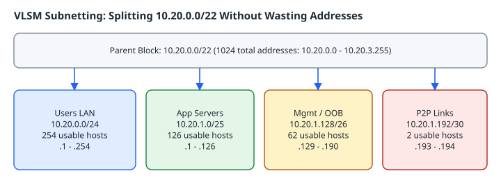

# CIDR, Subnetting, and VLSM Step-by-Step

Every routing table lookup, firewall rule, and VPC CIDR block relies on **longest-prefix match**. Understanding how IPv4 prefixes divide in binary removes all guesswork from subnet planning, supernetting, and troubleshooting overlapping routes.



## The Binary Mental Model

An IPv4 address is 32 bits written as four 8-bit octets. A CIDR prefix `/N` means the first `N` bits identify the **network** and the remaining `32 - N` bits identify **hosts** inside that network.

- **Total addresses in `/N`:** `2^(32 - N)`
- **Usable host addresses (standard LAN):** `2^(32 - N) - 2` (subtracting the all-zeros **network address** and all-ones **broadcast address**)
- **Point-to-point router links (`/31` per RFC 3021):** `2` usable addresses with no broadcast address wasted.

| Prefix | Dotted Netmask | Total IPs | Usable Hosts | Common Use |
|--------|----------------|-----------|--------------|------------|
| `/24` | `255.255.255.0` | `256` | `254` | Standard office/app VLAN |
| `/25` | `255.255.255.128` | `128` | `126` | Medium server subnet |
| `/26` | `255.255.255.192` | `64` | `62` | Management / OOB |
| `/28` | `255.255.255.240` | `16` | `14` | Small DMZ / cluster |
| `/30` | `255.255.255.252` | `4` | `2` | Legacy P2P router link |
| `/31` | `255.255.255.254` | `2` | `2` | Modern P2P router link (RFC 3021) |
| `/32` | `255.255.255.255` | `1` | `1` | Loopback / host route |

## Worked Example: Variable-Length Subnet Masking (VLSM)

Suppose you are assigned `10.20.0.0/22` (`10.20.0.0`–`10.20.3.255`, `1,024` addresses) and need:
1. **Users LAN:** 200 hosts → smallest power of 2 ≥ 202 is `256` (`/24`) → `10.20.0.0/24` (usable `.1`–`.254`, broadcast `.255`).
2. **App Servers:** 100 hosts → smallest power of 2 ≥ 102 is `128` (`/25`) → `10.20.1.0/25` (usable `.1`–`.126`, broadcast `.127`).
3. **Management / OOB:** 50 hosts → smallest power of 2 ≥ 52 is `64` (`/26`) → `10.20.1.128/26` (usable `.129`–`.190`, broadcast `.191`).
4. **Point-to-Point Link:** 2 hosts → `/30` → `10.20.1.192/30` (usable `.193`–`.194`, broadcast `.195`).

> [!IMPORTANT]
> Always allocate **largest subnets first** and align each subnet on a boundary divisible by its block size. Putting a `/24` after a `/26` without alignment creates overlapping or fragmented address space.

## Reserved Address Ranges You Must Recognize on Sight

| Range | Purpose |
|-------|---------|
| `10.0.0.0/8`, `172.16.0.0/12`, `192.168.0.0/16` | RFC 1918 private networks |
| `100.64.0.0/10` | RFC 6598 Carrier-Grade NAT (CGNAT) & Tailscale mesh |
| `127.0.0.0/8` | Host loopback |
| `169.254.0.0/16` | Link-local / Cloud instance metadata (`169.254.169.254`) |
| `192.0.2.0/24`, `198.51.100.0/24`, `203.0.113.0/24` | RFC 5737 documentation & lab examples |

## Verify with `ipcalc` / Python

```bash
python3 -c '
import ipaddress
net = ipaddress.ip_network("10.20.1.128/26")
print("network:", net.network_address, "broadcast:", net.broadcast_address, "usable:", net.num_addresses - 2)
'
```
