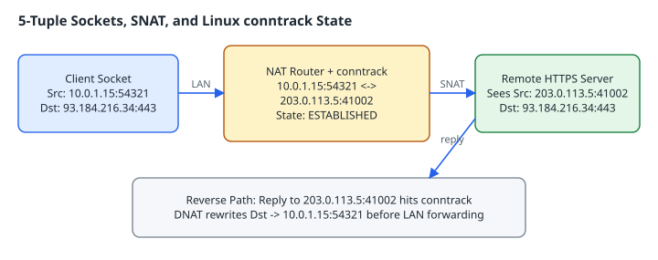

# Sockets, Ports, NAT, and Linux `conntrack`

IP addresses deliver packets to a **host**; TCP and UDP **ports** deliver segments to a specific **process**. On the open Internet, **NAT (Network Address Translation)** and **stateful connection tracking (`conntrack`)** rewrite IP/port tuples in flight so thousands of private hosts share one public IP.



## The 5-Tuple That Uniquely Identifies Every Flow

The kernel demultiplexes incoming packets using a 5-tuple:

```text
(Protocol, SrcIP, SrcPort, DstIP, DstPort)
   e.g. (TCP, 10.0.1.15, 54321, 93.184.216.34, 443)
```

Because `SrcPort` is chosen dynamically from the host's **ephemeral port range** (`net.ipv4.ip_local_port_range`, typically `32768–60999` on Linux), a single client IP can open tens of thousands of simultaneous connections to the same `93.184.216.34:443`.

## Port Ranges & Common Services

| Range | Name | Examples |
|-------|------|----------|
| `0–1023` | Well-Known Ports | `22` SSH, `53` DNS, `80` HTTP, `443` HTTPS, `179` BGP |
| `1024–49151` | Registered Ports | `3306` MySQL, `5432` PostgreSQL, `6379` Redis, `4789` VXLAN |
| `49152–65535` | Dynamic / Ephemeral | Client-side source ports |

## How SNAT, DNAT, and `conntrack` Work Together

1. **SNAT / Masquerade (Outbound):** When `10.0.1.15:54321` sends a `SYN` toward `93.184.216.34:443`, the NAT router rewrites `SrcIP:SrcPort` to `203.0.113.5:41002` and records the mapping in its `conntrack` table (`NEW -> ESTABLISHED`).
2. **Reverse DNAT (Inbound Reply):** When the server replies to `203.0.113.5:41002`, the router matches the `conntrack` entry and rewrites `DstIP:DstPort` back to `10.0.1.15:54321`.
3. **Port Forwarding (Inbound DNAT):** Exposing an internal web server (`10.0.1.50:8080`) on `203.0.113.5:443` creates a pre-routing DNAT rule before the routing decision.

## Inspecting Live Sockets and `conntrack` on Linux

```bash
# List listening TCP/UDP sockets and owning processes
ss -tulnp

# Inspect active NAT/conntrack entries and table saturation
sudo conntrack -L | head -n 20
sysctl net.netfilter.nf_conntrack_count net.netfilter.nf_conntrack_max
```

> [!WARNING]
> On busy NAT gateways or Kubernetes nodes, exhausting `nf_conntrack_max` causes the kernel to silently drop new `SYN` packets (`nf_conntrack: table full, dropping packet`). Always monitor `nf_conntrack_count / nf_conntrack_max`.
