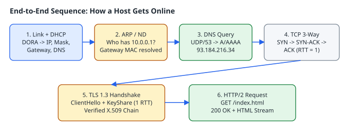

# End-to-End Walkthrough: How a Host Gets Online

Putting every foundational protocol together: what actually happens on the wire between plugging in an Ethernet cable (or joining Wi-Fi) and rendering `https://example.com`?



## Phase 1: Physical Link & DHCP Lease (`DORA`)

1. **Link Up:** The NIC negotiates speed/duplex (e.g., 1 Gbps full-duplex) or associates with a Wi-Fi AP (802.11 + WPA3).
2. **DHCP Discover (`255.255.255.255`, UDP `68 -> 67`):** Having no IP yet, the host broadcasts a DHCP Discover frame (`FF:FF:FF:FF:FF:FF`).
3. **Offer, Request, Ack:** The DHCP server leases an IP (`10.0.0.42/24`), default gateway (`10.0.0.1`), and recursive DNS resolver (`10.0.0.53`).

## Phase 2: Local Gateway Resolution (ARP / Neighbor Discovery)

The host checks `10.0.0.42/24` vs. its target and sees `10.0.0.53` (or an Internet IP) requires the default gateway `10.0.0.1`. It broadcasts an **ARP Request** (`Who has 10.0.0.1?`) and caches the gateway's MAC address in its neighbor table (`ip neigh`).

## Phase 3: DNS Resolution (`UDP/53`)

Before opening a TCP socket, the stub resolver sends an `A` and `AAAA` query for `example.com` to `10.0.0.53:53`. If uncached, the recursive resolver walks Root (`.`) → `.com` TLD → authoritative nameserver and returns `93.184.216.34`.

## Phase 4: TCP 3-Way Handshake + TLS 1.3 + HTTP/2

1. **TCP (`1 RTT`):** Client sends `SYN` (with MSS & Window Scale options) → Server replies `SYN-ACK` → Client sends `ACK`. Note that **at every router hop**, the outer Ethernet src/dst MAC addresses are rewritten while the inner IP `Src`/`Dst` stay unchanged.
2. **TLS 1.3 (`1 RTT`):** Client sends `ClientHello` + `key_share` + SNI (`example.com`); Server returns `ServerHello`, encrypted X.509 certificate chain, and `Finished`.
3. **HTTP/2 `GET /`:** Browser sends `GET / HTTP/2` over the encrypted TLS stream and receives `200 OK` + HTML bytes.

## Observe Every Phase Live

```bash
# Watch DHCP, ARP, DNS, and TCP SYN in one capture
sudo tcpdump -i eth0 -n 'port 67 or port 68 or arp or port 53 or (tcp[tcpflags] & tcp-syn != 0)'
```
