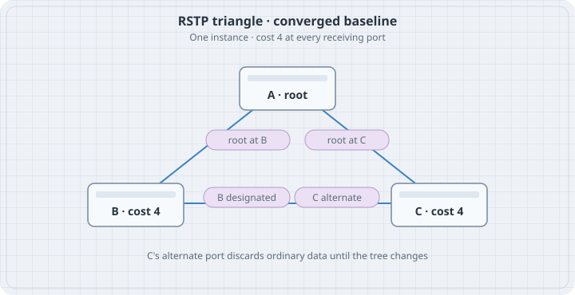

# Spanning Tree: Elections, Roles and Failure Analysis

Spanning Tree Protocol (STP) does not simply disable the slowest link. For each spanning-tree instance, bridges exchange Bridge Protocol Data Units (BPDUs), elect a single Root Bridge, and compute a loop-free active topology by assigning deterministic roles and forwarding states to every port. Always work through the election tie-breakers on paper before changing a production bridge priority or port cost.

## Election tie-breakers in exact order

Every RSTP (IEEE 802.1w) and MSTP (IEEE 802.1s) election compares a four-tuple **priority vector** from most significant to least significant. The **lowest numerical value** wins at each step.

### 1. Root Bridge ID (BID)

The 8-byte Bridge ID consists of:

- **Bridge Priority (4 bits, increments of 4096):** Configurable from `0` to `61440` (default `32768`).
- **Extended System ID (12 bits):** Encodes the VLAN ID (in Rapid-PVST+) or MST Instance ID (in MSTP), so each instance has a unique BID without requiring a separate MAC address per VLAN. For example, priority `4096` for VLAN 10 produces `4096 + 10 = 4106`.
- **Base Bridge MAC Address (48 bits):** Breaks ties when priority and system ID are equal.

> [!IMPORTANT]
> Never leave Root Bridge placement to default priorities and random MAC addresses. Explicitly configure a primary root (e.g., priority `4096`) and a deterministic secondary root (e.g., priority `8192`) at the distribution/core layer so an older access switch with a lower MAC address cannot hijack the root.

### 2. Root Path Cost (RPC)

Each non-root bridge selects its **Root Port** (the single port with the best path to the Root Bridge) by adding its local receiving port cost to the Root Path Cost advertised in the incoming BPDU. Modern RSTP/MSTP uses **IEEE 802.1t 32-bit long path costs** (whereas legacy 802.1D used 16-bit short costs that could not distinguish 10G from 100G):

| Link Speed | 802.1D Short Cost (Legacy) | 802.1t Long Cost (Modern Default) |
|---|---:|---:|
| 10 Mbps | 100 | 2,000,000 |
| 100 Mbps | 19 | 200,000 |
| 1 Gbps | 4 | 20,000 |
| 10 Gbps | 2 | 2,000 |
| 25 Gbps | 2 | 800 |
| 40 Gbps | 2 | 500 |
| 100 Gbps | 2 | 200 |

### 3. Sender Bridge ID and 4. Port ID

When a bridge receives two BPDUs with identical Root ID and equal total Root Path Cost:

- **Step 3 — Lowest Sender BID:** Prefers the path advertised by the upstream switch with the lower Bridge ID.
- **Step 4 — Lowest Sender Port ID:** If both links connect to the *same* upstream switch, compares the 16-bit Port ID (`4-bit port priority [default 128, increments of 16] + 12-bit port number`) advertised by the upstream switch.
- **Step 5 — Lowest Local Receiver Port ID:** Used only as a final local tie-breaker (for example, through a hub or repeated segment).

On every shared or point-to-point segment, the bridge advertising the best vector (`Root ID`, `RPC`, `Sender BID`, `Sender Port ID`) becomes the **Designated Port** for that segment.

### Port roles vs port states

A port **role** describes its function in the tree; its **state** controls frame forwarding and MAC learning:

| RSTP Port Role | Converged State | Function |
|---|---|---|
| **Root** | Forwarding | Best path from a non-root bridge toward the Root Bridge (one per bridge) |
| **Designated** | Forwarding | Best path onto a segment away from the Root Bridge (one per segment) |
| **Alternate** | Discarding | Backup path to the Root Bridge via a *different* upstream bridge |
| **Backup** | Discarding | Redundant connection to a segment for which the *same* bridge is already Designated |

RSTP collapses classic 802.1D's Disabled, Blocking, and Listening states into **Discarding**, leaving three states: **Discarding**, **Learning**, and **Forwarding**.



## Worked triangle election

Using the [three-switch workbook topology](../09-lab-workbook/05-spanning-tree.md) as a physical pattern, assume one common RSTP instance, three 1 Gbps point-to-point links with equal short path cost **4** on every port, and Bridge IDs ordered `A < B < C`:

| Bridge | Priority | MAC in Bridge ID | Ports |
|---|---:|---|---|
| A | 4096 | `02:00:00:00:00:01` | `a-b`, `a-c` |
| B | 8192 | `02:00:00:00:00:02` | `b-a`, `b-c` |
| C | 12288 | `02:00:00:00:00:03` | `c-a`, `c-b` |

1. **Root election:** Switch A has the lowest BID (`4096.0200.0000.0001`), so A is Root with `RPC = 0`. Both `a-b` and `a-c` are **Designated / Forwarding**.
2. **Root Ports:** On B, `b-a` has total `RPC = 4` vs `8` via C, so `b-a` is B's **Root Port**. On C, `c-a` has total `RPC = 4` vs `8` via B, so `c-a` is C's **Root Port**.
3. **B–C segment:** Both B and C advertise `RPC = 4`. Tie-breaker #3 compares Sender BID: B (`8192`) < C (`12288`). Therefore `b-c` is **Designated / Forwarding** and `c-b` is **Alternate / Discarding**.

| Link | End 1 | End 2 |
|---|---|---|
| A–B | A: Designated / Forwarding | B: Root / Forwarding |
| A–C | A: Designated / Forwarding | C: Root / Forwarding |
| B–C | B: Designated / Forwarding | C: Alternate / Discarding |

If link **A–C fails**, C immediately loses its Root Port and promotes its Alternate port `c-b` to Root Port (`RPC = 8`) without waiting for Max Age (20 seconds). If instead all links remain up and you raise C's local cost on `c-a` from `4` to `12`, C's path via B (`RPC = 8`) beats `c-a` (`RPC = 12`), making `c-b` the Root Port and `c-a` Alternate/Discarding.

## RSTP Proposal/Agreement sync handshake

Classic 802.1D relied on two 15-second Forward Delay timers (30 seconds total in Listening + Learning) before forwarding. RSTP eliminates timer-based convergence on **point-to-point (full-duplex)** links using a rapid **Proposal/Agreement** handshake:

1. When a new link comes up between Root A and Switch B, A's Designated port `a-b` starts in **Discarding** and sends a BPDU with the **Proposal** bit set.
2. Switch B receives the superior BPDU on `b-a` and recognizes it as its new Root Port.
3. Before replying, B executes the **Sync** operation: B immediately moves all of its *other* non-edge Designated ports into **Discarding** so no transient loop can form downstream.
4. Once synced, B transitions `b-a` to **Forwarding** and sends an **Agreement** BPDU back to A.
5. Switch A receives the Agreement and transitions `a-b` to **Forwarding** immediately—typically in milliseconds.
6. Switch B then repeats the Proposal/Agreement wave downstream on its synced ports until the wave reaches the edge of the topology.

> [!NOTE]
> Proposal/Agreement requires a **point-to-point** (full-duplex) link and an RSTP-speaking peer. If a link is half-duplex (shared) or connected to a legacy 802.1D bridge, RSTP falls back to classic 30-second timer-based transitions on that port.

## Topology Change (TC) MAC-flush blast radius and Edge ports

In RSTP, a **Topology Change (TC)** is triggered *only* when a **non-edge port transitions to the Forwarding state** (link loss alone does not trigger a TC). When a TC occurs:

1. The detecting switch starts a `TC While` timer (`2 × Hello Time`, typically 4 seconds) and sets the **TC flag** in BPDUs sent out all non-edge Root and Designated ports.
2. Every switch receiving a TC BPDU **immediately flushes** all MAC addresses learned on every non-edge port *except* the port on which the TC was received, and propagates the TC BPDU onward across the entire Layer 2 domain.
3. Until hosts transmit again, all unicast traffic destined for flushed MACs becomes **unknown unicast flooding** across the VLAN.

If a host-facing access port is *not* configured as an **Edge port (PortFast)**, every laptop sleep/wake cycle, server reboot, or VM vNIC bounce transitions a non-edge port to Forwarding—triggering a network-wide TC storm and periodic MAC-table flushes across every switch in the domain. Marking host ports as **Edge** prevents them from generating TCs, lets them enter Forwarding immediately, and excludes them from the RSTP Sync block.

## Protection controls and MSTP boundaries

- **BPDU Guard:** Placed on Edge ports; if any BPDU arrives (e.g., someone plugs in a rogue switch or loops a wall jack), the port immediately enters `errdisabled` instead of altering the tree.
- **Root Guard:** Placed on distribution ports facing downstream access/customer switches; if a superior BPDU arrives, the port enters `root-inconsistent` (discarding) to protect root placement.
- **Loop Guard:** Placed on Root and Alternate ports; if BPDUs suddenly stop arriving (unidirectional fiber failure or peer control-plane hang), the port enters `loop-inconsistent` (discarding) instead of ageing out and becoming Designated/Forwarding.
- **MSTP Regions:** Multiple Spanning Tree (802.1s) maps VLANs into a small number of instances (e.g., MSTI 1 and MSTI 2). Switches belong to the same region only if their **Region Name**, **Revision Number**, and **VLAN-to-Instance mapping hash** match identically; mismatches force switches into separate regions communicating only over the Common Spanning Tree (CST / IST 0).

## Verification commands and fault-injection drill

The commands and outputs below are **illustrative example outputs** for Arista EOS (cEOS) and Linux `bridge` hosts.

### Arista EOS / cEOS verification

```bash
show spanning-tree
show spanning-tree detail | include Topology change|Number of topology
show spanning-tree blockedports
```

Illustrative example output from `show spanning-tree` on Switch C:

```text
MST0
  Spanning tree enabled protocol mstp
  Root ID    Priority    4096
             Address     0200.0000.0001
             Cost        4
             Port        1 (Ethernet1)
  Bridge ID  Priority    12288
             Address     0200.0000.0003

Interface        Role       State      Cost      Prio.Nbr Type
---------------- ---------- ---------- --------- -------- --------------------
Et1              root       forwarding 4         128.1    P2p
Et2              alternate  discarding 4         128.2    P2p
Et3              designated forwarding 4         128.3    P2p Edge
```

### Linux `bridge` verification

```bash
# Inspect bridge STP state, root ID, and per-port roles/states
ip -d link show br0
bridge -d link show dev eth1
```

Illustrative example output from `bridge -d link show`:

```text
2: eth1: <BROADCAST,MULTICAST,UP,LOWER_UP> mtu 1500 master br0 state forwarding priority 32 cost 4
    hairpin off guard off root_block off fastleave off learning on flood on
3: eth2: <BROADCAST,MULTICAST,UP,LOWER_UP> mtu 1500 master br0 state blocking priority 32 cost 4
    hairpin off guard off root_block off fastleave off learning on flood on
```

### Fault-injection scenario: TC storm and Root hijack

In the three-switch lab topology, run a continuous 10 pps ping between hosts on Switch B and Switch C while executing two controlled drills:

1. **Non-Edge port flap (TC blast radius):** Remove `edge` / `portfast` from a spare port on Switch C and bounce it (`shutdown` / `no shutdown`). Watch `Number of topology changes` increment on Switch A and Switch B and observe MAC table entries flush across the ring. Re-enable `edge` and repeat—confirm zero TCs are generated.
2. **Path-cost steering & failover:** Shut down `Et1` (link A–C) on Switch C. Timestamp the exact ping loss interval as `Et2` promotes from `alternate/discarding` to `root/forwarding`. Restore `Et1`, then raise `Et1` cost to `12` and verify `Et2` becomes the stable Root Port while `Et1` moves to `alternate/discarding`.

## Review

1. Why does Switch B win the Designated Port role on segment B–C even though Switch A has a better priority than both B and C?
2. During an RSTP Proposal/Agreement handshake, why must the downstream bridge move its other non-edge Designated ports to Discarding before sending an Agreement?
3. Why does a flapping host port without Edge/PortFast degrade performance for unrelated hosts on other switches?
4. What symptom distinguishes a unidirectional link failure (mitigated by Loop Guard) from a downstream rogue switch sending superior BPDUs (mitigated by Root Guard)?

Further reading: [IEEE 802.1w RSTP](https://www.ieee802.org/1/pages/802.1w.html), [IEEE 802.1s MSTP](https://www.ieee802.org/1/pages/802.1s.html), and [Linux bridge documentation](https://docs.kernel.org/networking/bridge.html).
