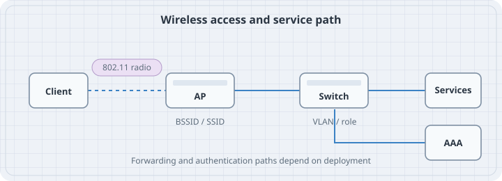

# Wireless LANs: Radio, Access, and Troubleshooting

A wireless client shares half-duplex radio airtime with every other station on the same channel; an access point (AP) bridges that radio cell to the wired distribution network. Because an Ethernet uplink can be completely healthy while clients experience high retries, contention, roaming drops, or authentication failures over the air, always separate troubleshooting into four stages: **radio/PHY**, **802.11 association**, **security/authorization**, and **L2/L3 forwarding**.



## From radio cell to network

A **Basic Service Set (BSS)** is a single radio cell identified by its **BSSID** (typically a unique radio MAC address). An **SSID** is the human-readable network name advertised in beacons and probe responses; multiple APs advertising the same SSID form an **Extended Service Set (ESS)**. Each additional SSID on a radio spawns its own BSSID and periodic management beacons (typically every 102.4 ms at low basic data rates), consuming measurable airtime—production designs keep SSIDs per radio to 3–4 or fewer.

A client joins a WLAN through a strict sequence:

1. **Discovery:** Passive listening for Beacons or active Probe Request / Probe Response exchanges.
2. **802.11 Authentication & Association:** Open System (or SAE in WPA3) authentication followed by Association Request/Response negotiating capabilities (rates, channel width, PMF).
3. **Security / 802.1X Handshake:** 4-way WPA2/WPA3 key derivation (and EAP exchange for Enterprise) before the AP opens the controlled port.
4. **IP Provisioning:** DHCPv4/SLAAC/DHCPv6, gateway ARP/ND, and DNS.

## 802.11 PHY and MAC mechanics

Unlike full-duplex switched Ethernet, Wi-Fi radios cannot reliably transmit and receive simultaneously on the same channel to detect collisions. Instead, 802.11 uses **CSMA/CA (Carrier Sense Multiple Access with Collision Avoidance)**:

- **Physical Carrier Sense (CCA):** The radio listens for valid 802.11 preambles (Signal Detect, around `-82 dBm`) and raw RF energy (Energy Detect, around `-62 dBm`) before transmitting.
- **Virtual Carrier Sense (NAV):** Every 802.11 frame header carries a **Duration/ID** field telling all listening stations how long the medium will remain busy (including the upcoming acknowledgment). Stations load this value into their **Network Allocation Vector (NAV)** countdown timer and stay silent until NAV reaches zero.
- **Interframe Spacing (SIFS vs DIFS):**
  - **SIFS (Short Interframe Space, e.g., 10–16 µs):** Shortest gap, reserved for high-priority immediate responses such as `ACK`, `Block ACK`, and `CTS`, guaranteeing no other station steals the channel before an acknowledgment completes.
  - **DIFS (Distributed Coordination Function Interframe Space):** Longer gap (`SIFS + 2 × Slot Time`). A station wanting to send a new data frame must wait until the channel is idle for a full DIFS, then count down a random **backoff** slot timer within its Contention Window (CW). If a frame is unacknowledged, CW doubles (binary exponential backoff) and the frame is retried.

### Hidden node problem and RTS/CTS

Two clients on opposite edges of an AP's coverage cell can both hear the AP clearly while being unable to hear each other. Both sense an idle channel and transmit simultaneously, causing collisions at the AP—the **hidden-node problem**. Enabling **RTS/CTS (Request to Send / Clear to Send)** lets the sender transmit a short RTS; the AP replies with a CTS whose Duration field updates the NAV on *all* clients in the cell (including hidden nodes), reserving airtime for the data frame. RTS/CTS reduces large-frame collisions at the cost of extra management overhead.

> [!NOTE]
> Signal-to-Noise Ratio (SNR) compares received signal strength (RSSI) against the noise floor in dBm: `-60 dBm - (-90 dBm) = 30 dB`. High RSSI alone does not guarantee high throughput—adjacent-channel interference, co-channel contention, and a single slow client consuming long airtime at low MCS rates can degrade the entire cell.

## Channel planning across 2.4, 5, and 6 GHz

| Band | Spectrum & Non-Overlapping 20 MHz Channels | Key Trade-offs & Constraints |
|---|---|---|
| **2.4 GHz** | Only **3** non-overlapping channels (`1`, `6`, `11` in most regions) | Longest wall penetration, severe co-channel contention, Bluetooth/microwave interference; never use 40 MHz bonding in enterprise deployments |
| **5 GHz** | Up to **25** non-overlapping channels (region-dependent), including **DFS** channels (`52–144`) | Much higher capacity; DFS channels require radar detection (CAC) and immediate channel evacuation if weather/airport radar is detected |
| **6 GHz (Wi-Fi 6E / 7)** | Up to **59** non-overlapping 20 MHz channels (e.g., US `5925–7125 MHz`) | Cleanest spectrum, no legacy 802.11a/b/g/n clients, WPA3 and PMF mandatory; shorter range requires denser AP placement |

### Channel width bonding trade-offs

Bonding channels from **20 MHz → 40 MHz → 80 MHz → 160 MHz** doubles peak PHY rate per step, but introduces two penalties:

1. **Halving the channel reuse pool:** Bonding reduces the number of independent channels available to neighboring APs, increasing co-channel interference (CCI) in dense offices or lecture halls.
2. **+3 dB noise floor penalty per doubling:** Doubling bandwidth admits twice the thermal noise, reducing SNR by 3 dB and shrinking the usable range of high-order QAM rates.

In high-density enterprise 5 GHz environments, **20 MHz** (or **40 MHz** in moderate density) consistently outperforms 80 MHz under load; save 80/160 MHz for 6 GHz or isolated low-density cells. Also avoid cranking AP transmit power to maximum: an AP broadcasting at 23 dBm cannot boost a smartphone's 12–14 dBm transmitter, creating asymmetric coverage where the client hears beacons but its frames never reach the AP.

## Security: WPA3-Personal (SAE) vs WPA3-Enterprise (802.1X)

| Mode | Authentication Mechanism | Key Security Properties |
|---|---|---|
| **WPA3-Personal (SAE)** | Simultaneous Authentication of Equals (Dragonfly handshake) | Replaces WPA2-PSK's vulnerable 4-way offline dictionary attack with zero-knowledge password proof; provides **Forward Secrecy** (compromised passphrase cannot decrypt past captures) and mandates **PMF (802.11w)** |
| **WPA3-Enterprise (802.1X/EAP)** | Supplicant (client) ↔ Authenticator (AP/WLC) ↔ RADIUS/EAP server | Per-user credentials or mutual X.509 certificates (**EAP-TLS**); dynamic per-session keys; supports RADIUS dynamic VLAN/ACL/role assignment; 192-bit suite-B option for high-assurance environments |

> [!WARNING]
> With EAP-TLS or PEAP, clients **must** validate the RADIUS server's certificate chain and expected Server Name (SAN). A client configured to skip server certificate validation can be tricked by an evil-twin AP into disclosing credentials or joining an attacker-controlled network.

## Roaming mechanics (802.11k, 802.11v, 802.11r)

The **client**—not the AP—decides when to roam. Three amendments work together to reduce scan latency and handoff interruption for voice and real-time traffic:

- **802.11k (Radio Resource Measurement):** The AP provides a **Neighbor Report** listing nearby APs and their channels so the client scans targeted channels instead of all 25+ channels blindly.
- **802.11v (BSS Transition Management):** The infrastructure can politely suggest a better AP (for load balancing or sticky-client steering), though the client retains final authority.
- **802.11r (Fast BSS Transition / FT):** Pre-derives and caches PMK-R0/R1 mobility keys across APs in the same Mobility Domain, collapsing an 802.1X roam from hundreds of milliseconds (full RADIUS round-trip) down to a 4-frame over-the-air or over-the-DS exchange (~10–30 ms).

## Linux `iw` and `tcpdump` monitor-mode triage

The commands and outputs below are **illustrative example outputs** for diagnosing link quality and 802.11 management frames on Linux.

### Inspecting association, RSSI, and bitrate with `iw`

```bash
# Show current BSSID, frequency, signal strength, and TX/RX MCS bitrates
iw dev wlan0 link

# Show detailed station retry counters and beacon loss
iw dev wlan0 station dump

# Scan nearby BSSIDs, channels, and signal levels
iw dev wlan0 scan | grep -E 'BSS |freq:|signal:|SSID:'
```

Illustrative example output from `iw dev wlan0 link`:

```text
Connected to d4:ca:6d:11:22:33 (on wlan0)
        SSID: Corp-WiFi
        freq: 5180.0
        RX: 18421034 bytes (21450 packets)
        TX: 4921840 bytes (9120 packets)
        signal: -61 dBm
        rx bitrate: 866.7 MBit/s VHT-MCS 9 80MHz short GI VHT-NSS 2
        tx bitrate: 585.0 MBit/s VHT-MCS 6 80MHz VHT-NSS 2
```

### Monitor-mode management frame capture with `tcpdump`

To inspect beacons, probe exchanges, deauthentication reason codes, or 4-way EAPOL handshakes, place a dedicated diagnostic interface into monitor mode on the target channel:

```bash
# Create a monitor interface and tune to channel 36 (5180 MHz)
sudo iw dev wlan0 interface add mon0 type monitor
sudo ip link set mon0 up
sudo iw dev mon0 set freq 5180

# Capture 802.11 management frames (auth, assoc, deauth, disassoc) and EAPOL
sudo tcpdump -i mon0 -e -n 'type mgt or ether proto 0x888e'
```

Illustrative example output from `tcpdump -i mon0`:

```text
10:14:02.118 5180 MHz -62dBm signal BSSID:d4:ca:6d:11:22:33 DA:aa:bb:cc:dd:ee:ff SA:d4:ca:6d:11:22:33 DeAuthentication (Class 3 frame received from nonassociated STA)
10:14:02.410 5180 MHz -61dBm signal BSSID:d4:ca:6d:11:22:33 SA:aa:bb:cc:dd:ee:ff Authentication (Open System)
10:14:02.415 5180 MHz -61dBm signal BSSID:d4:ca:6d:11:22:33 SA:aa:bb:cc:dd:ee:ff Assoc Request (Corp-WiFi)
10:14:02.421 5180 MHz -61dBm signal BSSID:d4:ca:6d:11:22:33 DA:aa:bb:cc:dd:ee:ff Assoc Response (Successful)
```

> [!TIP]
> Look at the **DeAuthentication / Disassociation reason code** and **Retry flag** in monitor-mode captures. Repeated `DeAuthentication` frames with reason `4-way handshake timeout` point to a PSK/SAE or PMF mismatch, while high `Retry` flags on data frames at `-55 dBm` signal co-channel interference or hidden nodes rather than weak coverage.

## Troubleshooting exercise

Using an authorized test WLAN with two APs and a diagnostic client, isolate one layer at a time and restore the baseline after each fault:

1. **Discovery:** Verify the SSID and BSSID appear in `iw dev wlan0 scan`. If missing, check radio state, regulatory domain (`iw reg get`), and DFS channel availability before touching DHCP.
2. **Authentication:** Supply an invalid test credential; verify `tcpdump` and RADIUS logs show failure at the EAP/SAE stage rather than association. For EAP-TLS, inspect system clock, certificate chain, and SAN without disabling validation.
3. **Forwarding:** Assign the test role to a VLAN without DHCP. Confirm 802.11 association and 802.1X succeed while IP acquisition fails—isolating authorization/VLAN trunking from radio health.
4. **Capacity vs SNR:** Under controlled load, compare idle and busy throughput, MCS rate, and retries. High channel utilization with low retries indicates contention; high retries with poor SNR indicates RF degradation.
5. **Roaming:** Run a timestamped continuous ping while walking between APs. Record old/new BSSIDs, packet loss gap, and whether 802.11r FT completed without a full RADIUS re-authentication.

## Review

1. Why does 802.11 use SIFS for ACK frames and DIFS + random backoff for new data transmissions?
2. Why can increasing AP transmit power to maximum worsen client connectivity at the cell edge?
3. What security weakness in WPA2-PSK does WPA3-Personal's SAE handshake eliminate?
4. How do 802.11k, 802.11v, and 802.11r each contribute to reducing voice roaming drops?

Further reading: [EAP architecture, RFC 3748](https://www.rfc-editor.org/rfc/rfc3748.html), [802.1X RADIUS usage, RFC 3580](https://www.rfc-editor.org/rfc/rfc3580.html), and [EAP-TLS 1.3, RFC 9190](https://www.rfc-editor.org/rfc/rfc9190.html).
