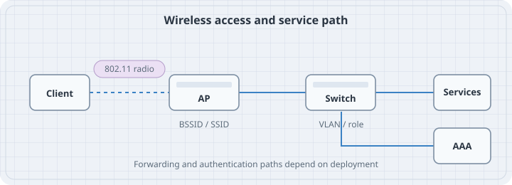

# Wi-Fi 6, 6E, 7 and Enterprise Roaming

Modern enterprise wireless networks are no longer just about peak single-client speed — they are engineered for **high-density efficiency, deterministic airtime sharing, strong cryptographic authentication, and sub-50 ms roaming**. Building on [Wireless LANs: Radio, Access, and Troubleshooting](06-wireless-lan-fundamentals.md), this chapter covers 802.11ax (Wi-Fi 6/6E), 802.11be (Wi-Fi 7), WPA3/802.1X security, fast roaming (802.11r/k/v), RF planning, controller architectures, and hands-on diagnostics on Linux and macOS.

## Learning goals

By the end of this chapter you can:

- Explain how OFDMA, UL/DL MU-MIMO, and BSS Coloring reduce contention in dense Wi-Fi 6/6E cells
- Design around 6 GHz spectrum rules, Preferred Scanning Channels (PSC), and mandatory WPA3
- Describe Wi-Fi 7's Multi-Link Operation (MLO), 320 MHz channels, and 4K-QAM tradeoffs
- Contrast WPA3-SAE with WPA3-Enterprise (802.1X / EAP-TLS) and Protected Management Frames (PMF)
- Trace fast roaming with 802.11k, 802.11v, and 802.11r (FT over-the-air vs over-the-DS)
- Compare controller-tunnelled vs local-breakout enterprise forwarding architectures
- Inspect live Wi-Fi links and frames using `iw`, `wdutil`, and Wireshark radiotap headers

## Wi-Fi 6 (802.11ax): efficiency over raw speed

Prior generations (802.11n/ac) used OFDM, where **one client owned the entire channel** during a transmission opportunity — even to send a tiny 60-byte TCP ACK or VoIP packet. Wi-Fi 6 redesigned the PHY and MAC layers to serve many clients concurrently.

### OFDMA and Resource Units (RUs)

**Orthogonal Frequency-Division Multiple Access (OFDMA)** subdivides a 20/40/80/160 MHz channel into smaller frequency slices called **Resource Units (RUs)** (as small as 26 subcarriers, ~2 MHz wide). The AP acts as a central scheduler:

- **Downlink OFDMA:** One AP transmission carries frames for multiple clients simultaneously across different RUs.
- **Uplink OFDMA:** The AP broadcasts a **Trigger Frame** instructing multiple clients to transmit uplink frames simultaneously on assigned RUs, slashing random CSMA/CA contention overhead.

### Uplink and Downlink MU-MIMO

While OFDMA splits a channel in **frequency** (best for small packets and many clients), **MU-MIMO** splits a channel in **space** using beamforming across multiple AP antennas (best for large payloads to spatially separated clients). Wi-Fi 5 supported downlink MU-MIMO only; Wi-Fi 6 added **uplink MU-MIMO** (up to 8×8 streams in the spec, commonly 4×4 on enterprise APs).

### BSS Coloring (Spatial Reuse)

In dense buildings, neighboring APs on the same channel hear each other's preambles and defer transmitting (co-channel interference, CCI). **BSS Coloring** stamps a 6-bit "color" (1–63) into the PHY header of every frame:

- If a station hears a weak frame carrying a **different BSS color** below an Overlapping BSS Preamble Detect (OBSS-PD) threshold, it may transmit simultaneously instead of backing off.
- If the frame carries the **same BSS color**, normal contention rules apply.

### Target Wake Time (TWT)

**TWT** lets the AP and client negotiate explicit wake schedules so IoT sensors and mobile devices sleep longer between transmissions, reducing both battery drain and bursty contention.

## Wi-Fi 6E: the 6 GHz greenfield

Wi-Fi 6E extends 802.11ax into the **6 GHz band** (up to 1,200 MHz of spectrum in the US/FCC: 5925–7125 MHz; 500 MHz in the EU/ETSI: 5945–6425 MHz). Because no legacy 802.11a/b/g/n/ac clients exist in 6 GHz, airtime is never dragged down by slow legacy beacons or protection mechanisms.

Key operational differences in 6 GHz:

- **Preferred Scanning Channels (PSC):** Scanning 59 individual 20 MHz channels would break roaming budgets. Instead, 6 GHz APs place their primary 20 MHz channel on every fourth channel — **channels 5, 21, 37, 53, 69, 85, ...** (every 80 MHz) — and advertise 6 GHz neighbors via **Reduced Neighbor Reports (RNR)** inside 2.4/5 GHz beacons.
- **WPA3 and PMF mandatory:** Open (unencrypted) SSIDs and WPA2-PSK are disallowed in 6 GHz; networks must use **WPA3-SAE**, **WPA3-Enterprise**, or **Enhanced Open (OWE)** with Protected Management Frames (802.11w) required.
- **Power classes:** **LPI (Low Power Indoor)** APs require no external frequency coordination; **SP (Standard Power)** outdoor/high-power APs must query an **AFC (Automated Frequency Coordination)** database to protect incumbent microwave links.

## Wi-Fi 7 (802.11be): deterministic multi-link

Wi-Fi 7 builds directly on Wi-Fi 6/6E with four headline capabilities:

| Feature | Mechanism | Enterprise Reality Check |
|---|---|---|
| **Multi-Link Operation (MLO)** | A Multi-Link Device (MLD) binds 2.4, 5, and 6 GHz links into one logical association (STR: Simultaneous Transmit/Receive, or eMLSR: switched single-radio) | Major latency and reliability win — traffic can fail over or aggregate across bands without re-associating |
| **320 MHz channels** | Doubles max channel width in 6 GHz (up to 3 non-overlapping 320 MHz channels in FCC regions) | Rarely used in dense enterprise offices (too few channels for reuse); useful in low-density labs or point-to-point |
| **4096-QAM (4K-QAM)** | 12 bits per symbol (20% peak gain over 1024-QAM) | Requires very high SNR (~38–40 dB+); only achieved close to the AP |
| **Multi-RU & Preamble Puncturing** | Allows an AP to notch out a noisy 20 MHz sub-channel inside an 80/160/320 MHz wide channel instead of dropping the whole channel width | Huge practical win in 5 GHz and 6 GHz where narrowband interference otherwise collapses wide channels |

## Enterprise security: WPA3-SAE and 802.1X / EAP-TLS

| Mode | Authentication | Key Exchange | Best Use Case |
|---|---|---|---|
| **WPA3-Personal (SAE)** | Shared passphrase | Simultaneous Authentication of Equals (Dragonfly handshake) — resists offline dictionary attacks | Small sites, isolated IoT (prefer SAE-only; transition mode weakens protection) |
| **WPA3-Enterprise (802.1X)** | Per-user / per-device identity via RADIUS (EAP-TLS) | Mutual X.509 certificate validation + per-session PMK | Corporate laptops, managed mobile devices |
| **WPA3-Enterprise 192-bit** | CNSA-suite certificates (ECDSA P-384 / RSA-3072) | GCMP-256 + HMAC-SHA384 | High-assurance / government networks |
| **Enhanced Open (OWE)** | No passphrase | Opportunistic unauthenticated Diffie-Hellman encryption per client | Guest Wi-Fi (prevents passive over-the-air sniffing) |

### Protected Management Frames (802.11w / PMF)

Historically, management frames (deauthentication, disassociation) were unencrypted and unauthenticated, making Wi-Fi trivial to DoS with spoofed deauth frames. **PMF (802.11w)** cryptographically protects unicast and broadcast management frames after association. PMF is **mandatory** for WPA3 and all 6 GHz SSIDs.

> [!WARNING]
> **EAP-TLS certificate validation rule:** Always pin the enterprise CA root and expected RADIUS server SAN/FQDN in client profiles (MDM/supplicant). Leaving "verify server certificate" unchecked exposes clients to evil-twin APs.

## Fast roaming: 802.11k, 802.11v, and 802.11r

Standard 802.1X roaming requires a full EAP exchange with the RADIUS server (often 150–500 ms), which drops voice calls and stalls real-time apps. Three amendments work together to bring roaming handoffs under **50 ms**:

```text
Client (STA)                    Current AP (AP1)                 Target AP (AP2)
     │                                 │                                │
     │──── 802.11k Neighbor Request ──►│                                │
     │◄─── Neighbor Report (AP2 ch) ───│                                │
     │                                 │                                │
     │◄─── 802.11v BSS Transition ─────│  (optional steer / load hint)  │
     │                                 │                                │
     │──── 802.11r FT Auth (PMK-R1) ───┼───────────────────────────────►│
     │◄─── FT Auth Response ───────────┼────────────────────────────────│
     │──── Reassociation Request ──────┼───────────────────────────────►│
     │◄─── Reassociation Response ─────┼────────────────────────────────│
     │              (Data resumes on AP2 — no full RADIUS round-trip)   │
```

- **802.11k (Radio Resource Measurement):** AP1 hands the client a **Neighbor Report** listing nearby APs, their BSSIDs, and exact channels. The client probes only those channels instead of blindly scanning all 25+ channels.
- **802.11v (BSS Transition Management):** AP1 can advise a sticky client that a better AP is available (for example during AP maintenance, band steering, or load balancing). The client still makes the final decision.
- **802.11r (Fast BSS Transition — FT):** Introduces a **3-tier key hierarchy** (`PMK-R0` → `PMK-R1` → `PTK`). Keys for neighboring APs in the same Mobility Domain are pre-derived, eliminating the RADIUS round-trip during roam:
  - **Over-the-Air (OTA):** Client sends FT authentication directly to AP2 on the target channel.
  - **Over-the-DS:** Client tunnels FT authentication to AP2 *through* AP1 before switching channels.

> [!TIP]
> **Legacy client trap:** Some older IoT and barcode scanners fail to associate if 802.11r is set to *mandatory* on a WPA2 SSID. Use **Adaptive 802.11r** (or separate IoT onto a dedicated non-FT SSID) while keeping 802.11k/v/r enabled on modern corporate WPA3-Enterprise SSIDs.

## RF planning and channel bonding traps

Good Wi-Fi design is **capacity and reuse engineering**, not cranking AP transmit power to maximum.

1. **2.4 GHz:** Only **3 non-overlapping 20 MHz channels** (1, 6, 11). Never bond to 40 MHz in 2.4 GHz — it destroys reuse and starves neighbors. Disable legacy 802.11b rates (1, 2, 5.5, 11 Mbps) and set minimum basic rate to 12 Mbps to shrink cell overlap and beacon airtime.
2. **5 GHz:** Prefer **20 MHz** in high-density auditoriums/offices and **40 MHz** in standard offices. Avoid 80 MHz in dense multi-floor buildings because channel reuse collapses into co-channel interference. Understand **DFS (Dynamic Frequency Selection)** channels (52–144): APs must vacate DFS channels for 30 minutes if radar is detected, causing sudden client drops if not planned around.
3. **6 GHz:** Start with **40 MHz or 80 MHz** aligned to PSC channels; reserve 160/320 MHz for isolated or low-density spaces.
4. **Power symmetry:** Match AP transmit power (typically 11–17 dBm EIRP on 5/6 GHz) to typical mobile client transmit power (~12–15 dBm). A shouting AP (23 dBm) creates an asymmetric link where the phone hears the AP at `-62 dBm`, refuses to roam, yet its own return packets arrive at the AP at `-85 dBm` and fail.

## Enterprise architectures: tunnelled vs local breakout

Before tracing a client's VLAN or firewall path, verify which forwarding model the WLAN uses (see the access-to-distribution boundary in [Wireless LANs: Radio, Access, and Troubleshooting](06-wireless-lan-fundamentals.md)).



| Dimension | Centralized Tunnelled (CAPWAP / GRE / VXLAN) | Distributed / Local Breakout (Flex / Cloud-Managed) |
|---|---|---|
| **Data path** | AP encapsulates client frames to a central Wireless LAN Controller (WLC) | AP bridges client traffic directly onto local access switch VLANs |
| **L2 roaming across closets** | Seamless — client keeps IP even across different switch blocks because L2 terminates at the WLC | Requires matching VLANs across closets, or L3 roaming tunnel / EVPN overlay |
| **Switch port config** | Simple access port on AP management VLAN | 802.1Q trunk carrying AP management VLAN + all client VLANs |
| **Failure blast radius** | WLC outage drops tunneled data plane unless HA/local-fallback is configured | Control-plane outage leaves existing local sessions forwarding |
| **WAN / branch fit** | Poor for remote branches (hairpins local traffic over WAN) | Ideal for branches and cloud-managed campuses |

## Practical Wi-Fi diagnostics on Linux and macOS

### Linux (`iw`)

Inspect link rate, channel width, signal strength, and BSS capabilities:

```bash
# Current association: SSID, BSSID, frequency, signal, TX/RX MCS & channel width
iw dev wlan0 link

# Detailed station counters: retries, failed frames, beacon loss
iw dev wlan0 station dump

# Scan nearby BSSs and inspect RSN (WPA3/PMF) and BSS load
sudo iw dev wlan0 scan | grep -E "BSS |SSID:|freq:|signal:|RSN:|BSS Load"
```

Watch for `tx retries` climbing rapidly relative to `tx packets` (>15–20% indicates RF interference, hidden nodes, or poor SNR) and asymmetric `tx bitrate` vs `rx bitrate`.

### macOS (`wdutil`)

On modern macOS (Sonoma 14.4+), Apple deprecated the legacy `airport` CLI in favor of `wdutil`:

```bash
# Snapshot of current Wi-Fi association, RSSI, noise, channel width, PHY mode, MCS
sudo wdutil info
```

Key fields to read in `wdutil info`:

- **RSSI / Noise:** Calculate SNR (`RSSI - Noise`, e.g., `-58 - (-92) = 34 dB`; aim for ≥ 25 dB for voice/video).
- **Channel:** Confirm band (`2g`, `5g`, `6g`) and width (`20`, `40`, `80`, `160` MHz).
- **PHY Mode & MCS Index:** Verify you actually negotiated `11ax` or `11be` rather than falling back to `11ac`/`11n`.
- **Security:** Confirm `WPA3 Enterprise` / `WPA3 Personal` and PMF state.

### Wireshark radiotap analysis

When capturing over the air with a monitor-mode adapter, Wireshark prepends a **Radiotap header** with physical-layer metadata. Useful display filters:

```text
# Inspect 802.11r Fast Transition auth & reassociation
wlan.fc.type_subtype == 0x0b || wlan.fc.type_subtype == 0x02 || wlan.fc.type_subtype == 0x03

# Find 802.11k Neighbor Reports and 802.11v BSS Transition frames
wlan.fixed.category_code == 5 || wlan.fixed.category_code == 10

# Spot high retry rates on data frames
wlan.fc.retry == 1 && wlan.fc.type == 2

# Filter 802.1X / EAPOL 4-way handshake and EAP-TLS exchanges
eapol || eap
```

## Summary

- **Wi-Fi 6 (802.11ax)** solves multi-client contention with OFDMA Resource Units, UL/DL MU-MIMO, and BSS Coloring.
- **Wi-Fi 6E** opens clean 6 GHz spectrum with PSC discovery and mandatory WPA3 + PMF.
- **Wi-Fi 7 (802.11be)** introduces Multi-Link Operation (MLO), preamble puncturing, 320 MHz channels, and 4K-QAM.
- **Enterprise roaming** pairs 802.11k (neighbor list), 802.11v (steering hints), and 802.11r (pre-derived PMK-R1 keys) to avoid RADIUS round-trips during handoff.
- **Good RF design** favors modest channel widths (20/40 MHz in 5 GHz, 40/80 MHz in 6 GHz) and symmetric AP/client transmit power over maximum radio output.
- Diagnose wireless faults in order: RF/PHY (`iw`, `wdutil`, radiotap) → 802.1X/WPA3 auth → roaming state → wired forwarding model (tunnelled vs local breakout).
