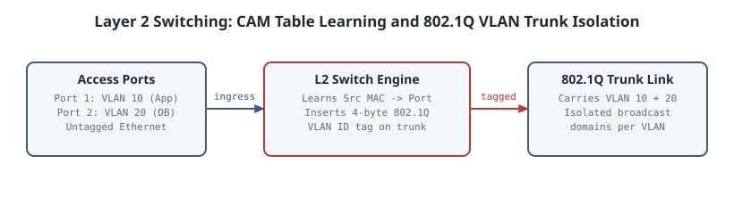

# Intro

**Layer 2** — Understand switching domains, VLANs, trunks, QinQ, spanning tree loop prevention, LACP link aggregation, failure drills, and modern enterprise Wi-Fi.

## How to use this part

Pair the concepts here with the Layer 2 exercises in the [Lab Workbook](../09-lab-workbook/index.md).

## Chapters in this part

| Chapter | File |
|---------|------|
| [Ethernet & MAC Learning](01-ethernet-mac.md) | `01-ethernet-mac.md` |
| [VLANs & Trunks](02-vlans-trunks.md) | `02-vlans-trunks.md` |
| [Private VLANs, Port Isolation and Q-in-Q: Separating Tenants at Layer 2](02b-private-vlans-port-isolation-qinq.md) | `02b-private-vlans-port-isolation-qinq.md` |
| [Loop Prevention](03-loop-prevention.md) | `03-loop-prevention.md` |
| [Spanning Tree: Elections, Roles and Failure Analysis](03b-spanning-tree-election.md) | `03b-spanning-tree-election.md` |
| [Link Aggregation](04-link-aggregation.md) | `04-link-aggregation.md` |
| [L2 Failure Drills](05-l2-failure-drills.md) | `05-l2-failure-drills.md` |
| [Wireless LANs: Radio, Access, and Troubleshooting](06-wireless-lan-fundamentals.md) | `06-wireless-lan-fundamentals.md` |
| [Wi-Fi 6, 6E, 7 and Enterprise Roaming](07-wifi-6-7-enterprise-roaming.md) | `07-wifi-6-7-enterprise-roaming.md` |
## Layer 2 Switching & VLAN Tagging Diagram + Lab



Inspect your local host's Layer 2 neighbor (ARP/NDP) cache and interface MTU/MAC addresses:

```bash
# Show local interfaces and ARP/NDP neighbor mappings
ip -br link show 2>/dev/null || ifconfig -a | grep -E '^[a-z]|ether' | head -n 12
ip neigh show 2>/dev/null | head -n 10 || arp -an | head -n 10
```
