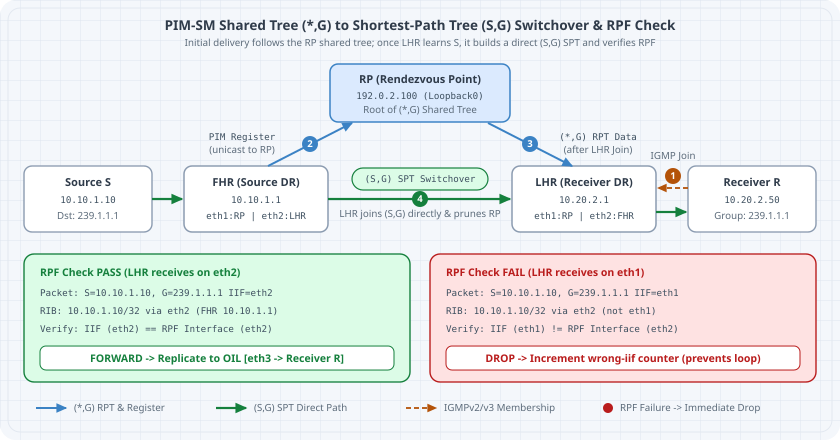

# Multicast Membership and Distribution Trees

A multicast sender transmits a single IP packet to a group address; routers and switches replicate that packet only where receiver paths diverge. Multicast conserves upstream bandwidth for market data, live video, and cluster discovery, but introduces control-plane state (`(*,G)` and `(S,G)`) in every hop along the path. Because IP multicast runs over UDP without transport-layer acknowledgments, loss detection and recovery remain the application's responsibility.

## Addressing and Ethernet MAC mapping

IPv4 multicast occupies `224.0.0.0/4`, divided into operational blocks:

| Prefix | Scope / Purpose | Routed? |
|---|---|---|
| `224.0.0.0/24` | Link-local control protocols (OSPF `224.0.0.5/6`, PIM `224.0.0.13`, VRRP `224.0.0.18`) | Never (TTL = 1) |
| `232.0.0.0/8` | Source-Specific Multicast (SSM) — requires `(S,G)` join, no RP | Yes |
| `239.0.0.0/8` | Administratively scoped (private enterprise multicast, RFC 2365) | Within local domain |
| `ff00::/8` | IPv6 multicast (4-bit scope field: `ff02::` link-local, `ff05::` site, `ff0e::` global) | Per scope |

At Layer 2, Ethernet maps the **low 23 bits** of an IPv4 multicast address into the OUI prefix `01:00:5e:00:00:00/25`. Because an IPv4 multicast address has 28 variable bits (excluding the fixed `1110` top nibble), the top 5 variable bits are discarded—meaning **32 distinct IPv4 groups collide onto the exact same Ethernet MAC address**. For example, `239.1.1.1` and `239.129.1.1` both map to `01:00:5e:01:01:01`. An L2 switch filtering solely by destination MAC cannot separate colliding groups; avoid allocating groups that share the same low 23 bits in the same VLAN.

## Host membership: IGMPv2/v3, MLDv2, and IGMP snooping

Hosts signal group interest to their local multicast router using **IGMP** (IPv4) or **MLD** (IPv6, carried inside ICMPv6):

- **IGMPv2:** Supports Any-Source Multicast (`(*,G)`) joins via Membership Reports and explicit `Leave Group` (`224.0.0.2`) messages. When a router receives a Leave, it sends a Group-Specific Query before pruning the group so other receivers on the same LAN are not cut off.
- **IGMPv3 / MLDv2:** Adds source filtering via **INCLUDE** (accept only listed sources—required for SSM) and **EXCLUDE** (accept all sources except listed; `EXCLUDE {}` equals an ASM `(*,G)` join). Hosts send reports to `224.0.0.22` (IPv4) or `ff02::16` (IPv6), and report suppression is removed so switches see every host's state accurately.

### IGMP snooping and querier election

Without IGMP snooping, an Ethernet switch floods multicast frames out every port in the VLAN like broadcast traffic. With **IGMP snooping** enabled, the switch inspects IGMP Membership Reports and programs hardware multicast forwarding entries only toward ports with active receivers plus learned **mrouter ports** (ports where PIM Hellos or IGMP Queries are heard).

> [!WARNING]
> IGMP snooping **requires an active IGMP Querier** in the VLAN. If a VLAN is pure Layer 2 (no multicast router SVI), enable a switch **IGMP snooping querier**. Without periodic General Queries (default every 125 seconds), switches time out snooping entries after ~260 seconds and silently drop or flood the stream. When multiple routers share a LAN, the router with the **lowest IP address** wins the IGMP Querier election.

Use **Fast Leave / Immediate Leave** only on single-host access ports; enabling it on a trunk or multi-host port cuts off remaining receivers the instant one host sends a Leave.

## PIM-SM distribution trees and SPT switchover

**Protocol Independent Multicast — Sparse Mode (PIM-SM, RFC 7761)** builds loop-free distribution trees using whatever unicast routing table (OSPF, IS-IS, BGP, static) is already present.



Follow the four-stage lifecycle illustrated above:

1. **Receiver Join & Shared Tree (`(*,G)` RPT):** Receiver R sends an IGMP Membership Report for `239.1.1.1`. Its Last-Hop Router (LHR) creates `(*, 239.1.1.1)` state and sends a PIM `(*,G)` Join hop-by-hop toward the **Rendezvous Point (RP)** (`192.0.2.100`), building the **RP Tree (RPT)**.
2. **Source Registration:** When Source S (`10.10.1.10`) starts transmitting to `239.1.1.1`, its First-Hop Router (FHR, the LAN's PIM Designated Router) encapsulates the initial packets in unicast **PIM Register** messages sent directly to the RP.
3. **RP Decapsulation & Delivery:** If the RP has downstream `(*,G)` receivers, it decapsulates the stream, forwards it down the RPT toward LHR, and sends an `(S,G)` Join back toward S. Once native multicast arrives at the RP, the RP sends a **Register-Stop** to FHR to halt unicast encapsulation.
4. **SPT Switchover (`(S,G)`):** Once LHR receives the first data packet from the RP and discovers Source S's IP (`10.10.1.10`), LHR triggers **SPT switchover** (default threshold `0 kbps` on most platforms): it sends a PIM `(S,G)` Join directly toward S along the shortest unicast path. When traffic arrives on the direct `(S,G)` tree, LHR sends an `(S,G,rpt)` Prune toward the RP to stop duplicate delivery.

### Source-Specific Multicast (SSM)

In **SSM (`232.0.0.0/8`, RFC 4607)**, the application already knows the sender's unicast IP and issues an IGMPv3 `INCLUDE (S, G)` report. LHR immediately sends a PIM `(S,G)` Join directly toward S—completely eliminating the RP, shared tree, Register encapsulation, and SPT switchover. SSM simplifies operations and avoids RP single-point-of-failure complexity whenever receivers can discover source IPs out-of-band.

## Reverse-Path Forwarding (RPF) check mechanics

Multicast routers never forward solely on destination group address. On every arriving multicast packet, the router performs a **Reverse-Path Forwarding (RPF) check**:

1. Look up the **Source IP `S`** (for `(S,G)` state) or the **RP IP** (for `(*,G)` state) in the unicast RIB (or dedicated Multicast RIB / MRIB if configured).
2. Identify the outgoing interface toward that address—this is the expected **Incoming Interface (IIF / RPF interface)**.
3. If the packet arrived on `IIF == RPF interface`, the check **passes** and the packet is replicated to every interface in the **Outgoing Interface List (OIL)**.
4. If `IIF != RPF interface`, the packet is **dropped immediately** and the `wrong-iif` counter increments.

> [!IMPORTANT]
> Unicast reachability does **not** guarantee multicast delivery. Asymmetric routing, missing PIM adjacencies on the shortest unicast link, or an ECMP hash mismatch causes traffic to arrive on a non-RPF interface—resulting in 100% multicast loss even though `ping` between Source and Receiver works cleanly.

## FRR `pimd` configuration and verification

The configuration and outputs below are **illustrative example outputs** for FRRouting (`pimd`) on a Linux router acting as the LHR in the topology above.

### Sample FRR configuration (`frr.conf`)

```cfg
router pim
 rp 192.0.2.100 239.0.0.0/8
 spt-switchover infinity-and-beyond
!
interface eth1
 description Uplink to RP
 ip pim
!
interface eth2
 description Direct link to FHR
 ip pim
!
interface eth3
 description Receiver LAN
 ip igmp
 ip igmp version 3
 ip pim
```

### Verification commands

```bash
vtysh -c "show ip pim rp-info"
vtysh -c "show ip rpf 10.10.1.10"
vtysh -c "show ip mroute"
vtysh -c "show ip igmp groups"
```

Illustrative example output from `show ip pim rp-info` and `show ip rpf 10.10.1.10`:

```text
RP address       group/prefix-list   OIF    I am RP  Source  Group-Type
192.0.2.100      239.0.0.0/8         eth1   no       Static  ASM

Routing entry for 10.10.1.10/32 (ospf)
  Known via "ospf", distance 110, metric 20
  RPF Interface: eth2
  RPF Nexthop:   10.0.12.1 (PIM neighbor up)
```

Illustrative example output from `show ip mroute`:

```text
Source          Group           Proto  Input   Output  TTL  Uptime
*               239.1.1.1       IGMP   eth1    eth3    1    00:05:12
10.10.1.10      239.1.1.1       PIM    eth2    eth3    1    00:04:58
```

## Multicast fault triage table

| Observation | Root-Cause Candidates | First Verification Step |
|---|---|---|
| No IGMP group on LHR | Host firewall, wrong interface, IGMPv2/v3 mismatch | `show ip igmp groups` & `tcpdump 'igmp'` on receiver LAN |
| Group learned, no switch egress | Missing IGMP snooping querier, wrong VLAN, no mrouter port | Inspect switch IGMP snooping table and active querier IP |
| `(*,G)` present, no `(S,G)` | RP unreachable, RP group-range mismatch, FHR not DR | `show ip pim rp-info` and `show ip pim neighbor` on FHR/RP/LHR |
| `wrong-iif` counter rising | Asymmetric routing, PIM missing on RPF link, bad static mroute | `show ip rpf <source-ip>` and compare with actual arrival interface |
| Correct IIF and OIL, zero delivery | Sender `TTL = 1`, ACL blocking UDP/group, MTU/fragmentation | Check packet TTL in `tcpdump -v` at FHR ingress |

For hands-on packet captures and a full routed PIM lab, continue with [Multicast Essentials](../07-a-overlays-tunnels/07-multicast-essentials.md), and practice diagnosing broken trees in the [multicast failure exercises](../09-lab-workbook/39-multicast-failure-exercises.md).

## Review

1. Why do `239.1.1.1` and `239.129.1.1` collide at Layer 2 on an Ethernet switch, and how many total IPv4 multicast groups share any single multicast MAC?
2. What happens to an IGMP-snooping VLAN if no router or switch is acting as the IGMP Querier?
3. Trace how PIM-SM transitions a flow from `(*,G)` on the shared tree to `(S,G)` on the shortest-path tree, and explain why SSM skips the RP entirely.
4. Why can unicast `ping` between Source S and Receiver R succeed while multicast packets from S are dropped at LHR with `wrong-iif`?

Further reading: [IGMPv3, RFC 9776](https://www.rfc-editor.org/rfc/rfc9776.html), [PIM-SM, RFC 7761](https://www.rfc-editor.org/rfc/rfc7761.html), [IGMP/MLD snooping, RFC 4541](https://www.rfc-editor.org/rfc/rfc4541.html), and [SSM architecture, RFC 4607](https://www.rfc-editor.org/rfc/rfc4607.html).
