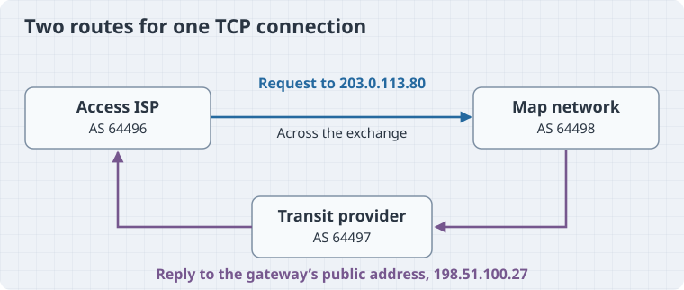

# Follow a Connection Across the Internet

A laptop requests a map tile. Its TCP SYN crosses an Internet exchange on the way to the map server. The SYN-ACK comes home through a transit provider. Can those packets belong to the same connection? Work from the socket addresses first, then work out which routers see each direction.

## Draw the path one network at a time

The laptop is `10.0.0.24/24`. DNS has returned `203.0.113.80` for the map service. The service listens on TCP port 443. The laptop's default gateway at `10.0.0.1` performs IPv4 network address and port translation (NAPT) on its WAN address `198.51.100.27`. All public-facing addresses and AS numbers in this example are reserved for documentation.

The access ISP operates AS 64496 and announces `198.51.100.0/24`. The map network operates AS 64498 and announces `203.0.113.0/24`. An **autonomous system** (AS) is a network or group of networks under a common routing policy. A single AS may contain many routers. Both networks attach to the same Internet exchange and also buy connectivity from transit AS 64497.

The laptop needs a route matching the server and a reachable next hop. Its default route supplies both once it resolves the gateway's MAC address. The laptop can open the socket without knowing any AS number. At the other end, the server needs a route covering the public address from which the SYN arrives. It has no route back to the laptop's private address in this example.

## Read the routing choices in both directions

**Peering** lets two networks exchange agreed routes directly. **Transit** lets one network purchase reachability through another to destinations beyond that provider's own network. At an Internet exchange point (IXP), a shared switching fabric can give the participants a link over which to peer. Draw the exchange as an interconnect between border routers. If the participants use an exchange route server, that server can distribute BGP announcements while the routers still send the actual map traffic directly to each other across the fabric. [Internet exchange route servers](https://www.rfc-editor.org/rfc/rfc7947)

Here are the eligible routes visible at the two borders. The AS path is shown from the receiving network's perspective, with the neighbor first. Both operators in this example choose the larger local preference for otherwise eligible routes to the same prefix. Local preference is set separately inside each AS.

| Router making the choice | Destination prefix | How learned | AS path | Local preference |
|---|---|---|---|---:|
| Access ISP | 203.0.113.0/24 | Exchange peer | 64498 | 180 |
| Access ISP | 203.0.113.0/24 | Transit | 64497 64498 | 100 |
| Map network | 198.51.100.0/24 | Exchange peer | 64496 | 100 |
| Map network | 198.51.100.0/24 | Transit | 64497 64496 | 170 |

The ISP chooses the exchange for the request. The map operator has temporarily lowered preference on the exchange route during maintenance, so its reply follows transit. Assume transit forwards each customer's prefix directly toward that customer. The longer return AS path can win because the local preference decision occurs earlier. Once the winning routes are installed, each packet undergoes an ordinary destination lookup. There is no AS-path list in the TCP segment or the IP packet that forces the reply to retrace the request. [BGP route selection](https://www.rfc-editor.org/rfc/rfc4271#section-9.1) · [Routing fundamentals](02-routing-fundamentals.md)

## Match four observations to one connection

Suppose the laptop picks source port 51514, and the gateway allocates external TCP port 62000. Read each row as a packet that could appear at the indicated observation point. The entries are predictions for this example.

| Where observed | TCP flags | Source | Destination |
|---|---|---|---|
| Home LAN, leaving laptop | SYN | 10.0.0.24:51514 | 203.0.113.80:443 |
| Gateway WAN, leaving for ISP | SYN | 198.51.100.27:62000 | 203.0.113.80:443 |
| Gateway WAN, arriving from ISP | SYN-ACK | 203.0.113.80:443 | 198.51.100.27:62000 |
| Home LAN, arriving at laptop | SYN-ACK | 203.0.113.80:443 | 10.0.0.24:51514 |

At the gateway, one active translation joins the LAN-side tuple to the WAN-side tuple. The gateway uses that state to rewrite the reply's destination and update the affected checksums. At the server, the remote socket address is the public address and port in the second row. At the laptop, the local socket retains the address and port in the first row. The IP TTL decreases at routed hops, and link-layer addresses belong to each individual link. Neither change breaks the TCP handshake. [Traditional NAT and NAPT](https://www.rfc-editor.org/rfc/rfc3022#section-4.1)

The path's asymmetry matters when interpreting observations. A capture on the ISP's exchange interface can contain the outgoing SYN and the laptop's final ACK while missing the SYN-ACK between them. A simultaneous capture on the gateway's WAN link should show all three. The exchange capture alone could make a healthy connection look one-sided.

## Predict a change before opening a capture

**The direct route disappears.** If the ISP loses its exchange route to the map prefix, the route through 64497 becomes its remaining candidate. After convergence the request travels through transit. The endpoints and the NAT mapping can stay the same. TCP can recover a packet lost during the transition if the route recovers before the connection times out.

**The home gateway loses its translation table.** Both ASes can still have valid routes. A reply for `198.51.100.27:62000` may arrive at the gateway, which now lacks the active mapping identifying `10.0.0.24:51514`. With no static port forward, that reply cannot be delivered through the original translation. Starting a fresh connection creates new state. Restoring a BGP route alone would leave this failure in place.

**The map tile is served by a local cache.** If DNS instead returns a cache address inside the access ISP, the laptop selects a different remote socket and the ISP looks up a different destination. The original peering and transit routes can remain healthy while neither carries tile traffic for this request. Record the address actually used by the application before using a path diagram to interpret a capture. [CDN edge delivery](../07-d-dataplanes-and-traffic-delivery/03-cdn-architecture-and-edge-delivery.md)

## Check your reading of the evidence

A server capture shows a SYN from `198.51.100.27:62000` and the server's outgoing SYN-ACK. The client reports a timeout. An operator sees no SYN-ACK on the ISP's exchange port. **Which observation would narrow the fault next?**

Check the home gateway's WAN capture for the exact reply tuple and time. Under the stated policy, a healthy reply also misses the exchange port. If the SYN-ACK reaches the WAN side, inspect the translation and capture the LAN-side reply. If it reaches the laptop, inspect the socket and its final ACK. If the WAN capture misses it, work backward along the selected return path. Each observation tests a particular boundary without requiring the two directions to share one route.

To observe the tuple change live, run [the source NAT workbook exercise](../09-lab-workbook/47-source-nat-observe.md). For the agreements and infrastructure behind the AS diagram, continue to [the architecture of global connectivity](../08-bgp-security/01-architecture-of-global-connectivity.md).
