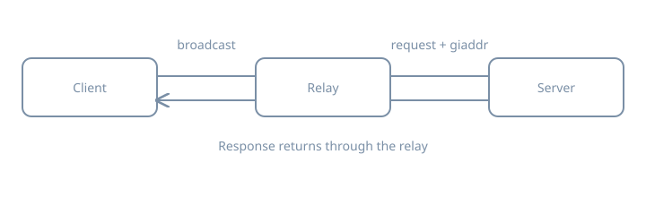

# DHCPv4 Lease and Relay Troubleshooting

A running DHCP server daemon does not guarantee clients can obtain leases. Because initial DHCPv4 discovery relies on Layer 2/Layer 3 broadcasts that cannot cross a router unaided, troubleshooting must follow the packet sequentially across the **client VLAN**, **relay agent**, **server scope selection**, and **return forwarding path**. (This chapter focuses on DHCPv4; DHCPv6 uses UDP ports 546/547, multicast `ff02::1:2`, and pairs with ICMPv6 Router Advertisements for default-gateway discovery.)



## Full DORA packet field walkthrough

A client without a valid lease runs the four-step **DORA** exchange over UDP ports `68` (client) and `67` (server/relay):

1. **DHCPDISCOVER (Client → `255.255.255.255`):** Client broadcasts a request from `0.0.0.0:68` to `255.255.255.255:67`.
2. **DHCPOFFER (Server → Relay → Client):** Eligible servers propose an available IPv4 address and lease parameters.
3. **DHCPREQUEST (Client → `255.255.255.255`):** Client broadcasts acceptance of one specific offer (identifying the chosen server via Option 54 so competing servers release their tentative offers).
4. **DHCPACK (Server → Relay → Client):** Selected server commits the lease and delivers final options (subnet mask, default router, DNS, NTP, lease duration). If the requested IP is invalid for the subnet, the server replies with **DHCPNAK**; if the client detects an ARP conflict after ACK, it sends **DHCPDECLINE**.

### Critical BOOTP/DHCP header fields to track

| Field / Option | Role in Troubleshooting | Common Pitfall |
|---|---|---|
| `xid` (Transaction ID) | 32-bit random ID correlating all messages in one DORA attempt | Always filter captures by `xid` when multiple clients boot simultaneously |
| `chaddr` (Client HW Addr) | Client MAC address (`aa:bb:cc:dd:ee:ff`) | Option 61 (Client Identifier) may override `chaddr` for server reservations |
| `yiaddr` (Your IP Addr) | The IPv4 address being offered/assigned to the client | Zero in DISCOVER; populated in OFFER and ACK |
| `siaddr` (Next Server IP) | TFTP/PXE boot server IP (not the DHCP server itself) | Often confused with Option 54 (`Server-ID`) |
| `giaddr` (Gateway IP Addr) | IP of the **relay agent's client-facing interface** | Zero on local LAN; stamped by the first relay so the server picks the right subnet scope and knows where to unicast the reply |
| `flags` (Broadcast `0x8000`) | Requests that the relay broadcast OFFER/ACK to the client LAN | Older PXE stacks cannot receive unicast frames before holding an IP and set `B=1` |
| Option 82 (Relay Agent Info) | Circuit ID (switch port/VLAN) and Remote ID (switch MAC/name) | Inserted by L2 snooping switches or relays; untrusted `giaddr=0.0.0.0` + Option 82 drops requests unless relay policy allows it. See [DHCP Option 82](02c-dhcp-option-82-relay-agent-information.md). |

> [!IMPORTANT]
> Never confuse `giaddr` with `yiaddr`. `giaddr` is the relay router's gateway IP on the client's VLAN (`10.20.10.1`), which tells the centralized DHCP server *which pool* to allocate from; `yiaddr` is the client's leased host IP (`10.20.10.55`).

## Relay configuration: Linux `dhcrelay` and Arista cEOS

When a router receives a broadcast `DHCPDISCOVER` on a client VLAN, it checks whether `giaddr == 0.0.0.0`, stamps its own ingress interface IP into `giaddr`, increments `hops`, and forwards the packet as a **unicast** UDP/67 packet to each configured DHCP server.

### Linux ISC `dhcrelay` example

```bash
# Forward DHCP requests arriving on client VLAN eth1 to two DHCP servers
# (-iu specifies upstream server-facing interface when using -a Option 82)
sudo dhcrelay -4 -d -i eth1 -i eth0 10.99.0.10 10.99.0.11
```

### Arista EOS / cEOS `ip helper-address` example

```cfg
interface Vlan10
   description Client Access VLAN 10
   ip address 10.20.10.1/24
   ip helper-address 10.99.0.10
   ip helper-address 10.99.0.11
!
ip dhcp relay information option
```

Verification commands on Arista EOS (illustrative example output):

```bash
show ip dhcp relay
show ip dhcp relay counters
```

```text
DHCP Relay Agent is enabled
Interface  Helper Address  VRF      Source Interface
---------- --------------- -------- ----------------
Vlan10     10.99.0.10      default  Vlan10
Vlan10     10.99.0.11      default  Vlan10

Received from client:  42   Forwarded to server:  84
Received from server:  40   Forwarded to client:  40
Dropped (invalid giaddr / Option 82): 0
```

> [!WARNING]
> Relay forwarding is only half the path. The DHCP server must have a **return route** back to `giaddr` (`10.20.10.1`), intermediate firewalls must permit UDP/67 bidirectionally between relay and server, and access switches running **DHCP Snooping** must mark the uplink toward the relay/server as `trust`.

## Lease renewal (T1/T2) and outage behavior

Once bound, a client tracks three timers defined in RFC 2131:

- **T1 (Renewal, default 50% of lease):** Client sends a **unicast** `DHCPREQUEST` directly to the original server (`Option 54`) from its leased IP. Notice this bypasses the relay agent!
- **T2 (Rebinding, default 87.5% of lease):** If T1 renewals fail, the client **broadcasts** `DHCPREQUEST` to any available server (again traversing the relay agent).
- **Expiry (100% of lease):** Client must immediately unbind its IPv4 address and restart DORA from `0.0.0.0`.

This timer model explains a common production surprise: **during a DHCP server outage, existing clients stay online for hours while newly connected laptops fail immediately.** High-availability designs address this with either:

- **DHCP Failover Protocol (ISC/Kea HA):** Active-active or hot-standby peers synchronize lease databases in real time so either server can renew any client seamlessly.
- **Split-Scope (e.g., 80/20 or 50/50):** Two independent servers share a subnet with non-overlapping address ranges. During a primary outage, existing clients cannot renew at T1, wait until T2, and may receive a `DHCPNAK` or new IP from the secondary if lease states are not shared—causing brief TCP resets.

## Packet capture analysis with `tcpdump`

Capture on both the client-facing and server-facing interfaces to prove whether the relay transformed and forwarded the packet:

```bash
sudo tcpdump -i eth0 -n -vvv 'udp port 67 or udp port 68'
```

Illustrative example output of a relayed `DHCPDISCOVER` and `DHCPOFFER` on the server-facing link:

```text
11:02:14.104 IP (tos 0x0, ttl 64, id 4120, proto UDP (17), length 328)
    10.20.10.1.67 > 10.99.0.10.67: BOOTP/DHCP, Request from aa:bb:cc:11:22:33, length 300, hops 1, xid 0x7c4e91a2
      Gateway-IP 10.20.10.1
      Client-Ethernet-Address aa:bb:cc:11:22:33
      Vendor-rfc1048 Extensions
        DHCP-Message (53), length 1: Discover
        Parameter-Request (55), length 4: Subnet-Mask, Default-Gateway, Domain-Name-Server, Domain-Name

11:02:14.109 IP (tos 0x0, ttl 64, id 8891, proto UDP (17), length 328)
    10.99.0.10.67 > 10.20.10.1.67: BOOTP/DHCP, Reply, length 300, hops 1, xid 0x7c4e91a2
      Your-IP 10.20.10.55
      Gateway-IP 10.20.10.1
      Client-Ethernet-Address aa:bb:cc:11:22:33
      Vendor-rfc1048 Extensions
        DHCP-Message (53), length 1: Offer
        Server-ID (54), length 4: 10.99.0.10
        Lease-Time (51), length 4: 3600
        Subnet-Mask (1), length 4: 255.255.255.0
        Default-Gateway (3), length 4: 10.20.10.1
        Domain-Name-Server (6), length 4: 10.99.0.53
```

Notice the source and destination ports on the relayed hop are **both UDP/67** (`10.20.10.1.67 > 10.99.0.10.67`), `hops` is `1`, `Gateway-IP` (`giaddr`) is `10.20.10.1`, and `xid 0x7c4e91a2` ties the Offer (`Your-IP 10.20.10.55`) directly to the Discover.

## Evidence-driven troubleshooting exercise

Use the [inter-VLAN and DHCP workbook lab](../09-lab-workbook/07-inter-vlan-and-dhcp.md) as a starting point, adding a dedicated server subnet and relay on the client VLAN. Capture simultaneously on the client segment and server segment, match packets by `xid`, and diagnose each injected fault:

| Fault | Evidence to Collect | Diagnostic Conclusion |
|---|---|---|
| Client port in wrong VLAN | `tcpdump` on relay client interface shows zero packets; switch VLAN table | DISCOVER never enters the intended broadcast domain |
| Relay disabled on client SVI | DISCOVER seen on client VLAN, zero UDP/67 packets on server link; `show ip dhcp relay counters` | Relay missing or disabled on ingress interface |
| Return route or firewall block | Relayed Request arrives at server, server sends Offer, Offer never reaches relay | Missing route to `giaddr` or ACL blocking UDP/67 reply |
| Pool exhausted or scope mismatch | Server logs `no free leases` or `unknown network segment 10.20.10.1` | Server received `giaddr` but has no matching/available scope |
| DHCP Snooping untrusted uplink | Offer reaches switch trunk, dropped before client port; switch snooping drop counters | Switch port toward relay/server lacks `ip dhcp snooping trust` |
| Wrong Option 3 / Option 6 | Client receives valid ACK (`ip addr`), fails `ping` to remote subnet or DNS lookup | Lease succeeded, but gateway or resolver option is misconfigured |

> [!TIP]
> For a shortened-lease drill, configure a 120-second test lease on the lab scope, confirm the client binds (`ip -4 addr show`), stop the DHCP server daemon, and watch `tcpdump` at ~60s (unicast T1 renewal) and ~105s (broadcast T2 rebinding) before expiry at 120s.

## Review

1. Why can new clients fail to obtain IP addresses during a DHCP server outage while already-connected clients continue communicating normally?
2. How do `giaddr` and `yiaddr` differ in a relayed `DHCPOFFER`, and what happens if the DHCP server has no route back to `giaddr`?
3. Why does a unicast T1 renewal bypass the DHCP relay agent, while a T2 rebinding request traverses it again?
4. What packet-capture evidence cleanly separates a broken relay agent from an exhausted DHCP server pool?

**References:** [DHCPv4, RFC 2131](https://www.rfc-editor.org/rfc/rfc2131.html), [DHCP options, RFC 2132](https://www.rfc-editor.org/rfc/rfc2132.html), [relay agent information, RFC 3046](https://www.rfc-editor.org/rfc/rfc3046.html), and [DHCPv6, RFC 9915](https://www.rfc-editor.org/rfc/rfc9915.html).
