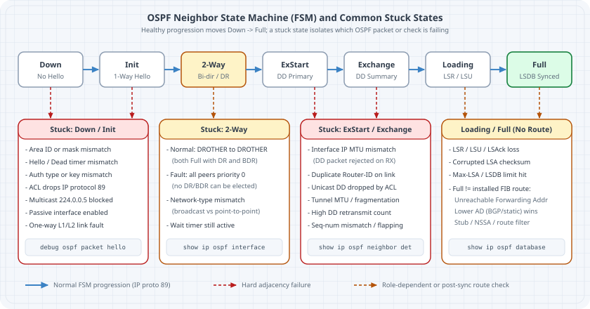
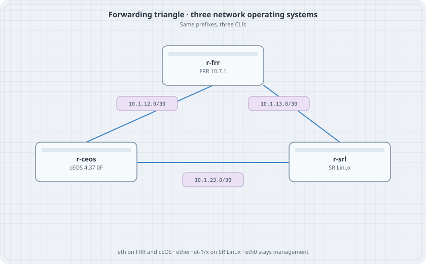

# OSPF Adjacencies and Database Troubleshooting

An OSPF neighbor table is a sequence of clues, not a connectivity test. Diagnose every relationship in stages: can the routers exchange valid Hellos, should they form a full adjacency, can they synchronize their Link-State Databases (LSDBs), and does the resulting SPF calculation install a working route in the forwarding table (FIB)? This chapter focuses on OSPFv2 for concrete packet fields; OSPFv3 uses IPv6 link-local transport and distinct LSA types, so verify its instance and interface configuration independently.



## OSPF packet types and the full FSM

OSPF runs directly over **IP protocol 89** (not TCP or UDP). Five packet types drive neighbor discovery and LSDB synchronization:

- **Hello (Type 1):** Discovers neighbors on multicast `224.0.0.5` (`AllSPFRouters`), negotiates bidirectional reachability, and elects DR/BDR on multi-access segments.
- **Database Description — DD (Type 2):** Summarizes LSA headers so peers learn which LSAs the other side is missing or has newer sequence numbers for.
- **Link State Request — LSR (Type 3):** Requests specific full LSAs identified during DD exchange.
- **Link State Update — LSU (Type 4):** Carries one or more full **LSAs** (Link-State Advertisements) in response to LSRs or during flooding.
- **Link State Acknowledgment — LSAck (Type 5):** Confirms receipt of flooded LSAs so they can be removed from the retransmission list.

A healthy point-to-point adjacency transitions rapidly through seven states (eight on NBMA links, which insert `Attempt` between `Down` and `Init`):

1. **Down:** No valid Hello received within the Dead interval. Local router sends Hellos out active (non-passive) interfaces.
2. **Init:** A valid Hello arrived from the peer, but the local Router-ID is *not* listed in the peer's Active Neighbor field. Communication is currently one-way.
3. **2-Way:** Both routers see their own Router-ID in the peer's Hello. Bidirectional communication is established; on broadcast/NBMA segments, DR/BDR election runs here.
4. **ExStart:** Peers elect a Primary/Secondary role (highest Router-ID becomes Primary, historically called Master/Slave prior to RFC 9454) and pick an initial DD sequence number. Interface IP MTU is checked in the DD header.
5. **Exchange:** Peers exchange DD packets summarizing their LSDB headers. Any newer or missing LSA headers are added to the Link-State Request list.
6. **Loading:** Peers send LSRs for missing LSAs and receive LSUs until the request list drains to zero.
7. **Full:** Initial LSDB synchronization is complete for the shared area. SPF runs and installs eligible OSPF routes into the RIB.

> [!NOTE]
> `Full` does not prove data-plane reachability, nor does it mean two routers hold identical databases across different areas. It only confirms that the two peers synchronized the LSAs scoped to their shared area and link.

## Stuck-state diagnostic matrix

When an adjacency stalls before `Full`, the exact state tells you which protocol check failed:

| Stuck State | Typical Root Causes | Primary Verification |
|---|---|---|
| **Down** (no entry) | Area ID mismatch, subnet mask mismatch (broadcast), Hello/Dead timer mismatch, stub/NSSA flag mismatch, authentication failure, passive interface, or L1/L2 down | Capture IP proto 89 on both ends; compare `show ip ospf interface` |
| **Init** | One-way traffic: asymmetric ACL blocking IP proto 89, multicast `224.0.0.5` dropped by switch IGMP/CoPP policy, or unidirectional fiber/VLAN fault | Check RX/TX Hello counters and interface ACL/CoPP drops on the peer |
| **2-Way** | **Normal** between two `DROTHER` routers on a broadcast LAN (both are `Full` with DR and BDR). **Fault** if all routers have priority `0` (no DR/BDR can be elected) or a broadcast/point-to-point network-type mismatch exists | Inspect `show ip ospf interface` for network type, priority, and DR/BDR IDs |
| **ExStart** | **Interface IP MTU mismatch** (most common), duplicate Router-ID on the same segment, unicast IP proto 89 blocked while multicast passes, or broken fragmentation/GRE/VXLAN tunnel MTU | Compare physical/L3 MTU on both ends; inspect DD retransmit counters and logs |
| **Exchange** | MTU mismatch where only one side's full-size DD exceeds the link path MTU, packet loss corrupting DD sequence numbers, or CPU/CoPP throttling unicast DD packets | Inspect `debug ospf packet dd`, interface errors, and CoPP drop counters |
| **Loading** | LSR/LSU/LSAck packet loss, corrupted LSA checksum, or hitting a configured `max-lsa` / LSDB overflow limit | Check `show ip ospf neighbor detail` retransmit/request queue counts and syslog |

> [!WARNING]
> On a broadcast segment with four routers, seeing `2-Way/DROTHER` between two non-DR routers is **expected behavior**. Never clear an OSPF process just because you see `2-Way` — verify whether each router is `Full` with the DR and BDR first.

## Multi-NOS inspection commands

Collect evidence from **both** routers with timestamps before making changes. The commands below show the equivalent inspection views across FRR, Arista cEOS, and Nokia SR Linux.

### FRR (`vtysh`)

```bash
# Detailed neighbor state, dead timer, DD retransmit/request queues, and transitions
vtysh -c "show ip ospf neighbor detail"

# Interface network type, area, timers, MTU, DR/BDR, and passive status
vtysh -c "show ip ospf interface eth1"

# Live packet debugging (use briefly in maintenance or lab; disable with 'no debug ...')
vtysh -c "debug ospf packet hello detail"
vtysh -c "debug ospf packet dd detail"
```

### Arista cEOS / EOS

```text
show ip ospf neighbor detail
show ip ospf interface Ethernet1
show ip ospf database router self-originate
show logging | include OSPF
```

### Nokia SR Linux

```text
show /network-instance default protocols ospf instance main neighbor
show /network-instance default protocols ospf instance main area 0.0.0.0 interface ethernet-1/1.0
show /network-instance default protocols ospf instance main statistics
```

## Production walkthrough: diagnosing an MTU mismatch in ExStart

Consider a point-to-point routed link between `R1` (MTU 9000, configured for jumbo underlay) and `R2` (still at default MTU 1500). Hellos are small (~48 bytes) and pass cleanly, so both routers reach `2-Way` and enter `ExStart`. However, OSPFv2 DD packets carry the sender's **Interface MTU** field in the DD header. When `R2` receives `R1`'s DD advertising MTU `9000`, RFC 2328 requires `R2` to discard it because `9000 > 1500`. The adjacency loops in `ExStart` until the dead timer resets it.

Illustrative FRR output on `R2` (`show ip ospf neighbor detail`):

```text
 Neighbor 10.255.0.1, interface address 10.0.12.1
    In the area 0.0.0.0 via interface eth1
    Neighbor priority is 1, State is ExStart, 14 state changes
    Most recent state change statistics:
      Progressive change 00:00:12 ago
    DR is 0.0.0.0, BDR is 0.0.0.0
    Options 0x42 (*|O|-|-|-|-|E|-)
    Dead timer due in 00:00:34
    Database Summary List 0
    Link State Request List 0
    Link State Retransmission List 1
```

Notice the two telltale clues: `State is ExStart`, a climbing `state changes` counter, and `Link State Retransmission List 1` (the unacknowledged initial DD packet). Running `debug ospf packet dd detail` (illustrative output) confirms the exact field mismatch:

```text
OSPF: RECV[DD]: From 10.255.0.1 via eth1:10.0.12.2
OSPF: DD MTU 9000 > interface eth1 MTU 1500 -- packet discarded
```

### Correct remediation versus the `mtu-ignore` trap

1. **Fix the underlying L2/L3 MTU** on both router interfaces and any intermediate switch trunks or tunnels so both ends match (e.g., `ip link set eth1 mtu 9000` or `mtu 9000` in cEOS).
2. **Validate data-plane jumbo forwarding** after the adjacency reaches `Full` with a Don't-Fragment ping (`ping -M do -s 8972 10.0.12.1` on Linux).

> [!IMPORTANT]
> Avoid using `ip ospf mtu-ignore` as a permanent fix. Ignoring the DD MTU check lets the control plane reach `Full`, but large LSUs or application packets will still blackhole silently across the mismatched link.

## When `Full` is not enough: post-adjacency route failures



Even when every neighbor in a triangle topology reports `Full`, a prefix can still fail to reach the FIB. Walk the pipeline in order:

1. **No originating LSA:** Check that the source interface is in OSPF (or redistributed), not filtered by area range/policy. Note that `passive-interface` suppresses Hellos on an interface while still advertising its connected prefix in the Router LSA (Type 1).
2. **LSA in LSDB, but missing from OSPF RIB:** Inspect the LSA's **Advertising Router** and (for Type 5/7 external LSAs) its **Forwarding Address**. If the forwarding address is nonzero and unreachable via an intra-area or inter-area OSPF route, RFC 2328 forbids installing the external route. For external metric and forwarding-address traps, see [Redistribution Design](03b-redistribution-design.md).
3. **OSPF route exists, but not selected in main RIB:** Another protocol with a better Administrative Distance (for example, eBGP at 20 or a static route at 1 vs. OSPF at 110) or a more-specific prefix (`/25` over `/24`) is winning.
4. **Selected in RIB, but forwarding fails:** Inspect FIB programming, ARP/ND resolution, egress ACLs, ECMP hash path, and the **return path** from the destination.

## Failure drills

Start from [OSPF in One Area](../09-lab-workbook/10-ospf-one-area.md). Record baseline neighbor states, LSDB counts, and loopback routes on every router before injecting one fault at a time:

1. **Hello parameter mismatch:** Change the OSPF area ID or Hello interval on one side of a link. Confirm the neighbor drops to `Down` (or disappears) and inspect `debug ospf packet hello` for the rejection reason. Restore and verify recovery.
2. **One-way filtering (`Init`):** Apply an ingress ACL on one router blocking IP protocol 89 from its peer. Observe the unfiltered peer enter `Init` while the filtered peer drops to `Down`. Remove the ACL and confirm recovery.
3. **DD MTU mismatch (`ExStart`):** Lower the MTU on one side of a point-to-point link from `1500` to `1400`. Observe `ExStart` and rising DD retransmissions, restore matching MTUs, and verify with a DF ping.
4. **Healthy `2-Way` vs. priority `0`:** On a four-router broadcast segment, verify two `DROTHER` peers stay in `2-Way` with each other while maintaining `Full` with the DR and BDR. Then set all four priorities to `0` and confirm all peers stall in `2-Way`. Restore priorities.
5. **`Full` with missing route:** Remove OSPF advertisement of a test loopback while keeping transit links `Full`. Confirm the adjacency stays `Full` while the Type 1 LSA and remote RIB entry disappear. Restore and verify end-to-end ping.

**References:** [OSPFv2, RFC 2328](https://www.rfc-editor.org/rfc/rfc2328.html), [OSPF terminology update, RFC 9454](https://www.rfc-editor.org/rfc/rfc9454.html), and [OSPFv3, RFC 5340](https://www.rfc-editor.org/rfc/rfc5340.html).
