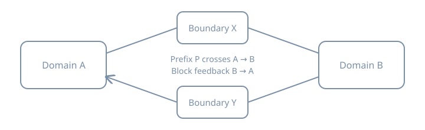

# Redistribution Design and Route Provenance

Redistribution translates routes learned from one routing protocol (or static/connected source) into advertisements for another. At a single boundary router, redistribution is straightforward. At **two or more redundant boundary routers** performing mutual redistribution, a route exported from Domain A into Domain B can re-enter Domain A at the second boundary, lose its original loop-prevention metadata, and trigger suboptimal routing, black holes, or persistent forwarding loops — even while every OSPF and BGP session looks completely healthy.

Start with the [redistribution and route-tag workbook lab](../09-lab-workbook/28-redistribute-and-tag.md) for a single OSPF–BGP boundary, then apply the dual-ASBR design patterns in this chapter.



## Why mutual redistribution loops happen

Imagine an enterprise OSPF core (Domain A) connected to a WAN/partner eBGP domain (Domain B) through two redundant ASBRs: **ASBR-1** and **ASBR-2**.

1. OSPF originates `10.10.0.0/24` inside Domain A.
2. **ASBR-1** redistributes `10.10.0.0/24` from OSPF into eBGP toward Domain B.
3. Domain B advertises `10.10.0.0/24` over eBGP to **ASBR-2**.
4. **ASBR-2** now holds two candidates for `10.10.0.0/24`: the native OSPF route (AD 110) and the newly learned eBGP route (AD 20).

### Administrative Distance inversion

Each router selects its best route in the main RIB by **Administrative Distance (AD)** (also called route preference) *before* deciding what to redistribute:

| Protocol / Route Source | FRR Default AD | Arista EOS Default AD | Loop Risk at Mutual Boundary |
|---|---:|---:|---|
| Connected | 0 | 0 | None (local link) |
| Static | 1 | 1 | High if redistributed without tags |
| **eBGP** | **20** | **20** | **Severe:** beats OSPF (110), causing AD inversion |
| **OSPF** (Intra/Inter/Ext) | **110** | **110** | Loses to eBGP (20), beats iBGP (200) |
| **iBGP** | **200** | **200** | Lower risk than eBGP, but still loops if OSPF fails or splits |

Because eBGP (AD 20) beats OSPF (AD 110), **ASBR-2** replaces its internal OSPF route to `10.10.0.0/24` with the eBGP path pointing *out* toward Domain B. Worse, if ASBR-2 is configured to redistribute BGP back into OSPF, it injects `10.10.0.0/24` as a new OSPF Type 5 external LSA back into Domain A. Packets from Domain A can now bounce between ASBR-2, Domain B, and ASBR-1 in a forwarding loop, or blackhole when the original link in Domain A flaps.

> [!WARNING]
> Protocol-native loop prevention cannot save you across a protocol boundary. OSPF does not carry BGP `AS_PATH`, and BGP does not understand OSPF LSAs. Raising or lowering metrics alone will not stop AD inversion — you must control **provenance** with route tags/communities and explicit prefix filters at **every** boundary router.

## OSPF external route types: E1 versus E2 traps

Metrics do not translate across protocols (a BGP MED of 50 is meaningless as an OSPF cost). When redistributing into OSPF, you must choose between **External Type 1 (E1)** and **External Type 2 (E2)** and set an explicit seed metric.

Within OSPF path selection (before AD comparison in the main RIB), the strict preference order is:
`Intra-area (O) > Inter-area (O IA) > External Type 1 (O E1) > External Type 2 (O E2)`.

- **E2 (default on most NOSes):** Compares **only** the external seed metric first. Internal OSPF cost to reach the ASBR is only used as a tie-breaker when two ASBRs advertise the exact same external metric.
- **E1:** Adds the internal OSPF cost to the ASBR plus the external seed metric (`total = internal + external`), ensuring routers choose the closest exit point.

Consider a router inside Domain A evaluating two exits for `198.51.100.0/24`:

| Exit ASBR | Internal OSPF Cost | External Seed Metric | E1 Total (`Int + Ext`) | E2 Primary (`Ext` only) |
|---|---:|---:|---:|---:|
| ASBR-1 | 10 | 20 | **30** | 20 |
| ASBR-2 | 50 | 10 | 60 | **10** |

- If both advertise **E1**, ASBR-1 wins (`30 < 60`).
- If both advertise **E2**, ASBR-2 wins (`10 < 20`) even though it is five times farther away inside the campus!
- If ASBR-1 advertises **E1 (total 30)** and ASBR-2 advertises **E2 (metric 10)**, **ASBR-1 still wins** because E1 always beats E2 regardless of metric values.

> [!TIP]
> Prefer **E1** when multiple ASBRs advertise the same external prefixes into a single OSPF domain so internal routers naturally exit via the topologically closest ASBR. Also verify the Type 5 LSA **Forwarding Address**: if nonzero and unreachable via an intra/inter-area OSPF route, the LSA stays in the LSDB but never installs into the RIB.

## Route-tag loop prevention contract

Before touching CLI, write a strict two-way provenance contract and apply it symmetrically on **both** ASBR-1 and ASBR-2:

| Direction | Deny First (Return Filter) | Permit & Stamp Provenance |
|---|---|---|
| **OSPF → BGP** | Deny OSPF routes tagged `65002` (originated from BGP) | Permit approved OSPF prefixes; set BGP community `65001:100` |
| **BGP → OSPF** | Deny BGP routes with community `65001:100` (originated from OSPF) | Permit approved BGP prefixes; set OSPF external tag `65002` and metric-type `1` |

Notice why both **OSPF tags** and **BGP communities** are used: OSPF external LSAs carry a 32-bit numeric tag, while BGP carries communities. Translating and denying the peer domain's marker at every boundary guarantees that no route ever completes a round trip.

### FRR (`vtysh`) mutual redistribution with tags and communities

```cfg
ip prefix-list PL-OSPF-OWNED seq 10 permit 10.10.0.0/16 le 24
ip prefix-list PL-BGP-ALLOWED seq 10 permit 198.51.100.0/24 le 24

bgp community-list standard CL-FROM-OSPF permit 65001:100

! --- OSPF -> BGP: block routes that originally came from BGP ---
route-map RM-OSPF-TO-BGP deny 10
 match tag 65002
!
route-map RM-OSPF-TO-BGP permit 20
 match ip address prefix-list PL-OSPF-OWNED
 set community 65001:100 additive
!
! --- BGP -> OSPF: block routes that originally came from OSPF ---
route-map RM-BGP-TO-OSPF deny 10
 match community CL-FROM-OSPF
!
route-map RM-BGP-TO-OSPF permit 20
 match ip address prefix-list PL-BGP-ALLOWED
 set metric 20
 set metric-type type-1
 set tag 65002
!
router ospf
 redistribute bgp route-map RM-BGP-TO-OSPF
!
router bgp 65001
 address-family ipv4 unicast
  redistribute ospf route-map RM-OSPF-TO-BGP
 exit-address-family
```

### Arista cEOS / EOS equivalent

```cfg
ip prefix-list PL-OSPF-OWNED
   seq 10 permit 10.10.0.0/16 le 24
!
ip community-list CL-FROM-OSPF permit 65001:100
!
route-map RM-OSPF-TO-BGP deny 10
   match tag 65002
!
route-map RM-OSPF-TO-BGP permit 20
   match ip address prefix-list PL-OSPF-OWNED
   set community 65001:100 additive
!
route-map RM-BGP-TO-OSPF deny 10
   match community CL-FROM-OSPF
!
route-map RM-BGP-TO-OSPF permit 20
   set metric 20
   set metric-type type-1
   set tag 65002
!
router ospf 1
   redistribute bgp route-map RM-BGP-TO-OSPF
!
router bgp 65001
   redistribute ospf route-map RM-OSPF-TO-BGP
```

> [!IMPORTANT]
> If the remote eBGP neighbor strips standard communities (common with third-party ISPs), communities alone cannot protect the return path. Pair tags with **disjoint prefix-list allowlists** (Domain A only exports Domain A's space; Domain B only exports Domain B's space) and raise eBGP distance or filter locally originated prefixes inbound on eBGP sessions.

## External route summarization hazards

Summarization at an ASBR (`summary-address` in OSPF, `aggregate-address` in BGP) reduces LSDB/RIB churn, but introduces two subtle redistribution risks:

1. **Provenance loss:** An aggregate route is newly originated by the ASBR and typically **does not inherit** the tags or communities of its component routes unless explicitly stamped. If ASBR-1 summarizes `10.10.0.0/16` without a tag, ASBR-2's deny-by-tag rule will miss it and re-inject the `/16`.
2. **Blackhole persistence:** If all component prefixes behind ASBR-1 fail, the summary must be withdrawn immediately (and the local discard/Null0 route must prevent looping packets back to a default route). Never advertise a static summary that outlives its components.

## Step-by-step verification checklist

Run these checks on **both** ASBR-1 and ASBR-2 and on one interior router in each domain after every redistribution change:

1. **Inspect RIB and AD ownership:** Confirm Domain A's native prefixes are installed as `O` (AD 110) — not `B` (AD 20) — on both ASBR-1 and ASBR-2 (`show ip route 10.10.0.0/24`).
2. **Verify provenance tags in OSPF LSDB:** Run `show ip ospf database external 198.51.100.0` and confirm `External Route Tag: 65002` and `Metric Type: 1` (illustrative field names).
3. **Verify BGP communities on exported routes:** Run `show bgp ipv4 unicast 10.10.0.0/24` on the peer and confirm `Community: 65001:100`.
4. **Prove the deny clause actually matched:** Check route-map hit counters (`show route-map`) on ASBR-2 to verify the deny sequence incremented — an absent route alone does not prove your tag filter stopped it.
5. **Test prefix withdrawal:** Withdraw `10.10.0.0/24` inside Domain A. Verify it disappears from both OSPF and BGP within seconds and does **not** stay alive via a stale return copy from ASBR-2.
6. **Test single-ASBR failover:** Shut down ASBR-1's eBGP uplink, confirm traffic shifts cleanly to ASBR-2 in both directions, then restore ASBR-1 and confirm symmetric reconvergence.
7. **Test unapproved routes:** Inject a test `/25` outside `PL-OSPF-OWNED` and a `0.0.0.0/0` default route in lab; verify neither leaks across the boundary.

**References:** [OSPFv2 External Route Calculation, RFC 2328](https://www.rfc-editor.org/rfc/rfc2328.html), [FRR OSPF Redistribution](https://docs.frrouting.org/en/stable-8.0/ospfd.html), and [FRR BGP Redistribution](https://docs.frrouting.org/en/latest/bgp.html).
