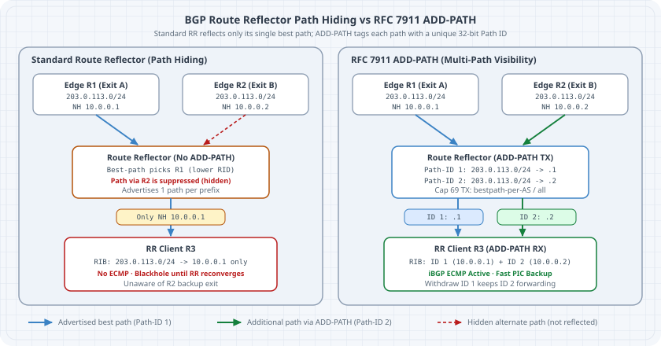

# BGP Large Communities and ADD-PATH

Standard BGP communities and Route Reflectors solved the scaling problems of the 1990s, then quietly ran into two structural walls on modern networks. First, RFC 1997 communities only give you two 16-bit integers (`ASN:Value`), which breaks the moment you operate a 32-bit Autonomous System Number (ASN). Second, a Route Reflector advertises only its single best path per prefix, hiding alternate exits from clients—breaking ECMP, slowing failover, and triggering MED oscillation.

**BGP Large Communities (RFC 8092)** and **BGP ADD-PATH (RFC 7911)** close those two gaps directly in the protocol without hacks or overlay workarounds.

## Learning goals

- Structure an operational RFC 8092 Large Community taxonomy (`GlobalAdmin:LocalData1:LocalData2`) for 32-bit ASNs and enforce stripping at trust boundaries.
- Diagnose Route Reflector path-hiding, ECMP loss, and MED oscillation, and explain how RFC 7911 32-bit Path Identifiers solve them.
- Choose between `addpath-tx-all-paths` and `addpath-tx-bestpath-per-AS` based on RIB/FIB scale and topology.
- Configure and verify Large Communities and ADD-PATH on FRR, Arista cEOS, and Nokia SR Linux.

## RFC 8092 BGP Large Communities

### Why standard and extended communities fall short

A standard community (RFC 1997) is 32 bits split into two 16-bit fields (`ASN:Value`, such as `65001:100`). Once IANA began allocating 32-bit ASNs (RFC 6793, values above `65535`), an operator with ASN `4200000100` literally could not place its own ASN in the first 16 bits. Operators resorted to placeholder ASNs (`23456` or private 16-bit ASNs), which collided across peering exchanges and broke automated filtering.

Extended Communities (RFC 4360) are 64 bits wide, but they carry a 2-octet type/sub-type header, leaving only 6 octets for payload—enough for a 4-byte ASN and a 2-byte local value, not two independent local fields, and their rigid type registry makes ad-hoc routing policy clumsy.

RFC 8092 defines **BGP Large Communities** as an optional transitive path attribute (type code `32`) containing one or more **12-octet (96-bit)** values:

```text
 0                   1                   2                   3
 0 1 2 3 4 5 6 7 8 9 0 1 2 3 4 5 6 7 8 9 0 1 2 3 4 5 6 7 8 9 0 1
+-+-+-+-+-+-+-+-+-+-+-+-+-+-+-+-+-+-+-+-+-+-+-+-+-+-+-+-+-+-+-+-+
|                    Global Administrator (32 bits)             |
+-+-+-+-+-+-+-+-+-+-+-+-+-+-+-+-+-+-+-+-+-+-+-+-+-+-+-+-+-+-+-+-+
|                     Local Data Part 1 (32 bits)               |
+-+-+-+-+-+-+-+-+-+-+-+-+-+-+-+-+-+-+-+-+-+-+-+-+-+-+-+-+-+-+-+-+
|                     Local Data Part 2 (32 bits)               |
+-+-+-+-+-+-+-+-+-+-+-+-+-+-+-+-+-+-+-+-+-+-+-+-+-+-+-+-+-+-+-+-+
```

The canonical text notation is `GlobalAdmin:LocalData1:LocalData2` (for example, `4200000100:100:2`). Because every field is a full 32-bit unsigned integer, you can encode a 4-byte ASN in `GlobalAdmin`, a function or category code in `LocalData1`, and a target peer, region, or peer 4-byte ASN in `LocalData2`.

### Informational vs action community taxonomy

Following RFC 8195 (Use of BGP Large Communities), production networks separate Large Communities into two namespaces using `LocalData1`:

| Namespace | Example (`GA:LD1:LD2`) | Meaning | Where Set |
| :--- | :--- | :--- | :--- |
| **Informational** | `4200000100:100:1` | Route learned from customer (`100`) in region `1` (US-East) | Inbound on edge router |
| **Informational** | `4200000100:200:2` | Route learned from transit (`200`) in region `2` (EU-West) | Inbound on edge router |
| **Action (prepend)** | `4200000100:1001:64512` | Prepend our ASN once (`1001`) when advertising to peer `64512` | Customer or internal TE |
| **Action (no-export)** | `4200000100:1000:64512` | Do not advertise (`1000`) to peer `64512` | Customer or internal TE |
| **Action (blackhole)** | `4200000100:666:0` | Trigger RTBH / discard next hop | Customer or SOC |

> [!IMPORTANT]
> **Strip your own communities at every external trust boundary.** On ingress from every eBGP peer, delete all Large Communities matching `<Your-ASN>:*:*` before tagging the route with your own informational communities. If you allow a peer to send your internal informational or blackhole communities (`4200000100:100:*` or `4200000100:666:*`), an external neighbor can spoof customer status, bypass export filters, or blackhole arbitrary prefixes inside your AS. Only explicitly permit documented customer action communities on customer sessions.

For foundational community filtering mechanics and route-map ordering, see [Policy and Filters](03-policy-and-filters.md).

## RFC 7911 BGP ADD-PATH

### The Route Reflector path-hiding problem

A standard BGP speaker—including a [Route Reflector](07-bgp-route-reflectors.md)—advertises only **one** best path per NLRI (prefix) to each peer. If a second `UPDATE` arrives for the same prefix, it implicitly replaces the previous path.

In an iBGP design with Route Reflectors, this single-path rule creates three production failure modes:

1. **ECMP loss:** Two edge routers (`R1` and `R2`) both receive `203.0.113.0/24` with identical `LOCAL_PREF`, `AS_PATH` length, and `ORIGIN`. The RR picks `R1` using a tie-breaker (lower IGP metric or lower Router ID) and reflects *only* `R1` to client `R3`. Even if `R3` has `maximum-paths ibgp 4` configured, it only sees one path and cannot load-balance.
2. **Slow failover:** When `R1` fails, `R3` has no backup path in its Adj-RIB-In. Traffic blackholes until the RR detects the failure, runs best-path recalculation, withdraws `R1`, and advertises `R2`. With ADD-PATH, `R3` already holds `R2` in its RIB and can program a BGP PIC (Prefix Independent Convergence) backup path in hardware.
3. **MED oscillation:** When multiple exit routers advertise different MED values from different clusters, hiding non-best paths can cause Route Reflectors in different clusters to cycle endlessly between paths (RFC 3345).



### How Path IDs work on the wire

RFC 7911 introduces a BGP capability (Capability Code `69`, negotiated per AFI/SAFI during `OPEN`) with three modes per peer: **Receive only (`1`)**, **Send only (`2`)**, or **Send/Receive (`3`)**.

When negotiated, every NLRI in `UPDATE` and `WITHDRAW` messages is prepended with a **4-octet (32-bit) Path Identifier**:

```text
Standard NLRI:  [ Prefix Length (1B) | Prefix (variable) ]
ADD-PATH NLRI:  [ Path ID (4B) | Prefix Length (1B) | Prefix (variable) ]
```

The Path ID is locally significant to the sending speaker and the specific BGP session. Together, `(Path ID, Prefix)` uniquely identifies a path:

- Advertising `(Path-ID 1, 203.0.113.0/24, NH 10.0.0.1)` and `(Path-ID 2, 203.0.113.0/24, NH 10.0.0.2)` installs **both** paths in the receiver's Adj-RIB-In.
- Withdrawing `(Path-ID 1, 203.0.113.0/24)` removes only the `R1` path while leaving `R2` untouched.

### Selecting paths to advertise: `all-paths` vs `bestpath-per-AS`

Reflecting every known path for a 1-million-prefix internet table across 10 edge routers multiplies memory and CPU by 10x. Modern BGP implementations let you bound how many paths an RR advertises:

| Selection Mode | What the RR Sends | Best Use Case | Memory Impact |
| :--- | :--- | :--- | :--- |
| **`tx-all-paths`** | Every valid path in Loc-RIB | Private fabrics, VPNs, small-to-medium prefix counts | High (linear with exit count) |
| **`tx-bestpath-per-AS`** | Best path from each unique neighbor AS | Internet edge / multi-homed transit RRs | Medium (bounded by upstream AS count) |
| **`tx-best-N` (`send N`)** | Top `N` paths (commonly `2`–`4`) | Large DFZ tables needing ECMP + 1 backup | Predictable, strictly bounded |

> [!WARNING]
> **ADD-PATH capability changes reset the BGP session.** Because Capability `69` is negotiated in the `OPEN` message, enabling ADD-PATH on an established peering tears down and re-establishes the session (unless dynamic capability refresh is supported and enabled on both sides). Roll it out in a maintenance window or drain the RR first (see [IGP Maintenance and Graceful Drain](16-igp-maintenance-and-graceful-drain.md)).

## Configuration examples

### FRR (Route Reflector and Client)

On the **Route Reflector**, enable Large Community ingress stripping/tagging and ADD-PATH transmit (`bestpath-per-AS` or `all-paths`):

```cfg
bgp large-community-list standard OUR-INTERNAL permit 4200000100:.*:.*
bgp large-community-list standard CUST-NO-EXPORT permit 4200000100:1000:64512

route-map EBGP-IN permit 10
 set large-community-list OUR-INTERNAL delete
 set large-community 4200000100:100:1 additive

router bgp 4200000100
 bgp router-id 10.255.0.1
 neighbor CLIENTS peer-group
 neighbor CLIENTS remote-as 4200000100
 neighbor CLIENTS update-source lo
 neighbor 10.255.0.3 peer-group CLIENTS
 !
 address-family ipv4 unicast
  neighbor CLIENTS route-reflector-client
  neighbor CLIENTS addpath-tx-bestpath-per-AS
  ! Use `addpath-tx-all-paths` on small fabrics where full visibility is needed
 exit-address-family
```

On **Client R3**, FRR enables ADD-PATH receive by default on recent releases, and you enable iBGP multipath so the FIB uses the extra paths:

```cfg
router bgp 4200000100
 bgp router-id 10.255.0.3
 neighbor 10.255.0.1 remote-as 4200000100
 neighbor 10.255.0.1 update-source lo
 !
 address-family ipv4 unicast
  maximum-paths ibgp 4
  ! Optional: disable receive if a low-memory router should not accept multiple paths
  ! neighbor 10.255.0.1 disable-addpath-rx
 exit-address-family
```

### Arista cEOS (EOS)

```cfg
ip large-community-list OUR-INTERNAL permit 4200000100:*:*

route-map EBGP-IN permit 10
   set large-community large-community-list OUR-INTERNAL delete
   set large-community 4200000100:100:1 additive

router bgp 4200000100
   router-id 10.255.0.1
   neighbor CLIENTS peer group
   neighbor CLIENTS remote-as 4200000100
   neighbor CLIENTS route-reflector-client
   neighbor CLIENTS bgp additional-paths send any
   neighbor 10.255.0.3 peer group CLIENTS
   !
   address-family ipv4
      bgp additional-paths receive
      bgp additional-paths send any
      maximum-paths 4 ecmp 4
```

### Nokia SR Linux

```cfg
set / network-instance default protocols bgp group clients afi-safi ipv4-unicast add-paths receive true
set / network-instance default protocols bgp group clients afi-safi ipv4-unicast add-paths send true
set / network-instance default protocols bgp group clients afi-safi ipv4-unicast add-paths send-max 4
set / network-instance default protocols bgp group clients afi-safi ipv4-unicast route-reflector client true

set / routing-policy community-set our-internal member [ "4200000100:*:*" ]
set / routing-policy policy ebgp-in statement 10 action policy-result accept
set / routing-policy policy ebgp-in statement 10 action bgp communities remove our-internal
set / routing-policy policy ebgp-in statement 10 action bgp communities add customer-region-1
```

## Verification and troubleshooting

The following commands and outputs are **illustrative** (not captured from a live host).

Verify that Capability `69` (AddPath) negotiated in the expected direction on FRR:

```bash
vtysh -c "show bgp neighbors 10.255.0.3"
```

```text
BGP neighbor is 10.255.0.3, remote AS 4200000100, local AS 4200000100, internal link
  Neighbor capabilities:
    4 Byte AS: advertised and received
    AddPath:
      IPv4 Unicast: RX advertised IPv4 Unicast and received
      IPv4 Unicast: TX advertised IPv4 Unicast
```

Inspect the received paths, Path IDs, and Large Communities on Client `R3`:

```bash
vtysh -c "show bgp ipv4 unicast 203.0.113.0/24"
```

```text
BGP routing table entry for 203.0.113.0/24, version 42
Paths: (2 available, best #1, table default)
  Multipath: iBGP
  4200000200
    10.0.0.1 (metric 10) from 10.255.0.1 (10.255.0.1)
      Origin IGP, localpref 100, valid, internal, multipath, best (Router ID)
      Large Community: 4200000100:100:1
      Remote AddPath ID: 1
  4200000200
    10.0.0.2 (metric 10) from 10.255.0.1 (10.255.0.1)
      Origin IGP, localpref 100, valid, internal, multipath
      Large Community: 4200000100:100:1
      Remote AddPath ID: 2
```

### Common pitfalls

- **Multipath still shows only 1 FIB next hop:** ADD-PATH only delivers the paths to the RIB. For ECMP installation, both paths must have equal `LOCAL_PREF`, `AS_PATH` (or `bgp bestpath as-path multipath-relax`), `ORIGIN`, `MED`, and equal IGP metric to their respective BGP next hops.
- **Asymmetric capability negotiation:** If the RR sends `TX` but the client has `disable-addpath-rx`, the RR falls back to standard single-best-path reflection silently. Always verify both `advertised` and `received` in `show bgp neighbors`.
- **Regex vs exact matching on Large Communities:** In FRR, `standard` large-community-lists match exact `GA:LD1:LD2` values while `expanded` lists evaluate regular expressions. Using `.*` inside a `standard` list fails silently or is rejected—use `expanded` when wildcarding fields.

## Summary

- **RFC 8092 Large Communities** (`GlobalAdmin:LocalData1:LocalData2`) give 32-bit ASN networks a clean 96-bit policy primitive; always separate informational from action namespaces and scrub your own ASN's communities at external borders.
- **RFC 7911 ADD-PATH** eliminates Route Reflector path-hiding by tagging each candidate path with a 32-bit Path ID, restoring iBGP ECMP, fast PIC failover, and MED stability.
- Bound memory overhead on large tables with `addpath-tx-bestpath-per-AS` or `send-max N` rather than blindly reflecting every path.
