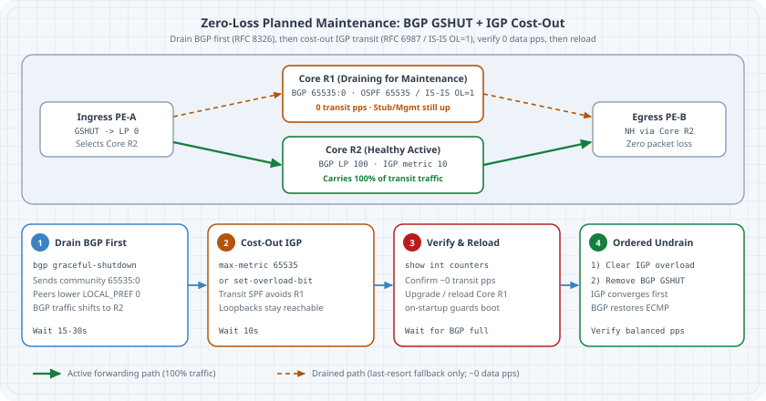

# IGP Maintenance and Graceful Drain

Taking a core router or leaf switch offline for a NOS upgrade, line-card swap, or kernel patch should not drop a single packet. Simply running `reboot` forces peers to wait for BFD or hello timers to expire, drops in-flight packets during reconvergence, and—worse—can leave BGP forwarding into a half-converged IGP when the router boots back up.

**Zero-loss planned maintenance** separates **traffic draining** from **node shutdown**. By signaling peers to shift traffic away *before* any link goes down—and holding traffic off until control planes fully converge *after* boot—you convert an outage into a non-event.

## Learning goals

- Use OSPF `max-metric router-lsa` (RFC 6987) and IS-IS Overload Bit (`set-overload-bit`) to drain transit IGP traffic while keeping stub links reachable.
- Coordinate BGP Graceful Shutdown (`GSHUT`, community `65535:0`, RFC 8326) with IGP cost-out in the right order.
- Explain why `on-startup` hold-down timers prevent post-reboot BGP blackholes.
- Execute a repeatable Drain, Maintain, and Undrain runbook on FRR, Arista cEOS, and Nokia SR Linux.

## Why ordering matters: BGP before IGP

A router in a production network usually plays two roles simultaneously: it is an **IGP transit hop** for other routers' loopbacks, and it is a **BGP speaker** advertising external or overlay prefixes. If you drain them in the wrong order, you can still blackhole traffic:

1. **Drain BGP first (RFC 8326 `GSHUT`):** Signal BGP peers to stop using this router as a BGP next hop. Because the IGP is still healthy, all BGP updates propagate cleanly and alternate exits take over smoothly.
2. **Drain IGP second (OSPF max-metric / IS-IS Overload Bit):** Signal IGP neighbors to stop using this router as a *transit* node for other routers' loopbacks. Because BGP next hops have already moved off this router, shifting IGP transit paths does not cause BGP next-hop churn.
3. **Undrain in reverse order (IGP first, then BGP):** After reboot, keep IGP overloaded until BGP finishes receiving its full table (`on-startup wait-for-bgp`), then clear IGP overload so underlay reachability is optimal, and finally remove BGP `GSHUT`.



## OSPF Max-Metric Router-LSA (RFC 6987)

RFC 6987 defines **OSPF Stub Router Advertisement**. Instead of shutting down interfaces or manually editing link costs on every port, the router sets the metric of all **non-stub** (transit and point-to-point) links in its Type-1 Router-LSA to **`LSInfinity` (`65535`)**:

- **Transit traffic shifts away:** Other routers running SPF see a cost of `65535` through the draining router and immediately pick any alternate path with lower total cost.
- **Stub links stay reachable:** Directly connected subnets and the router's own loopback keep their normal metric, so SSH/management and directly attached hosts remain reachable if no other path exists.
- **Last-resort fallback:** Unlike shutting down OSPF, `65535` is still a valid finite path cost in RFC 6987. If the alternate path fails during your maintenance window, traffic still falls back through the draining router rather than blackholing.

Three modes cover the full maintenance lifecycle:

| Mode | Trigger | Operational Purpose |
| :--- | :--- | :--- |
| **`administrative`** | Manual CLI toggle | Planned drain before maintenance; stays active until manually cleared. |
| **`on-shutdown <sec>`** | Graceful reload/stop | Advertises `65535` for `<sec>` seconds right before OSPF shuts down. |
| **`on-startup <sec>` / `wait-for-bgp`** | Router/process boot | Holds transit traffic off after reboot until BGP converges, preventing post-boot blackholes. |

> [!IMPORTANT]
> **Why `on-startup wait-for-bgp` is mandatory on BGP transit routers.** When a router reboots, OSPF converges in 1–2 seconds, while a full BGP table takes 15–90 seconds to download and install into the FIB. Without `on-startup`, neighbors immediately send transit traffic to the rebooted router—which lacks the BGP routes to forward it and silently drops packets until BGP finishes.

## IS-IS Overload Bit (RFC 1195 / RFC 5301)

IS-IS implements the exact same stub-router behavior via a single flag in the Link State PDU (LSP) header: the **Overload (OL) bit**.

- When a router sets `OL=1` in its LSP, SPF implementations on all other routers in the area/level exclude that router from transit shortest-path calculations.
- Directly attached IP prefixes (loopbacks and stub subnets) advertised in the router's LSP remain reachable.
- Like OSPF, IS-IS supports **`on-startup`** (fixed timer or `wait-for-bgp`) so a rebooting node does not attract transit traffic before BGP is ready.

> [!NOTE]
> If you run **MPLS LDP** or **Segment Routing**, check whether your NOS also needs `mpls ldp igp sync` or TI-LFA awareness during drain; setting the IS-IS Overload Bit or OSPF max-metric shifts both IP and SR-MPLS/LDP LSPs cleanly around the node.

## BGP Graceful Shutdown (`GSHUT`, RFC 8326)

For BGP-level draining, RFC 8326 standardizes the well-known community **`65535:0` (`graceful-shutdown` / `GSHUT`)**. See [BGP Graceful Restart, LLGR and GSHUT](13-bgp-graceful-restart-llgr-gshut.md) for the protocol mechanics; here is how it fits into a maintenance drain:

- **Pre-configured on all peers (steady state):** Every router in your AS (and cooperating eBGP peers) runs an inbound policy matching community `65535:0` and setting **`LOCAL_PREF 0`**.
- **At maintenance time:** Enabling `bgp graceful-shutdown` on the draining router automatically attaches `65535:0` to all outbound advertisements (and optionally lowers `LOCAL_PREF` locally).
- **Make-before-break shift:** Peers still hold the draining router's routes as a fallback at `LOCAL_PREF 0`, immediately switch best-path to healthy peers (`LOCAL_PREF 100`), and send zero packets to the draining router—*before* a single BGP session is torn down.

## Configuration examples

### FRR (OSPF + IS-IS + BGP GSHUT)

Always configure the steady-state `on-startup` protection and inbound `GSHUT` receiver policy *before* a maintenance window:

```cfg
! Steady-state: protect reboots and honor peers' GSHUT community
bgp community-list standard GSHUT permit graceful-shutdown

route-map ACCEPT-GSHUT permit 10
 match community GSHUT
 set local-preference 0
 on-match next
route-map ACCEPT-GSHUT permit 20

router ospf
 max-metric router-lsa on-startup 180
 max-metric router-lsa on-shutdown 10

router isis CORE
 set-overload-bit on-startup 180
```

During a planned maintenance window, activate the drain on the target node:

```cfg
! Step 1: Drain BGP
router bgp 65001
 bgp graceful-shutdown

! Step 2: Drain IGP (use the one your fabric runs)
router ospf
 max-metric router-lsa administrative
! or for IS-IS:
router isis CORE
 set-overload-bit
```

### Arista cEOS (EOS)

Arista EOS provides both individual protocol knobs and a unified `maintenance` profile that coordinates BGP GSHUT and IGP cost-out in one transaction:

```cfg
! Manual protocol-level drain on EOS
router bgp 65001
   graceful-shutdown

router ospf 1
   max-metric router-lsa
   max-metric router-lsa on-startup wait-for-bgp

router isis CORE
   set-overload-bit
   set-overload-bit on-startup wait-for-bgp
```

```cfg
! Alternative: EOS Maintenance Mode unit (drains BGP + IGP together)
maintenance
   profile bgp DRAIN-BGP
      initiator route-map GSHUT-OUT out
   profile unit CORE-R1
      group bgp ALL-PEERS
      group isis CORE
      quiesce
```

### Nokia SR Linux

```cfg
# Drain BGP via graceful-shutdown
set / network-instance default protocols bgp admin-state enable
set / network-instance default protocols bgp group peers export-policy [ gshut-out ]

# Drain OSPF (stub-router)
set / network-instance default protocols ospf instance main max-metric router-lsa administrative true
set / network-instance default protocols ospf instance main max-metric router-lsa on-startup 180

# Drain IS-IS (overload bit)
set / network-instance default protocols isis instance main overload immediate set-bit true
set / network-instance default protocols isis instance main overload on-boot timeout 180
```

## Production Drain / Undrain Runbook

Treat every planned router maintenance as a gated checklist—never proceed to reload until traffic counters confirm the drain actually worked.

### Phase 1: Pre-flight checks

1. Verify alternate paths exist and have headroom (utilization < 50% on sibling links/routers so N-1 capacity does not saturate).
2. Confirm steady-state `ACCEPT-GSHUT` policy is deployed on peer routers.
3. Snapshot baseline interface rates and BGP/IGP session counts.

### Phase 2: Ordered drain

1. Enable **BGP `graceful-shutdown`** on the target node; wait 15–30 seconds for BGP propagation.
2. Enable **IGP cost-out** (`max-metric router-lsa administrative` or `set-overload-bit`); wait 10 seconds for SPF.
3. **Verify zero transit traffic** using interface counters (illustrative output):

```bash
# Watch transit interface pps drop to near-zero (only hellos/BGP keepalives remain)
vtysh -c "show interface eth1" | grep -E "input rate|output rate"
```

```text
  5 minute input rate 1200 bits/sec, 2 packets/sec
  5 minute output rate 1200 bits/sec, 2 packets/sec
```

4. Verify OSPF Router-LSA / IS-IS LSP flags on a *neighbor* router (illustrative output):

```bash
vtysh -c "show ip ospf database router 10.255.0.1"
```

```text
  LS age: 12
  Options: 0x2 (*|-|-|-|-|-|E|-)
  LS Type: router-LSA
  Advertising Router: 10.255.0.1
    Link connected to: another Router (point-to-point)
      Number of TOS metrics: 0
      TOS 0 Metric: 65535
```

> [!WARNING]
> **If transit pps does NOT drop to near-zero, STOP.** Common culprits include: a static route pointing at the draining node, an eBGP peer ignoring `65535:0` (requires temporary AS-path prepending or outbound `LOCAL_PREF` adjustment), or a single-homed downstream host with no alternate path.

### Phase 3: Maintenance & ordered undrain

1. Perform the upgrade/reboot. Upon boot, verify `on-startup` hold-down is active while BGP sessions return to `Established`.
2. Verify all expected IGP adjacencies (`Full` / `Up`) and BGP prefix counts match your pre-flight snapshot.
3. Remove **IGP administrative cost-out** first (`no max-metric router-lsa administrative` / `no set-overload-bit`).
4. Remove **BGP `graceful-shutdown`** (`no bgp graceful-shutdown`).
5. Confirm transit interface pps rises back to balanced ECMP levels and zero interface drops occur.

## Summary

- Always drain **BGP first (`GSHUT 65535:0`)**, then **IGP (`max-metric 65535` / IS-IS `OL=1`)**, and undrain in reverse order (**IGP first, then BGP**).
- Configure **`on-startup`** (`wait-for-bgp` or 180s) permanently in your baseline config so unplanned crashes and planned reboots never attract transit traffic before BGP converges.
- Never reload a router without verifying that transit interface packet rates have dropped to control-plane keepalive levels.
