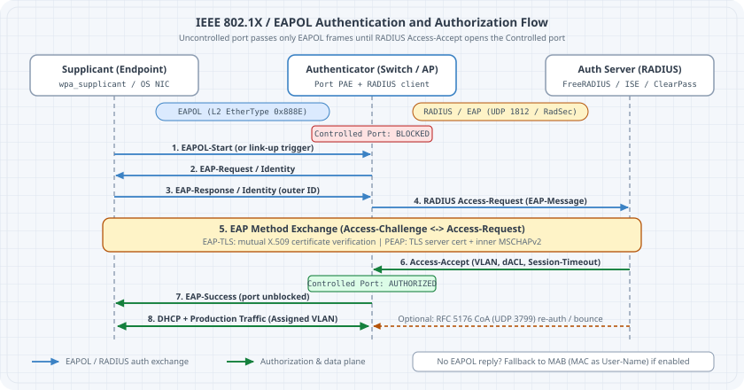
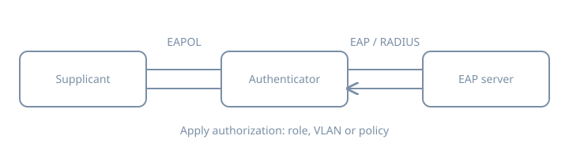

# Network Access Control: 802.1X, EAP and Authorization

A switch port can be electrically up (`up/up`) and still block every user frame until the attached endpoint proves its identity and receives an authorization policy. IEEE 802.1X couples link-layer port control with centralized identity verification, turning every campus access port into an enforcement boundary.



## Roles and the Controlled vs. Uncontrolled port

Every 802.1X deployment separates responsibilities across three components:

- **Supplicant:** Software on the endpoint (`wpa_supplicant` on Linux, native 802.1X clients on Windows/macOS) that answers identity challenges using credentials or X.509 certificates.
- **Authenticator:** The access switch or wireless controller/AP. It enforces port state locally and relays EAP frames inside RADIUS packets (UDP 1812, or RadSec over TLS/TCP 2083).
- **Authentication Server:** A RADIUS/AAA policy engine (FreeRADIUS, Cisco ISE, Aruba ClearPass) that validates credentials against PKI/AD/LDAP and returns an `Access-Accept` or `Access-Reject` with authorization attributes.

Logically, the authenticator splits each physical port into two virtual paths:

- **Uncontrolled Port:** Always open, but permits **only** EAPOL frames (`EtherType 0x888E`, destination multicast `01:80:C2:00:00:03`) plus any explicitly allowed pre-auth traffic (such as PXE/DHCP if configured in Low-Impact/Monitor mode).
- **Controlled Port:** Blocked (`Unauthorized`) until the authentication server returns `Access-Accept`. Once `Authorized`, normal production traffic enters the assigned VLAN and ACL.



> [!NOTE]
> 802.1X authenticates the port; it does **not** encrypt wired Ethernet frames. To protect confidentiality and integrity on the wire after authentication, pair 802.1X with MACsec key agreement (MKA). See [MACsec and MKA](09-macsec-and-mka.md) and [Wireless LAN Fundamentals](../03-layer-2/06-wireless-lan-fundamentals.md).

## EAP-TLS versus PEAP-MSCHAPv2

EAP (RFC 3748) is an extensible transport framework, not a single authentication method. In enterprise networks, two methods dominate:

| Criterion | EAP-TLS (RFC 5216 / RFC 9190) | PEAP-MSCHAPv2 |
|---|---|---|
| **Authentication basis** | Mutual X.509 certificates (server + client) | Server certificate + inner username/password |
| **Phishing / evil-twin resistance** | **Strong** (when client validates server CA + SAN) | Moderate; vulnerable if client skips server cert validation |
| **Credential rotation** | Automated via SCEP / ACME / MDM | Tied to user password lifecycle (lockouts on password change) |
| **Operational dependency** | Internal PKI, CRL/OCSP reachability, NTP clock sync | AD/NTLM backend (`ntlm_auth` / Samba / NPS) |
| **Production recommendation** | **Preferred standard** for corporate managed endpoints | Legacy fallback only; migrate off MSCHAPv2 where possible |

> [!WARNING]
> Never "fix" an EAP-TLS or PEAP failure by disabling server certificate validation on the supplicant. Without pinning the trusted CA and expected RADIUS server DNS name (`altsubject_match`), an attacker with a rogue switch or AP can intercept credentials or impersonate the network.

## MAB fallback for headless devices

Printers, badge readers, IP cameras, and medical/OT sensors rarely run an 802.1X supplicant. **MAC Authentication Bypass (MAB)** lets the switch wait for EAPOL to time out, then read the device's first source MAC address and send it to RADIUS as both `User-Name` and `User-Password`.

Because a MAC address is printed on the chassis and trivial to spoof (`ip link set dev eth0 address ...`), treat MAB as **weak classification**, never strong authentication:

- Place MAB endpoints in a dedicated, tightly firewalled VLAN with a downloadable ACL (dACL) permitting only required ports (for example, IPP/9100 to the print server).
- Combine MAB with **device profiling** (DHCP fingerprint, LLDP/CDP, OUI) and port-security MAC limits (`max 1` or `max 2` for IP phone + PC).
- Maintain an explicit exception lifecycle so unused MAB entries are pruned.

## Dynamic VLAN assignment and RFC 5176 CoA

Authentication answers *who are you?*; authorization answers *what can you touch?* Using RFC 3580 RADIUS attributes inside `Access-Accept`, the AAA server dynamically assigns the endpoint's VLAN:

- `Tunnel-Type = VLAN` (`13`)
- `Tunnel-Medium-Type = IEEE-802` (`6`)
- `Tunnel-Private-Group-Id = "20"` (VLAN ID or name)
- Optional: `Filter-Id` or vendor-specific dACL, plus `Session-Timeout` for periodic reauthentication.

### Change of Authorization (CoA — RFC 5176)

Standard RADIUS is pull-only (the switch asks the server). **CoA (UDP 3799)** lets the RADIUS server push mid-session changes *to* the switch:

- **Quarantine / Re-auth:** If an EDR/SIEM flags a compromised laptop, the AAA server sends a `CoA-Request` to move the port into a quarantine VLAN or apply a restrictive dACL immediately.
- **Port Bounce:** Because changing a wired port's VLAN does not automatically trigger a Windows/Linux DHCP renew, a CoA `Bounce-Host-Port` briefly flaps the link so the client requests a new IP on the new VLAN.

## Rollout strategy: Monitor Mode to Closed Mode

Enabling strict 802.1X across a live campus overnight will cause an outage. Roll out in three controlled phases:

1. **Monitor Mode (Open Authentication):** Switch runs 802.1X and MAB and logs every `Access-Accept`/`Access-Reject` to RADIUS, but permits traffic even on failure (`authentication open`). Use this phase to inventory headless devices, fix broken supplicants, and verify RADIUS redundancy.
2. **Low-Impact Mode:** Apply a pre-authentication ACL permitting only DHCP, DNS, and remediation/PKI servers before authentication succeeds; once authorized, full VLAN/dACL applies.
3. **Closed Mode:** Remove the open bypass. Unauthenticated ports drop all non-EAPOL traffic (or fall back to a strictly isolated guest/remediation VLAN). Configure **Critical Auth (AAA Fail-Open/Fail-VLAN)** so a total RADIUS outage does not lock out active workstations.

## Concrete configuration snippets

### Linux Supplicant (`wpa_supplicant` wired EAP-TLS)

```cfg
# /etc/wpa_supplicant/wpa_supplicant-wired-eth0.conf
ctrl_interface=/run/wpa_supplicant
ap_scan=0

network={
    key_mgmt=IEEE8021X
    eap=TLS
    identity="host/ws-042.corp.example"
    ca_cert="/etc/ssl/certs/corp-root-ca.pem"
    client_cert="/etc/ssl/certs/ws-042.pem"
    private_key="/etc/ssl/private/ws-042.key"
    altsubject_match="DNS:radius.corp.example"
    eapol_flags=0
}
```

### FreeRADIUS dynamic VLAN policy (`users` / `authorize` snippet)

```text
# Illustrative FreeRADIUS policy returning RFC 3580 VLAN 20 for corporate hosts
"host/ws-042.corp.example"
    Tunnel-Type := VLAN,
    Tunnel-Medium-Type := IEEE-802,
    Tunnel-Private-Group-Id := "20",
    Session-Timeout := 28800,
    Termination-Action := RADIUS-Request
```

### Switch access port (Cisco IOS-XE style, Closed Mode + MAB + Critical VLAN)

```cfg
interface GigabitEthernet1/0/12
 switchport mode access
 switchport access vlan 999
 authentication host-mode multi-domain
 authentication order dot1x mab
 authentication priority dot1x mab
 authentication port-control auto
 authentication event fail action next-method
 authentication event server dead action authorize vlan 20
 authentication periodic
 authentication timer reauthenticate server
 mab
 dot1x pae authenticator
 spanning-tree portfast
```

## Troubleshooting sequence

When a user reports "link is up, no network," isolate the failure layer by layer:

1. **No EAP exchange:** Verify `dot1x pae authenticator`, link state, and `show dot1x interface` EAPOL counters. On wireless, separate 802.11 association from 802.1X EAP.
2. **EAP starts, then times out:** Check switch-to-RADIUS reachability, shared secret, UDP 1812 firewall rules, and EAP-TLS certificate fragmentation (reduce `framed-mtu` to `1300` if certificates exceed path MTU).
3. **Explicit `Access-Reject` or TLS error:** Compare FreeRADIUS logs (`radiusd -X` in lab) against client trust store, server SAN, certificate expiry, CRL/OCSP reachability, and NTP clock skew.
4. **`Access-Accept` received, but no IP/connectivity:** Confirm the assigned VLAN actually exists on the switch, is permitted on the upstream trunk, and has a working DHCP relay (`ip helper-address`).
5. **Drops after hours of working:** Check `Session-Timeout` reauthentication, AAA server availability during re-auth, and whether CoA UDP 3799 is blocked by a firewall.

**References:** [EAP, RFC 3748](https://www.rfc-editor.org/rfc/rfc3748.html), [802.1X RADIUS Usage, RFC 3580](https://www.rfc-editor.org/rfc/rfc3580.html), [RADIUS CoA Extensions, RFC 5176](https://www.rfc-editor.org/rfc/rfc5176.html), and [EAP-TLS 1.3, RFC 9190](https://www.rfc-editor.org/rfc/rfc9190.html).
