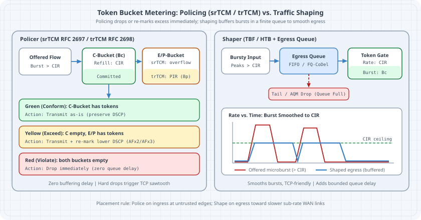
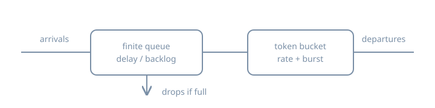

# QoS: Queues, Token Buckets and Congestion Evidence

QoS decides how a finite link and its buffers are shared during contention. A DSCP label alone does not reserve bandwidth or guarantee latency: each hop must classify, meter, mark, queue, and schedule traffic according to a consistent policy, and the path must have enough sustained capacity. Start with [QoS Vocabulary](03-qos-vocabulary.md), then quantify queueing, token buckets, scheduling, and platform enforcement here.



## The bottleneck and the queue



For a constant-rate link, serialization delay is `packet bits / link bits per second`. A 1,500-byte packet at 10 Mbit/s takes about 1.2 ms to serialize, before link-layer overhead. A queue holding 100,000 bytes drained at 10 Mbit/s adds roughly `100,000 × 8 / 10,000,000 = 0.08 s` (80 ms) of queueing delay to a packet arriving at the tail. Larger buffers absorb microbursts without immediate drops, but under sustained overload they turn into standing latency (bufferbloat); see [FQ-CoDel and CAKE](06-fq-codel-and-cake.md) and [ECN and L4S](06b-ecn-and-l4s.md) for active queue management.

Traffic does not need to average above line rate to build a queue: sub-millisecond bursts easily exceed egress service rate. A one-minute SNMP utilization poll can read 30% while microbursts overflow a 4 MB shared switch buffer. Distinguish counter classes before tuning: input drops, egress queue tail drops, policer drops, FCS/CRC interface errors, and upstream congestion each point to a different bottleneck.

## Token-bucket math: srTCM versus trTCM

A token bucket models a rate limiter or shaper using a sustained rate and burst depth. Tokens accumulate at a configured rate up to a maximum bucket size; admitting or transmitting a packet removes tokens equal to its accounted byte length. Units must stay explicit: `1 Mbit/s = 125,000 bytes/s`, and a `16,000-byte` burst is `128,000 bits`, not `16,000 bits`.

| Parameter | Meaning | Typical formula / sizing rule |
|---|---|---|
| **CIR** (Committed Information Rate) | Sustained average rate permitted over time | Contracted or policy rate (bits/s or bytes/s) |
| **PIR** (Peak Information Rate) | Upper ceiling rate during bursts (two-rate only) | `PIR >= CIR`, capped by physical interface rate |
| **Bc / CBS** (Committed Burst Size) | Depth of the C-bucket (bytes) | `Bc = CIR_bytes_per_sec × Tc` (often 50–100 ms, at least `>= 1 × MTU`) |
| **Be / EBS or PBS** (Excess / Peak Burst Size) | Depth of the E- or P-bucket (bytes) | Sized to absorb transient bursts without starving CIR |

Two IETF metering standards govern three-color marking (green = conforming, yellow = exceeding, red = violating):

- **srTCM (Single-Rate Three-Color Marker, RFC 2697):** uses one token refill rate (**CIR**) and two buckets (**C** of size `CBS`, **E** of size `EBS`). Tokens enter bucket C at rate CIR; only when C is full do overflow tokens spill into bucket E. A packet is marked **green** if C has enough tokens, **yellow** if C lacks tokens but E has enough, and **red** if neither has enough. srTCM meters *burst size* around a single rate; it cannot sustain a second higher rate.
- **trTCM (Two-Rate Three-Color Marker, RFC 2698):** uses two independent refill rates (**CIR** filling bucket C up to `CBS`, and **PIR** filling bucket P up to `PBS`). A packet is checked against P first: if P lacks tokens it is **red**; otherwise if C lacks tokens it is **yellow** (consuming from P only); if both have tokens it is **green** (consuming from both C and P). trTCM enforces both a committed baseline and a hard peak rate.

> [!NOTE]
> When an ISP and a customer router account for different L2 headers (Ethernet FCS, 802.1Q VLAN tags, or PPPoE/VXLAN overhead), a customer shaper set to the nominal CIR can still trip the provider's ingress policer. Shape 3–5% below the contracted CIR or configure explicit overhead accounting (`overhead` in Linux `tc`).

## Policing versus shaping

A **policer** evaluates packets against token buckets and immediately transmits, remarks (e.g., yellow to AF22/AF23), or drops nonconforming packets. Because it does not buffer excess traffic, policing adds negligible delay but creates sharp sawtooth throughput under TCP when burst depth `Bc` is too small.

A **shaper** holds excess packets in a finite egress queue until enough tokens accumulate, smoothing bursts into a steady pacing rate. Shaping reduces TCP retransmissions at the cost of added queueing delay (bounded by buffer size) and only works on **egress**; ingress interfaces cannot physically slow down an upstream sender without link-layer pause frames or drops.

## Scheduling: strict priority versus DWRR and WFQ

Once packets are classified into hardware or software queues, a scheduler chooses which eligible queue transmits next:

- **Strict Priority (SP / LLQ):** always drains the highest-priority queue before serving any lower queue. SP minimizes jitter for bounded real-time flows (VoIP EF, control-plane CS6), but an unbounded SP flow will completely **starve** lower queues during congestion. Always pair SP with an ingress or queue-level policer/shaper cap (for example, capping EF to 15–20% of link capacity).
- **DWRR (Deficit Weighted Round Robin):** assigns each non-priority queue a weight (quantum in bytes) and visits queues in round-robin order. A deficit counter tracks leftover credit so variable-size packets achieve accurate long-term bandwidth shares in $O(1)$ per-packet work, making DWRR standard in switch ASICs.
- **WFQ (Weighted Fair Queueing):** approximates bit-by-bit Generalized Processor Sharing by computing virtual finish times per flow or class. WFQ gives small interactive packets lower latency than bulk flows, at higher per-packet sorting cost than DWRR.

## DSCP trust boundaries

DSCP occupies the upper 6 bits of the IPv4 TOS / IPv6 Traffic Class byte; the lower 2 bits carry ECN. EF is DSCP 46 (`101110`): with ECN `00` the byte is `0xb8`, while with ECN CE (`11`) the byte becomes `0xbb`. Never match the full byte without masking out ECN.

End-user hosts, unmanaged switches, and untrusted WAN peers can stamp arbitrary DSCP values (such as EF or CS6) to jump queues. Establish an explicit **trust boundary**:

1. **Untrusted access ports:** remark all ingress traffic to DSCP `0` (Best Effort / CS0), or classify strictly by L3/L4 policy (for example, corporate VoIP subnet + RTP ports → EF).
2. **Trusted infrastructure links:** trust DSCP on switch-to-switch trunks, IP phone ports authenticated via 802.1X/LLDP-MED, and internal router uplinks.
3. **WAN handoffs:** remark on egress to match the carrier's SLA classes (often 3–4 classes) and re-mark or validate on ingress.

## Linux `tc` (HTB + FQ-CoDel + ingress policer)

Linux traffic control (`tc`) separates egress shaping/scheduling from ingress policing. The example below shapes egress on `eth0` to `100 Mbit/s` with HTB (Hierarchical Token Bucket), allocates a bounded priority class for EF (`DSCP 46`, byte `0xb8` masked with `0xfc`), gives bulk traffic FQ-CoDel for low standing latency, and applies an ingress policer on `eth0`.

```bash
# 1. Egress: HTB root shaper at 100 Mbit/s with default class 1:30
tc qdisc replace dev eth0 root handle 1: htb default 30
tc class add dev eth0 parent 1: classid 1:1 htb rate 100mbit ceil 100mbit

# Priority class (EF / VoIP): 20 Mbit/s committed, capped at 25 Mbit/s (prevents starvation)
tc class add dev eth0 parent 1:1 classid 1:10 htb rate 20mbit ceil 25mbit prio 0
tc qdisc add dev eth0 parent 1:10 handle 10: fq_codel limit 400 target 5ms interval 50ms

# Business-critical class (AF21): 50 Mbit/s committed, can borrow up to 90 Mbit/s
tc class add dev eth0 parent 1:1 classid 1:20 htb rate 50mbit ceil 90mbit prio 1
tc qdisc add dev eth0 parent 1:20 handle 20: fq_codel

# Best-effort class (CS0): 30 Mbit/s committed, can borrow up to 90 Mbit/s
tc class add dev eth0 parent 1:1 classid 1:30 htb rate 30mbit ceil 90mbit prio 2
tc qdisc add dev eth0 parent 1:30 handle 30: fq_codel

# Classify IPv4 EF (DSCP 46 -> 0xb8, mask 0xfc ignores ECN bits) into 1:10
tc filter add dev eth0 protocol ip parent 1: prio 1 u32 \
  match ip dsfield 0xb8 0xfc flowid 1:10

# 2. Ingress: drop traffic exceeding 100 Mbit/s with a 256 KB burst
tc qdisc replace dev eth0 handle ffff: ingress
tc filter add dev eth0 parent ffff: protocol ip prio 1 u32 \
  match ip src 0.0.0.0/0 \
  police rate 100mbit burst 256k drop flowid :1
```

## Arista cEOS QoS configuration

On Arista EOS / cEOS switches, QoS uses explicit trust boundaries on ingress and hardware traffic-class queues with strict priority plus DWRR weights on egress:

```text
! Global DSCP-to-Traffic-Class mapping (EOS defaults map EF->TC5, CS6->TC6, AF21->TC2)
qos map dscp 46 to traffic-class 5
qos map dscp 18 to traffic-class 2

! Untrusted access port: ignore host DSCP, force Best Effort (TC0 / DSCP 0)
interface Ethernet1
   description Access-Host-Untrusted
   qos trust disabled
   qos dscp 0

! Trusted uplink: trust DSCP, cap strict-priority TC5, schedule TC0/TC2 with DWRR
interface Ethernet49
   description Uplink-Core
   qos trust dscp
   tx-queue 5
      priority
      bandwidth percent 20
   tx-queue 2
      no priority
      bandwidth percent 50
   tx-queue 0
      no priority
      bandwidth percent 30
```

Verify queue drops and counter deltas with `show qos interfaces Ethernet49` and `show interfaces Ethernet49 counters queue` (outputs vary by platform; cEOS software forwarding does not emulate hardware MMU buffer exhaustion identically to Trident/Jericho ASICs).

## Lab: observe a shaper under burst load

The following disposable Linux namespace script requires `unshare`, `nsenter`, `ip`, `tc`, and Python 3. It sends 2,000 UDP datagrams across a `veth` pair shaped with TBF (`1 Mbit/s`, `16 KB` burst, `100 ms` max latency) without touching host interfaces.

Save as `shape-lab.sh` and run `unshare -rn bash shape-lab.sh`:

```bash
set -eu
unshare -n sleep 60 & peer=$!
trap 'kill "$peer" 2>/dev/null || true; wait "$peer" 2>/dev/null || true' EXIT
sleep 0.2
ip link add tx0 type veth peer name rx0
ip link set rx0 netns "$peer"
ip addr add 10.77.0.1/24 dev tx0
ip link set tx0 up
nsenter -t "$peer" -n ip link set lo up
nsenter -t "$peer" -n ip addr add 10.77.0.2/24 dev rx0
nsenter -t "$peer" -n ip link set rx0 up

tc qdisc add dev tx0 root tbf rate 1mbit burst 16kb latency 100ms
python3 - <<'PY'
import socket
s = socket.socket(socket.AF_INET, socket.SOCK_DGRAM)
for _ in range(2000):
    s.sendto(b'x' * 1000, ('10.77.0.2', 9999))
s.close()
PY
sleep 1
tc -s qdisc show dev tx0
tc qdisc del dev tx0 root
```

Illustrative output on a test host:

```text
qdisc tbf 8001: root refcnt 2 rate 1Mbit burst 16Kb lat 100.0ms
 Sent 48926 bytes 47 pkt (dropped 1957, overlimits 2039 requeues 0)
 backlog 0b 0p requeues 0
```

`overlimits` counts rate-enforcement events rather than drops; `dropped` confirms the finite `100ms` latency buffer overflowed while the burst drained at `1 Mbit/s`. Repeat with a larger `burst` or slower sender to observe how drops and delay trade off.

## Verification commands and congestion evidence

When diagnosing a QoS incident, correlate interface counters, hardware queue counters, and active delay probes instead of looking at average utilization alone:

```bash
# Linux: inspect per-class byte/packet counters, overlimits, drops, and standing backlog
tc -s -d class show dev eth0
tc -s qdisc show dev eth0
```

Illustrative Linux HTB + FQ-CoDel output during congestion:

```text
class htb 1:10 parent 1:1 leaf 10: prio 0 rate 20Mbit ceil 25Mbit burst 1600b cburst 1600b
 Sent 4120800 bytes 18730 pkt (dropped 0, overlimits 0 requeues 0)
 backlog 0b 0p requeues 0
class htb 1:30 parent 1:1 leaf 30: prio 2 rate 30Mbit ceil 90Mbit burst 1599b cburst 1600b
 Sent 184920100 bytes 123280 pkt (dropped 412, overlimits 8941 requeues 0)
 backlog 18144b 12p requeues 0
```

In this illustrative snapshot, `1:10` (EF) stays at zero drops and zero standing backlog while `1:30` (Best Effort) absorbs drops and `overlimits` under load.

## Design checks

1. At 20 Mbit/s, how long does a 50,000-byte FIFO backlog take to drain (ignoring overhead and new arrivals)? **20 ms** (`50,000 × 8 / 20,000,000`).
2. If latency spikes while drops stay near zero, inspect standing queue depth and bufferbloat rather than assuming a policer is dropping packets.
3. If a marked EF voice stream lands in the best-effort queue, inspect the trust boundary and DSCP-to-queue map at every hop; packet marking alone does not move traffic between queues.
4. Always cap strict-priority queues so a misbehaving or spoofed EF flow cannot starve BGP, OSPF, or SSH management traffic.

**References:** [Differentiated Services field, RFC 2474](https://www.rfc-editor.org/rfc/rfc2474.html), [srTCM, RFC 2697](https://www.rfc-editor.org/rfc/rfc2697.html), [trTCM, RFC 2698](https://www.rfc-editor.org/rfc/rfc2698.html), and [Linux `tc-htb(8)`](https://man7.org/linux/man-pages/man8/tc-htb.8.html).
