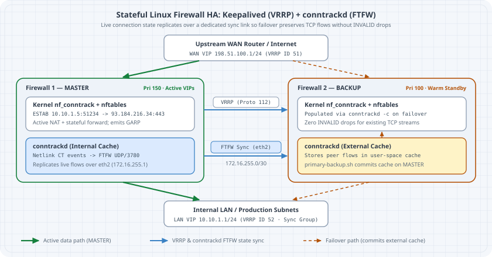

# Stateful Firewall HA and Conntrack Sync

Running two Linux firewalls with **VRRP (`keepalived`)** gives you Layer 3 gateway redundancy in seconds—but for a stateful firewall, moving the Virtual IP (VIP) is only half the problem. When the active firewall dies and the standby takes over the VIP, every in-flight TCP connection hits a blank kernel conntrack table. The standby sees a `TCP ACK` with no prior `SYN`, classifies the packet as **`ct state invalid`**, and drops it. Every SSH session, database connection, and long-lived TLS stream freezes or resets.

Eliminating that failover blackout requires pairing VRRP with **`conntrackd`** (from the Netfilter project) to replicate connection tracking state continuously from the active node to the standby node.

## Learning goals

- Explain why VRRP alone breaks stateful `nftables` firewalls on failover.
- Configure `conntrackd` in **FTFW** (Fault-Tolerant Firewall) mode over a dedicated sync interface and wire it into `keepalived` state-transition scripts.
- Diagnose asymmetric routing, `INVALID` state drops, `nf_conntrack_tcp_loose` trade-offs, and split-brain VRRP failures.
- Verify live cache synchronization, GARP/gratuitous NA convergence, and zero-drop TCP failover.

## Why VRRP alone drops TCP sessions

A standard stateful [nftables](07-nftables-fundamentals.md) policy drops anything not belonging to an established flow and drops `invalid` packets early in the `forward` hook:

```cfg
ct state established,related accept
ct state invalid drop
```

When Firewall 1 (`MASTER`) fails:

1. Firewall 2 (`BACKUP`) misses three VRRP advertisements (~3 seconds by default, or sub-second with VRRPv3 centisecond timers) and transitions to `MASTER`.
2. Firewall 2 claims the WAN and LAN VIPs and broadcasts **Gratuitous ARP (GARP)** (IPv4) and **Unsolicited Neighbor Advertisements (NA)** (IPv6) so upstream/downstream switches update their MAC tables.
3. Active clients immediately send their next `TCP PSH/ACK` segments to Firewall 2.
4. Because Firewall 2 never saw the initial `SYN` / `SYN-ACK`, its `nf_conntrack` table has no entry for the 5-tuple (and no NAT mapping if SNAT/DNAT is in use). The kernel marks the packet `INVALID` (or fails reverse NAT), and `nftables` drops it.



## How `conntrackd` FTFW mode works

`conntrackd` runs in user space on both firewalls and listens to Netfilter Netlink (`nfnetlink_conntrack`) events. It maintains two caches:

- **Internal cache:** Mirrors the local kernel's active `nf_conntrack` table on the `MASTER`.
- **External cache:** Holds replicated flow entries received from the peer over a dedicated sync link (typically a direct cross-connect or isolated VLAN, e.g., `172.16.255.0/30`).

On the `BACKUP` node, replicated entries stay in `conntrackd`'s **external cache** rather than being blindly injected into the kernel table on every packet. When `keepalived` promotes Firewall 2 to `MASTER`, it invokes `/usr/share/doc/conntrackd/examples/sync/primary-backup.sh primary` (or `/etc/conntrackd/primary-backup.sh`), which runs:

1. `conntrackd -c` — **commits** the entire external cache into Firewall 2's live kernel `nf_conntrack` table (including TCP sequence windows and NAT translations).
2. `conntrackd -f` — **flushes** the stale internal/external caches.
3. `conntrackd -R` — **resynchronizes** with the kernel table.

### Sync protocols: FTFW vs NOTRACK vs ALARM

| Mode | Reliability | Wire Overhead | When to Use |
| :--- | :--- | :--- | :--- |
| **FTFW** | Sequence-numbered UDP with NACK retransmission | Low–Moderate | **Production default** for active/standby stateful HA |
| **NOTRACK** | Best-effort UDP, no retransmission | Lowest | High-churn short flows where occasional loss is acceptable |
| **ALARM** | Periodic full-state broadcasts | High | Legacy / small tables only; avoid at scale |

> [!IMPORTANT]
> **Always use a dedicated point-to-point sync interface for `conntrackd`.** Sync packets carry unencrypted flow and NAT state and generate steady PPS proportional to your new-connection rate (see [Conntrack Exhaustion](08-conntrack-exhaustion.md)). Never share the sync link with untrusted WAN traffic, and add an `nftables` input rule restricting UDP `3780` strictly to the dedicated sync interface.

## Configuration snippets

### 1. `keepalived.conf` (Firewall 1 — MASTER)

Use `vrrp_sync_group` so the WAN and LAN VIPs always fail over **together**—never allow one firewall to hold the WAN VIP while the other holds the LAN VIP (which guarantees asymmetric routing):

```cfg
global_defs {
    router_id FW1
    vrrp_garp_master_refresh 60
    vrrp_garp_master_repeat 3
    enable_script_security
    script_user root
}

vrrp_sync_group VG_FW {
    group {
        VI_WAN
        VI_LAN
    }
    notify_master "/etc/conntrackd/primary-backup.sh primary"
    notify_backup "/etc/conntrackd/primary-backup.sh backup"
    notify_fault  "/etc/conntrackd/primary-backup.sh fault"
}

vrrp_instance VI_WAN {
    state MASTER
    interface eth0
    virtual_router_id 51
    priority 150
    advert_int 1
    nopreempt
    unicast_src_ip 198.51.100.2
    unicast_peer {
        198.51.100.3
    }
    virtual_ipaddress {
        198.51.100.1/24
    }
}

vrrp_instance VI_LAN {
    state MASTER
    interface eth1
    virtual_router_id 52
    priority 150
    advert_int 1
    nopreempt
    unicast_src_ip 10.10.1.2
    unicast_peer {
        10.10.1.3
    }
    virtual_ipaddress {
        10.10.1.1/24
    }
}
```

> [!TIP]
> **Set `nopreempt` on both nodes (or `state BACKUP` + `nopreempt` with different priorities).** Without `nopreempt`, a flapping primary firewall that recovers from a reboot immediately steals the VIP back before its `conntrackd` external cache has finished bulk-syncing (`conntrackd -n`), causing a second avoidable failover hit.

### 2. `conntrackd.conf` (FTFW mode over dedicated `eth2`)

```cfg
Sync {
    Mode FTFW {
        ResendQueueSize 131072
        PurgeTimeout 60
        ACKWindowSize 300
        DisableExternalCache Off
    }
    UDP {
        IPv4_address 172.16.255.1
        IPv4_Destination_Address 172.16.255.2
        Port 3780
        Interface eth2
        SndSocketBuffer 1249280
        RcvSocketBuffer 1249280
        Checksum on
    }
    Options {
        TCPWindowTracking Off
        ExpectationSync On
    }
}

General {
    HashSize 32768
    HashLimit 131072
    Syslog on
    LockFile /var/lock/conntrackd.lock
    UNIX {
        Path /var/run/conntrackd.sock
    }
    NetlinkBufferSize 2097152
    NetlinkBufferSizeMaxGrowth 8388608
    Filter From Userspace {
        Protocol Accept {
            TCP
            UDP
            ICMP
        }
        Address Ignore {
            IPv4_address 127.0.0.1
            IPv4_address 172.16.255.1
            IPv4_address 172.16.255.2
            IPv4_address 198.51.100.2
            IPv4_address 10.10.1.2
        }
    }
}
```

Notice `TCPWindowTracking Off` inside `Options`—this is critical. Because TCP sequence numbers advance hundreds of times per second between sync packets, strict window tracking on replicated entries causes the newly promoted `MASTER` to reject valid in-flight segments as out-of-window `INVALID` packets.

### 3. `nftables` stateful policy (allowing VRRP + sync link)

```cfg
table inet filter {
    chain input {
        type filter hook input priority 0; policy drop;
        iif "lo" accept
        ct state established,related accept
        ct state invalid drop

        # Allow VRRP (IP protocol 112) on WAN/LAN interfaces
        iifname { "eth0", "eth1" } ip protocol vrrp accept

        # Allow conntrackd FTFW strictly on the dedicated sync link
        iifname "eth2" ip saddr 172.16.255.2 udp dport 3780 accept
    }

    chain forward {
        type filter hook forward priority 0; policy drop;
        ct state established,related accept
        ct state invalid drop
        iifname "eth1" oifname "eth0" ct state new accept
    }
}
```

## Asymmetric routing, `nf_conntrack_tcp_loose`, and split-brain

### Asymmetric routing & `nf_conntrack_tcp_loose`

If outbound packets leave via Firewall 1 while return packets enter via Firewall 2 (for instance, due to an ECMP upstream router or a broken `vrrp_sync_group`), Firewall 2 sees only half of the TCP handshake.

Linux exposes the sysctl `net.netfilter.nf_conntrack_tcp_loose` (default `1`):

- **`1` (loose):** A mid-stream `TCP ACK` with no conntrack entry creates a new `ESTABLISHED` entry (and is accepted if policy permits)—which weakens stateful inspection and still **fails** for NATed flows because the NAT mapping is missing.
- **`0` (strict):** Mid-stream TCP packets without a matching `SYN` entry are strictly marked `INVALID` and dropped.

In a properly synced active/standby HA pair, keep traffic strictly symmetric through `vrrp_sync_group` and `conntrackd`. Do not rely on `nf_conntrack_tcp_loose=1` as a substitute for state sync.

### Split-brain and GARP convergence

**Split-brain** occurs when Firewall 1 and Firewall 2 both believe they are `MASTER`—usually because VRRP packets were blocked by an `nftables` rule, a VLAN mismatch, or a dead switch port. Both nodes claim the same VIP and fight over the switch CAM table with competing GARP frames, shattering every active session.

Prevent and mitigate split-brain by:

1. Running VRRP over **unicast** (`unicast_peer`) where multicast is restricted, and explicitly permitting `ip protocol vrrp` in `nftables`.
2. Tracking upstream and downstream link health (`track_interface` / `vrrp_script`) so a firewall that loses its WAN uplink lowers its priority below the standby and yields cleanly.
3. Setting `vrrp_garp_master_repeat 3` so switches reliably flush stale MAC entries on failover.

## Verification and troubleshooting

The following commands and outputs are **illustrative** (not captured from a live host).

Check `conntrackd` sync statistics on both nodes (look for zero `msg fail` and non-zero `external cache` entries on `BACKUP`):

```bash
# On Firewall 2 (BACKUP): verify replicated flows are arriving in the external cache
conntrackd -s cache
conntrackd -s network
```

```text
cache external:
current active connections:             14820
connections created:                    98412
connections destroyed:                  83592

traffic processed:
                 8421040 Bytes        62410 Pckts
UDP traffic (active device=eth2):
                 9104220 Bytes sent   48210 Pckts sent
                 8912440 Bytes recv   47998 Pckts recv
                 0 Error send         0 Error recv
message tracking:
                 0 Malformed msgs     0 Lost msgs
```

Test a live failover while holding an active `ssh` or `iperf3` TCP stream, then inspect `nftables` invalid drop counters on the newly promoted `MASTER`:

```bash
# On Firewall 2 immediately after failover: confirm flows committed to kernel
conntrack -L | grep "ESTABLISHED" | head -n 3
nft list chain inet filter forward
```

```text
tcp  6 431995 ESTABLISHED src=10.10.1.5 dst=93.184.216.34 sport=51234 dport=443 ...
```

### Common failover failure modes

- **External cache is 0 on BACKUP:** Check `eth2` firewall rules for UDP `3780`, verify `IPv4_address` / `IPv4_Destination_Address` are swapped on FW2, and check `journalctl -u conntrackd`.
- **Sessions stall for 5–10s then reset after failover:** `TCPWindowTracking` was left `On`, or `primary-backup.sh` lacks execute permission (`chmod +x`) or failed under `keepalived`'s `script_user`.
- **Netlink buffer overruns under high CPS:** Raise `NetlinkBufferSize` and `NetlinkBufferSizeMaxGrowth` in `conntrackd.conf` and monitor `conntrackd -s` for `netlink events lost`.

## Summary

- VRRP (`keepalived`) moves the Layer 3 VIP, while **`conntrackd` in FTFW mode** replicates kernel connection and NAT state so stateful `nftables` rules do not drop established TCP flows on failover.
- Always pair WAN and LAN VRRP instances in a **`vrrp_sync_group`** with `nopreempt`, run `conntrackd` over a dedicated sync interface, and disable strict `TCPWindowTracking` on synced entries.
- Verify failover under load by checking `conntrackd -s network` (`0 Lost msgs`) and confirming zero `ct state invalid` spikes during a planned `MASTER` demotion.
