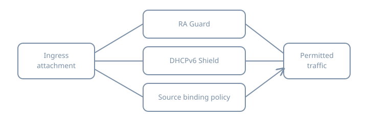

# IPv6 First-Hop Security and Binding Validation

On a shared access link, IPv6 replaces ARP and DHCPv4 with ICMPv6 Neighbor Discovery (ND), SLAAC, and DHCPv6. Because these link-local control protocols are unauthenticated by default, an unauthorized host can advertise itself as the default router, hand out rogue DNS servers, hijack on-link neighbors, or exhaust switch and router neighbor tables. First-Hop Security (FHS) narrows that exposure at the access switch, though it does not replace L3 segmentation, host hardening, or routing policy. Start by defining a clear trust boundary: which ports may originate Router Advertisements (RAs), DHCPv6 server messages, or specific IPv6 source addresses?



## IPv6 Layer 2 threat model

Every IPv6 access VLAN faces five distinct first-hop attack classes. Mitigating only one leaves the remaining paths open:

| Attack vector | Mechanism | Operational impact | Primary mitigation |
|---|---|---|---|
| **Rogue RA** | Untrusted host sends ICMPv6 Type 134 (RA) with high router preference or short lifetime | On-link MITM (traffic routed through attacker) or DoS (`Router Lifetime = 0` or invalid prefix) | RA Guard (RFC 6105 / 7113) |
| **Rogue DHCPv6** | Untrusted host answers `Solicit` with `Advertise`/`Reply` (UDP 547 → 546) | Malicious DNS servers (RDNSS), wrong addresses, or credential interception | DHCPv6 Guard / Shield (RFC 7610) |
| **ND cache exhaustion** | Attacker scans an unused `/64` (2^64 addresses) or floods unsolicited NAs | Router CPU spikes generating Neighbor Solicitations; hardware ND/ARP TCAM fills and drops legitimate hosts | ND rate-limiting, `/64` glean throttling, host-table limits |
| **DAD spoofing (DoS)** | Attacker answers every Duplicate Address Detection NS (`::` → solicited-node multicast) with a forged NA | Victim concludes its address is a duplicate and never brings up IPv6 | ND Inspection + SAVI binding validation |
| **Extension-header evasion** | Attacker inserts Hop-by-Hop, Destination Options, or Fragment headers before ICMPv6 RA | Shallow hardware parsers stop inspecting before reaching ICMPv6 Type 134, bypassing naive RA Guard | RFC 7113 compliant parser, drop fragmented ND (RFC 6980) |

> [!WARNING]
> An uplink trunk carries both legitimate router control traffic and untrusted user traffic from downstream switches. Marking an uplink "trusted" without enforcing FHS on the downstream access switch extends implicit trust to every host behind that switch.

## RA Guard, DHCPv6 Guard, SAVI, and ND inspection

First-hop controls work as complementary layers rather than a single toggle:

### RA Guard (RFC 6105 and RFC 7113)
RA Guard inspects ingress frames on access ports and drops ICMPv6 Router Advertisements (Type 134) and Redirects (Type 137) arriving on untrusted host ports. Authorized router ports are explicitly marked trusted (or matched by allowed link-local source IPv6 address, prefix list, and managed/other flags).

Per **RFC 7113** and **RFC 6980**, Neighbor Discovery messages MUST NOT be fragmented across IPv6 Fragment headers. Compliant switches drop fragmented ICMPv6 ND packets and drop or punt packets with excessive extension-header chains that exceed the ASIC's header-parsing depth.

### DHCPv6 Guard / Shield (RFC 7610)
DHCPv6 operates over UDP port 546 (client) and 547 (server/relay). DHCPv6 Guard blocks server-originated messages (`Advertise`, `Reply`, `Reconfigure`, `Relay-Reply`) arriving on untrusted client ports while allowing client `Solicit`/`Request` messages outbound. RA Guard does **not** block rogue DHCPv6, and DHCPv6 Guard does **not** block rogue RAs.

### SAVI and ND inspection (RFC 7039)
**Source Address Validation Improvement (SAVI)** builds a dynamic binding table mapping `(IPv6 Address, MAC Address, VLAN, Switch Port, Lifetime)` by snooping DHCPv6 exchanges and SLAAC/DAD Neighbor Discovery messages. **ND Inspection** validates incoming Neighbor Solicitations and Advertisements against that table (blocking DAD spoofing and neighbor cache poisoning), while **IPv6 Source Guard** filters data-plane packets whose source IPv6 address does not match the port's bindings.

Because a single IPv6 host routinely uses multiple concurrent addresses—a link-local `fe80::/64` address, a stable SLAAC or DHCPv6 global address, and rotating RFC 8981 temporary privacy addresses—a rigid one-address-per-port limit will break legitimate clients. Configure realistic per-port address limits (commonly 8–16 addresses per host port) and verify how bindings age out when a device roams between access points or ports.

## TCAM and neighbor table limits

In IPv4, a `/24` subnet contains at most 254 hosts, naturally bounding the router's ARP table. In IPv6, a standard `/64` subnet contains $1.8 \times 10^{19}$ addresses. An attacker sending packets to random destinations inside an active `/64` forces the first-hop router to punt packets to the CPU and create `INCOMPLETE` neighbor entries, exhausting hardware L3 host TCAM and evicting real hosts.

Protect the first-hop router and access switch with three guardrails:

1. **Limit unresolved (`INCOMPLETE`) ND entries** and rate-limit CPU-bound ND glean packets per interface.
2. **Bound per-port SAVI/ND binding entries** so one compromised port cannot fill the switch's global binding table.
3. **Use `/127` (RFC 6164) on point-to-point router links** and dedicated infrastructure VLANs so transit links have no unused host space to scan.

## Linux host and router mitigations (`nftables` and `sysctl`)

On Linux gateways, hypervisors, and container hosts, combine kernel `sysctl` hardening with `nftables` bridge or inet filtering to block rogue RAs, fragmented ND, and ND cache exhaustion:

```bash
# /etc/sysctl.d/99-ipv6-fhs.conf
# Do not accept Router Advertisements on routers or statically configured servers
net.ipv6.conf.all.accept_ra = 0
net.ipv6.conf.default.accept_ra = 0
net.ipv6.conf.all.accept_redirects = 0

# Bound the IPv6 neighbor cache to prevent memory/table exhaustion
net.ipv6.neigh.default.gc_thresh1 = 512
net.ipv6.neigh.default.gc_thresh2 = 2048
net.ipv6.neigh.default.gc_thresh3 = 4096
net.ipv6.neigh.default.unres_qlen = 16
```

Apply an `nftables` policy on a Linux bridge (`br0`) or edge interface (`eth1`) to block rogue RAs, rogue DHCPv6 server responses, and fragmented ICMPv6 ND from untrusted client ports:

```text
table bridge ipv6_fhs {
    chain forward {
        type filter hook forward priority 0; policy accept;

        # Drop fragmented IPv6 packets carrying ICMPv6 (RFC 6980 / RFC 7113 defense)
        iifname "veth-client*" ip6 nexthdr ipv6-frag drop

        # RA Guard: block Router Advertisements and Redirects from client ports
        iifname "veth-client*" icmpv6 type { nd-router-advert, nd-redirect } counter drop

        # DHCPv6 Guard: block DHCPv6 server replies (UDP src 547 -> dst 546) from client ports
        iifname "veth-client*" udp sport 547 udp dport 546 counter drop
    }
}
```

## Arista cEOS / EOS switch mitigations

On Arista EOS switches, apply RA Guard, DHCPv6 snooping/guard, and ND limits on untrusted access interfaces while trusting verified router uplinks:

```text
! Define RA Guard policy for untrusted host ports
ipv6 nd raguard policy HOST-PORT
   device-role host

! Define RA Guard policy for authorized router uplinks
ipv6 nd raguard policy ROUTER-UPLINK
   device-role router

! Untrusted access interface
interface Ethernet1
   description Access-Client-Port
   switchport access vlan 20
   ipv6 nd raguard attach-policy HOST-PORT
   ipv6 dhcp relay guard

! Authorized router uplink
interface Ethernet49
   description Uplink-Dist-Router
   switchport mode trunk
   ipv6 nd raguard attach-policy ROUTER-UPLINK

! First-hop SVI ND cache protection on the distribution router
interface Vlan20
   ipv6 address 2001:db8:20::1/64
   ipv6 nd cache expire 1800
   ipv6 nd cache limit 2048
```

Verify active policies and drop counters with `show ipv6 nd raguard policy`, `show ipv6 neighbors summary`, and interface ACL/guard drop statistics. (Exact CLI support varies between hardware EOS platforms and cEOS software containers; validate in your lab image before rollout.)

Illustrative verification output on an EOS access switch:

```text
sw1# show ipv6 nd raguard policy
Policy Name: HOST-PORT
  Device Role: host
  Interfaces: Ethernet1, Ethernet2
  Dropped Packets: 14 (last drop: 00:02:11 ago on Ethernet1)
Policy Name: ROUTER-UPLINK
  Device Role: router
  Interfaces: Ethernet49
  Dropped Packets: 0
```

## Host-level and Linux verification commands

When validating FHS behavior from a Linux test host or router, inspect the active RA-learned default route, neighbor table states (`REACHABLE`, `STALE`, `INCOMPLETE`), and `nftables` drop counters directly:

```bash
# Inspect IPv6 default routes and RA lifetimes on a client host
ip -6 route show default

# Count unresolved INCOMPLETE neighbor entries (early warning of ND scan/exhaustion)
ip -6 neigh show | awk '/INCOMPLETE/ {c++} END {print "INCOMPLETE:", c+0}'

# Check nftables bridge FHS drop counters
nft list table bridge ipv6_fhs
```

Illustrative `nftables` counter output after injecting a rogue RA from `veth-client1`:

```text
table bridge ipv6_fhs {
    chain forward {
        type filter hook forward priority 0; policy accept;
        iifname "veth-client*" ip6 nexthdr ipv6-frag drop
        iifname "veth-client*" icmpv6 type { nd-router-advert, nd-redirect } counter packets 3 bytes 210 drop
        iifname "veth-client*" udp sport 547 udp dport 546 counter packets 0 bytes 0 drop
    }
}
```

## Operational deployment phased rollout

Enabling strict FHS enforcement on an active campus VLAN without baselining first can drop legitimate infrastructure (such as dual-stack wireless controllers, hypervisor bridges, or IP phones). Roll out in three phases:

1. **Inventory and audit:** Map every router-facing trunk, DHCPv6 relay/server port, and multi-host port (APs, VoIP phones with daisy-chained PCs, hypervisor NICs).
2. **Enforce RA Guard and DHCPv6 Guard first:** These two controls have crisp port-role boundaries (`host` vs `router`/`server`) and minimal false positives once router uplinks are explicitly marked trusted.
3. **Layer SAVI / ND Inspection with generous per-port limits:** Monitor binding table utilization for at least one full DHCPv6 lease cycle and RFC 8981 privacy-address rotation window before switching from monitor/log mode to drop mode.

## Validation lab and troubleshooting

Use an isolated managed switch or Linux bridge lab with two hosts, an authorized router, and a disposable test client. For a runnable Linux control-plane filter walkthrough, see the [IPv6 Neighbor Discovery lab](../09-lab-workbook/43-ipv6-neighbor-discovery-filter.md).

1. **RA boundary:** confirm an authorized RA populates the client's default route (`ip -6 route`), then inject a test RA from the untrusted port and confirm the guard drop counter increments while the client ignores it.
2. **Extension-header evasion test:** send a fragmented RA or an RA preceded by a Hop-by-Hop header from the untrusted port; confirm the switch drops it rather than forwarding it to the client.
3. **DHCPv6 boundary:** inject a test UDP 547 → 546 `Advertise` from the untrusted port and verify DHCPv6 Guard drops it independently of RA Guard.
4. **SAVI / privacy-address lifecycle:** verify that a host's link-local, SLAAC stable, and RFC 8981 temporary addresses all pass source validation, then move the host to a second port and measure binding re-learning time.
5. **Failover:** shut down the primary router and verify the backup router's RA arrives on a trusted uplink and updates hosts within the expected lifetime.

**Troubleshooting quick checks:**
- **Host has an IPv6 address but no default route:** check RA Guard drop counters on the router uplink, RA `Router Lifetime`, and whether `accept_ra` is disabled on the host.
- **DHCPv6 works but privacy addresses fail:** inspect SAVI per-port binding limits and whether SLAAC snooping is enabled alongside DHCPv6 snooping.
- **Intermittent drops across a `/64`:** inspect `show ipv6 neighbors summary` or `ip -6 neigh | grep INCOMPLETE | wc -l` for ND cache exhaustion.

**References:** [RA Guard, RFC 6105](https://www.rfc-editor.org/rfc/rfc6105.html), [Fragmentation of ND, RFC 6980](https://www.rfc-editor.org/rfc/rfc6980.html), [RA Guard implementation advice, RFC 7113](https://www.rfc-editor.org/rfc/rfc7113.html), [DHCPv6 Shield, RFC 7610](https://www.rfc-editor.org/rfc/rfc7610.html), [SAVI framework, RFC 7039](https://www.rfc-editor.org/rfc/rfc7039.html), and [IPv6 operational security, RFC 9099](https://www.rfc-editor.org/rfc/rfc9099.html).
