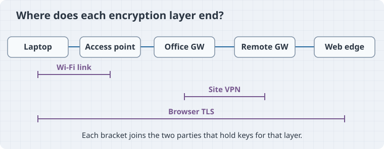

# Keys, Identities, and Encryption Boundaries

A laptop on protected office Wi-Fi opens an HTTPS application through a site VPN. A diagram might put a padlock on all three connections. Each padlock has different endpoints. The access point can remove the Wi-Fi protection, the VPN gateway can remove the tunnel protection, and the server holding the TLS traffic keys can read the HTTP request. To decide who can read a field, follow that field until its protection ends.

## What evidence does a key provide?

| Mechanism | Example use | What the verifier can conclude |
|---|---|---|
| Cryptographic hash | Compare a downloaded image with a digest obtained through a trusted channel | The bytes match the expected digest, subject to the hash's security properties. Anyone can calculate a fresh digest for different bytes. |
| Message authentication code | Two systems share a secret and authenticate messages with HMAC | A holder of the shared secret generated the tag. Every verifier with that secret could also create one. |
| Digital signature | A software publisher signs a release with a private key | The matching public key verifies the signature over those bytes. Attributing the key to the publisher requires a trusted binding. |
| Authenticated encryption | TLS protects application records with a traffic key | A peer with the appropriate key can recover the plaintext and detect changes to protected data. Packet timing and approximate sizes can still be observable. |

Algorithms are public rules. A **key** selects the particular transformation a participant can perform. Symmetric protection uses secrets shared between the parties. A signature scheme separates the ability to sign from the ability to verify. Key agreement lets two participants derive a shared secret across the network. A protocol must also establish which peer participated in the agreement.

Consider an office with one group secret printed on every device's setup card. A valid authentication tag can establish group membership, but all members can generate one. Giving each device its own credential permits individual attribution at authentication time and lets an administrator withdraw one device's credential. Shared group traffic keys can still serve a separate purpose such as delivering local broadcasts.

## How a browser authenticates a service key

Suppose a browser requests `https://inventory.example/` using a full, certificate-based TLS 1.3 handshake with ephemeral key agreement.

1. The client and server exchange key shares. Each uses its private contribution with the peer's public contribution to derive shared secret material. The long-lived certificate key has a different purpose from these ephemeral secrets.
2. The server presents a certificate chain and signs the handshake transcript with the private key corresponding to its leaf certificate. The client can now check that the peer controls that key in this handshake.
3. The client builds a valid certification path to a locally trusted anchor and checks constraints, validity times, and the service name it intended to contact. A certificate issued for a different service can chain to the same anchor and still fail the name check.
4. The Finished messages authenticate the handshake transcript using derived secrets. The peers derive directional traffic keys and protect application records. An ordinary server-authenticated handshake still leaves the application to identify the human user.

A public key received in the same unauthenticated exchange as a claimed name cannot, by itself, establish who owns that name. Web PKI supplies one binding through certification authorities and the client's configured roots. An administrator can also distribute a peer public key directly through an authenticated management channel, as in a small WireGuard deployment. In that case the administrator owns the binding and its rotation. [TLS 1.3 handshake](https://www.rfc-editor.org/rfc/rfc9846) · [Service identity checks](https://www.rfc-editor.org/rfc/rfc9525) · [WireGuard peer keys](../07-a-overlays-tunnels/02b-wireguard-cryptokey-routing-and-psk.md)

Try [the certificate path and name lab](../09-lab-workbook/70-certificate-path-and-service-name.md) to see which error follows from changing each input while the leaf certificate stays fixed.

## Follow one request through three boundaries

In the diagram the office gateway encrypts an inner IP packet for a remote site gateway. The web edge in the remote site terminates TLS. The browser sends an HTTP request containing a session cookie.

| Observation point | Information available there |
|---|---|
| Office access point after Wi-Fi decryption | Local frame and inner IP endpoints, plus TLS ciphertext. The site tunnel begins farther along the path. |
| Transit router between gateways | Outer gateway addresses and tunnel traffic size and timing. With encrypted tunnel payloads, the inner web endpoint and cookie are concealed here. |
| Remote gateway after tunnel decryption | Inner addresses and TLS ciphertext. The web edge holds the TLS keys. |
| Web edge after TLS decryption | HTTP method, path, fields, and cookie. A backend connection starts a separate security relationship if the edge proxies the request. |

An ordinary IP firewall between the gateways can allow the tunnel by outer addresses and protocol. A firewall after tunnel termination can also match inner addresses and transport ports. To enforce a rule such as “only editors may change this record,” an application or trusted application proxy needs the authenticated subject, requested operation, and object. A TLS certificate for the site does not assign that role to the user.

## Work out the effect of a termination change

Move TLS termination from the web edge to a load balancer. Keep the VPN endpoints in place. Which system can now log the request path? The load balancer can, because it has the plaintext there. If it opens a second TLS connection to a backend, both legs are encrypted on their respective links, and the load balancer still sees both plaintexts. The backend verifies whatever client credential the second connection presents. Any assertion about the original browser needs a separately trusted handoff.

Now rotate only the VPN's long-term peer credential. The gateways need coordinated configuration for subsequent tunnel establishment. The browser's trust roots and the application's role assignments serve different relationships. When investigating a failure after rotation, identify the verifier rejecting a credential, the identity it expected, and the trust material it used.

For a single-link example, follow [MACsec and MKA](09-macsec-and-mka.md). For application permissions after a successful TLS handshake, continue to [federated login and delegated access](13-federated-login-and-api-authorization.md).
