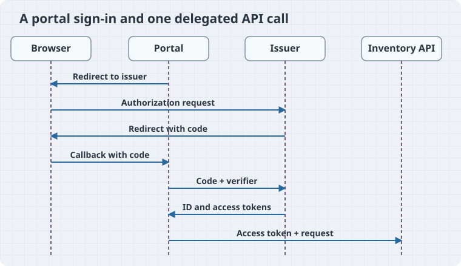

# Federated Login and API Authorization

Mira signs in to a network inventory portal using her company account. The portal can list devices at the east site. A request to change a west-site device returns 403. All three outcomes can be correct. The identity provider established who signed in, the portal established its own session, and the inventory API evaluated a permission on a particular device.

## Four participants and two decisions

The **browser** carries redirects. The **portal** is the OpenID Connect (OIDC) relying party and OAuth client. The **identity provider** authenticates Mira and, in this example, also operates the OAuth authorization server. The **inventory API** is the resource server. Each service has its own audience and responsibilities.

Federation is an agreement under which one system accepts identity assertions from another issuer. **Single sign-on (SSO)** is the user experience when an existing provider session allows a second application to establish a session with little or no further interaction. Each application still has its own client registration, callback, permissions, and session lifetime. A social login can use the same OIDC flow with a consumer identity provider. The portal must decide which external accounts it will admit and how it links an identity to a local account. An issuer and subject identifier together make a stable identifier within that issuer's rules. Email addresses can change or be reassigned. [OpenID Connect Core, subject identifiers](https://openid.net/specs/openid-connect-core-1_0.html#SubjectIDTypes)

## Follow the authorization code

Assume a server-side portal, HTTPS throughout, and an OIDC authorization code flow with PKCE (Proof Key for Code Exchange).

1. **Start a transaction.** The portal stores a fresh random verifier, a state value bound to the browser session, and an OIDC nonce. It redirects the browser to the configured issuer with its registered client ID, callback URI, the S256 challenge derived from the verifier, and requested scopes including `openid` and `inventory.read`.
2. **Identify the user.** The provider authenticates Mira or reuses an eligible provider session. It evaluates the client's requested grant against policy and any required consent. The browser returns to the portal's registered callback carrying a short-lived code and the state value.
3. **Redeem the code.** The portal correlates the response with its pending session and expected issuer. Its backend sends the code, original verifier, and matching redirect URI to the provider's token endpoint, authenticating as the registered confidential client. The provider checks the bindings and accepts the code once. The browser never needs the portal's client secret.
4. **Create the application session.** The portal validates the ID token for its own client ID, including the expected issuer, signature, lifetime, and the nonce it sent. It binds the resulting subject to a local account and issues its own session cookie. A second portal can reuse the provider session but receives its own tokens.
5. **Call the API.** The portal presents the access token intended for the inventory API. The API validates the token and evaluates the operation, authorized scope, subject, tenant, and target device. Its response returns through the portal.

Here, state links the callback to the browser transaction, the nonce links the ID token to the authentication request, and PKCE binds code redemption to the client that generated the verifier. These values are checked by different participants at different points. [OpenID Connect code flow](https://openid.net/specs/openid-connect-core-1_0.html#CodeFlowAuth) · [OAuth security practice](https://www.rfc-editor.org/rfc/rfc9700)

## Read a token from the recipient's perspective

| Artifact | Intended recipient | Decision it supports |
|---|---|---|
| Authorization code | Token endpoint, through the registered client | Complete one bound transaction and issue tokens |
| ID token | Portal | Establish the authenticated subject for this client |
| Access token | Inventory API | Evaluate a request covered by this grant |
| Portal session cookie | Portal | Associate subsequent browser requests with the portal session |

A **JWT** is a claims format. A common signed JWT has a base64url-encoded header, payload, and signature. Anyone holding that form can read its claims. The signature check, expected issuer, acceptable algorithms and key source, audience, token type, and time checks give the recipient grounds to trust it for a particular use. An attacker-supplied header cannot select an arbitrary trusted key or policy. When using a JWT access-token profile, enforce that profile's rules at the API. An access token can also be opaque, with the API obtaining its meaning through a trusted lookup. [JWT best practices](https://www.rfc-editor.org/rfc/rfc8725) · [JWT access-token profile](https://www.rfc-editor.org/rfc/rfc9068)

A **bearer** access token can be presented by whoever holds it during its usable lifetime. Application logs should record a decision, request identifier, issuer, and suitable internal subject reference. Raw tokens, authorization codes, and session cookies can expose credentials to everyone with log access.

## Work a delegated permission by hand

Mira has the local role *east operator*, which permits reading and updating devices assigned to the east site. She authorizes a reporting portal to read inventory on her behalf. The API receives a valid token for this portal with `inventory.read`. Assume it requires both an adequate scope and matching local role and site membership.

| Request | Delegated scope | Local policy | Result |
|---|---|---|---|
| Read east router | Read | East operator may read it | Allow |
| Edit east router | Read | East operator may edit it | Deny at the scope check |
| Read west router | Read | East operator has no west assignment | Deny at the object check |

Role-based access control (RBAC) bundles permissions into named roles. The site check narrows the objects on which that role applies. Delegation limits what this particular client may do for Mira. A successful login alone answers none of those operation-specific questions.

## Diagnose a successful login followed by a failed request

First identify the component that answered. A callback rejection before any session exists points to the portal's transaction or token validation. An API rejecting an expired or wrong-audience token commonly returns 401. A valid token with inadequate scope commonly yields 403. A service can deliberately conceal object existence, so use its decision log to interpret the status. Compare the operation and object with the table before changing network policy.

Finally, sign-out and revocation have different scopes. Ending the portal's session removes that browser session. The provider may still recognize the user at another application, and an issued access token may remain usable until expiry or a revocation mechanism takes effect. For an incident timeline, record which session ended, where the authorization was enforced, and when each credential ceased to work.
