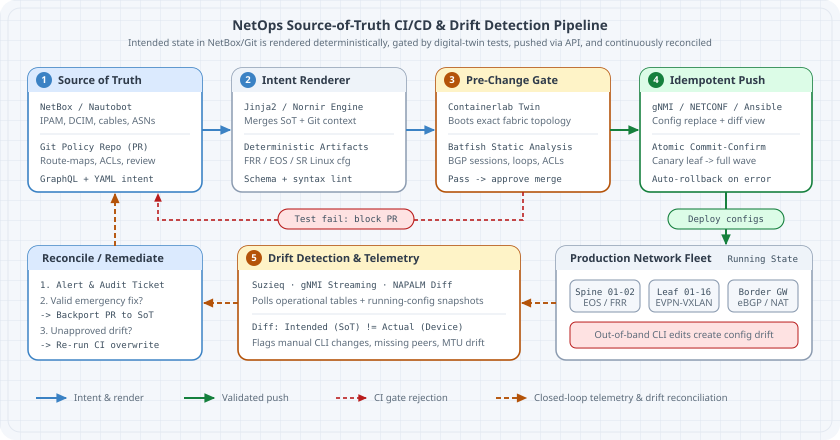

# Source of Truth, Config Templating, and Drift Detection

Every manual CLI session leaves behind a tiny fork between what the network *is* and what the team *thinks* it is. Multiply that by ten engineers, two hundred switches, and three years of midnight incident fixes, and the only reliable documentation left is `show running-config` on live gear. Moving from artisanal CLI edits to repeatable network automation starts with inverting that relationship: **intended state** lives in a structured Source of Truth (SoT), device configurations are rendered deterministically from templates, deployments are idempotent diffs, and **drift detection** continuously catches any out-of-band change.



## Learning goals

By the end of this chapter you can:

- Explain why spreadsheets and wiki pages fail as operational Sources of Truth
- Model a network cleanly in NetBox or Nautobot (sites, VRFs, prefixes, devices, interfaces, cables, and config context)
- Render vendor-specific FRR, Arista EOS, and Nokia SR Linux configurations from structured data using Jinja2
- Build an idempotent diff-and-deploy pipeline with Nornir (or Ansible) that previews changes before committing
- Detect and remediate configuration drift automatically without overwriting legitimate emergency fixes blindly

## Why spreadsheets and wikis fail

A spreadsheet is an unstructured grid of strings. It does not enforce that an IP address belongs to its parent prefix, that a VLAN ID is unique within a site, that a cable has two distinct ends, or that an interface's MTU matches its peer. Worse, spreadsheets have no transactional API, no schema validation, and no audit trail linked to a deployment pipeline.

| Failure mode | Spreadsheet / Wiki | Structured Source of Truth (NetBox / Nautobot) |
|--------------|--------------------|------------------------------------------------|
| Duplicate IP or ASN | Silently accepted as text | Rejected by database uniqueness constraints |
| Broken cable record | Free-text cell `"eth1 -> sp2"` | Foreign-key relationship between two concrete interfaces |
| Automation consumption | Fragile CSV scraping | Versioned REST and GraphQL APIs with typed schemas |
| Change review | "Who edited row 412?" | Built-in changelog, webhooks, and Git-backed branching (Nautobot / SoT-as-Git) |
| Stale documentation | Updated *after* the change (or never) | Updated *before* the change; configs are generated from it |

> [!IMPORTANT]
> A Source of Truth only stays truthful if **nobody pushes configs that did not come from it**. If engineers edit the switch first and promise to "update NetBox later," NetBox degrades into an expensive spreadsheet within a quarter.

## Data modeling in NetBox and Nautobot

Both NetBox and Nautobot share the same core relational model for IPAM (IP Address Management) and DCIM (Data Center Infrastructure Management). Before writing a single template, model the hierarchy cleanly so templates stay simple and free of string-parsing hacks.

```text
Region / Site (e.g., iad-dc1)
 ├── Tenant & VRF (e.g., vrf-prod, RD 65001:100)
 │    └── Aggregate → Prefix (10.20.0.0/16 → 10.20.1.0/24)
 │         └── IP Address (10.20.1.1/24) ──▶ assigned to Interface
 ├── Device Role (spine, leaf, border) & Platform (frr, eos, srlinux)
 │    └── Device (leaf01.iad-dc1)
 │         ├── Primary IPv4 (loopback /32)
 │         ├── Interfaces (Ethernet1, lo, vlan100)
 │         └── Cables (leaf01:Ethernet1 ── spine01:Ethernet1)
 └── Config Context (JSON/YAML: NTP, syslog, BGP timers, route-maps)
```

### Modeling rules that prevent template sprawl

- **Use Device Roles and Platforms, not hostnames, for logic.** Never write `` in a template. Query `device.role.slug == "leaf"` and `device.platform.slug == "eos"`.
- **Keep routing policy in Config Contexts or Git-backed YAML.** NetBox/Nautobot excels at relational inventory (IPs, interfaces, cables, ASNs). Complex policy objects (prefix lists, community maps, QoS queues) are often easier to review in Git YAML files and merge with SoT inventory at render time.
- **Model point-to-point links with cables and `/31` prefixes (RFC 3021).** When `leaf01:Ethernet1` is cabled to `spine01:Ethernet1`, your template can derive the eBGP peer IP and remote ASN directly from the far end of the cable—eliminating manual neighbor tables.
- **Distinguish `Active`, `Planned`, and `Decommissioning` statuses.** Only generate production configs for `Active` (or `Staged`) devices so a rack in planning does not leak half-baked peers into live spine routers.

### Querying the SoT with GraphQL

Rather than making dozens of paginated REST calls per device, a single GraphQL query fetches a device's interfaces, IPs, connected peers, and config context in one round trip:

```graphql
query LeafRenderData($site: String!) {
  device_list(site: $site, status: "active") {
    name
    role { slug }
    platform { slug }
    primary_ip4 { address }
    config_context
    interfaces {
      name
      enabled
      mtu
      description
      ip_addresses { address }
      connected_endpoints {
        ... on InterfaceType {
          name
          device {
            name
            config_context
          }
          ip_addresses { address }
        }
      }
    }
  }
}
```

## Generating configs with Jinja2

A clean intent-to-config pipeline separates **data normalization** from **vendor rendering**:

```text
NetBox / Nautobot API + Git Policy YAML
        │
        ▼  (validate schema with Pydantic / JSON Schema)
Normalized Host Intent (YAML / dict)
        │
        ├──▶ templates/frr.conf.j2      ──▶ rendered/leaf01.frr.conf
        ├──▶ templates/eos.cfg.j2       ──▶ rendered/leaf01.eos.cfg
        └──▶ templates/srlinux.json.j2  ──▶ rendered/leaf01.srl.json
```

### Normalized intent example

Whether sourced from NetBox GraphQL or a Git repository, normalize each node into a predictable dictionary before rendering:

```yaml
# intent/leaf01.yml
hostname: leaf01
platform: frr
asn: 65101
router_id: 10.255.0.11
loopback: 10.255.0.11/32
underlay_links:
  - interface: eth1
    ip: 10.0.11.0/31
    peer_ip: 10.0.11.1
    peer_asn: 65001
    peer_name: spine01
  - interface: eth2
    ip: 10.0.12.0/31
    peer_ip: 10.0.12.1
    peer_asn: 65002
    peer_name: spine02
advertised_prefixes:
  - 10.20.1.0/24
```

### FRR Jinja2 template

```jinja
{# templates/frr.conf.j2 #}
frr defaults datacenter
hostname {{ hostname }}
service integrated-vtysh-config
!
interface lo
 ip address {{ loopback }}
exit
!

interface {{ link.interface }}
 description to {{ link.peer_name }}
 ip address {{ link.ip }}
exit
!

router bgp {{ asn }}
 bgp router-id {{ router_id }}
 bgp bestpath as-path multipath-relax

 neighbor {{ link.peer_ip }} remote-as {{ link.peer_asn }}
 neighbor {{ link.peer_ip }} description {{ link.peer_name }}

 !
 address-family ipv4 unicast
  network {{ loopback }}

  network {{ pfx }}

  maximum-paths 4
 exit-address-family
exit
!
```

### Arista EOS and Nokia SR Linux equivalents

The exact same normalized intent drives Arista EOS (CLI block) and Nokia SR Linux (structured JSON/gNMI payload):

```jinja
{# templates/eos.cfg.j2 #}
hostname {{ hostname }}
!
interface Loopback0
   ip address {{ loopback }}
!

interface {{ link.interface }}
   description to {{ link.peer_name }}
   no switchport
   ip address {{ link.ip }}
!

router bgp {{ asn }}
   router-id {{ router_id }}
   maximum-paths 4 ecmp 4

   neighbor {{ link.peer_ip }} remote-as {{ link.peer_asn }}
   neighbor {{ link.peer_ip }} description {{ link.peer_name }}

   network {{ loopback }}

   network {{ pfx }}

!
```

```jinja
{# templates/srlinux.json.j2 #}
{
  "srl_nokia-network-instance:network-instance": [
    {
      "name": "default",
      "type": "default",
      "protocols": {
        "bgp": {
          "autonomous-system": {{ asn }},
          "router-id": "{{ router_id }}",
          "group": [
            {
              "group-name": "underlay",
              "afi-safi": [{ "afi-safi-name": "ipv4-unicast", "admin-state": "enable" }]
            }
          ],
          "neighbor": [
            
            {
              "peer-address": "{{ link.peer_ip }}",
              "peer-as": {{ link.peer_asn }},
              "peer-group": "underlay",
              "description": "{{ link.peer_name }}"
            }{{ "," if not loop.last else "" }}
            
          ]
        }
      }
    }
  ]
}
```

> [!TIP]
> Enable `StrictUndefined` in Jinja2 (`Environment(undefined=StrictUndefined)`). Without it, a typo like `{{ link.peer_as }}` instead of `{{ link.peer_asn }}` silently renders an empty string and produces broken router syntax.

## Idempotent diff and deploy workflows

A deployment tool must be **idempotent**: running it twice with unchanged intent must produce zero changes on the second run. Equally important, it must support a **dry-run (diff) mode** so engineers and CI pipelines can review the exact candidate-vs-running diff before committing.

### Nornir vs Ansible

| Aspect | Nornir (Python) | Ansible (YAML) |
|--------|-----------------|----------------|
| Execution model | Native Python multithreading; fast at 500+ devices | Forked processes; slower for complex data transforms |
| Data wrangling | Full Python (Pydantic validation, GraphQL, custom diff logic) | Jinja2 filters inside YAML tasks (harder to debug) |
| Ecosystem | `nornir-napalm`, `nornir-scrapli`, `nornir-netbox`, `pygnmi` | Huge vendor collection library (`arista.eos`, `nokia.srlinux`) |
| Best fit | Teams comfortable with Python building custom pipelines | Teams standardizing on Ansible across servers and network |

### Idempotent deploy script with Nornir and NAPALM

The script below loads inventory, renders each host's template, validates with `StrictUndefined`, and uses `replace_config` (declarative full-config replace) in dry-run or commit mode:

```python
#!/usr/bin/env python3
"""Render and deploy declarative configs via Nornir + NAPALM."""
import argparse
from jinja2 import Environment, FileSystemLoader, StrictUndefined
from nornir import InitNornir
from nornir_napalm.plugins.tasks import napalm_configure
from nornir_utils.plugins.functions import print_result


def render_and_push(task, env, dry_run):
    template_name = f"{task.host.platform}.cfg.j2"
    template = env.get_template(template_name)
    rendered = template.render(**task.host.data)

    # Full-config replace guarantees removed lines in SoT are removed on the box.
    return task.run(
        task=napalm_configure,
        configuration=rendered,
        replace=True,
        dry_run=dry_run,
    )


def main():
    parser = argparse.ArgumentParser()
    parser.add_argument("--commit", action="store_true", help="Apply changes instead of dry-run")
    args = parser.parse_args()

    env = Environment(
        loader=FileSystemLoader("templates"),
        undefined=StrictUndefined,
        trim_blocks=True,
        lstrip_blocks=True,
    )
    nr = InitNornir(config_file="config.yaml")
    result = nr.run(task=render_and_push, env=env, dry_run=not args.commit)
    print_result(result)

    if result.failed:
        raise SystemExit(1)


if __name__ == "__main__":
    main()
```

### Declarative replace vs imperative merge

- **Merge (`replace=False`)** adds new lines and modifies existing ones, but **never deletes** stale lines. If you remove a BGP neighbor or an ACL entry from NetBox, a merge leaves the old line behind on the switch forever.
- **Replace (`replace=True`)** compares the entire candidate configuration against the running configuration and computes the minimal delta—including `no` deletions—inside a single atomic commit (on EOS `configure replace`, Junos `load override`, SR Linux gNMI `replace`, or FRR `frr-reload.py`).

> [!WARNING]
> Before enabling `replace=True` in production, verify that your templates include **every** baseline stanza (management VRF, SSH keys, AAA, SNMP/gNMI listeners, console timeouts). Omitting the management interface from a full-replace template will lock you out on the first commit. Always test in a Containerlab twin first (see [Containerlab in CI](07-containerlab-in-ci.md)).

## Automated drift detection

Even with a clean CI/CD pipeline, drift happens: an on-call engineer shuts down a flapping port at 03:00, a vendor TAC engineer adds a debug knob, or a failed script leaves half a rack updated. **Drift detection** runs on a schedule (for example, every hour via CI cron) and compares live running state against the freshly rendered intended config.

### The drift detection loop

```text
Scheduled Job (cron / GitHub Actions / AWX)
   │
   ├─ 1. Pull latest intent from NetBox + Git
   ├─ 2. Render intended config for every active device
   ├─ 3. Run dry-run diff against live devices (NETCONF / gNMI / NAPALM)
   ├─ 4. Filter known volatile fields (encrypted secrets, timestamps, counters)
   └─ 5. If diff != empty:
           ├── Open a tracking ticket / Slack alert with unified diff
           └── Export metric `netops_config_drift_devices{site="iad-dc1"} 1`
```

### Handling noisy diffs cleanly

Naive text diffs trigger false alerts on every run because devices rewrite comments, timestamps, or salted password hashes. Normalize both sides before diffing:

- **Prefer structured diffs over text diffs** where supported: gNMI `Get` / NETCONF `<get-config>` returns JSON/XML that can be canonicalized and compared semantically (see [YANG, NETCONF, and gNMI](06-yang-netconf-gnmi.md)).
- **Strip volatile lines** with an explicit, audited allowlist (for example, `! Last configuration change at ...` or `Last config commit` banners).
- **Never auto-remediate blindly on first detection.** An unexpected `shutdown` on `Ethernet4` might be an active incident mitigation. Page or ticket the team to choose between two actions: **backport** the emergency fix into the Source of Truth, or **re-converge** the device back to intended state.

### Drift check in CI

```bash
# Run dry-run diff across the fabric; fail the job if any device has a non-empty diff
python3 deploy.py --check-drift --output-dir artifacts/drift/
```

When the script detects a non-empty diff on `leaf01`, it writes `artifacts/drift/leaf01.diff` and exits with a distinct status code (for example `2` for drift detected vs `1` for unreachable device) so alerting routes cleanly to the right runbook.

## Pitfalls and guardrails

- **Partial SoT adoption:** If half the fleet is templated and half is hand-managed, tag devices explicitly (`automation_managed: true`) so drift jobs only evaluate managed gear and never clobber legacy snowflakes.
- **Secret leakage in templates:** Never store BGP MD5 keys, TACACS secrets, or SNMPv3 passphrases in NetBox custom fields or Git YAML. Pull secrets at render time from a vault (HashiCorp Vault, SOPS, or cloud KMS) and mask diffs in CI logs.
- **Skipping pre-change validation:** A syntactically valid Jinja2 render can still create a routing loop or shadow an ACL entry. Pair templating with static analysis before pushing, covered next in [Pre-Change Verification and Streaming Telemetry](10-prechange-verification-and-streaming-telemetry.md).

## Related chapters

- [Automation and Lab-as-Code](02-automation-lab-as-code.md)
- [YANG, NETCONF, and gNMI](06-yang-netconf-gnmi.md)
- [Containerlab in CI: Smoke-Testing a Topology on Every Change](07-containerlab-in-ci.md)
- [Runbooks and Incident Notes](09-runbooks-and-incident-notes.md)
- [Pre-Change Verification and Streaming Telemetry](10-prechange-verification-and-streaming-telemetry.md)
