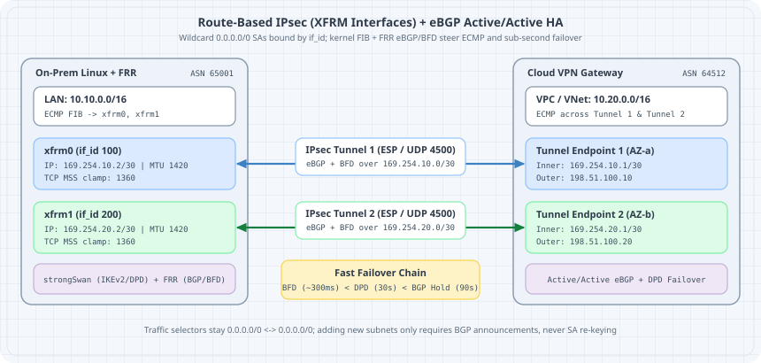

# Route-Based IPsec: XFRM Interfaces, VTI and eBGP Failover

Classic policy-based IPsec embeds routing inside Security Policy Database (SPD) traffic selectors—every new subnet requires editing crypto maps on both ends and renegotiating Child SAs. Modern cloud VPNs (AWS Site-to-Site VPN, Azure VPN Gateway, GCP HA VPN) and enterprise WAN edges instead use **route-based IPsec**: each tunnel becomes a first-class Layer 3 virtual interface (`xfrm0`, `xfrm1`, or legacy `vti0`) with wildcard `0.0.0.0/0` selectors, letting the kernel FIB and **eBGP + BFD** handle dynamic routing, ECMP load sharing, and sub-second failover. This chapter extends [IPsec ESP, XFRM, and IKEv2](02f-ipsec-esp-xfrm-and-ikev2.md) and [Site-to-Site Tunnels](02-site-tunnels.md).



## Policy-based versus route-based IPsec (`xfrm` and `if_id`)

In Linux, route-based IPsec moved through two generations: legacy **VTI (`ip_vti`)** interfaces using netfilter fwmarks (`key`/`mark`), and modern **XFRM interfaces (`type xfrm`)** introduced in Linux 4.19 using a dedicated 32-bit **`if_id`**.

| Aspect | Policy-based IPsec (SPD selectors) | Route-based IPsec (`xfrm` interface + `if_id`) |
|---|---|---|
| **Traffic selectors** | Explicit subnet pairs (`10.10.0.0/16 <-> 10.20.0.0/16`) | Wildcard (`0.0.0.0/0 <-> 0.0.0.0/0` and `::/0 <-> ::/0`) |
| **Routing integration** | Invisible to FIB; hard to run OSPF/BGP or ECMP | Standard L3 interface; full support for eBGP, OSPF, VRFs, ECMP |
| **Adding new subnets** | Requires updating IPsec configs and re-keying Child SAs | Zero IPsec changes—just advertise the prefix over BGP |
| **Dual-stack / NAT / fwmarks** | Complex policy priority conflicts | Single `xfrm` interface carries IPv4 + IPv6 without touching `fwmark` |
| **Packet inspection** | `tcpdump` sees pre/post-ESP on physical NIC only | Clean cleartext capture directly on `tcpdump -i xfrm0` |

With `xfrm` interfaces, strongSwan stamps every Child SA and kernel XFRM policy with `if_id_in` and `if_id_out` (for example, `100` for `xfrm0` and `200` for `xfrm1`). When the kernel routes a packet out `xfrm0`, it looks up only the XFRM policy matching `if_id 100`, encrypts it with ESP, and transmits the outer packet via the underlying physical interface.

## Dual active/active eBGP over IPsec (Cloud VPN model)

Cloud providers terminate a single Site-to-Site VPN connection on **two independent tunnel endpoints** in separate Availability Zones. Each tunnel receives a link-local `/30` inside `169.254.0.0/16` (for example, `169.254.10.0/30` on `xfrm0` and `169.254.20.0/30` on `xfrm1`), and an eBGP session runs directly over each `/30`:

- **Active/Active ECMP:** With `maximum-paths 2` enabled in FRR (and ECMP enabled on the cloud Transit Gateway / VPN Gateway), flows hash across both tunnels simultaneously, doubling aggregate throughput (for example, `2 × 1.25 Gbps` on AWS TGW).
- **Active/Passive control:** If you prefer deterministic single-tunnel forwarding (for example, to avoid asymmetric flows through a stateful firewall), apply **AS-Path prepending** outbound and **Local Preference** inbound on Tunnel 2 so Tunnel 1 carries all traffic unless it fails.

## DPD and BFD failover budgets

IPsec tunnels can black-hole silently when an intermediate ISP drops UDP 4500 packets while local physical links stay UP. Three layered timers govern how fast traffic shifts to the healthy tunnel:

| Mechanism | Typical detection time | What it checks | Operational role |
|---|---|---|---|
| **BGP Hold Timer** (default 90 s / cloud 30 s) | `30–90 s` | TCP keepalives inside the tunnel | Baseline fallback when BFD is unavailable (e.g., standard AWS VGW) |
| **IKEv2 DPD** (Dead Peer Detection) | `10–30 s` (`dpd_delay = 10s`) | Encrypted IKEv2 `INFORMATIONAL` liveness exchanges | Tears down dead IKE/Child SAs and triggers re-negotiation |
| **BFD** (Bidirectional Forwarding Detection) | `150–300 ms` (`100 ms × 3`) | Lightweight UDP 3784 echo/control packets inside `xfrm0` | Sub-second BGP session teardown and FIB failover when both peers support BFD |

> [!WARNING]
> Ensure strongSwan's `dpd_action = restart` is paired with `start_action = start` (or `trap`) on active/active tunnels. If a cloud endpoint performs scheduled maintenance and tears down Tunnel 1, `restart` ensures the on-prem gateway actively re-establishes the SA while Tunnel 2 carries 100% of production traffic seamlessly.

## ESP + UDP encapsulation MTU and TCP MSS math

IPsec tunnel mode adds an outer IP header, optional UDP NAT-Traversal header (8 bytes when UDP 4500 is used), and ESP header/IV/padding/ICV. Assuming a standard 1,500-byte Ethernet WAN MTU and **AES-256-GCM-16** (16-byte ICV, 8-byte IV, up to 4-byte alignment padding):

| Header component | Bytes | Running overhead |
|---|---|---|
| Outer IPv4 header | 20 B | 20 B |
| UDP NAT-T header (port 4500) | 8 B | 28 B |
| ESP header (SPI 4 B + Seq 4 B) | 8 B | 36 B |
| AES-GCM IV (8 B) + Trailer/Pad (~6 B) + ICV (16 B) | 30 B | **66 B** |
| **Resulting tunnel MTU** (`1500 - 66`, rounded down safely) | **1420–1434 B** | Leaves margin for PPPoE/GCM variance |
| **Safe TCP MSS** (`1420 - 20 IPv4 - 20 TCP - 20 TCP opts/safety`) | **1360 B** | Avoids outer fragmentation and PMTUD black holes |

Because ICMP `Fragmentation Needed` messages are frequently dropped on the public internet, **always clamp TCP MSS to `1360` bytes** (or `1340` if PPPoE/IPv6 outer transport is present) on both `xfrm0` and `xfrm1`.

## Linux XFRM interface and MSS clamping setup

Create both `xfrm` interfaces, disable strict reverse-path filtering (`rp_filter = 2` or `0`) so asymmetric ECMP packets are not dropped, and clamp TCP MSS via `nftables`:

```bash
# Create XFRM interfaces bound to physical WAN NIC eth0
ip link add xfrm0 type xfrm dev eth0 if_id 100
ip link add xfrm1 type xfrm dev eth0 if_id 200

ip addr add 169.254.10.2/30 dev xfrm0
ip addr add 169.254.20.2/30 dev xfrm1

ip link set xfrm0 mtu 1420 up
ip link set xfrm1 mtu 1420 up

# Allow asymmetric ECMP return paths and enable IPv4 forwarding
sysctl -w net.ipv4.ip_forward=1
sysctl -w net.ipv4.conf.xfrm0.rp_filter=0
sysctl -w net.ipv4.conf.xfrm1.rp_filter=0
sysctl -w net.ipv4.conf.xfrm0.disable_policy=1
sysctl -w net.ipv4.conf.xfrm1.disable_policy=1
```

Clamp TCP MSS on forwarded SYN packets traversing `xfrm0` and `xfrm1` using `nftables`:

```text
table inet vpn_mss {
    chain forward {
        type filter hook forward priority mangle; policy accept;
        oifname { "xfrm0", "xfrm1" } tcp flags syn tcp option maxseg size set 1360
        iifname { "xfrm0", "xfrm1" } tcp flags syn tcp option maxseg size set 1360
    }
}
```

## strongSwan `swanctl.conf` configuration

Configure two independent IKEv2 connections with wildcard `0.0.0.0/0` traffic selectors, explicit `if_id_in`/`if_id_out`, and `charon.install_routes = no` (in `/etc/strongswan.d/charon.conf`) so FRR owns the routing table:

```text
# /etc/swanctl/conf.d/cloud-ha-vpn.conf
connections {
  cloud-tun1 {
    version = 2
    local_addrs = 203.0.113.2
    remote_addrs = 198.51.100.10
    proposals = aes256gcm16-prfsha256-ecp256
    dpd_delay = 10s
    encap = yes
    if_id_in = 100
    if_id_out = 100
    local { auth = psk; id = 203.0.113.2 }
    remote { auth = psk; id = 198.51.100.10 }
    children {
      tun1-sa {
        local_ts = 0.0.0.0/0
        remote_ts = 0.0.0.0/0
        esp_proposals = aes256gcm16-ecp256
        dpd_action = restart
        start_action = start
        life_time = 3600s
      }
    }
  }
  cloud-tun2 {
    version = 2
    local_addrs = 203.0.113.2
    remote_addrs = 198.51.100.20
    proposals = aes256gcm16-prfsha256-ecp256
    dpd_delay = 10s
    encap = yes
    if_id_in = 200
    if_id_out = 200
    local { auth = psk; id = 203.0.113.2 }
    remote { auth = psk; id = 198.51.100.20 }
    children {
      tun2-sa {
        local_ts = 0.0.0.0/0
        remote_ts = 0.0.0.0/0
        esp_proposals = aes256gcm16-ecp256
        dpd_action = restart
        start_action = start
        life_time = 3600s
      }
    }
  }
}
```

## FRR eBGP + BFD configuration

Pair FRR's `bgpd` and `bfdd` over the two tunnel `/30` links, enabling ECMP (`maximum-paths 2`) and explicit prefix-lists:

```text
! /etc/frr/frr.conf
ip prefix-list ONPREM-OUT seq 10 permit 10.10.0.0/16
ip prefix-list CLOUD-IN   seq 10 permit 10.20.0.0/16 le 24

bfd
 profile vpn-fast
  detect-multiplier 3
  transmit-interval 100
  receive-interval 100
 exit
exit

router bgp 65001
 bgp router-id 169.254.10.2
 no bgp ebgp-requires-policy
 neighbor 169.254.10.1 remote-as 64512
 neighbor 169.254.10.1 timers 10 30
 neighbor 169.254.10.1 bfd profile vpn-fast
 neighbor 169.254.20.1 remote-as 64512
 neighbor 169.254.20.1 timers 10 30
 neighbor 169.254.20.1 bfd profile vpn-fast
 !
 address-family ipv4 unicast
  network 10.10.0.0/16
  maximum-paths 2
  neighbor 169.254.10.1 prefix-list ONPREM-OUT out
  neighbor 169.254.10.1 prefix-list CLOUD-IN in
  neighbor 169.254.20.1 prefix-list ONPREM-OUT out
  neighbor 169.254.20.1 prefix-list CLOUD-IN in
 exit-address-family
```

## Verification and troubleshooting

Confirm SAs, `if_id` bindings, BGP ECMP routes, and clean cleartext traffic (illustrative outputs):

```bash
# 1. Verify strongSwan SAs and XFRM if_id state
swanctl --list-sas
ip -s xfrm state

# 2. Verify kernel ECMP route across both xfrm interfaces
ip route show 10.20.0.0/16
# 3. Verify FRR BGP and BFD session health
vtysh -c "show bgp ipv4 unicast summary"
vtysh -c "show bfd peers brief"
```

```text
# Illustrative kernel ECMP output
10.20.0.0/16 proto bgp metric 20
        nexthop via 169.254.10.1 dev xfrm0 weight 1
        nexthop via 169.254.20.1 dev xfrm1 weight 1

# Illustrative BFD peer summary
SessionId  LocalAddress   PeerAddress    Status
1          169.254.10.2   169.254.10.1   up
2          169.254.20.2   169.254.20.1   up
```

### Troubleshooting checklist

- **BGP stays `Idle`/`Active` while IPsec SA is `INSTALLED`:** Run `tcpdump -ni xfrm0 port 179`. Check whether `rp_filter` is dropping packets or whether `swanctl` installed conflicting routes (`install_routes = no` missing in `charon.conf`).
- **Small pings work, large HTTPS/SSH transfers stall:** Classic PMTUD black hole. Verify `nft list table inet vpn_mss` counters increment on SYN packets and test with `ping -M do -s 1392 10.20.1.10`.
- **Recursive routing loop:** Never advertise the remote VPN peer's public outer IP (`198.51.100.10/32`) inside the tunnel; filter it out in `CLOUD-IN` so outer ESP packets always exit the physical WAN interface.
- **Asymmetric firewall drops on ECMP:** If a stateful firewall sits behind the Linux gateway, either pin primary traffic to `xfrm0` via AS-Path prepending + Local Preference, or enable session synchronization across firewall peers.

**References:** [IKEv2, RFC 7296](https://www.rfc-editor.org/rfc/rfc7296.html), [ESP, RFC 4303](https://www.rfc-editor.org/rfc/rfc4303.html), [BFD, RFC 5880](https://www.rfc-editor.org/rfc/rfc5880.html), and [strongSwan Route-Based VPN documentation](https://docs.strongswan.org/docs/latest/features/routeBasedVpn.html).
