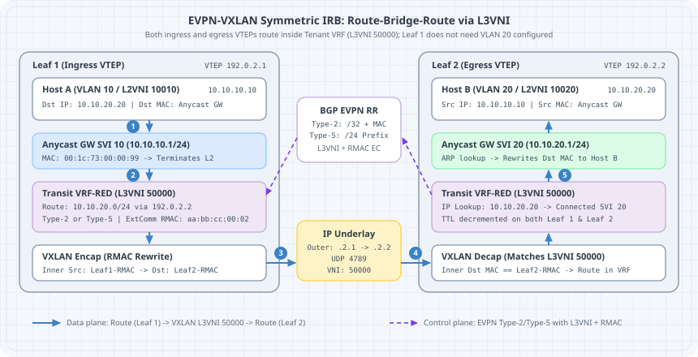

# EVPN Symmetric IRB and Type-5 IP Prefix Routes

Layer 2 VXLAN stretching solves intra-subnet mobility, but real data centers route constantly between application tiers, tenants, and external WAN prefixes. **Integrated Routing and Bridging (IRB)** lets each leaf VTEP act as both an L2 bridge and an L3 default gateway directly at the top of rack, eliminating trombone traffic to centralized core routers. This chapter builds on [VXLAN Data Plane](03-vxlan-data-plane.md) and [EVPN Control Plane Intro](04-evpn-control-plane-intro.md) to explain **Symmetric IRB**, **L3VNIs**, **Router MAC extended communities**, and **EVPN Type-5 IP Prefix Routes**.



## Asymmetric versus Symmetric IRB

Every leaf switch participating in IRB terminates host VLANs on local SVIs (Switch Virtual Interfaces / IRB interfaces) inside a tenant VRF. The two IRB architectures differ in *where* routing happens and *which* VLANs must exist on every leaf:

| Dimension | Asymmetric IRB (Bridge-Route-Bridge) | Symmetric IRB (Route-Bridge-Route) |
|---|---|---|
| **Ingress VTEP action** | Bridges on source VLAN, **routes** to destination VLAN, bridges onto destination **L2VNI** | Bridges on source VLAN, **routes** into tenant VRF, encapsulates into shared **L3VNI** |
| **Egress VTEP action** | Bridges only (decapsulates destination L2VNI and forwards to host) | Decapsulates **L3VNI**, **routes** in tenant VRF to destination SVI, bridges to host |
| **VLAN/L2VNI footprint** | **Every leaf must host every VLAN/L2VNI** that its local hosts talk to | Leaves only need VLANs that have **local attached hosts** + one shared L3VNI per VRF |
| **MAC/ARP scale** | Ingress leaf must learn remote MACs for every destination subnet | Ingress leaf only needs the remote VTEP's **Router MAC (RMAC)** and IP route |
| **External L3 / WAN routes** | Awkward (requires mapping external prefixes to dummy L2VNIs) | Native via **EVPN Type-5 IP Prefix Routes** over the L3VNI |

**Symmetric IRB** is the production standard for medium-to-large EVPN-VXLAN fabrics because it decouples L2 VLAN sprawl from L3 routing scale: Leaf 1 can route to VLAN 20 on Leaf 2 without ever configuring VLAN 20 or L2VNI 10020 locally.

## L3VNI, Transit VRF, and the Router MAC extended community

In Symmetric IRB, each tenant VRF is assigned a single fabric-wide **Layer 3 VNI (L3VNI)**—for example, VNI `50000` mapped to an internal transit VLAN (such as VLAN `4000`) inside `VRF-RED`.

Because VXLAN always carries an inner Ethernet frame, Leaf 1 must still place a valid inner source and destination MAC address inside the encapsulated L3VNI packet. Rather than using Host B's MAC address (which Leaf 1 may not know), BGP EVPN carries the **Router MAC Extended Community** (`RFC 9135`, Type `0x06`, Sub-Type `0x03`) attached to every L3-routable EVPN route:

- Leaf 2 advertises its system/VRF Router MAC (`aa:bb:cc:00:00:02`) and L3VNI (`50000`) alongside its EVPN routes.
- When Leaf 1 routes a packet over L3VNI `50000` toward Leaf 2, Leaf 1 rewrites the inner Ethernet header to `Src MAC = Leaf1-RMAC`, `Dst MAC = Leaf2-RMAC`.
- When Leaf 2 decapsulates VNI `50000` and sees its own `Leaf2-RMAC` as the inner destination MAC, the ASIC knows to perform an **L3 IP route lookup** inside `VRF-RED` rather than an L2 bridge lookup.

## Distributed Anycast Gateway

Hosts on VLAN 10 may live behind Leaf 1, Leaf 2, or a multihomed ESI pair ([EVPN Multihoming](04b-evpn-multihoming-esi-df-election.md)). With a **Distributed Anycast Gateway**, every leaf hosting VLAN 10 configures the **exact same SVI IP address and virtual MAC address** (for example, `10.10.10.1/24` and `00:1c:73:00:00:99`):

- A host always reaches its default gateway locally in one hop on its attached leaf—no VRRP master/backup election or north-south hairpins.
- When a VM live-migrates from Leaf 1 to Leaf 3, its ARP cache for `10.10.10.1` remains valid immediately without waiting for ARP expiry.
- Leaves suppress advertising the Anycast Gateway MAC into EVPN Type-2 routes (or mark it as a default-gateway extended community) so leaves do not learn each other's local gateway MAC as a remote host.

## EVPN Type-2 versus Type-5 IP Prefix Routes

Symmetric IRB uses two complementary BGP EVPN route types inside the `l2vpn evpn` address family:

| Attribute | EVPN Type-2 (MAC/IP Advertisement) | EVPN Type-5 (IP Prefix Route, RFC 9136) |
|---|---|---|
| **Primary purpose** | Advertises host `/32` (or `/128`) IP + MAC bindings learned via ARP/ND | Advertises arbitrary IPv4/IPv6 prefixes (`/24`, `/16`, `0.0.0.0/0`) decoupled from L2 MACs |
| **Labels carried** | Label 1 = L2VNI, Label 2 = L3VNI (when carrying an IP) | Label = L3VNI (single label) |
| **Extended communities** | L2 Route Target + L3 Route Target + Router MAC | L3 Route Target + Router MAC |
| **Best use case** | Optimal `/32` host routing for stretched VLANs across multiple leaves | Border leaf WAN/external routes, non-stretched per-rack subnets, route summarization |

> [!TIP]
> On border leaves peering with firewalls or WAN routers via eBGP inside `VRF-RED`, redistribute or advertise external subnets and `0.0.0.0/0` as **EVPN Type-5** routes. That avoids leaking host-level `/32` churn across the fabric and keeps L3 routing clean even when no L2VNI exists for those prefixes.

## Inter-subnet VXLAN packet walkthrough

Trace a packet from **Host A** (`10.10.10.10`, VLAN 10 on Leaf 1) to **Host B** (`10.10.20.20`, VLAN 20 on Leaf 2), where both VLANs belong to `VRF-RED` (L3VNI `50000`):

1. **Host A → Leaf 1:** Host A sees `10.10.20.20` is off-subnet and sends an Ethernet frame with `Dst MAC = 00:1c:73:00:00:99` (Anycast GW), `Src IP = 10.10.10.10`, `Dst IP = 10.10.20.20`.
2. **Ingress L3 lookup (Leaf 1):** Leaf 1 terminates L2 on SVI 10, decrements IP TTL by 1, and looks up `10.10.20.20` in `VRF-RED`. It matches either a Type-2 `/32` route or a Type-5 `10.10.20.0/24` route with next-hop `192.0.2.2`, L3VNI `50000`, and `RMAC = aa:bb:cc:00:00:02`.
3. **VXLAN encapsulation (Leaf 1):** Leaf 1 rewrites the inner Ethernet header to `Src MAC = Leaf1-RMAC`, `Dst MAC = Leaf2-RMAC`, wraps it in VXLAN (`VNI = 50000`, `UDP Dst 4789`), and adds outer IP `192.0.2.1 → 192.0.2.2`.
4. **Underlay transit:** Spine switches route purely on outer IP `192.0.2.2` using ECMP; spines hold zero tenant VRFs or MAC tables.
5. **Egress decap and L3 lookup (Leaf 2):** Leaf 2 strips outer IP/UDP/VXLAN, sees `VNI = 50000` and `Inner Dst MAC == Leaf2-RMAC`, decrements IP TTL by 1, and looks up `10.10.20.20` in `VRF-RED`.
6. **Leaf 2 → Host B:** Leaf 2 finds `10.10.20.20` connected on SVI 20, resolves Host B's MAC from its local ARP table, rewrites `Src MAC = 00:1c:73:00:00:99`, `Dst MAC = HostB-MAC`, and transmits the frame out Host B's access port.

## Platform configurations

### FRR (Linux VRF + VXLAN Symmetric IRB)

On Linux with FRRouting, bind the L3VNI VXLAN device (`vxlan50000`) to a transit bridge enslaved to `vrf-red`, then advertise Type-5 routes in `bgpd`:

```bash
# Linux kernel data-plane setup for VRF-RED + L3VNI 50000
ip link add vrf-red type vrf table 1001
ip link set vrf-red up
ip link add br50000 type bridge stp_state 0
ip link set br50000 master vrf-red addrgenmode none
ip link add vxlan50000 type vxlan id 50000 dstport 4789 local 192.0.2.1 nolearning
ip link set vxlan50000 master br50000
ip link set br50000 up && ip link set vxlan50000 up
```

```text
! FRR bgpd.conf (Leaf 1)
vrf vrf-red
 vni 50000
exit-vrf

router bgp 65001
 bgp router-id 192.0.2.1
 neighbor 192.0.2.254 remote-as 65000
 address-family l2vpn evpn
  neighbor 192.0.2.254 activate
  advertise-all-vni
 exit-address-family

router bgp 65001 vrf vrf-red
 address-family ipv4 unicast
  redistribute connected
 exit-address-family
 address-family l2vpn evpn
  advertise ipv4 unicast
 exit-address-family
```

### Arista cEOS / EOS

Arista EOS enables Symmetric IRB by binding a VRF to an L3VNI under `interface Vxlan1` and redistributing connected routes into the VRF BGP instance:

```text
ip virtual-router mac-address 00:1c:73:00:00:99
vrf instance RED
ip routing vrf RED

interface Vlan10
   vrf RED
   ip address virtual 10.10.10.1/24

interface Vxlan1
   vxlan source-interface Loopback1
   vxlan udp-port 4789
   vxlan vlan 10 vni 10010
   vxlan vrf RED vni 50000

router bgp 65001
   vrf RED
      rd 192.0.2.1:50000
      route-target import evpn 65000:50000
      route-target export evpn 65000:50000
      redistribute connected
```

### Nokia SR Linux

SR Linux models L2 bridging with `mac-vrf` network instances and L3 routing with `ip-vrf` network instances linked by an `irb0.10` subinterface and an EVPN `vxlan-interface`:

```text
set / network-instance vrf-red type ip-vrf
set / network-instance vrf-red interface irb0.10
set / network-instance vrf-red vxlan-interface vxlan0.50000
set / network-instance vrf-red protocols bgp-evpn bgp-instance 1 vxlan-interface vxlan0.50000
set / network-instance vrf-red protocols bgp-evpn bgp-instance 1 evi 50000
set / network-instance vrf-red protocols bgp-vpn bgp-instance 1 route-target export-rt target:65000:50000
set / network-instance vrf-red protocols bgp-vpn bgp-instance 1 route-target import-rt target:65000:50000
```

## Verification and common failure modes

Verify both the EVPN control plane (Type-2/Type-5 routes, L3VNI, and Router MAC) and the VRF data plane (installed next-hop, VXLAN FDB, and RMAC neighbor entry) on FRR.

### Control-plane and data-plane checks (illustrative output)

```text
leaf1# show bgp l2vpn evpn route type prefix
   Network          Next Hop            Metric LocPrf Weight Path
Route Distinguisher: 192.0.2.2:50000
 *> [5]:[0]:[24]:[10.10.20.0]
                    192.0.2.2                0             0 65000 65002 i
                    Extended Community: RT:65000:50000 ET:8 Rmac:aa:bb:cc:00:00:02

leaf1# show ip route vrf vrf-red 10.10.20.0/24
Routing entry for 10.10.20.0/24
  Known via "bgp", distance 20, metric 0, best
  * 192.0.2.2, via br50000 (vrf vrf-red) onlink, weight 1
```

On the Linux kernel data plane, verify that the remote VTEP's Router MAC is programmed into the L3VNI bridge FDB and neighbor table:

```bash
# Confirm Leaf 2's RMAC resolves to VTEP 192.0.2.2 on vxlan50000
bridge fdb show dev vxlan50000 | grep aa:bb:cc:00:00:02
ip neigh show dev br50000
```

Illustrative kernel output:

```text
aa:bb:cc:00:00:02 dst 192.0.2.2 self extern_learn
192.0.2.2 dev br50000 lladdr aa:bb:cc:00:00:02 extern_learn PERMANENT
```

### Common failure modes

| Symptom | Root cause | Fix |
|---|---|---|
| Type-5 route in BGP table, missing from VRF FIB | L3VNI mismatch between leaves, missing `vni 50000` under `vrf`, or missing `Rmac` extended community | Align L3VNI and L3 Route Targets on all leaves; verify `vxlan50000` is UP and enslaved to the VRF bridge |
| Inter-subnet traffic black-holes on silent hosts | Egress leaf has a Type-5 `/24` route, decapsulates L3VNI, and ARPs for a silent host; or ARP suppression suppressed a needed lookup | Confirm local SVI is UP and ARP/ND resolution succeeds on the egress leaf |
| Duplicate IP / MAC mobility loops | Anycast Gateway MACs differ across leaves or are accidentally leaked as host MACs | Enforce identical virtual MAC per VLAN and suppress gateway MAC advertisement |
| Traceroute shows unexpected extra hop | Symmetric IRB decrements IP TTL **twice** (ingress VTEP + egress VTEP) | Expected behavior—account for 2 L3 hops across the fabric |
| MTU drops on inter-subnet flows | Underlay links at 1,500 B cannot carry 1,500 B inner frame + 50 B VXLAN overhead | Set underlay fabric MTU to `>= 9000` (minimum `1550` B for 1,500 B inner MTU) |

**References:** [Integrated Routing and Bridging in EVPN, RFC 9135](https://www.rfc-editor.org/rfc/rfc9135.html) and [IP Prefix Advertisement in EVPN, RFC 9136](https://www.rfc-editor.org/rfc/rfc9136.html).
