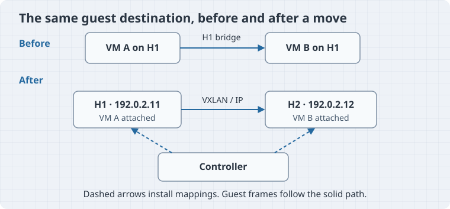

# Virtual Interfaces and Software-Defined Networks

Two virtual machines share a network segment. When both run on the same host, a frame can travel between them entirely in memory. Move one VM to another rack, and the same guest addresses can communicate through a routed fabric. Three decisions make this possible. The host supplies a virtual attachment, a tunnel can carry the frame between hosts, and a control system arranges the forwarding state.

## What a virtual interface carries

| Interface or device | What enters or leaves it | Example use |
|---|---|---|
| Virtual Ethernet pair (veth) | An Ethernet frame written at one end arrives at its peer | Attach a container namespace to a host bridge |
| TAP | Ethernet frames exchanged between a kernel interface and a userspace program | Attach a VM's emulated NIC to host networking |
| TUN | IP packets exchanged between a kernel interface and a userspace program | Give a routed tunnel program packets selected by host routes |
| Software bridge | Frames enter member ports and leave eligible ports according to VLAN membership and the forwarding database | Switch locally between guests and an uplink |
| VRF | An interface association selects a routing context with its own forwarding table | Keep tenants with overlapping IP address space separate |

The guest sees a NIC with a MAC address and link state. The host may see a TAP interface and a bridge port representing the same attachment from another perspective. An IP tunnel attached through TUN has no need to transport the guest's Ethernet broadcast domain. Choosing a device decides which headers the next component will see. [Linux TUN/TAP interface](https://www.kernel.org/doc/html/latest/networking/tuntap.html)

## Trace a VM move



Suppose VM A and VM B are in tenant segment 42. A already knows B's MAC. On host H1, the bridge initially knows that MAC B is on local port tapB. An A-to-B unicast frame arrives at tapA, and the bridge delivers it to tapB. The physical uplink has no copy of this known unicast. A successful capture on the guest paired with an empty physical capture can be entirely consistent.

Move B to H2. In this design the hosts are VXLAN tunnel endpoints, H1 at 192.0.2.11 and H2 at 192.0.2.12. The tenant segment uses VNI 42. Once the move converges, the relevant entries are as follows.

| Lookup | Key | Expected result |
|---|---|---|
| H1 tenant forwarding | Segment 42, destination MAC B | Send via VXLAN to H2 |
| H1 underlay route | Outer destination 192.0.2.12 | Local uplink and next hop toward H2 |
| H2 tunnel ingress | Received VNI 42 | Select the tenant bridge or bridge domain |
| H2 tenant forwarding | Segment 42, destination MAC B | Deliver to B's local attachment |

H1 encapsulates the complete original Ethernet frame as a VXLAN payload. Underlay routers forward on the outer IP destination. H2 removes the tunnel headers and delivers the inner frame. A routed hop changes the outer link header along the way. The addresses in the tenant frame retain their guest-level meaning. This is how two sets of link and network headers can describe different paths for the same bytes.

## Where software-defined control enters

A controller can accept a high-level request such as “attach B to tenant 42 on H2.” Its **northbound** interface faces the application expressing that request. Toward devices, a **southbound** interface carries mappings, forwarding rules, or configuration. A host agent translates those instructions into entries a local dataplane can apply. The exact interface and the division of work vary by system. [SDN layers and terminology](https://www.rfc-editor.org/rfc/rfc7426)

In this example, the controller learns the new attachment, arranges local delivery on H2, and updates remote forwarding toward H2. Packets travel through the hosts and fabric. The controller can run as a replicated service, and switches can execute programmed rules in hardware. Conversely, two manually configured tunnel endpoints can carry the same VXLAN headers with no SDN controller. Capturing VXLAN establishes the packet format. To establish who programmed it, inspect the control system. [Linux switch forwarding offload](https://docs.kernel.org/networking/switchdev.html)

## Diagnose a stale location

After the move, other VMs on H2 reach B, but A on H1 cannot. An underlay test between the tunnel endpoints succeeds. Gather evidence for this particular unicast in order.

1. Observe A's frame at its guest attachment. Verify B's destination MAC and the segment assigned to the port.
2. Examine H1's installed entry for B. An entry still pointing at the old local port explains why a working underlay sees no encapsulated frame.
3. If H1 sends toward H2, compare the outer destination and VNI with H2's receive configuration. Underlay delivery proves only that an outer packet arrived.
4. Inspect H2's local bridge entry and guest observation. If the request arrives but the reply disappears, repeat the lookups starting at B.

On a Linux bridge/VXLAN host, the following read-only commands expose the separate tables. Run them in the namespace that owns the relevant interfaces. An empty VXLAN listing is expected on hosts that place encapsulation in another namespace or dataplane.

```bash
bridge link show
bridge fdb show
ip -d link show type vxlan
ip route get 192.0.2.12
```

If the controller is temporarily unreachable, previously installed mappings may keep forwarding while a newly moved VM remains unreachable. Stale entries, timeouts, and local failover policy determine the result. Check both the controller's desired mapping and the installed entry before concluding that successful forwarding proves the control system is healthy.

Compare the [VXLAN data plane](03-vxlan-data-plane.md) with the [EVPN control plane](04-evpn-control-plane-intro.md) to see how distributed route advertisements can carry endpoint reachability for a similar overlay.
