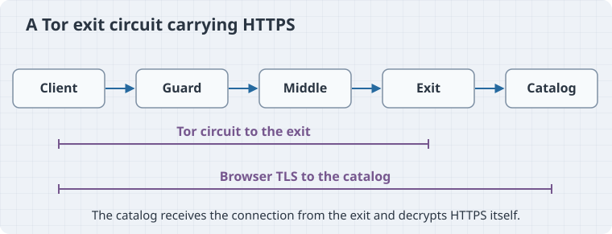
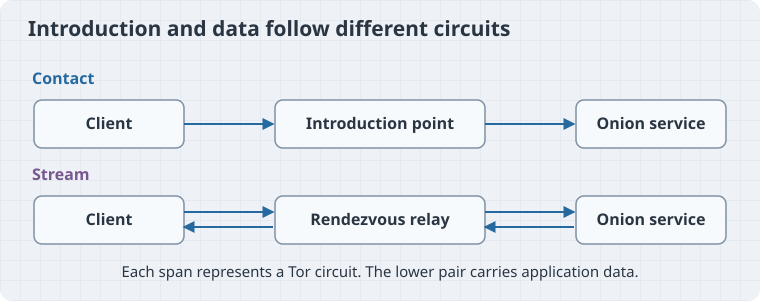

# Onion Routing and Observer Visibility

A library patron reads a public HTTPS catalog through Tor. The access network sees a connection from the patron's device. The catalog sees a connection arrive from a Tor exit. The patron sees the catalog's certificate and page. These observations describe one visit from three positions. Privacy here depends on which observations a party can combine.

## A circuit to a public website

For an ordinary connection to the public Internet, a Tor client typically builds a circuit through a guard, a middle relay, and an exit. The underlying Internet still routes traffic between adjacent participants. A Tor circuit is an overlay path maintained by the relays. An ordinary IP traceroute toward the catalog describes a different mechanism and cannot list those circuit roles. [Tor protocol overview](https://spec.torproject.org/intro/index.html) · [Tor relay roles](https://community.torproject.org/relay/types-of-relays/)

The client establishes cryptographic state with each relay as it extends the circuit. For outbound relay data, it applies layers so the guard can process its own layer and forward the remainder. The middle does likewise. The exit processes the final circuit layer and opens a connection toward the public service. In the reverse direction the relays add their circuit protection and the client removes the layers. Each relay maintains state for its part of the circuit. No individual relay needs a list of every participant.

A browser's HTTPS session runs across that path. TLS authenticates the catalog to the browser and protects the request path, headers, and response body between TLS endpoints. The exit connects to the destination and can observe the destination and traffic pattern. With unencrypted HTTP it could also read the request and response. With HTTPS, the catalog itself can still read and log the request after terminating TLS.

## Fill in the observation table

Assume an ordinary three-relay exit circuit, an HTTPS site without a client login, and observers acting independently. The table describes direct observations available at each position. It makes no assumption that an observer is incapable of inference.

| Position | Direct observation | Information needed for a stronger attribution |
|---|---|---|
| Patron's access network | Client IP, guard IP, traffic times and volumes | A link from that connection to the selected catalog |
| Guard | Incoming client connection and next relay | Knowledge of the final destination for this stream |
| Middle | Adjacent relays and circuit traffic | Both client and destination context |
| Exit | Preceding relay, destination connection, traffic times and volumes | An independent link to the patron's device or identity |
| Catalog's HTTPS endpoint | Exit IP, HTTP request, cookies, and any submitted identity | Evidence tying the browser to the patron if the request carries no identifying state |

Now change one condition. The patron signs in with a named library account. The source address in the catalog's access log can stay the same while the application now knows whose account is reading. Change a different condition and give an observer records from both ends of the path. Similar timing and volume patterns can support correlation. The separation achieved against a single relay does not guarantee anonymity against this observer.

## What changes for an onion service?

An onion service offers a service within Tor. Its onion address is tied to the service's public identity key. For a v3 address, the encoded name contains the public key, a checksum, and a version byte. The client must still obtain the intended address through a trustworthy channel. A cryptographically valid address can belong to somebody else. [Onion service overview](https://community.torproject.org/onion-services/overview/)

The service maintains circuits to introduction points and publishes a signed descriptor that lets clients find them. A client selects a rendezvous relay and sends an introduction through one of the advertised points. The service builds its own circuit to the rendezvous relay. The relay joins the two sides and forwards protected traffic. There is no exit connection from the rendezvous relay to a public origin server. The introduction point helps set up contact and does not carry the resulting application stream.

The term *dark web* often refers to sites intentionally reachable through systems such as onion services. A public HTTPS site visited through a Tor exit remains a public HTTPS site. A password-protected page or an unindexed company wiki can run on ordinary web infrastructure. Search visibility, application access control, and the network path answer different questions.

## Compare the observation with a VPN

Suppose the patron instead uses a conventional single-provider VPN with all catalog traffic routed through it. The access network sees a connection to the VPN gateway. The provider can associate the incoming connection with traffic it forwards toward the catalog, and the catalog sees the provider's egress address. HTTPS still protects the content on the path to the catalog. Tor distributes the entry and exit roles across a circuit. In both designs, a signed-in account, persistent application identifier, or endpoint log can identify the session at the application layer.

As a final exercise, a catalog operator finds two requests from the same exit IP, one authenticated and one anonymous. What can the operator conclude? Both arrived from that exit address, and one supplied a valid account credential. Multiple users can share an exit. Attributing the other request to the account requires additional evidence, such as a common session identifier. This is the same distinction between a network observation and a user identity that matters behind carrier NATs and corporate proxies.

For the single-provider case, see [site tunnels](02-site-tunnels.md). For the visibility of fields after each decryption step, see [keys and encryption boundaries](../06-policy-qos-hardening/12-keys-identities-and-encryption-boundaries.md).
