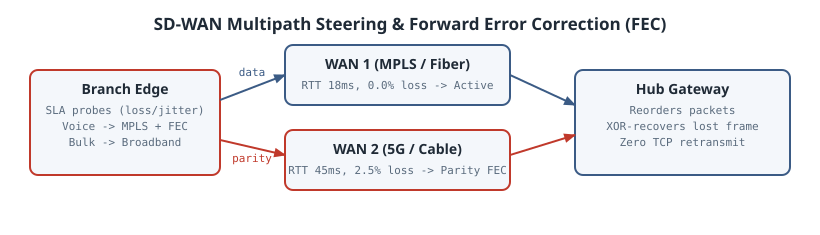

# SD-WAN, Multi-Path Steering, and Forward Error Correction

Traditional active/passive WAN failover waits for a link to go completely dark before switching, leaving voice and interactive apps suffering through 3% packet loss or 200ms jitter on a "technically up" circuit. **SD-WAN** continuously measures per-path SLA metrics (loss, latency, jitter) and steers flows dynamically across MPLS, broadband, and 5G uplinks.

## Control & Data-Plane Mechanics

```text
Branch SD-WAN Edge
   ├── Tunnel 1 (Fiber Broadband) -- BFD SLA Probe: 18ms RTT, 0.0% loss  [SELECTED for Voice/SSH]
   └── Tunnel 2 (5G / LTE)        -- BFD SLA Probe: 65ms RTT, 1.2% loss  [Bulk / Backup + FEC]
```

## Three Core SD-WAN Techniques

1. **Continuous SLA Probing (BFD / TWAMP):** Probes measure one-way/round-trip loss, jitter, and MOS every few hundred milliseconds. When Tunnel 1 crosses a latency or loss SLA threshold, new (or active) sessions steer to Tunnel 2 without waiting for BGP hold timers.
2. **Application-Aware Steering (DPI / First-Packet Classification):** Map DSCP markings or L7 signatures (`EF` voice, `AF41` video, `BE` bulk backup) to distinct SLA policies.
3. **Forward Error Correction (FEC) & Packet Duplication:** On lossy wireless/broadband links, send XOR parity packets (e.g., 1 parity packet per 4 data packets) or duplicate critical voice packets across both tunnels so the receiver reconstructs lost packets with **zero retransmission delay**.
## Multipath Architecture Diagram & XOR FEC Recovery Lab



Verify how a single XOR parity packet recovers any lost packet in a 4-packet FEC block without waiting for a TCP retransmission RTT:

```python
packets = [b"pkt0-hdr", b"pkt1-voip", b"pkt2-voip", b"pkt3-end"]
# Compute byte-wise XOR parity across the block
parity = bytes(a ^ b ^ c ^ d for a, b, c, d in zip(*packets))

# Simulate packet 2 dropped on a lossy 5G link -> reconstruct from {0, 1, 3, parity}
recovered_pkt2 = bytes(
    a ^ b ^ d ^ p for a, b, d, p in zip(packets[0], packets[1], packets[3], parity)
)
assert recovered_pkt2 == packets[2]
print("Recovered dropped packet via XOR FEC:", recovered_pkt2)
```
