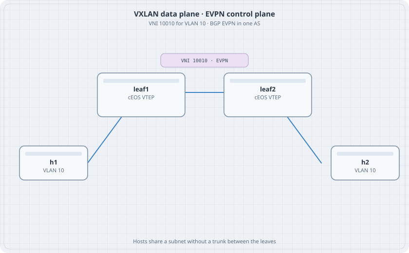

# EVPN-VXLAN Fabric Design: IRB, Anycast Gateway, and Route Types

Once an IP Clos underlay is stable and multipath-verified (see [Clos Leaf-Spine](01-clos-leaf-spine.md) and [Underlay Design Choices](05-underlay-design-choices.md)), modern data centers decouple tenant addressing and Layer 2 mobility from the physical fabric using **VXLAN** for the data plane and **MP-BGP EVPN (RFC 7432 / RFC 8365)** for the control plane. Instead of flooding unknown MACs across the fabric to learn where workloads live, leaves advertise MAC and IP reachability as BGP routes.



## Learning goals

By the end of this chapter you can:

- Distinguish **L2VNI** (MAC-VRF) from **L3VNI** (IP-VRF) and explain why VXLAN overlays separate them
- Compare **Asymmetric IRB** and **Symmetric IRB** packet walks and scaling tradeoffs
- Explain how **Distributed Anycast Gateway** gives every leaf the same default gateway IP and MAC
- Read and troubleshoot **BGP EVPN Route Types 1, 2, 3, 4, and 5**
- Explain RD/RT auto-derivation, **ARP/ND suppression**, and the **silent host** failure mode
- Verify EVPN-VXLAN state on FRR, Arista EOS, and Nokia SR Linux

## Overlay building blocks: VTEP, L2VNI, and L3VNI

VXLAN encapsulates an original Ethernet frame inside a **UDP packet (destination port 4789)** routed across the IP underlay between **VXLAN Tunnel Endpoints (VTEPs)** — typically the loopback interfaces of leaf switches.

| Concept | Scope | Purpose |
|---|---|---|
| **VTEP** | Leaf loopback (`/32`) | Encapsulates/decapsulates VXLAN packets; reachable via the IP underlay |
| **L2VNI (MAC-VRF)** | One per stretched VLAN / broadcast domain (e.g., VLAN 10 → VNI 10010) | Bridges Layer 2 frames between hosts in the same subnet across different leaves |
| **L3VNI (IP-VRF)** | One per tenant VRF (e.g., `VRF-TENANT-A` → VNI 50001) | Routes Layer 3 packets between different subnets inside the same tenant VRF (Symmetric IRB) |
| **BUM traffic** | Broadcast, Unknown unicast, Multicast | Handled via **Ingress Replication (IR)** (head-end replication) or underlay multicast |

> [!NOTE]
> **MTU overhead:** VXLAN adds **50 bytes** (54 bytes if the inner frame carries an 802.1Q tag): 14 B outer Ethernet + 20 B outer IPv4 + 8 B UDP + 8 B VXLAN header. Always configure jumbo frames (**≥ 9000 bytes** or at least 1550–1600 bytes) across the entire underlay so inner 1500-byte tenant frames never fragment.

## Integrated Routing and Bridging (IRB): Asymmetric vs Symmetric

When a host in VLAN 10 (`10.10.10.10/24`) on Leaf 1 sends traffic to a host in VLAN 20 (`10.10.20.20/24`) on Leaf 2, where does Layer 3 routing happen?

### Asymmetric IRB

In **Asymmetric IRB**, the ingress leaf performs **both bridging and routing**, then encapsulates the packet using the **destination L2VNI** (VNI 10020). The egress leaf only bridges into VLAN 20.

- **Pros:** No L3VNI needed; simple lookup on egress.
- **Cons:** **Every leaf must instantiate every VLAN/L2VNI** that any of its local hosts might talk to — even if that leaf has zero local ports in VLAN 20. This wastes MAC/VLAN scale and stretches broadcast domains unnecessarily.

### Symmetric IRB (Production Standard)

In **Symmetric IRB**, both leaves perform symmetrical **bridge → route → encapsulate → decapsulate → route → bridge** operations over a shared **L3VNI** per tenant VRF:

```text
Host A (VLAN 10) ──► Leaf 1: bridge in VLAN 10 ──► route in VRF-A
                        │
                        ▼  VXLAN encap: L3VNI 50001, inner dst MAC = Leaf 2 Router MAC (RMAC)
                   [ IP Underlay / Spines ]
                        │
                        ▼  VXLAN decap: match L3VNI 50001 ──► route in VRF-A
                     Leaf 2: bridge in VLAN 20 ──► Host B (VLAN 20)
```

- **Pros:** Leaf 1 only needs VLAN 10 configured; Leaf 2 only needs VLAN 20 configured. Only the tenant's single **L3VNI** spans both leaves.
- **Cons:** Requires an L3VNI per VRF and EVPN Router MAC (`RMAC`) extended community support (standard on FRR, EOS, NX-OS, SR Linux, Junos).

## Distributed Anycast Gateway

In a classic campus network, VRRP/HSRP gives two routers one shared gateway IP. In an EVPN-VXLAN fabric, **every leaf** hosting VLAN 10 is configured with the **exact same SVI IP address and virtual MAC address** (for example, `10.10.10.1/24` and `00:00:5e:00:01:01`):

- Every VM or server routes out through its **directly attached local leaf** — zero hair-pinning to a central router.
- When a VM live-migrates from Leaf 1 to Leaf 2, its default gateway IP and MAC stay identical, so it never needs to re-ARP for its gateway.
- Leaves mark the anycast gateway MAC as a **local default-gateway MAC** and do not advertise it as a movable host MAC across EVPN.

## BGP EVPN Route Types (1 through 5)

BGP EVPN uses `AFI=25 (L2VPN)`, `SAFI=70 (EVPN)` to carry five core route types:

| Route Type | Name | What It Advertises | Primary Use |
|---|---|---|---|
| **Type 1** | Ethernet Auto-Discovery (A-D) | Ethernet Segment Identifier (ESI) reachability | **All-active EVPN multihoming** (fast mass MAC withdrawal, aliasing/ECMP, split-horizon filtering) |
| **Type 2** | MAC / IP Advertisement | Host MAC, optional host IP (`/32` or `/128`), L2VNI, optional L3VNI + RMAC | Unicast MAC learning, host `/32` routing, and **ARP/ND suppression** |
| **Type 3** | Inclusive Multicast Ethernet Tag (IMET) | VTEP IP + L2VNI | Builds the **Ingress Replication (flood) list** for BUM traffic per VNI |
| **Type 4** | Ethernet Segment (ES) | ESI + originating VTEP IP | **Designated Forwarder (DF) election** on multihomed segments so only one leaf floods BUM frames to a dual-homed server |
| **Type 5** | IP Prefix Route | IP subnet (`10.20.0.0/24`, `0.0.0.0/0`) + L3VNI + RMAC | Advertises **external/border subnets** and pure L3 prefixes without needing a host MAC |

> [!IMPORTANT]
> **Quick troubleshooting heuristic:**
> - Broadcast/ARP flooding fails between leaves → check **Type 3 (IMET)** routes.
> - Same-subnet unicast fails → check **Type 2 (MAC)** routes.
> - Inter-subnet or external reachability fails → check **Type 2 (MAC+IP)** and **Type 5 (IP Prefix)** routes, plus L3VNI + RMAC.
> - Duplicate packets on a dual-homed server LAG → check **Type 1 / Type 4 (ESI & DF election)**.

## RD and RT auto-derivation

Every MAC-VRF (L2VNI) and IP-VRF (L3VNI) requires:

- **Route Distinguisher (RD):** Makes identical customer prefixes/MACs unique in BGP (typically `<router-id>:<vni-or-vlan-id>`, e.g., `10.0.0.11:10010`). Must be **unique per VTEP per VRF**.
- **Route Target (RT):** Extended community controlling **import/export** into VRFs (typically `<asn>:<vni>`, e.g., `65100:10010`). Must **match** across leaves participating in the same VNI.

Modern NOS platforms (FRR `advertise-all-vni`, EOS `auto` RD/RT, SR Linux) auto-derive RDs and RTs cleanly when all leaves share a consistent VNI numbering scheme.

> [!WARNING]
> **eBGP underlay RT pitfall:** In an eBGP fabric where every leaf has a **unique ASN** (e.g., Leaf 1 = `65101`, Leaf 2 = `65102`), auto-derived RTs using `<local-asn>:<vni>` will **not match** (`65101:10010` ≠ `65102:10010`)! Always configure explicit matching RTs (or use a common fabric RT base like `65000:10010`, or iBGP EVPN with spine Route Reflectors).

## ARP suppression and silent hosts

### ARP / ND suppression

Because Type 2 routes carry both the remote host's MAC and IP, a leaf can intercept a local ARP Request (`Who has 10.10.10.20?`), look up `10.10.10.20` in its EVPN Type 2 table, and **proxy-reply locally** without flooding the ARP frame across the VXLAN fabric. This dramatically cuts broadcast noise at scale.

### The silent host problem

A **silent host** is a server or appliance that has an IP address configured but has not sent any traffic (no ARP, no DHCP, no gratuitous ARP) since booting or aging out. Because its local leaf has not learned its MAC/IP, **no EVPN Type 2 route exists** for it:

- Another host in a **different subnet** routes to the silent host via the anycast gateway.
- The ingress leaf has no `/32` Type 2 route, only a `/24` Type 5 or connected route.
- **Fix:** Ensure leaves advertise the connected subnet as a **Type 5** route (or originate a local ARP probe when receiving routed traffic for an unknown host in a locally attached subnet). On FRR/Linux, verify `arp_notify` and local SVI ARP resolution behavior.

## Concrete verification: FRR, Arista EOS, and Nokia SR Linux

### FRR (Linux kernel VXLAN + `bgpd`)

Minimal FRR EVPN configuration snippet on a leaf with Symmetric IRB (`VRF-A`, L2VNI `10010`, L3VNI `50001`):

```text
vrf VRF-A
 vni 50001
exit-vrf
!
router bgp 65101
 bgp router-id 10.0.0.11
 neighbor SPINES peer-group
 neighbor SPINES remote-as external
 !
 address-family l2vpn evpn
  neighbor SPINES activate
  advertise-all-vni
  advertise-svi-ip
 exit-address-family
!
router bgp 65101 vrf VRF-A
 address-family l2vpn evpn
  advertise ipv4 unicast
 exit-address-family
```

Verification commands on FRR and the Linux data plane:

```bash
# Control plane: EVPN summary, Type 2/3/5 routes, and VNI mapping
vtysh -c "show bgp l2vpn evpn summary"
vtysh -c "show bgp l2vpn evpn route"
vtysh -c "show evpn vni detail"
vtysh -c "show evpn mac vni 10010"
vtysh -c "show evpn arp-cache vni 10010"
vtysh -c "show evpn rmac vni 50001"

# Data plane: Linux bridge FDB and VXLAN tunnel state
bridge fdb show dev vxlan10010
ip -d link show vxlan10010
ip route show vrf VRF-A
```

### Arista EOS (`cEOS` / physical switches)

```text
show bgp evpn summary
show bgp evpn route-type mac-ip
show bgp evpn route-type imet
show bgp evpn route-type ip-prefix ipv4
show vxlan vni
show vxlan address-table
show ip route vrf VRF-A
```

### Nokia SR Linux

```text
show network-instance default protocols bgp neighbor
show network-instance default protocols bgp routes evpn summary
show network-instance mac-vrf-10 bridge-table mac-table all
show network-instance ip-vrf-a route-table ipv4-unicast summary
show tunnel-interface vxlan0 vxlan-interface 10
```

## Summary

- **VXLAN** encapsulates L2 frames in UDP/4789 across an IP underlay; **MP-BGP EVPN** replaces data-plane flood-and-learn with control-plane MAC/IP advertisements.
- **Symmetric IRB** (L2VNI per subnet + L3VNI per tenant VRF) is the production standard because leaves only instantiate VLANs they actually host.
- **Distributed Anycast Gateway** places the same gateway IP and MAC on every leaf for optimal local routing and seamless VM mobility.
- Know the five EVPN route types: **Type 1** (A-D/multihoming), **Type 2** (MAC/IP), **Type 3** (IMET flooding), **Type 4** (ES/DF election), and **Type 5** (IP prefixes).
- Always verify **underlay MTU ≥ 1550+**, **matching Route Targets** across unique-ASN eBGP leaves, and **data-plane FDB/VXLAN programming** alongside BGP EVPN tables.

Next: eliminate point-to-point IPv4 link addressing in your underlay with [BGP Unnumbered in Clos Fabrics (RFC 5549 / RFC 8950)](07-bgp-unnumbered-clos.md).
