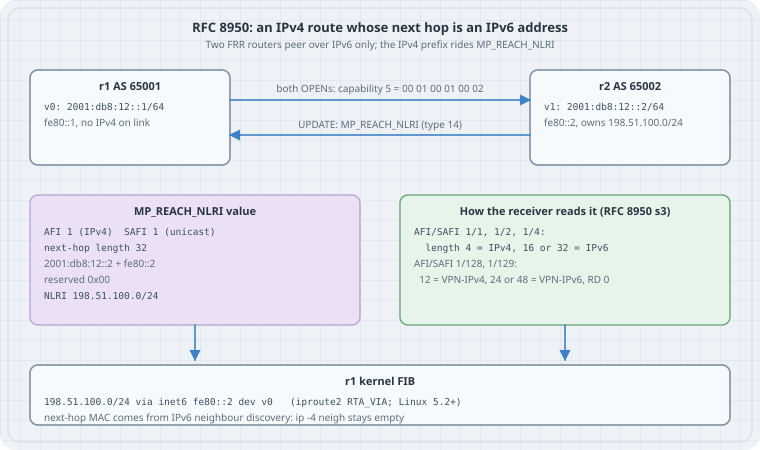

# BGP Unnumbered in Clos Fabrics (RFC 5549 / RFC 8950)

Assigning `/30` or `/31` IPv4 point-to-point subnets to every leaf-spine link in a 64-leaf × 8-spine Clos fabric means managing **512 unique transit subnets and 1,024 interface IP addresses** — every one of them a potential typo or cabling mismatch. **BGP Unnumbered** eliminates point-to-point IPv4 link addressing altogether by discovering BGP peers automatically over **IPv6 link-local addresses** and advertising IPv4 prefixes with **IPv6 next hops (RFC 8950, obsoleting RFC 5549)**.



## Learning goals

By the end of this chapter you can:

- Explain how IPv6 Router Advertisements (RAs) and link-local addresses (`fe80::/10`) bootstrap BGP peers without manual neighbor IPs
- Explain how **RFC 8950 / RFC 5549 Extended Next Hop Encoding** carries IPv4 unicast routes over an IPv6 BGP transport session
- Write zero-touch leaf and spine templates for **FRR** and **Arista EOS**
- Verify unnumbered BGP sessions, IPv6 next hops in the IPv4 FIB, and ECMP forwarding
- Diagnose common RA, link-local, and Linux kernel forwarding failures

## How BGP Unnumbered works (two mechanisms)

BGP Unnumbered combines two independent standards:

### 1. Peer discovery via IPv6 Router Advertisements (NDP)

Every Ethernet interface with IPv6 enabled automatically generates a link-local address (`fe80::/64`) via EUI-64 or stable-privacy derivation.

1. Both ends of a point-to-point fabric link send periodic **ICMPv6 Router Advertisements (RAs)** (`ff02::1`, multicast all-nodes) with a short interval (e.g., 10 seconds).
2. Each router learns the peer's `fe80::...` link-local address and MAC address directly from the RA's **Source Link-Layer Address** option.
3. The BGP daemon automatically opens a TCP port 179 session to that `fe80::...%ethX` peer using the interface name (`neighbor eth1 interface remote-as external`).
4. Because `remote-as external` accepts any ASN different from the local ASN, **cabling a leaf into any spine port brings the session up with zero per-link IP or ASN changes**.

### 2. IPv4 NLRI over IPv6 next hops (RFC 8950 / RFC 5549)

During BGP `OPEN`, both peers negotiate **BGP Capability Code 5 (Extended Next Hop Encoding)**:

- The BGP transport session runs over **IPv6 link-local** (`fe80::...`).
- Inside the `MP_REACH_NLRI` attribute, the router advertises **IPv4 Unicast prefixes** (AFI=1, SAFI=1) with an **IPv6 next hop** (Next Hop AFI=2, e.g., `fe80::20c:29ff:fe11:2233`).
- The receiving router installs the IPv4 prefix directly into the IPv4 FIB pointing via the IPv6 link-local next hop (`via inet6 fe80::... dev eth1`).
- At forwarding time, the router only needs the **next hop's Layer 2 MAC address** (already resolved via IPv6 Neighbor Discovery) to rewrite the Ethernet header and transmit the IPv4 packet! No IPv4 address is ever needed on the transit link.

> [!NOTE]
> **Traceroute caveat:** Because transit interfaces have no IPv4 address, routers source ICMPv4 `Time Exceeded` replies from their **IPv4 loopback (`lo`)** address (RFC 1812). Always give every spine and leaf a unique `/32` IPv4 loopback so `traceroute` and management remain crystal clear.

## Zero-touch Clos templates

### FRR (Leaf and Spine)

On FRR, enabling `ipv6 nd ra-interval` on fabric interfaces and using `neighbor <iface> interface peer-group` makes every spine and leaf config nearly identical.

**Spine `s1` (`frr.conf`):**

```text
frr version 10.2.1
frr defaults datacenter
hostname s1
!
interface lo
 ip address 10.0.0.1/32
!
interface eth1
 no ipv6 nd suppress-ra
 ipv6 nd ra-interval 10
!
interface eth2
 no ipv6 nd suppress-ra
 ipv6 nd ra-interval 10
!
router bgp 65100
 bgp router-id 10.0.0.1
 bgp bestpath as-path multipath-relax
 neighbor FABRIC peer-group
 neighbor FABRIC remote-as external
 neighbor FABRIC capability extended-nexthop
 neighbor eth1 interface peer-group FABRIC
 neighbor eth2 interface peer-group FABRIC
 !
 address-family ipv4 unicast
  network 10.0.0.1/32
  neighbor FABRIC activate
  maximum-paths 64
 exit-address-family
!
line vty
```

**Leaf `l1` (`frr.conf`):**

```text
frr version 10.2.1
frr defaults datacenter
hostname l1
!
interface lo
 ip address 10.0.0.11/32
!
interface eth1
 no ipv6 nd suppress-ra
 ipv6 nd ra-interval 10
!
interface eth2
 no ipv6 nd suppress-ra
 ipv6 nd ra-interval 10
!
interface eth3
 ip address 192.168.1.1/24
!
router bgp 65101
 bgp router-id 10.0.0.11
 bgp bestpath as-path multipath-relax
 neighbor FABRIC peer-group
 neighbor FABRIC remote-as external
 neighbor FABRIC capability extended-nexthop
 neighbor eth1 interface peer-group FABRIC
 neighbor eth2 interface peer-group FABRIC
 !
 address-family ipv4 unicast
  network 10.0.0.11/32
  network 192.168.1.0/24
  neighbor FABRIC activate
  maximum-paths 64
 exit-address-family
!
line vty
```

> [!TIP]
> `frr defaults datacenter` automatically sets fast BGP timers (3s keepalive / 9s hold), enables `bgp bestpath as-path multipath-relax`, and activates `no bgp ebgp-requires-policy` (though production fabrics should always attach explicit prefix-list route-maps).

### Arista EOS (`cEOS` / physical switches)

Arista EOS supports RFC 8950 unnumbered eBGP with `ipv6 enable` on fabric interfaces and `neighbor interface` peering:

```text
service routing protocols model multi-agent
ip routing
ipv6 unicast-routing
!
interface Loopback0
   ip address 10.0.0.11/32
!
interface Ethernet1
   no switchport
   ipv6 enable
!
interface Ethernet2
   no switchport
   ipv6 enable
!
router bgp 65101
   router-id 10.0.0.11
   maximum-paths 4 ecmp 4
   neighbor FABRIC peer group
   neighbor FABRIC send-community
   neighbor interface Et1-2 peer-group FABRIC remote-as 65100
   !
   address-family ipv4
      neighbor FABRIC activate
      neighbor FABRIC next-hop address-family ipv6 originate
      network 10.0.0.11/32
```

## Verification commands

### Control plane (FRR)

```bash
# Confirm BGP sessions are Established on interface names (eth1, eth2)
vtysh -c "show bgp summary"

# Confirm Extended Next Hop capability was negotiated (both advertised & received)
vtysh -c "show bgp neighbors eth1" | grep -A 3 "Extended nexthop"

# Inspect IPv4 routes showing IPv6 link-local next hops
vtysh -c "show bgp ipv4 unicast"
vtysh -c "show ip route bgp"
```

Expected `show ip route bgp` excerpt on Leaf 1 for Leaf 2's host subnet:

```text
B>* 192.168.2.0/24 [20/0] via fe80::a8c1:abff:fe01:1001, eth1, weight 1, 00:04:12
  *                       via fe80::a8c1:abff:fe02:2001, eth2, weight 1, 00:04:12
```

### Data plane (Linux kernel FIB & NDP)

```bash
# Kernel IPv4 FIB shows "via inet6 fe80::..." ECMP nexthops
ip route show 192.168.2.0/24

# Confirm IPv6 neighbor discovery resolved the peer's link-local MAC
ip -6 neigh show dev eth1
```

## Troubleshooting RA and link-local failures

When an unnumbered BGP neighbor stays stuck in `Idle` or `Active`, walk this checklist in order:

| Symptom | Likely Cause | Diagnostic Command & Fix |
|---|---|---|
| Neighbor stuck in `Idle (No peer)` | Peer is not sending RAs, or interface is down | Run `tcpdump -ni eth1 icmp6` — verify Router Advertisements arrive every 10s. Check `no ipv6 nd suppress-ra` on both ends |
| No `fe80::` address on `eth1` | IPv6 disabled in Linux kernel/container (`disable_ipv6 = 1`) | Check `sysctl net.ipv6.conf.eth1.disable_ipv6`; set to `0` and flap interface |
| BGP session Established, **0 prefixes installed** | Missing `capability extended-nexthop` on one side, or `ebgp-requires-policy` blocking routes | Check `show bgp neighbors eth1` for `Extended nexthop` and `Inbound/Outbound updates discarded due to missing policy` |
| Route in BGP table, **missing from kernel FIB** | Old kernel without RFC 5549 support, or `net.ipv4.ip_forward = 0` | Verify `ip route` and `sysctl net.ipv4.ip_forward net.ipv6.conf.all.forwarding` |
| Only 1 path installed instead of 2-way ECMP | Missing `maximum-paths` or spines have different ASNs without `as-path multipath-relax` | Add `maximum-paths 64` and `bgp bestpath as-path multipath-relax` |

## Summary

- **BGP Unnumbered** pairs IPv6 link-local Router Advertisements (peer discovery) with **RFC 8950 / RFC 5549** (IPv4 prefixes over IPv6 next hops).
- Every leaf-spine link requires **zero IPv4 transit addressing**, eliminating hundreds of `/30` or `/31` subnets and enabling plug-and-play cabling.
- Always keep an IPv4 `/32` loopback on every router for router-id, VTEP addressing, and readable `traceroute` hops.
- When debugging, verify in strict layers: `fe80::` present → RAs visible in `tcpdump` → Extended Next Hop capability negotiated → `via inet6 fe80::` in `ip route`.

Next: move down to the physical and hardware forwarding layer in [Optics, Switch ASICs, and Lossless AI/ML Fabrics](08-optics-hardware-and-ai-fabrics.md).
