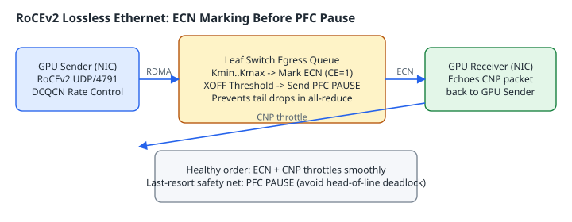

# RoCEv2, Lossless Ethernet, and AI/GPU Fabrics

Distributed GPU training (`all-reduce`, `all-to-all`) generates synchronized, high-bandwidth **elephant flows** where a single dropped packet forces an RDMA retransmission that stalls thousands of GPUs. **RoCEv2 (RDMA over Converged Ethernet v2)** achieves InfiniBand-like tail latency on Ethernet using **ECN/DCQCN** congestion control, **PFC (Priority Flow Control)**, and **rail-optimized** fabrics.

## Why Standard TCP + ECMP Struggles on AI Clusters

- **Kernel & copy overhead:** Standard TCP copies buffers through the OS kernel; RDMA NICs bypass the kernel and write directly into GPU HBM memory (GPUDirect RDMA).
- **ECMP hash polarization:** Two 400 Gbps RDMA flows hashing onto the same spine uplink saturate 100% of one link while leaving parallel links idle. Modern AI fabrics (Ultra Ethernet / Spectrum-X) use **per-packet spraying** with out-of-order reassembly at the NIC.

## ECN + DCQCN vs. PFC (Priority Flow Control)

1. **ECN (Explicit Congestion Notification) + DCQCN:** When a switch egress queue crosses `Kmin`, it marks IP ECN `CE=1` bits. The receiver NIC echoes a **CNP (Congestion Notification Packet)** back to the sender, which smoothly reduces its transmission rate *before* buffers fill.
2. **PFC (`802.1Qbb`):** Only if ECN fails to drain the queue and buffer hits `XOFF`, the switch sends a PFC `PAUSE` frame for priority class 3 (leaving other traffic classes unaffected).

> [!CAUTION]
> Misconfigured PFC without ECN causes **PFC storms and head-of-line deadlocks** that freeze an entire fabric. Always tune `Kmin < Kmax < XOFF` and enable **PFC Watchdog** on every leaf/spine switch.

## Rail-Optimized Leaf-Spine Topology

Instead of connecting all 8 NICs of a GPU server to one ToR switch, **rail optimization** connects GPU `i` of every server to **Rail Leaf `i`**, keeping single-hop intra-rail `all-reduce` traffic off the spine layer.
