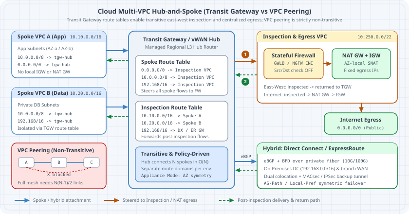

# Cloud VPC Networking Patterns

Public cloud Virtual Private Clouds (VPCs in AWS and GCP, VNets in Azure) look like traditional Ethernet subnets from inside a virtual machine, but their underlying dataplane is a software-defined Layer 3 overlay running on hypervisor SmartNICs or DPUs (such as AWS Nitro, Azure SmartNIC/VFP, and Google Andromeda). Understanding where cloud VPCs diverge from campus and data-center L2 networks prevents painful surprises during architecture, migration, and troubleshooting.

## Learning goals

By the end of this chapter you can:

- Explain why L2 broadcast, multicast, and gratuitous ARP behave differently in cloud VPCs
- Plan non-overlapping CIDRs, subnets, and route tables for multi-account and hybrid clouds
- Contrast Internet Gateways, NAT Gateways, and centralized egress designs
- Choose between VPC Peering, Transit Gateway / hub-and-spoke, and PrivateLink / Private Endpoints
- Design hybrid connectivity using Direct Connect / ExpressRoute and IPSec + BGP
- Diagnose common cloud routing pitfalls (asymmetric return paths, source/dest checks, and overlapping CIDRs)

## Why Layer 2 is an illusion in cloud VPCs

In a physical VLAN, an Ethernet switch floods ARP broadcasts (`ff:ff:ff:ff:ff:ff`), learns MAC addresses dynamically, and allows protocols like VRRP, HSRP, or gratuitous ARP to move a floating VIP between two hosts. In a public cloud VPC, **there is no real L2 broadcast domain**.

Instead, the cloud control plane knows the exact mapping of every virtual NIC's IP address, MAC address, and host hypervisor location:

- **Synthetic ARP / Neighbor Discovery**: When a VM sends an ARP Who-Has for its gateway or another VM in the same subnet, the local hypervisor intercepts the frame and synthesizes an ARP Reply directly from its local mapping table. The broadcast never leaves the physical host.
- **No L2 flooding or multicast**: Unknown unicast flooding, L2 broadcast storms, and native IP multicast do not exist on standard VPC subnets (specialized overlays such as AWS Transit Gateway Multicast emulate multicast at L3).
- **Floating VIPs require API calls, not GARP**: Sending a gratuitous ARP from a standby HAProxy or firewall VM does nothing. To move a secondary IP or route target, the failover agent must call the cloud control plane API to reassign the IP or update the VPC route table.
- **L3-first forwarding**: Even traffic between two VMs in the same `/24` subnet is encapsulated by the hypervisor overlay (e.g., Geneve/VXLAN-like headers) and routed over the provider's physical Clos underlay to the destination host.

> [!IMPORTANT]
> **Source/Destination Check:** Cloud hypervisors drop packets whose source or destination IP does not match the VM's assigned ENI addresses. If you run a virtual router, NAT instance, or firewall appliance inside a VPC, you must explicitly disable source/destination checking (AWS) or enable IP forwarding (Azure/GCP) on its network interfaces.

## CIDR planning and route tables

Poor IP address management (IPAM) is the hardest networking mistake to undo in the cloud. Once workloads are deployed, renumbering a VPC or VNet is disruptive.

### CIDR sizing guidelines

| Scope | Typical prefix | Notes |
|-------|----------------|-------|
| Regional cloud supernet | `/16` or `/15` per region | Summarizes cleanly over BGP to on-premises |
| Production VPC / VNet | `/16` to `/20` | Leave headroom for Kubernetes Pods and ENIs |
| Tier subnet (app, db, edge) | `/22` to `/24` per AZ | Cloud reserves 4–5 IPs per subnet (network, gateway, DNS, future, broadcast) |
| Transit / firewall attachment subnet | `/27` or `/28` per AZ | Dedicated small subnets for TGW/NLB/firewall ENIs |
| RFC 6598 (`100.64.0.0/10`) | Secondary CIDR | Useful for non-routable Kubernetes Pod CIDRs when RFC 1918 space is scarce |

> [!TIP]
> Avoid `172.17.0.0/16` (Docker default bridge) and `192.168.0.0/16` (common home/VPN subnets) for corporate VPCs. Reserve contiguous blocks per region and environment (`10.10.0.0/16` prod-us-east, `10.11.0.0/16` prod-eu-west) so on-premises firewalls only need a handful of summary routes.

### Route table evaluation

Every VPC subnet is associated with a route table. Cloud route tables follow standard **longest prefix match (LPM)**, with one subtle rule: the local VPC CIDR route cannot be deleted, though modern clouds allow more-specific routes (such as a `/32` or a subnet `/24`) to steer intra-VPC traffic through a virtual firewall appliance.

```text
Destination        Target                 Purpose
10.20.0.0/16       local                  Intra-VPC routing (implicit)
10.20.2.0/24       eni-firewall-az1       More-specific override for inspection
10.0.0.0/8         tgw-0a1b2c3d4e         Corporate spokes and on-premises via TGW
0.0.0.0/0          nat-0f9e8d7c6b         Private subnet internet egress via NAT GW
```

## Internet Gateway, NAT Gateway, and egress architecture

A subnet is "public" or "private" strictly based on its route table—not its name:

- **Internet Gateway (IGW)**: Performs stateless 1:1 NAT between a VM's private IP and its assigned public IPv4 address (for IPv6, the VM has a globally routable address and the IGW simply forwards). A subnet with `0.0.0.0/0 -> igw` is a public subnet.
- **NAT Gateway**: A managed, stateful SNAT appliance deployed in a public subnet. Private subnets route `0.0.0.0/0 -> nat-gw`. The NAT Gateway rewrites the source IP to its Elastic/Public IP and tracks flows in a connection table.
- **Egress-only Internet Gateway (IPv6)**: Allows outbound IPv6 connections from private subnets while blocking unsolicited inbound connections—no NAT required.

### Per-AZ NAT vs centralized egress

| Pattern | Pros | Cons |
|---------|------|------|
| **NAT Gateway per AZ per VPC** | Fault-isolated by AZ; zero cross-AZ data transfer fees | Higher fixed hourly cost when you have dozens of VPCs |
| **Centralized Egress VPC (via TGW)** | Single place for egress firewalling, URL filtering, and fixed allowlisted public IPs | Adds TGW data processing fees; requires careful AZ-affinity routing |

> [!WARNING]
> **Cross-AZ NAT trap:** If a private subnet in `az-b` points its default route to a NAT Gateway in `az-a`, every gigabyte of outbound traffic pays cross-AZ data transfer charges and breaks if `az-a` fails. Always pair each private subnet with a NAT Gateway in the same Availability Zone.

## Inter-VPC connectivity: Peering, Transit Gateway, and PrivateLink

As an organization grows beyond a single VPC, three primary patterns connect workloads.



### VPC Peering

VPC Peering creates a direct, non-transitive L3 routing link between two VPCs.

- **Non-transitive**: If VPC A peers with VPC B, and VPC B peers with VPC C, VPC A cannot reach VPC C through B.
- **Scale limit**: Connecting $N$ VPCs in a full mesh requires $\frac{N(N-1)}{2}$ peering connections (10 VPCs = 45 peerings; 50 VPCs = 1,225 peerings).
- **Best fit**: High-throughput, low-latency point-to-point links between a small number of VPCs (and zero per-GB hop fee inside the same AZ on most clouds).

### Hub-and-spoke (Transit Gateway / Virtual WAN / NCC)

A managed regional router (AWS Transit Gateway, Azure Virtual WAN, GCP Network Connectivity Center) acts as the hub for dozens or thousands of spoke VPCs and VPN/Direct Connect links.

- **Route domains / tables**: Separate route tables on the hub enforce macro-segmentation (for example, `prod` spokes cannot route to `dev` spokes, or all east-west traffic is forced through an inspection VPC).
- **Inspection VPC appliance mode**: Enable **Appliance Mode** on the inspection VPC attachment so that both directions of a cross-AZ flow hash to the same firewall ENI; otherwise stateful firewalls drop asymmetric return packets.

### PrivateLink / Private Endpoints

PrivateLink exposes a **single service** (backed by a Network Load Balancer) from a Provider VPC into a Consumer VPC as a private ENI inside the consumer's own subnet.

- **Unidirectional**: Only the consumer can initiate connections to the service; the provider cannot initiate connections back into the consumer VPC.
- **Overlapping CIDRs allowed**: Because traffic is NATed at the PrivateLink fabric boundary, consumer and provider VPCs can both use `10.0.0.0/16` with zero routing conflict.
- **Zero lateral blast radius**: Unlike peering or TGW, exposing a database or SaaS API via PrivateLink grants no L3 reachability to the rest of the provider VPC.

| Mechanism | Transitive | Overlapping CIDRs | Directionality | Typical use case |
|-----------|------------|-------------------|----------------|------------------|
| **VPC Peering** | No | No | Bidirectional | 2–5 VPCs needing cheap, low-latency full L3 |
| **Transit Gateway** | Yes (via hub) | No | Bidirectional | Enterprise hub-and-spoke, hybrid routing, centralized egress |
| **PrivateLink / Private Endpoint** | No | **Yes** | Unidirectional (consumer -> provider) | Exposing SaaS, shared APIs, or PaaS services safely |

## Hybrid connectivity: Direct Connect, ExpressRoute, and IPSec + BGP

Connecting on-premises data centers to cloud VPCs typically uses one of two transports, both running **eBGP** for dynamic route exchange (see [BGP Basics](../05-dynamic-routing/02-bgp-basics.md)):

1. **Managed Site-to-Site IPSec VPN**: Encrypted tunnels over the public internet to a cloud VPN gateway or Transit Gateway. Fast to provision (minutes), capped at ~1.25 Gbps per tunnel unless combined with ECMP across multiple tunnels.
2. **Dedicated Private Circuit (AWS Direct Connect / Azure ExpressRoute / GCP Cloud Interconnect)**: Physical fiber cross-connect at a colocation facility (1G, 10G, 100G). Provides deterministic latency and lower egress fees, but is **not encrypted by default** at L3 unless you add MACsec (on 10G/100G dedicated ports) or run IPSec over the private VIF.

### Designing resilient hybrid BGP

- **Redundant locations**: Terminate circuits at two distinct colocation facilities and two on-premises edge routers to avoid single-facility outages.
- **BFD (Bidirectional Forwarding Detection)**: Enable BFD on Direct Connect / Interconnect BGP sessions so link failures converge in sub-second time rather than waiting for BGP hold timers (often 90 seconds).
- **Symmetric path preference**: Advertise identical prefixes from both edge routers if you want ECMP, or use **AS-Path prepending** (outbound from on-prem) and **Local Preference** (inbound to on-prem) to control active/passive failover cleanly.
- **MTU and MSS clamping**: IPSec tunnels reduce effective MTU (often to 1380–1436 bytes). Clamp TCP MSS to `1360`–`1380` on VPN edge routers to avoid Path MTU black holes when ICMP Fragmentation Needed is filtered.

## Common cloud routing pitfalls

### 1. Security Groups vs Network ACLs

| Control | Scope | Stateful? | Evaluation order |
|---------|-------|-----------|------------------|
| **Security Group / NSG** | Elastic Network Interface (VM/Pod) | **Yes** (return traffic auto-allowed) | Allow-only union (implicit deny at end) |
| **Network ACL (NACL)** | Subnet boundary | **No** (must allow ephemeral return ports `1024-65535`) | Numbered rules, first match wins |

A classic outage occurs when someone adds a restrictive outbound rule to a subnet NACL and forgets to allow ephemeral TCP ports (`1024–65535` or `32768–65535`), breaking all inbound HTTPS return traffic even though Security Groups allow port 443.

### 2. Asymmetric routing through stateful appliances

When a spoke VPC sends traffic through a firewall in `az-a`, and the return packet enters the inspection VPC in `az-b` and hits a different firewall instance without shared session state, the second firewall drops the packet as an invalid mid-stream TCP segment. Fixes:

- Enable Transit Gateway **Appliance Mode** on the inspection attachment.
- Or perform SNAT on the firewall so return traffic is forced back to the exact firewall ENI that originated it (at the cost of losing original client IP unless Proxy Protocol or XFF is used).

### 3. AWS/Cloud VPC Flow Logs and Reachability Analyzer

Because you cannot attach a physical tap to a cloud router, verify cloud paths with control-plane analyzers and flow telemetry:

```bash
# Example: Querying AWS VPC Reachability Analyzer (control-plane path proof)
aws ec2 create-network-insights-path \
  --source eni-0123456789abcdef0 \
  --destination eni-0fedcba9876543210 \
  --protocol tcp \
  --destination-port 443

# Verify interface routes and MTU from inside a Linux cloud instance
ip -br addr
ip route show table all
tracepath -n 10.20.2.15
```

Cloud flow logs record 5-tuple metadata (`srcaddr`, `dstaddr`, `srcport`, `dstport`, `protocol`, `action: ACCEPT/REJECT`) at the ENI level. A `REJECT` in flow logs points immediately to a Security Group or NACL drop, whereas an `ACCEPT` on the sender with no matching entry on the receiver points to a missing route table entry, blackhole route, or disabled IP forwarding on an intermediate appliance.

## Summary

Cloud VPCs replace physical L2 broadcast fabrics with programmable L3 overlays enforced at the hypervisor. Plan non-overlapping CIDRs early, keep NAT Gateways AZ-local, choose Peering vs Transit Gateway vs PrivateLink based on transitivity and blast radius, and remember that stateful inspection appliances require symmetric routing and disabled source/destination checks. Next, we zoom inside a single Linux host to see how containers and CNI plugins build virtual networks on top of these nodes in [Container Networking and CNI Primitives](02-container-and-cni-primitives.md).
