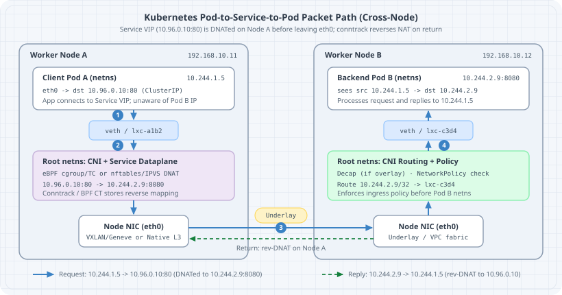

# Kubernetes Services, kube-proxy, and Cilium eBPF

Pod IP addresses are ephemeral: every deployment rollout, node failure, or autoscaling event replaces Pods with new IP addresses. A Kubernetes **Service** provides a stable Virtual IP (VIP) and DNS name that load-balances traffic across a dynamic set of healthy backend Pods tracked via `EndpointSlice` objects.

## Learning goals

By the end of this chapter you can:

- Trace a cross-node Pod-to-Service-to-Pod packet through `veth`, DNAT, conntrack, and underlay transport
- Differentiate `ClusterIP`, `NodePort`, `LoadBalancer`, and `Headless` Services
- Compare `kube-proxy` modes (`iptables`, `nftables`, IPVS) against Cilium eBPF kube-proxy replacement
- Explain `externalTrafficPolicy: Local` vs `Cluster` and diagnose SNAT / source-IP loss traps
- Troubleshoot CoreDNS latency and the `ndots:5` DNS amplification pitfall

## Pod-to-Service-to-Pod packet path

A `ClusterIP` is a **virtual IP**—it is not assigned to any physical NIC or routing table entry (except as a dummy interface in IPVS mode). Instead, every worker node intercepts packets destined for a Service VIP and performs **Destination NAT (DNAT)** to rewrite the destination to a chosen healthy backend Pod IP before the packet leaves the node.



Walking through the cross-node flow above:

1. **Client Pod A** (`10.244.1.5`) opens a TCP connection to `10.96.0.10:80` (the Service `ClusterIP`).
2. **DNAT on Node A**: Before leaving Node A—either at the socket `connect()` hook (Cilium eBPF socket-level LB) or in the root namespace `PREROUTING`/`OUTPUT` hooks (`kube-proxy`)—the dataplane selects backend Pod B (`10.244.2.9:8080`), rewrites the destination IP and port, and records the translation in the connection tracking (`conntrack` or BPF CT) table.
3. **Underlay delivery**: Node A routes `10.244.2.9` across the CNI overlay (VXLAN/Geneve) or native L3 fabric to Node B.
4. **Delivery to Pod B**: Node B decapsulates (if overlay), enforces any ingress `NetworkPolicy`, and delivers the packet over Pod B's `veth`. Pod B sees the real source IP `10.244.1.5`.
5. **Return path**: Pod B replies to `10.244.1.5`. When the reply arrives back at Node A, `conntrack` matches the reverse tuple and performs **reverse-DNAT**, rewriting the source back to `10.96.0.10:80` so Pod A's TCP stack accepts the segment.

> [!NOTE]
> Because DNAT happens on the **client's node**, a Service VIP never needs to be routable outside the cluster. Only Pod IPs (or encapsulated node IPs) traverse the network between nodes.

## Service types compared

| Service type | Reachability | How traffic enters | Common use case |
|--------------|--------------|--------------------|-----------------|
| **`ClusterIP`** (default) | Internal to cluster | Virtual IP from Service CIDR (`10.96.0.0/12`) | East-west microservice communication |
| **`Headless`** (`clusterIP: None`) | Internal to cluster | No VIP; CoreDNS returns all backend Pod IPs directly (`A`/`AAAA` records) | StatefulSets (Kafka, Cassandra, etcd), gRPC client-side LB |
| **`NodePort`** | External via `<NodeIP>:<30000-32767>` | Every node listens on the allocated high port and DNATs to backends | Bare-metal labs, building block under `LoadBalancer` |
| **`LoadBalancer`** | External via cloud/MetalLB VIP | Cloud controller provisions an external L4 LB targeting NodePorts (or Pod IPs directly) | Production external TCP/UDP ingress and Gateway/Ingress controllers |

## Dataplane implementations: `kube-proxy` vs Cilium eBPF

Historically, `kube-proxy` ran as a DaemonSet on every node watching `Service` and `EndpointSlice` objects from the API server and programming Linux kernel packet-forwarding rules.

### 1. `kube-proxy` `iptables` mode (legacy)

- Encodes Services and Endpoints as sequential `KUBE-SERVICES` and `KUBE-SVC-*` chains using `--statistic --mode random` probability rules.
- **Scaling bottleneck**: Rule evaluation is $O(N)$ linear in the number of Services, and every endpoint churn requires rewriting large rule batches atomically via `iptables-restore`. At 5,000+ Services, sync latency and packet CPU overhead spike sharply.

### 2. `kube-proxy` `nftables` mode (modern Kubernetes default replacement)

- Uses native Linux `nftables` **verdict maps (`vmap`)** for $O(1)$ hash lookups of Service VIPs and ports, avoiding linear chain walks.
- Supports incremental atomic transactions and cleaner IPv4/IPv6 dual-stack handling while remaining part of standard `kube-proxy`.

### 3. `kube-proxy` IPVS mode

- Uses the Linux **IP Virtual Server** kernel module (a hash-table-based L4 load balancer) with a dummy interface (`kube-ipvs0`) holding all Service VIPs.
- Supports rich scheduling algorithms (`rr`, `lc`, `sh`, `sed`) and $O(1)$ lookups, though it still relies on `iptables`/Netfilter for masquerading and hairpinning.

### 4. Cilium eBPF kube-proxy replacement

Cilium replaces `kube-proxy` completely using eBPF programs attached to **cgroup socket hooks** and **TC/XDP**:

- **Socket-level load balancing**: When a Pod calls `connect()` or `sendmsg()` to `10.96.0.10:80`, an eBPF program attached to `cgroup/connect4` rewrites the destination address *directly on the socket* before a single packet is constructed. Subsequent packets on that TCP connection bypass per-packet NAT entirely.
- **BPF hash maps**: Service and backend lookups are $O(1)$ in-kernel BPF map lookups with zero `iptables` chains.
- **Native DSR and Maglev**: Supports Direct Server Return (see [L4/L7 Load Balancing, DSR, and Reverse Proxies](../07-d-dataplanes-and-traffic-delivery/02-l4-l7-load-balancing-dsr-and-proxies.md)) and Maglev consistent hashing for NodePort/LoadBalancer traffic.

| Dataplane | Lookup complexity | Socket-level LB | DSR support | Operational notes |
|-----------|-------------------|-----------------|-------------|-------------------|
| `iptables` | $O(N)$ linear | No | No | Legacy; avoid on large clusters |
| `nftables` | $O(1)$ verdict maps | No | No | Drop-in modern replacement for `iptables` |
| `IPVS` | $O(1)$ hash table | No | Partial | Mature L4 algorithms; still uses Netfilter for SNAT |
| **Cilium eBPF** | $O(1)$ BPF maps | **Yes** | **Yes** | Eliminates `kube-proxy`; requires Linux 5.10+ |

## `externalTrafficPolicy`: `Cluster` vs `Local`

When external traffic hits a `NodePort` or `LoadBalancer` Service on Node A, what happens if the backend Pod is actually running on Node B? This is governed by `spec.externalTrafficPolicy`.

### `externalTrafficPolicy: Cluster` (default)

1. External client (`198.51.100.10`) connects to Node A on port `30080`.
2. Node A picks Pod B on Node B, performs DNAT to Pod B, **and performs SNAT (masquerade)** rewriting the source IP to Node A's IP.
3. **Why SNAT is mandatory here**: Without SNAT, Pod B on Node B would reply directly to `198.51.100.10`. The client would receive a packet from Node B (or Pod B) instead of Node A/the LB VIP and drop it as asymmetric.
4. **Consequences**: Extra network hop between nodes, **original client IP is lost** (unless Proxy Protocol is used), and health checks pass on every node even if it has zero local Pods.

### `externalTrafficPolicy: Local`

1. Each node only forwards external Service traffic to **local Pods on the same node**.
2. Kubernetes opens a `healthCheckNodePort` that returns `200 OK` only on nodes hosting at least one ready backend Pod, so the external cloud Load Balancer stops sending traffic to empty nodes.
3. **No SNAT is performed**: Pod B sees the real client IP `198.51.100.10`, and there is no cross-node hop.

> [!WARNING]
> **Uneven load distribution with `Local`:** If Node A runs 1 replica of your Ingress controller and Node B runs 3 replicas, an external LB distributing equally across healthy nodes will send 50% of traffic to Node A's single Pod. Pair `externalTrafficPolicy: Local` with a `DaemonSet` or pod anti-affinity so every targeted node carries equal capacity.

## CoreDNS and the `ndots:5` pitfall

By default, kubelet writes the following `/etc/resolv.conf` into every Pod:

```text
nameserver 10.96.0.10
search default.svc.cluster.local svc.cluster.local cluster.local
options ndots:5
```

The `ndots:5` option instructs the stub resolver: *if a queried hostname has fewer than 5 dots, append every domain in the `search` list before trying the name as an absolute FQDN.*

When an application resolves `api.stripe.com` (2 dots, which is `< 5`), the Pod issues **up to 4 sequential NXDOMAIN queries** (8 queries if dual-stack A + AAAA are enabled) before ever querying `api.stripe.com.`:

1. `api.stripe.com.default.svc.cluster.local` -> `NXDOMAIN`
2. `api.stripe.com.svc.cluster.local` -> `NXDOMAIN`
3. `api.stripe.com.cluster.local` -> `NXDOMAIN`
4. `api.stripe.com.` -> `NOERROR`

At high request rates, this multiplies CoreDNS QPS by 4–8× and can exhaust Linux `conntrack` UDP entries on busy nodes.

### Mitigations

- **Use trailing dots** for external hostnames (`api.stripe.com.`) where application libraries support it.
- **Lower `ndots` in `dnsConfig`** for external-heavy workloads:

```yaml
spec:
  dnsConfig:
    options:
      - name: ndots
        value: "2"
```

- **Deploy NodeLocal DNSCache**: Runs a local DNS cache daemon on every node (listening on a link-local IP such as `169.254.20.10`), upgrading upstream CoreDNS lookups to TCP and avoiding `conntrack` UDP races.

## Inspecting Service dataplanes on a node

```bash
# Inspect EndpointSlices (the source of truth for kube-proxy and Cilium)
kubectl get endpointslices -l kubernetes.io/service-name=web -o wide

# On a Cilium node: inspect BPF service map and backend weights
kubectl -n kube-system exec ds/cilium -- cilium service list

# On a kube-proxy nftables node: inspect the kubernetes nftables table
sudo nft list table ip kube-proxy

# Check conntrack table utilization (drops happen when count reaches max)
sysctl net.netfilter.nf_conntrack_count net.netfilter.nf_conntrack_max
```

## Summary

Kubernetes Services decouple clients from ephemeral Pod IPs by programming per-node DNAT via `kube-proxy` (`nftables`/IPVS) or Cilium's socket-level eBPF dataplane. Understanding `externalTrafficPolicy: Local` prevents silent client-IP loss and asymmetric drops, while tuning `ndots` or deploying NodeLocal DNSCache protects CoreDNS under load. Next, we cover L7 traffic routing and zero-trust Pod isolation in [Ingress, Gateway API, and NetworkPolicy](04-ingress-gateway-api-and-network-policy.md).
