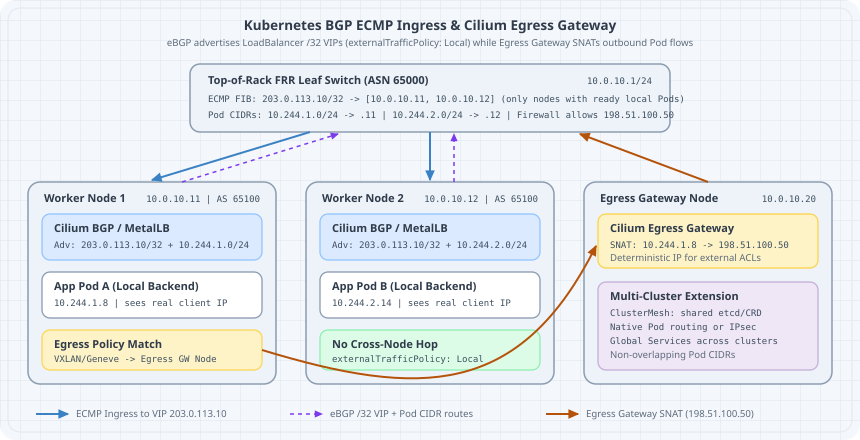

# Kubernetes BGP, Egress Gateways and Multi-Cluster Networking

Cloud-managed Kubernetes clusters rely on cloud-provider APIs to provision external LoadBalancers and NAT gateways. On bare metal, private data centers, or hybrid fabrics, Kubernetes nodes must speak directly to the physical network using **BGP**. This chapter builds on [Kubernetes Services and Dataplanes](03-kubernetes-services-and-dataplanes.md) and [Ingress, Gateway API and NetworkPolicy](04-ingress-gateway-api-and-network-policy.md) to cover **MetalLB and Cilium BGP Control Plane**, **`externalTrafficPolicy: Local` versus `Cluster`**, **Cilium Egress Gateway**, and **multi-cluster networking**.



## Advertising LoadBalancer VIPs and Pod CIDRs with BGP

When a bare-metal cluster creates a `Service` of type `LoadBalancer`, nothing allocates or routes its external IP unless a speaker announces it to the Top-of-Rack (ToR) switches. Two production patterns dominate:

- **MetalLB (BGP mode with FRR backend):** Runs a DaemonSet speaker on worker nodes that peers eBGP/iBGP with ToR switches and advertises `/32` (or `/128`) LoadBalancer VIPs. Works alongside any CNI (Calico, Flannel, Cilium, Antrea) and supports BFD for sub-second node failure detection.
- **Cilium BGP Control Plane:** Built directly into `cilium-agent` (using GoBGP) with declarative CRDs (`CiliumBGPClusterConfig`, `CiliumBGPPeerConfig`, `CiliumBGPAdvertisement`). A single BGP session per node can advertise **both** `LoadBalancer` `/32` VIPs and the node's **Pod CIDR** (`10.244.1.0/24`), enabling native unencapsulated Pod-to-external routing without VXLAN/Geneve overhead.

With multiple worker nodes advertising the same `/32` VIP to the ToR switch, the ToR installs an **ECMP** route with one next-hop per healthy node. Hardware 5-tuple hashing distributes incoming client flows across nodes at line rate without a single active/standby bottleneck.

## `externalTrafficPolicy: Local` versus `Cluster`

The `spec.externalTrafficPolicy` field on a `LoadBalancer` Service fundamentally changes both BGP route advertisements and packet SNAT behavior:

| Behavior | `externalTrafficPolicy: Cluster` (default) | `externalTrafficPolicy: Local` |
|---|---|---|
| **Which nodes advertise the VIP?** | **Every** BGP-speaking worker node in the cluster | **Only** nodes hosting at least one `Ready` local backend Pod |
| **Client source IP preservation** | **Lost** — ingress node SNATs traffic to its own Node IP if forwarded cross-node | **Preserved** — ingress node delivers directly to a local Pod with no SNAT |
| **Extra cross-node hop** | Frequent (statistically `(N-1)/N` flows bounce to another node) | Zero — traffic lands directly on a node running the Pod |
| **Load balance distribution** | Even across all Pods regardless of node placement | Even across **nodes** (can skew if one node runs 1 Pod and another runs 5) |
| **Failover on Pod drain** | Instant local reroute to another node | BGP withdraws `/32` from draining node; ECMP re-hashes (watch for active TCP resets if ToR lacks resilient hashing) |

> [!IMPORTANT]
> When using `externalTrafficPolicy: Local` with BGP ECMP, enable **resilient ECMP hashing** (or Maglev/consistent hashing) on your ToR switches if supported. Standard modulo ECMP re-hashes *all* flows to the VIP whenever a single worker node joins or leaves the ECMP group, resetting unrelated TCP connections.

## Cilium Egress Gateway for deterministic outbound IPs

By default, when a Pod initiates an outbound connection to an external database, SaaS API, or partner firewall, the worker node masquerades (SNATs) the packet to **whichever node's IP** the Pod happens to be scheduled on. Because Pods reschedule dynamically across dozens of nodes, external firewall allowlists cannot safely track them.

**Cilium Egress Gateway** solves this in eBPF without sidecars or HTTP proxies:

1. A `CiliumEgressGatewayPolicy` selects source Pods by namespace/label and destination CIDRs (for example, `198.51.100.0/24` or `0.0.0.0/0` excluding internal RFC 1918 ranges).
2. On the source worker node, Cilium intercepts matching egress packets in eBPF and tunnels them (via VXLAN/Geneve) to a designated **Egress Gateway Node** (selected by node label).
3. The Egress Gateway Node SNATs the flow to a fixed, static **Egress IP** (for example, `198.51.100.50`) and forwards it out the physical NIC. Return packets arrive at `198.51.100.50`, match BPF conntrack, and tunnel back to the originating Pod.

For high availability, assign multiple gateway nodes (or a floating VIP managed via BGP/keepalived) so a single gateway node reboot does not sever outbound connectivity.

## Multi-cluster networking patterns

Connecting workloads across multiple Kubernetes clusters (across Availability Zones, regions, or on-prem + cloud) requires solving three problems: **IP addressing**, **service discovery**, and **cross-cluster encryption/policy**.

| Approach | Data plane | Discovery & policy | Best fit |
|---|---|---|---|
| **Cilium ClusterMesh** | Native L3 routing or VXLAN/Geneve + optional WireGuard/IPsec | Syncs identities, Endpoints, and Global Services via etcd/API; enforces L3/L4/L7 `CiliumNetworkPolicy` across clusters | Homogeneous Cilium clusters needing flat Pod-to-Pod routing and shared identity policy |
| **Submariner** | IPsec/WireGuard/VXLAN gateway tunnels between designated cluster Gateway nodes | Lighthouse DNS (`*.clusterset.local`, K8s MCS API `ServiceExport`/`ServiceImport`) | Heterogeneous CNIs (e.g., Calico + OVN-Kubernetes) or overlapping/NATed underlay networks |
| **Gateway API / Service Mesh (East-West Gateways)** | mTLS over L7/L4 ingress-egress gateways (Envoy / Istio / Cilium Gateway) | DNS + `HTTPRoute` / `TCPRoute` with mTLS SPIFFE identities | Overlapping Pod CIDRs, strict tenant isolation, or gradual multi-cloud migration |

> [!WARNING]
> Flat L3 multi-cluster meshes (such as Cilium ClusterMesh) require **non-overlapping Pod CIDRs** across every connected cluster (for example, Cluster A `10.244.0.0/16`, Cluster B `10.245.0.0/16`). Plan IPAM before day-one cluster creation; renumbering Pod CIDRs in production requires draining and rebuilding nodes.

## Kubernetes YAML and FRR ToR configurations

### Cilium BGP Control Plane and LoadBalancer IP Pool

```yaml
apiVersion: cilium.io/v2alpha1
kind: CiliumLoadBalancerIPPool
metadata:
  name: prod-vips
spec:
  blocks:
    - cidr: "203.0.113.0/28"
---
apiVersion: cilium.io/v2alpha1
kind: CiliumBGPAdvertisement
metadata:
  name: bgp-adv-prod
  labels:
    advertise: bgp
spec:
  advertisements:
    - advertisementType: PodCIDR
    - advertisementType: Service
      service:
        addresses: [LoadBalancerIP]
      selector:
        matchLabels:
          bgp-announce: "true"
---
apiVersion: cilium.io/v2alpha1
kind: CiliumBGPPeerConfig
metadata:
  name: tor-peer
spec:
  timers:
    holdTimeSeconds: 9
    keepAliveTimeSeconds: 3
  families:
    - afi: ipv4
      safi: unicast
      advertisements:
        matchLabels:
          advertise: bgp
---
apiVersion: cilium.io/v2alpha1
kind: CiliumBGPClusterConfig
metadata:
  name: rack-a-bgp
spec:
  nodeSelector:
    matchLabels:
      rack: rack-a
  bgpInstances:
    - name: instance-65100
      localASN: 65100
      peers:
        - name: tor-leaf1
          peerASN: 65000
          peerAddress: "10.0.10.1"
          peerConfigRef:
            name: tor-peer
```

### Cilium Egress Gateway Policy

```yaml
apiVersion: cilium.io/v2
kind: CiliumEgressGatewayPolicy
metadata:
  name: payments-static-egress
spec:
  selectors:
    - podSelector:
        matchLabels:
          app: payments-api
          io.kubernetes.pod.namespace: finance
  destinationCIDRs:
    - "198.51.100.0/24"
  egressGateway:
    nodeSelector:
      matchLabels:
        node-role.kubernetes.io/egress-gw: "true"
    egressIP: "198.51.100.50"
```

### FRR Top-of-Rack Leaf Switch (`frr.conf`)

Use BGP peer-groups and dynamic listen ranges (`bgp listen range`) so adding or replacing Kubernetes worker nodes never requires editing switch configs:

```text
ip prefix-list K8S-ALLOWED seq 10 permit 203.0.113.0/28 ge 32 le 32
ip prefix-list K8S-ALLOWED seq 20 permit 10.244.0.0/16 ge 24 le 24

router bgp 65000
 bgp router-id 10.0.10.1
 bgp bestpath as-path multipath-relax
 neighbor K8S-NODES peer-group
 neighbor K8S-NODES remote-as 65100
 neighbor K8S-NODES timers 3 9
 bgp listen range 10.0.10.0/24 peer-group K8S-NODES
 !
 address-family ipv4 unicast
  maximum-paths 16
  neighbor K8S-NODES prefix-list K8S-ALLOWED in
  neighbor K8S-NODES default-originate
 exit-address-family
```

## Verification and failure checks

Inspect BGP peer state and ECMP VIP installation from both Kubernetes and the FRR ToR (illustrative output):

```bash
# On a Kubernetes control-plane host with cilium CLI
cilium bgp peers
cilium bgp routes advertised ipv4 unicast

# Inspect active BPF egress gateway policy mappings on a worker node
kubectl -n kube-system exec ds/cilium -- cilium-dbg bpf egress list

# On the FRR ToR switch
vtysh -c "show ip route 203.0.113.10/32"
```

```text
# Illustrative FRR ECMP output for LoadBalancer VIP with externalTrafficPolicy: Local
Routing entry for 203.0.113.10/32
  Known via "bgp", distance 20, metric 0, best
  * 10.0.10.11, via vlan10, weight 1
  * 10.0.10.12, via vlan10, weight 1
```

### Troubleshooting checklist

| Symptom | Likely cause | Verification / fix |
|---|---|---|
| VIP missing from ToR FIB | ToR `prefix-list` rejects `/32` host routes, or `externalTrafficPolicy: Local` has zero `Ready` Pods | Verify `ge 32 le 32` on ToR `K8S-ALLOWED` and check `kubectl get endpointslices` |
| Client IP shows as Node IP in app logs | Service uses default `externalTrafficPolicy: Cluster` (cross-node SNAT) | Switch to `externalTrafficPolicy: Local` and ensure Pods are spread across nodes with topology spread constraints |
| Existing TCP connections reset when 1 node drains | ToR uses modulo ECMP hashing instead of resilient/consistent hashing | Enable resilient ECMP hashing on ToR or configure graceful BGP drain (`graceful-shutdown` / `GSHUT` community) |
| Outbound Pod traffic still uses worker Node IP | Egress Gateway disabled, label mismatch, or destination excluded by `excludedCIDRs` | Confirm `egressGateway.enabled=true`, `kubeProxyReplacement=true`, and verify `cilium-dbg bpf egress list` |
| ClusterMesh Pods unreachable across clusters | Overlapping Pod CIDRs or blocked underlay VXLAN/UDP 8472 / WireGuard 51871 | Audit IPAM ranges per cluster and verify firewall/security groups between cluster nodes |

**References:** [Cilium BGP Control Plane](https://docs.cilium.io/en/stable/network/bgp-control-plane/), [Cilium Egress Gateway](https://docs.cilium.io/en/stable/network/egress-gateway/), [MetalLB BGP mode](https://metallb.io/concepts/bgp/), and [Kubernetes Multi-Cluster Services API (KEP-1645)](https://multicluster.sigs.k8s.io/concepts/multicluster-services-api/).
