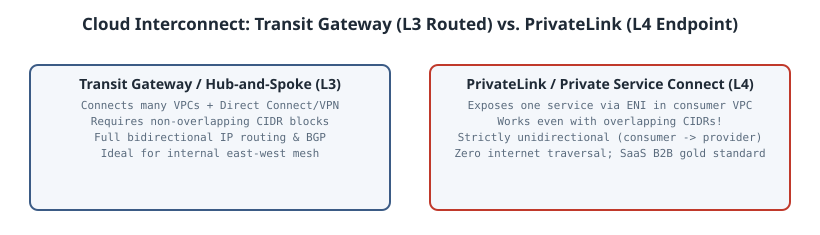

# Cloud Transit, Hybrid BGP/IPSec, and PrivateLink

Connecting dozens of VPCs/VNets and on-premises data centers requires a structured **hub-and-spoke transit layer** (AWS Transit Gateway, Azure Virtual WAN, GCP Network Connectivity Center) paired with **BGP over IPSec / Direct Connect** and **PrivateLink** for zero-internet SaaS/internal service exposure.

## Hybrid Transit Architecture

```text
On-Premises Data Center (FRR / Edge Router)
   ├── Primary: Direct Connect / Interconnect (10G, eBGP + BFD)
   └── Backup:  Site-to-Site IPSec VPN (ECMP / AS-PATH prepended eBGP)
        |
        v
[ Cloud Transit Hub (AWS TGW / GCP NCC) ]
   ├── Spoke VPC A (Prod)      <-- Route Table isolation (no East-West to Dev)
   ├── Spoke VPC B (SharedSvc) <-- PrivateLink Endpoint Service (no overlapping CIDR issues!)
   └── Egress VPC              <-- Centralized NAT + DNS + Firewall inspection
```

## Key Design Patterns

- **Symmetric routing on active/active links:** If you run two BGP/IPSec tunnels or Direct Connect circuits into stateful firewalls, use identical `LOCAL_PREF` / `MED` and `conntrack` sync—or use stateless transit routers and place stateful inspection in a centralized inspection VPC.
- **Overlapping CIDRs with PrivateLink:** When acquiring companies or onboarding BYOC customers whose VPCs also use `10.0.0.0/16`, expose services via **AWS PrivateLink / GCP Private Service Connect** rather than VPC peering—consumers reach a local endpoint ENI without L3 routing conflicts.
- **MTU across cloud IPSec:** Cloud VPN gateways typically cap tunnel MTU at `1400–1440` bytes (`MSS 1360`). Clamp TCP MSS on both sides so large TLS handshakes never black-hole.
## Interconnect Architecture Diagram & CIDR Overlap Audit Lab



Check a list of VPC CIDRs for overlaps before attaching them to a Transit Gateway (overlaps force NAT or PrivateLink):

```python
import ipaddress

vpcs = [
    ("prod-app", ipaddress.ip_network("10.10.0.0/16")),
    ("prod-db",  ipaddress.ip_network("10.20.0.0/16")),
    ("partner",  ipaddress.ip_network("10.10.128.0/17")),
]

for i, (n1, net1) in enumerate(vpcs):
    for n2, net2 in vpcs[i + 1:]:
        if net1.overlaps(net2):
            print(f"OVERLAP: {n1} ({net1}) <-> {n2} ({net2}) -> use PrivateLink!")
```
