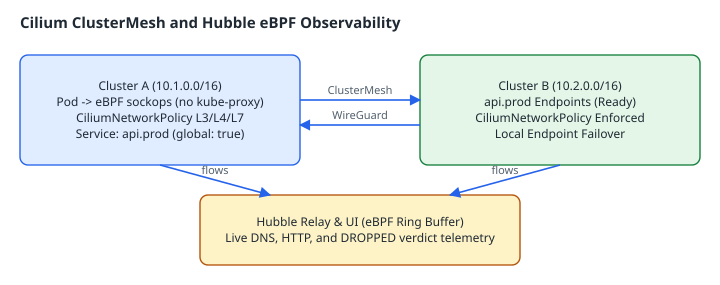

# Cilium eBPF CNI Internals and Kubernetes Gateway API

At scale, legacy `kube-proxy` `iptables` chains degrade with O(N) rule evaluation per packet. **Cilium** replaces `iptables` with **eBPF hash maps (`sockops` + Maglev)** for O(1) service load balancing, while **Kubernetes Gateway API** replaces overloaded Ingress annotations with role-oriented `GatewayClass`, `Gateway`, `HTTPRoute`, and `GRPCRoute` resources.



## How Cilium Bypasses `kube-proxy`

1. **Socket-level LB (`connect` / `sendmsg` eBPF hooks):** When a pod calls a `ClusterIP` (`10.96.0.10:80`), Cilium translates the destination directly to a healthy backend pod IP at `connect()` time—avoiding per-packet NAT and `conntrack` overhead inside the pod network namespace.
2. **Maglev consistent hashing:** For `NodePort` / `LoadBalancer` traffic, Cilium uses a fixed-size Maglev lookup table in eBPF so backend pod churn minimally disrupts existing TCP flows.
3. **Identity-based policy:** Instead of churning IP-based firewall rules as pods scale, Cilium assigns each label set a numeric **security identity** cached in eBPF maps.

## Kubernetes Gateway API (`HTTPRoute` Canary Split)

```yaml
apiVersion: gateway.networking.k8s.io/v1
kind: HTTPRoute
metadata:
  name: api-canary
  namespace: prod
spec:
  parentRefs:
    - name: prod-gateway
  rules:
    - matches:
        - path: { type: PathPrefix, value: /v1 }
      backendRefs:
        - name: api-stable
          port: 8080
          weight: 90
        - name: api-canary
          port: 8080
          weight: 10
```
